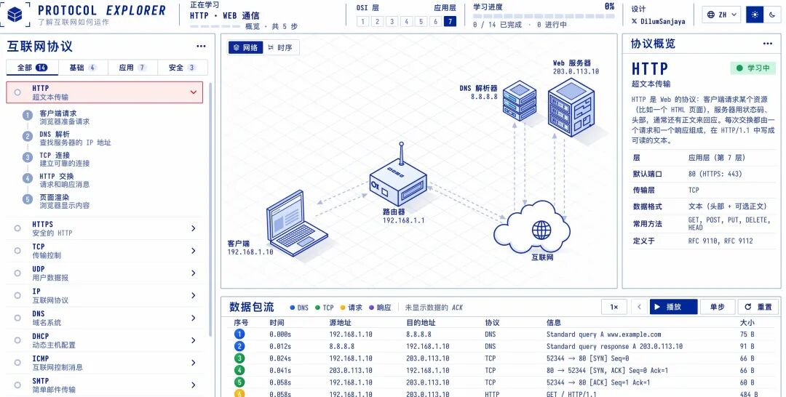

# 可视化网络请求
> 💡 备注属性未写入，可能是备注属性名称或者类型被修改了，建议将字段类型设置为 rich_text，可以在小程序-操作-修改文章数据库页面进行调整
> 💡 原文链接:[https://mp.weixin.qq.com/s?__biz=MzIxNzY5NDk5MA==&mid=2247486328&idx=1&sn=adde779c2f9c50e718b58ee024b845bf&chksm=9699f94031ae68d5dbb7fea0c58dcbe1dc99beb3830209a7669927fc495463b7f58b546dbd2e#rd](https://mp.weixin.qq.com/s?__biz=MzIxNzY5NDk5MA%3D%3D&mid=2247486328&idx=1&sn=adde779c2f9c50e718b58ee024b845bf&chksm=9699f94031ae68d5dbb7fea0c58dcbe1dc99beb3830209a7669927fc495463b7f58b546dbd2e#rd)
发现一个宝藏网站！终于有人把复杂的网络协议做成了可视化教程！
TCP 三次握手、DNS 查询、HTTP 请求到底是怎么工作的？以前看一堆文字都搞不懂，现在直接看动画演示！
网站整理了 14 种互联网协议，还能通过内置的数据包检查器，直观理解数据是怎么传输的。
学计算机网络、准备面试，或者想搞懂互联网底层原理的，强烈建议收藏！

网站：
https://protocol-explorer-alpha.vercel.app
