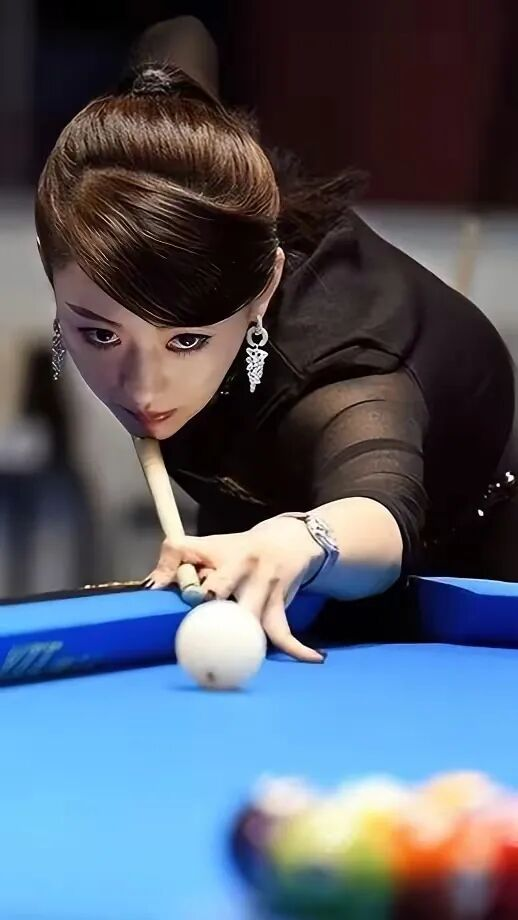

# 台球女王潘晓婷公开择偶标准，有条件的男人为何不敢追，而她也不想凑合
> 💡 备注属性未写入，可能是备注属性名称或者类型被修改了，建议将字段类型设置为 rich_text，可以在小程序-操作-修改文章数据库页面进行调整
> 原文链接:[https://mp.weixin.qq.com/s/-4qFzgodVHpdZEA7UWaqlw](https://mp.weixin.qq.com/s/-4qFzgodVHpdZEA7UWaqlw)
44岁的潘晓婷一共拿过10个世界冠军，身价高达8亿，至今却没有男生敢追。
记得潘晓婷父亲曾经说过一句话“我女儿拿了那么多冠军，还怕找不到对象吗？”现在听起来，当成她父亲那句话似乎有点讽刺。
潘晓婷在16岁的时候就拿到全国冠军，2007年又成为中国第一个女子台球世界冠军；2010年亚运会再添一金。但荣誉越多，她左手无名指没有人给她戴上戒指。
说白了，她不是没有男生追，富二代、体育明星都追求过，但却被她父亲一句“不合适”拒之门外了。更扎心的是，2014年，潘晓婷父亲在电视上替她征婚，亲口承认以前管女儿太严了，可能耽误了她。
如今潘晓婷虽然已经44岁，但她不想凑合，随便找个人把自己嫁了，她公开了五条择偶标准：身高180公分以上，有运动感，长相帅气，有自己的事业，不能整天应酬喝酒。
这几点择偶标准虽然很普通，但网友一算账，30岁还能保持运动习惯，事业有成的男人本来就不多，而且有这条件的男人多半会找20来岁，更漂亮的小姑娘。
潘晓婷确实也遇到过同行男生和教练，但对方一开口就要求她放弃事业，以家庭为重。归根结底她不是择偶标准高，是她见过太多为结婚而结婚的人，最后连年夜饭都各吃各的。
潘晓婷曾经说过，打球的时候没人因为她是女生就让着她，生活也一样，球杆再推出彩球，一颗颗落袋，她的日子照样干净利落。一个人把日子过明白了，比起硬找个人凑合强得多。

