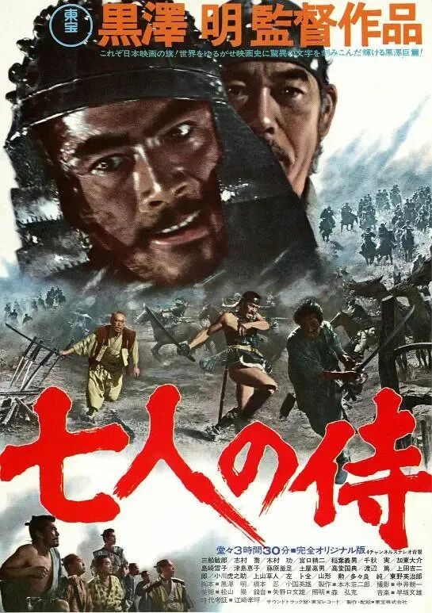
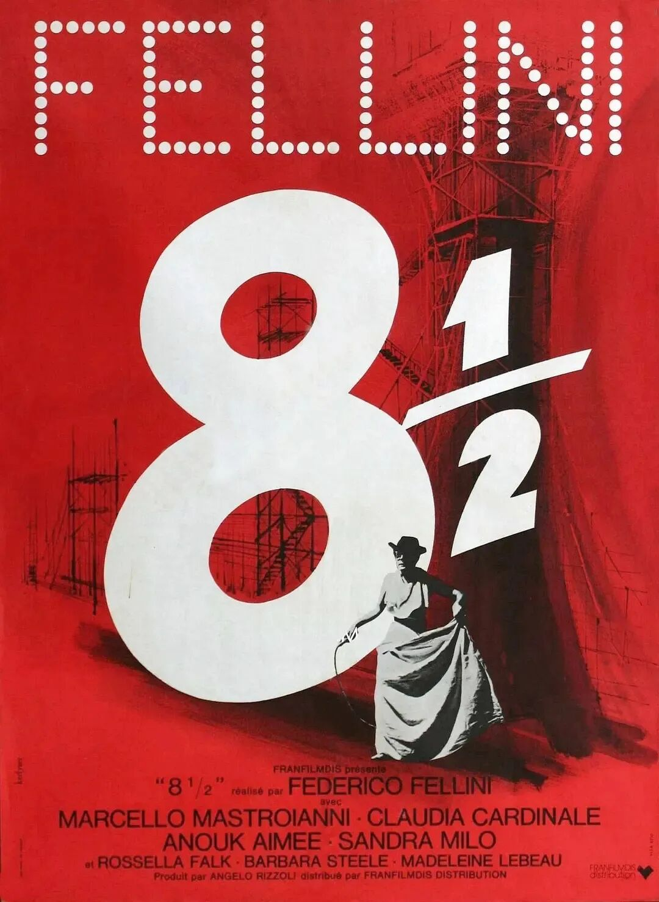
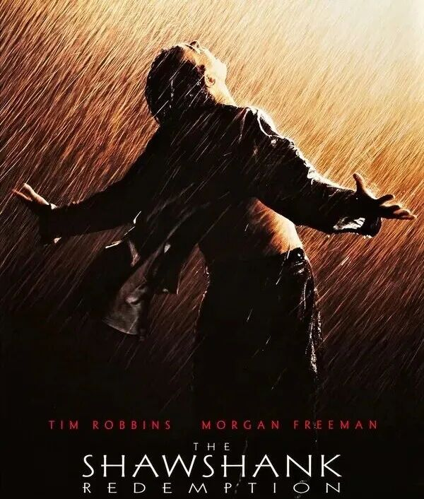
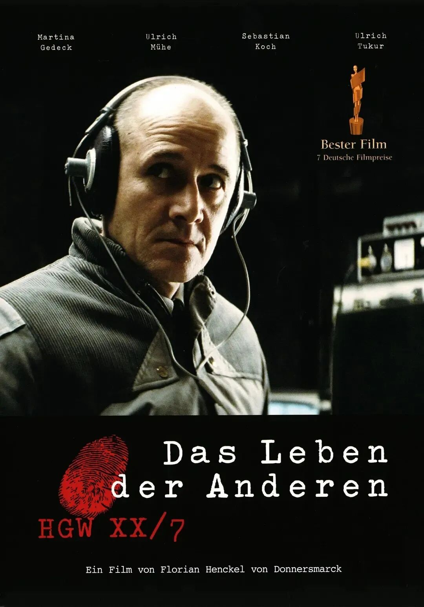
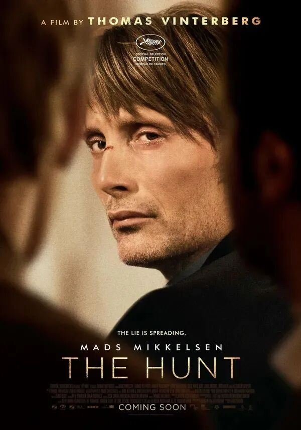
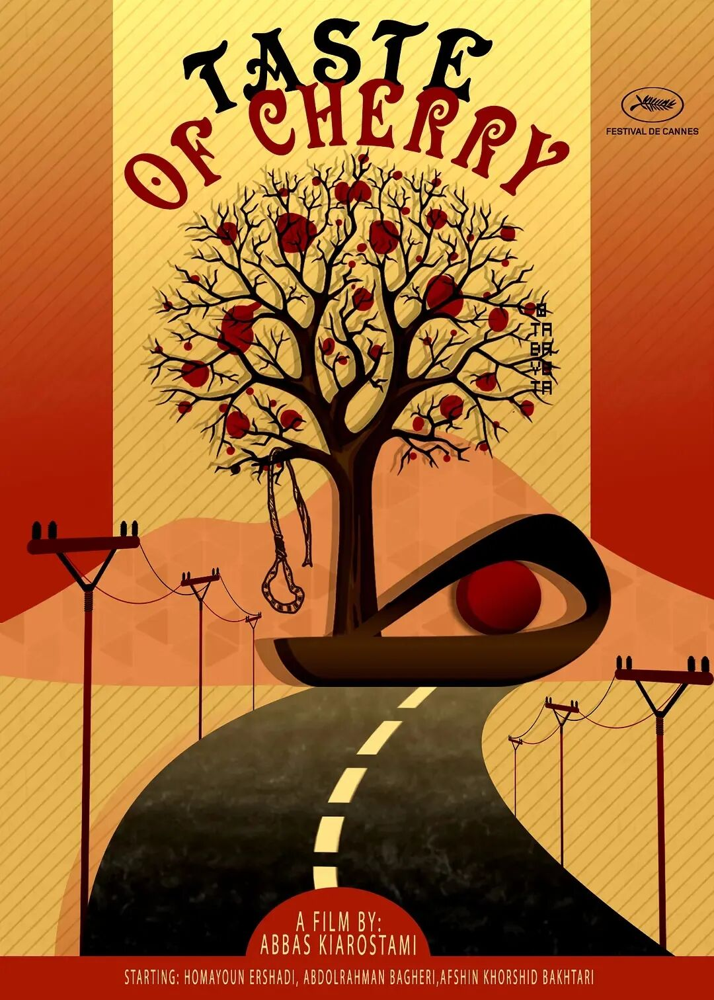
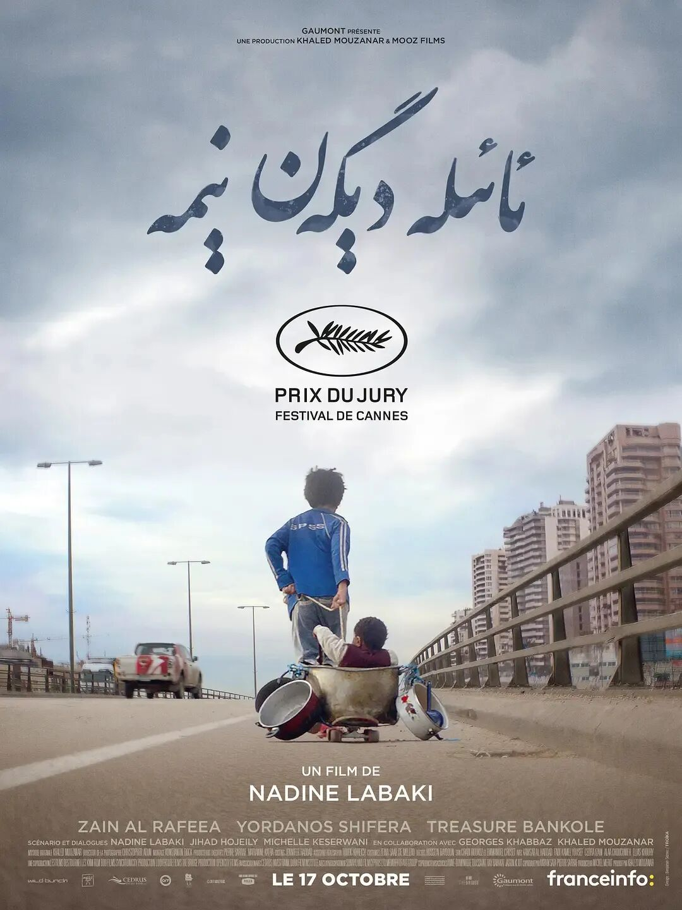
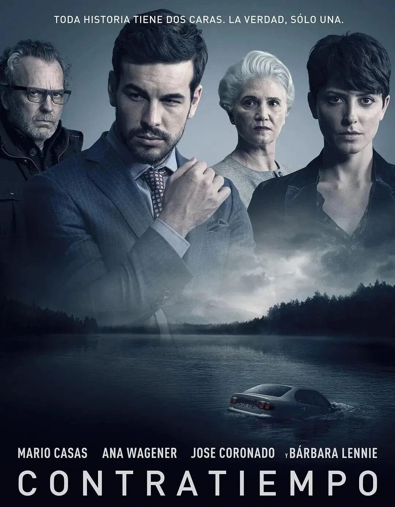
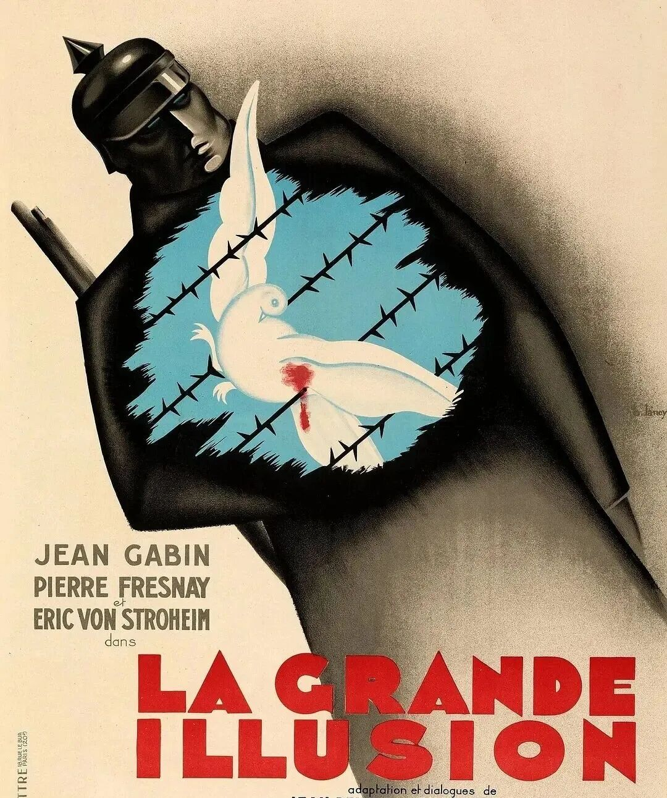

# 各国电影巅峰之作：世界影史封神清单
> 💡 备注属性未写入，可能是备注属性名称或者类型被修改了，建议将字段类型设置为 rich_text，可以在小程序-操作-修改文章数据库页面进行调整
> 💡 原文链接:[https://mp.weixin.qq.com/s?__biz=MzAxNDY3MTMzNA==&mid=2247488615&idx=1&sn=6ded7f3e4dd56857470a89a4409dcf19&chksm=9a72859d19bf5e1bef7a5b15bb536e13c21dc8c2968f141e4f6781b16d1515307a068c989fba#rd](https://mp.weixin.qq.com/s?__biz=MzAxNDY3MTMzNA%3D%3D&mid=2247488615&idx=1&sn=6ded7f3e4dd56857470a89a4409dcf19&chksm=9a72859d19bf5e1bef7a5b15bb536e13c21dc8c2968f141e4f6781b16d1515307a068c989fba#rd)
**中国｜《霸王别姬》**

豆瓣评分：9.6 
类型：剧情 / 爱情 / 同性 

华语电影在国际影坛的最高标杆，讲述程蝶衣、段小楼两位京剧名角，跨越半个世纪的命运沉浮，将个人命运、艺术信仰与宏大时代揉合，借一出《霸王别姬》映照时代沧桑。 
**日本｜《七武士》**

豆瓣评分：9.3 
类型：剧情 / 动作 / 冒险 

黑泽明传世史诗，现代群像片模板。饱受山贼劫掠的山村，请来七位落魄武士保护村民，一场保卫战之后，武士与农民之间复杂的阶级关系显露无遗。
**意大利｜《八部半》**

豆瓣评分：8.6
类型：剧情 / 奇幻 

费里尼巅峰之作，意识流电影开山典范。陷入创作瓶颈的导演，在现实、回忆与梦境中不断游走，在女人、朋友与自我之间挣扎，开始了一场对内心世界的影像剖析。
**美国｜《肖申克的救赎》**

豆瓣评分：9.7 
类型：剧情 / 犯罪

好莱坞现实主义人文电影的天花板。银行家安迪蒙冤入狱，在肖申克监狱漫长岁月里，用几十年时间完成一场安静而震撼的自我救赎。
**德国｜《窃听风暴》**

豆瓣评分：9.2 
类型：剧情 / 悬疑

东德秘密特工奉命监听一对剧作家夫妻，在持续监听中，冰冷的特工慢慢被他们的生活打动，冷静审视极权时代下普通人的良知选择。
**丹麦｜《狩猎》**

豆瓣评分：9.1 
类型：剧情 / 社会

丹麦道格玛电影的代表作。因小女孩一句瞎话，被全镇认定为恋童罪犯，承受铺天盖地的流言伤害，也因此承受群体偏见、舆论暴力，压抑感直击人心。
**伊朗｜《樱桃的滋味》**

豆瓣评分：8.1 
类型：剧情 / 哲学

伊朗新浪潮电影巅峰。一名打算结束生命的男人，开车在伊朗乡间四处寻找愿意帮自己收尸的人，旅途中不断遇见不同的人，重新思考生与死。
**黎巴嫩｜《何以为家》**

豆瓣评分：9.1 
类型：剧情 / 纪实

黎巴嫩贫民窟少年赞恩，不堪原生家庭的苦难，在流浪求生之后，将父母告上法庭，控诉他们生下孩子却无力抚养。 近乎纪实的拍摄手法，直击难民、贫困与底层困境。
**西班牙｜《看不见的客人》**

豆瓣评分：8.8 
类型：剧情 / 悬疑 / 犯罪

西班牙类型片走向世界的巅峰代表作。企业家被指控密室杀人，金牌女律师上门帮他梳理案情，一次次推翻口供，层层反转，真相不断被重构。
**法国｜《大幻影》**

豆瓣评分：8.4
类型：剧情 / 战争 

法国影史不朽反战经典。一战期间，几位不同阶级的法国军官被俘，在战俘营里，他们共同谋划越狱，反思战争与阶级。 
**韩国｜《寄生虫》**

豆瓣评分：8.8 
类型：剧情 / 悬疑 

一则关于阶级的黑色寓言。穷人一步步渗透进富家豪宅，两个家庭的碰撞慢慢滑向无法挽回的悲剧，是韩国电影工业 + 社会表达结合到极致的作品。
**巴西｜《上帝之城》**

豆瓣评分：9.0 
类型：剧情 / 犯罪 

里约热内卢贫民窟 “上帝之城”，数十年间，少年们在暴力、毒品与杀戮中挣扎，一代又一代重复着残酷生存轮回。 
**瑞典｜《芬妮与亚历山大》**

豆瓣评分：8.6
类型：剧情 / 家庭 / 奇幻 

兄妹芬妮与亚历山大，原本生活在热闹温暖的戏剧家庭，父亲离世后母亲改嫁严苛主教，两个孩子在压抑的新家挣扎成长。
**波兰｜《钢琴家》**

豆瓣评分：9.3 
类型：剧情 / 传记 / 战争

基于波兰本土真实幸存者回忆录，二战时期犹太钢琴家在华沙战火与大屠杀中艰难躲藏求生，靠着对音乐的信念，在废墟里活下来。
如果你心中还有其他不同选择欢迎在评论区一起交流讨论~#电影 #影史

## 摘要

（待补充）

## 我的笔记

（待补充）
