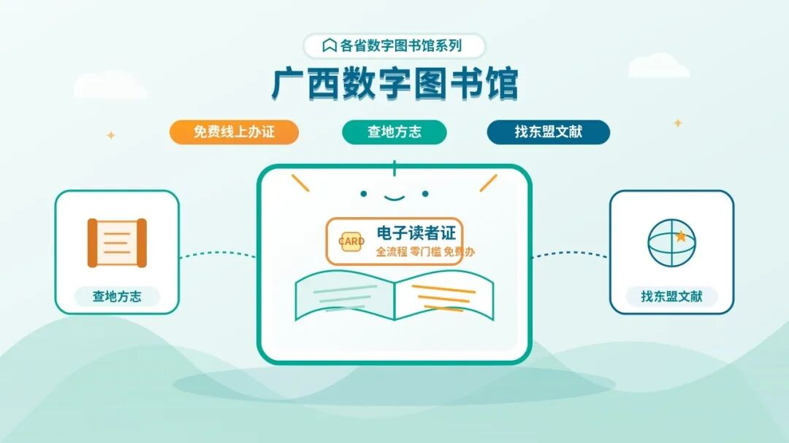

# 各省数字图书馆：广西馆免费线上办证，查地方志、找东盟文献
> 💡 备注属性未写入，可能是备注属性名称或者类型被修改了，建议将字段类型设置为 rich_text，可以在小程序-操作-修改文章数据库页面进行调整
> 💡 原文链接:[https://mp.weixin.qq.com/s?__biz=Mzg3NTI1MjUwMA==&mid=2247491098&idx=1&sn=fb79c148818c44f51c967a7b334122a3&chksm=cf57cce97293b539a4f1f67f4c7f534ea7a1790629aadcd559af1550affd1110f04dc457512f#rd](https://mp.weixin.qq.com/s?__biz=Mzg3NTI1MjUwMA%3D%3D&mid=2247491098&idx=1&sn=fb79c148818c44f51c967a7b334122a3&chksm=cf57cce97293b539a4f1f67f4c7f534ea7a1790629aadcd559af1550affd1110f04dc457512f#rd)

广西壮族自治区图书馆有个免费的数字资源平台。注册电子证后，持证读者可以在馆外登录，查图书、看数字资料。其中值得留意的是地方志，以及广西图书馆收藏的东盟文献。
先把最容易弄错的地方说清楚：线上办证能让你使用馆外开放的数字资源，不等于东盟阅览室里的原版书都能在手机上看全文。地方志可以进数据库找；东盟小语种资料可以先查馆藏目录，确认资料在哪里，再决定要不要到馆。这两条路分清了，才不会白忙。
## 电子证怎么免费办
打开广西壮族自治区图书馆官网，从“我的图书馆”进入注册页面；用微信的读者，也可以关注“广西壮族自治区图书馆”服务号，在“我的图书馆”里找“在线注册”。按页面提示，用本人有效身份证件完成认证。馆方明确说明，电子证可以免费注册，用来访问数字资源平台，但不能凭它借阅实体书。已经有本馆借书证的读者，可以先用原证登录，无须重复注册。官方电子证说明
办好证，再打开数字资源平台，按提示登录。平台说明，数字资源对持证读者免费开放，读者可以在馆外远程访问。把它想成图书馆的线上书架更容易懂：先找到资源库，再进入库里找具体资料。别在平台首页搜不到一本书，就以为整个馆没有。
这张电子证适合想在家查资料、看电子资源的人。若要借纸质书，按办证指南查看实体借阅证的办理要求。两种证的用途不同，别为了线上查资料专门跑去办一张实体卡。
## 查广西地方志，先别只搜“广西”
地方志有点像一座地方的资料柜：地名沿革、山川物产、风俗人物，都可能在里面留下记录。孩子做家乡主题的阅读作业，或者家里人想弄清老地名的来历，它比网上随手找到的一段介绍更适合用来追查出处。
广西馆的数字资源平台列有“中国历代方志集”，分收明清、民国时期及新中国成立后的地方志。入口在平台的资源导航里，搜索资源库名称“方志”，找到对应数据库后再检索内容。馆方数字资源目录
找广西资料时，可以从“广西＋市县名”试起；知道旧地名的，再把旧地名也试一遍。想了解一处老街，先查所在县；想找当地风俗，就在找到方志后看相关篇章。方志记录的是一个地方，不是替每户人家保存族谱。找不到某个人的名字，并不代表这份地方资料没有用。
如果孩子对长篇古文没耐心，可以先让他提出一个小问题，比如“家乡以前叫什么”，再带着问题查。查到的内容记下书名和篇章，回头也方便核对。比起把搜索结果整段抄进作业，这样更容易讲明白资料从哪里来。
同一平台还有“广西民国照片”“广西文物库”等地方特色资源。老照片适合看街道与生活场景，文物资料适合找器物和相关历史信息。家里有孩子正在做广西乡土文化主题作业的，可以把这些入口留着；图像资料往往比一上来读整部方志更容易入手。馆方数字资源目录
## 东盟小语种资料，先查书，再谈阅读
广西图书馆收藏东盟文献，也设有东盟文献阅览室。馆方介绍过，馆内集中收藏与东盟有关的中文文献和来自东盟的文献，并有了解越南语、泰语等语种的工作人员参与相关工作。馆方介绍
如果家里有人学越南语、泰语，或者要做东盟国家的文化、地理资料搜集，先打开馆藏目录查书名、作者或相关主题。查到记录后，看清馆藏位置；需要原版书的，再根据目录线索向馆方确认阅览方式。这样做至少能先回答一个很实际的问题：馆里有没有你要找的资料。
馆藏目录是一张找书地图，不是电子书下载页。馆方展示过东盟外文原版图书，相关展阅活动也在东盟文献阅览室进行；不能因为它出现在目录里，就认定电子证能远程打开全文。馆方东盟文献活动介绍
这段尤其适合转给学小语种、做东盟主题报告的人：先查馆藏，再问阅览权限，省得只拿着一个书名四处找资源。
## 注意事项
免费注册电子证，指的是办证及按馆方权限使用数字资源。具体数据库能否馆外访问、能否下载全文，要看资源页面的入口标识和使用规则；“试用入口”也应以页面显示状态为准。看到想要的资料，先确认能否阅读，再考虑保存，别把“可检索”当成“可下载”。
使用时只从官网进入注册、数字资源平台和馆藏目录。遇到登录或权限问题，可以查看馆方办证指南里的咨询方式。涉及证件信息，没必要交给声称“代办免费图书馆账号”的陌生页面。
入口放在一起，方便收藏：办证进广西图书馆官网https://www.gxlib.org.cn/；查地方志、老照片等进数字资源平台；找东盟原版书的馆藏线索进馆藏目录。
你最想查家乡的哪类资料：旧地名、老照片，还是地方风俗？欢迎在留言区说说。觉得这份入口有用，也可以星标这个号，需要查资料时翻出来就能用。
关注这个号，我会继续整理能直接上手的正规免费数字资源，把入口、用法和限制讲清楚。
精彩历史文章：
[免费电子书下载：日本国立国会图书馆35万册古籍免费在线读](https://mp.weixin.qq.com/s?__biz=Mzg3NTI1MjUwMA%3D%3D&mid=2247489831&idx=1&sn=284f32c29b192a4f014dfb67e78eb7dd&scene=21#wechat_redirect)
[免费电子书下载：英国最古老图书馆把镇馆手稿全部搬上网，随便看](https://mp.weixin.qq.com/s?__biz=Mzg3NTI1MjUwMA%3D%3D&mid=2247489828&idx=1&sn=877def7388a4e234b0e844e655970056&scene=21#wechat_redirect)
[免费阅读器软件：本地电子书能朗读、记笔记，还能在多设备接着读](https://mp.weixin.qq.com/s?__biz=Mzg3NTI1MjUwMA%3D%3D&mid=2247489819&idx=1&sn=eccbe04baaecda9101fc5e4a1397f13a&scene=21#wechat_redirect)
[留学不等于烧钱：欧洲一批公立大学免学费，还不用学小语种](https://mp.weixin.qq.com/s?__biz=Mzg3NTI1MjUwMA%3D%3D&mid=2247488523&idx=1&sn=0a29141efaf75d2006b2ce161636f852&scene=21#wechat_redirect)
[语言学习最大的误区：一个加拿大老头会20种语言，靠的不是天赋](https://mp.weixin.qq.com/s?__biz=Mzg3NTI1MjUwMA%3D%3D&mid=2247488421&idx=1&sn=e4dc1030aa00d73713af7496786f4ca3&scene=21#wechat_redirect)
[买编程书花了五千块才发现，GitHub上这11万星的中文书单全是免费的](https://mp.weixin.qq.com/s?__biz=Mzg3NTI1MjUwMA%3D%3D&mid=2247487919&idx=1&sn=f08b16f48b92c328d4d364518f70624d&scene=21#wechat_redirect)
[这些免费学习App，我让孩子用了一个学期，效果比报班好](https://mp.weixin.qq.com/s?__biz=Mzg3NTI1MjUwMA%3D%3D&mid=2247487735&idx=1&sn=5991e2641c98e9de8eafc81baf376c61&scene=21#wechat_redirect)
[一年花两千买书？这6个免费渠道让你一分不花读到饱](https://mp.weixin.qq.com/s?__biz=Mzg3NTI1MjUwMA%3D%3D&mid=2247487799&idx=1&sn=8c46a4d4db80e917253ce2f2f23787cb&scene=21#wechat_redirect)
[ebook-treasure-chest：一个藏了上万本电子书的「海盗宝箱」](https://mp.weixin.qq.com/s?__biz=Mzg3NTI1MjUwMA%3D%3D&mid=2247487578&idx=1&sn=950079c173204ea10f7afbef52485508&scene=21#wechat_redirect)
[B站上有个叫3Blue1Brown的数学频道，每期视频几百万播放，动画讲数学一绝](https://mp.weixin.qq.com/s?__biz=Mzg3NTI1MjUwMA%3D%3D&mid=2247487542&idx=1&sn=9e1e3b6dcdac2fc4792b2d6d982218c8&scene=21#wechat_redirect)
[教育资源的“数字宇宙”：这个4.2K星的项目藏着超100T的学习资料](https://mp.weixin.qq.com/s?__biz=Mzg3NTI1MjUwMA%3D%3D&mid=2247487157&idx=1&sn=65bd1d882c82afe7f492e081231c0b40&scene=21#wechat_redirect)
[国家中小学智慧平台的“万能钥匙”：这个5.8K星的开源工具让你一次下载所有教材PDF](https://mp.weixin.qq.com/s?__biz=Mzg3NTI1MjUwMA%3D%3D&mid=2247487148&idx=1&sn=5d4729976dc057196a8c86f01c2623ad&scene=21#wechat_redirect)
[免费教科书一键下载：这个开源工具帮你把国家智慧教育平台的课本存到本地](https://mp.weixin.qq.com/s?__biz=Mzg3NTI1MjUwMA%3D%3D&mid=2247487098&idx=1&sn=852f3e0c49a4b22671c32d2026d508e9&scene=21#wechat_redirect)
[75K星！这个开源项目把中国中小学教材全部装进了GitHub](https://mp.weixin.qq.com/s?__biz=Mzg3NTI1MjUwMA%3D%3D&mid=2247487161&idx=1&sn=34aa13332d7757789584e3757b38e386&scene=21#wechat_redirect)
[12.7万星！这个GitHub项目把全网免费服务扒了个底朝天，每年至少省5000块](https://mp.weixin.qq.com/s?__biz=Mzg3NTI1MjUwMA%3D%3D&mid=2247485291&idx=1&sn=534e537c34e00448b3468440b244f6a1&scene=21#wechat_redirect)
[免费教材下载：一个开源工具把电子课本课件音频一次搬回家](https://mp.weixin.qq.com/s?__biz=Mzg3NTI1MjUwMA%3D%3D&mid=2247488774&idx=1&sn=294fd493af4ebedd813bdb22078019c9&scene=21#wechat_redirect)
[免费下载：电子课本下载，英语教材配套听力也能找到](https://mp.weixin.qq.com/s?__biz=Mzg3NTI1MjUwMA%3D%3D&mid=2247488674&idx=1&sn=c629557cbed894769535fd2e9193f8b9&scene=21#wechat_redirect)
[把故事变成动画视频，这个开源工具免费，自媒体人看完直接收藏](https://mp.weixin.qq.com/s?__biz=Mzg3NTI1MjUwMA%3D%3D&mid=2247488560&idx=1&sn=8cc062a999b1a95b5a8c37f9f1d3eba9&scene=21#wechat_redirect)
