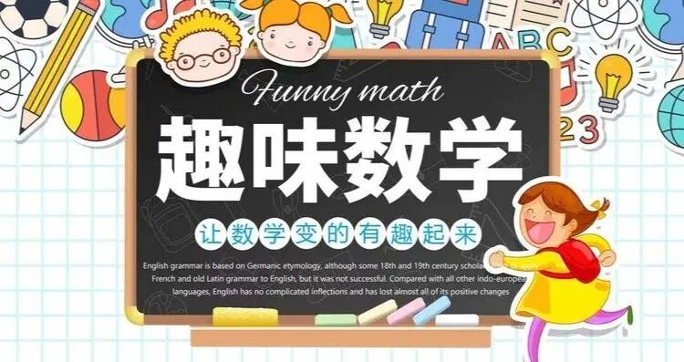

# 合辑丨小学奥数讲解564集+初中趣味微课258集（收藏）
> 💡 备注属性未写入，可能是备注属性名称或者类型被修改了，建议将字段类型设置为 rich_text，可以在小程序-操作-修改文章数据库页面进行调整
> 原文链接:[https://mp.weixin.qq.com/s/C2tnZo3qG558ckbBDyMfHA](https://mp.weixin.qq.com/s/C2tnZo3qG558ckbBDyMfHA)

**咨询预约：微信annelu2014 QQ248863548 **
**m.psy525.cn/d8844.html**或www.psy525.cn/d8844.html

**『点击蓝字标题，即可观看课程』**

**快速导航**
> 💡 疑似存在合并单元格，表格内容无法展现（Notion 暂不支持合并单元格）。qid(oMPagIacmPbXVtt5oL4mf)
> 💡 疑似存在合并单元格，表格内容无法展现（Notion 暂不支持合并单元格）。qid(w-x_8g384FOj5Ckm6ZO6p)
**一年级奥数讲解**
[第01讲：需要换位思考的位置关系](http://mp.weixin.qq.com/s?__biz=MzU2MDg2MDc3Mg%3D%3D&mid=2247530201&idx=1&sn=1866a3056e6418e6dc2aee8db6bbf4dd&chksm=fc03add2cb7424c47211d8bbf433732edc0c264328a1cf82335cba2ac275594551127ab826f7&scene=21#wechat_redirect)
[第02讲：生活中的可能性](http://mp.weixin.qq.com/s?__biz=MzU2MDg2MDc3Mg%3D%3D&mid=2247530201&idx=2&sn=60d339a24bee98f92c04254790beacbb&chksm=fc03add2cb7424c4cd112d94c2c2e3ad41c7dbcd69ff1a4e22a9f90eaeb8f79d3458046e1de6&scene=21#wechat_redirect)
[第03讲：分类](http://mp.weixin.qq.com/s?__biz=MzU2MDg2MDc3Mg%3D%3D&mid=2247530201&idx=3&sn=a38a54a44e5dd15d082e5c16a4948145&chksm=fc03add2cb7424c473a02d40dcf91eb7395e2cada076d4ea34255fcb7a3c7a59d48814e83874&scene=21#wechat_redirect)
[第04讲：比长短](http://mp.weixin.qq.com/s?__biz=MzU2MDg2MDc3Mg%3D%3D&mid=2247530201&idx=4&sn=4a193911d54c1398be890190fb8de9c2&chksm=fc03add2cb7424c4e5ee493d8f9ff9d22da90a31b48b4766f4563cd745f8901557fd60f80396&scene=21#wechat_redirect)
[第05讲：比轻重](http://mp.weixin.qq.com/s?__biz=MzU2MDg2MDc3Mg%3D%3D&mid=2247530201&idx=5&sn=b46ae74b78589c23b7c7cdc912222066&chksm=fc03add2cb7424c4ed7116d482bdf1cfb3445c8db55d7c30cfdb4d7135f01a6592525215d92f&scene=21#wechat_redirect)
[第06讲：多角度观察初步](http://mp.weixin.qq.com/s?__biz=MzU2MDg2MDc3Mg%3D%3D&mid=2247530201&idx=6&sn=ad7c6731260b8012d11f4bc28e133fb4&chksm=fc03add2cb7424c48922e9024dc7ca6b787eea21e5f15bbb158ec3e892126c108b9c29ace252&scene=21#wechat_redirect)
[第07讲：基数与序数](http://mp.weixin.qq.com/s?__biz=MzU2MDg2MDc3Mg%3D%3D&mid=2247530201&idx=7&sn=c2fdcb1bd98b11f1a7ff6db9fc44d475&chksm=fc03add2cb7424c43acf656a0528bf78822368e13f6a9b75778a53dbcbdbf251c4de4e43ff82&scene=21#wechat_redirect)
[第08讲：有趣的骰子](http://mp.weixin.qq.com/s?__biz=MzU2MDg2MDc3Mg%3D%3D&mid=2247529750&idx=1&sn=a96e6c61e0b2a89a9a4d8b122a30bd7b&chksm=fc03ae1dcb74270b5730bb16aca66b3b1f10920397fafdf90c0a575a1a19efc3c7cf893c5ddd&scene=21#wechat_redirect)
[第09讲：大小怪物分析法](http://mp.weixin.qq.com/s?__biz=MzU2MDg2MDc3Mg%3D%3D&mid=2247529750&idx=2&sn=b8f844f8829c78283ef3abc16e0ddce1&chksm=fc03ae1dcb74270b4e4c3e1738f1a84c342079914775d12dbeff7d07bb2aa266bb2f7c2a0926&scene=21#wechat_redirect)
[第10讲：图文算式](http://mp.weixin.qq.com/s?__biz=MzU2MDg2MDc3Mg%3D%3D&mid=2247529750&idx=3&sn=05a1b7bbcf789061856fbc4793910c4e&chksm=fc03ae1dcb74270b4de34fe8bd57673a6a790a92bdd54a74f247dc0864159e6f224e34bfe57b&scene=21#wechat_redirect)
[第11讲：简单的图形规律](http://mp.weixin.qq.com/s?__biz=MzU2MDg2MDc3Mg%3D%3D&mid=2247529750&idx=4&sn=3e6a04c0ffd5cf5d2a25f493b44d369a&chksm=fc03ae1dcb74270b46b77282ee1c663315ce1084b8bea3c484750b637753b408aa78a532daa9&scene=21#wechat_redirect)
[第12讲：图形位置变化规律](http://mp.weixin.qq.com/s?__biz=MzU2MDg2MDc3Mg%3D%3D&mid=2247529750&idx=5&sn=2927a4a4a4d85e941ea587e4453926e9&chksm=fc03ae1dcb74270b030e8d99f103c4bc94e87b4f147381d7654597d766255bc028fd95f0cb8b&scene=21#wechat_redirect)
[第13讲：图形组合规律](http://mp.weixin.qq.com/s?__biz=MzU2MDg2MDc3Mg%3D%3D&mid=2247529750&idx=6&sn=175113c3b75fe9857d7dc98bf59ecfdc&chksm=fc03ae1dcb74270b75cb56e310fe054ecb332ce16e9e4d183a7d9fee4f66b567d0570ffade2b&scene=21#wechat_redirect)
[第14讲：简单的数图形](http://mp.weixin.qq.com/s?__biz=MzU2MDg2MDc3Mg%3D%3D&mid=2247529750&idx=7&sn=69b0aee6c5ca8c63588473de612b7539&chksm=fc03ae1dcb74270bd89147e71f7031b8811d66734d1e9dbbc51d6731b416025b92044f98aed0&scene=21#wechat_redirect)
[第15讲：简单的图形数量规律](http://mp.weixin.qq.com/s?__biz=MzU2MDg2MDc3Mg%3D%3D&mid=2247529750&idx=8&sn=1ac6b7f281b0110875edce83e6f05c98&chksm=fc03ae1dcb74270bc0ae199e73314568267d90121afea37ac6c52d1727730bb615b76fcf2a1b&scene=21#wechat_redirect)
[第16讲：整体与部分](http://mp.weixin.qq.com/s?__biz=MzU2MDg2MDc3Mg%3D%3D&mid=2247529753&idx=1&sn=da4e3360721e8a2f74e8f11aaa42fc2c&chksm=fc03ae12cb7427049b6749176084dd3cf370740d657ec3b864cf15993f194b8e2d88475fb2b5&scene=21#wechat_redirect)
[第17讲：角的初步认识](http://mp.weixin.qq.com/s?__biz=MzU2MDg2MDc3Mg%3D%3D&mid=2247529753&idx=2&sn=144d57aa91240af1c39cd01cbe4dd552&chksm=fc03ae12cb74270436db06a88aa1e568998ee50ab0c2b2b6312de76d81801ba77220488f15dd&scene=21#wechat_redirect)
[第18讲：竖式的认识](http://mp.weixin.qq.com/s?__biz=MzU2MDg2MDc3Mg%3D%3D&mid=2247529753&idx=3&sn=c60afb27555d9cecfdfadc5f8fb82348&chksm=fc03ae12cb742704fa2497444a36f2f09d01a77477c9c783d69279a0e19bd1288360ceb9c4b8&scene=21#wechat_redirect)
[第19讲：立体图形的认识](http://mp.weixin.qq.com/s?__biz=MzU2MDg2MDc3Mg%3D%3D&mid=2247529753&idx=4&sn=00cea8de8a49781e56fbde7c56c4ba54&chksm=fc03ae12cb742704a1ae5cfa1c38d40d7b72d531e0bad2c41df84b5c03e055748684cda1d186&scene=21#wechat_redirect)
[第20讲：加法竖式](http://mp.weixin.qq.com/s?__biz=MzU2MDg2MDc3Mg%3D%3D&mid=2247529753&idx=5&sn=9f2a447afdf26eff032ba38993d8f3d6&chksm=fc03ae12cb742704f91a7ceb8f8a66402045f9321fd1b0d7cdfb40bf5c6c95574c8dc653c42b&scene=21#wechat_redirect)
[第21讲：减法竖式](http://mp.weixin.qq.com/s?__biz=MzU2MDg2MDc3Mg%3D%3D&mid=2247529753&idx=6&sn=fc5b44185bc3f6df7bd2830986da5a3d&chksm=fc03ae12cb7427043c15f14dd0a00cf48a512d7b80a0bdb315d8bf75179e61c3015f5febc281&scene=21#wechat_redirect)
[第22讲：加与减](http://mp.weixin.qq.com/s?__biz=MzU2MDg2MDc3Mg%3D%3D&mid=2247529753&idx=7&sn=6ed98e2b8eeb392279a49c728b0f8b1f&chksm=fc03ae12cb74270471869d72b8f779a71009e255c9d28b7d5a5fc1189774c5394938d5b117c3&scene=21#wechat_redirect)

[第23讲：简单的数的规律](http://mp.weixin.qq.com/s?__biz=MzU2MDg2MDc3Mg%3D%3D&mid=2247529753&idx=8&sn=84c337ad314c558231dde6aae5e7ded2&chksm=fc03ae12cb7427047fad87e29be433a7ba017ab32749dabe314826605f30343d3ec4f997edb8&scene=21#wechat_redirect)
[第24讲：简单的加法竖式谜](http://mp.weixin.qq.com/s?__biz=MzU2MDg2MDc3Mg%3D%3D&mid=2247529755&idx=1&sn=e19300bb021a1d75245d98c085fc498d&chksm=fc03ae10cb7427066053aa8cff80bf281e1b120390fbb4907ee1d16d50b7f16c6decdfda872c&scene=21#wechat_redirect)
[第25讲：简单的减法竖式谜](http://mp.weixin.qq.com/s?__biz=MzU2MDg2MDc3Mg%3D%3D&mid=2247529755&idx=2&sn=ff7ceeed49639b02f09d51911e9207ad&chksm=fc03ae10cb742706f9a966533fac8fb8ed6498f8b80a5afd653a10e4f0e221d6a0848a1a36ff&scene=21#wechat_redirect)
[第26讲：克、千克和吨](http://mp.weixin.qq.com/s?__biz=MzU2MDg2MDc3Mg%3D%3D&mid=2247529755&idx=3&sn=508740599ad09da018fa041601764310&chksm=fc03ae10cb742706d205228be4145d9094125c8ccc373eec9794edb988fe893e84439975c809&scene=21#wechat_redirect)
[第27讲：斤和公斤](http://mp.weixin.qq.com/s?__biz=MzU2MDg2MDc3Mg%3D%3D&mid=2247529755&idx=4&sn=541bd7b43fa2a07231d01e0cfab9f604&chksm=fc03ae10cb7427066e039c2a9de44fd1e285b181df9263aa9737a8935e07ec5fa72b839dbcd2&scene=21#wechat_redirect)
[第28讲：钟面数学初步](http://mp.weixin.qq.com/s?__biz=MzU2MDg2MDc3Mg%3D%3D&mid=2247529755&idx=5&sn=9a69db07dd0b84eaebb3d01ab76ca967&chksm=fc03ae10cb7427066e1c960167fbeee4c776ff4ca37bbd8cd86c84622ece9236c5324adc7af4&scene=21#wechat_redirect)
[第29讲：钟面数学进阶](http://mp.weixin.qq.com/s?__biz=MzU2MDg2MDc3Mg%3D%3D&mid=2247529755&idx=6&sn=ed78bd71cdc08dec30d309b9036987a7&chksm=fc03ae10cb74270649fe087788a8f15532dc8c78548bec0e128e906fd777647b1391501fb326&scene=21#wechat_redirect)
[第30讲：钟面上的计算（上）](http://mp.weixin.qq.com/s?__biz=MzU2MDg2MDc3Mg%3D%3D&mid=2247529755&idx=7&sn=24599bcb4f8a4cf27664d639a8440233&chksm=fc03ae10cb742706cd1433401944f99892070d4165686a78ef59ae220785473d58a2db12767f&scene=21#wechat_redirect)
[第31讲：钟面上的计算（下）](http://mp.weixin.qq.com/s?__biz=MzU2MDg2MDc3Mg%3D%3D&mid=2247529755&idx=8&sn=f2385965a2f45bae404911193812a326&chksm=fc03ae10cb742706bd0839d5d9f5d3535b8f3d28ae61c711da84f6a1b90e343fb2595b8f4eac&scene=21#wechat_redirect)
[第32讲：趣题巧解](http://mp.weixin.qq.com/s?__biz=MzU2MDg2MDc3Mg%3D%3D&mid=2247529757&idx=1&sn=1299dfe40d1febf68282df45deb1bfd8&chksm=fc03ae16cb74270006cc3ac3452afa42b3bfa7eb4d00529e8c8cf745e5674ffc5293697420bb&scene=21#wechat_redirect)
[第33讲：一对一比较](http://mp.weixin.qq.com/s?__biz=MzU2MDg2MDc3Mg%3D%3D&mid=2247529757&idx=2&sn=7ee51046277db5f902e0140956a025b3&chksm=fc03ae16cb742700b1bb32704ab466bf8758e11c48dfd64dfe155bd242fe416509c70056a0b8&scene=21#wechat_redirect)
[第34讲：一对多比较](http://mp.weixin.qq.com/s?__biz=MzU2MDg2MDc3Mg%3D%3D&mid=2247529757&idx=3&sn=467e6f31ac99a14c6d6eda2d43422ce2&chksm=fc03ae16cb74270042595ad081cd0bf0dbcd8fd0da4ad1d5c43db9a7ac187c8920248cca8b5b&scene=21#wechat_redirect)
[第35讲：认识奇与偶](http://mp.weixin.qq.com/s?__biz=MzU2MDg2MDc3Mg%3D%3D&mid=2247529757&idx=4&sn=051257c0f3aed5b1910cc3f578453ceb&chksm=fc03ae16cb7427006f464ae540ad54e00b2fdf030e6dfcfa6089a4dbc5f5abc4804302aed31b&scene=21#wechat_redirect)
[第36讲：奇偶分析的袜子大法](http://mp.weixin.qq.com/s?__biz=MzU2MDg2MDc3Mg%3D%3D&mid=2247529757&idx=5&sn=0ba77d12f751e9a7da928a9925cf0fd5&chksm=fc03ae16cb7427009a511c3b9a97c650f5297249629932cbbb179bc91de13700afc6ee794df9&scene=21#wechat_redirect)
[第37讲：哪杯水多](http://mp.weixin.qq.com/s?__biz=MzU2MDg2MDc3Mg%3D%3D&mid=2247529757&idx=6&sn=f662cf3e401256b1291023f660904cca&chksm=fc03ae16cb7427009610e457db8b8bf0b12b7da5e68e53fb83fed63a85ef7b41ff63258ab071&scene=21#wechat_redirect)
[第38讲：哪杯水甜](http://mp.weixin.qq.com/s?__biz=MzU2MDg2MDc3Mg%3D%3D&mid=2247529757&idx=7&sn=17a01ed0cd0f8e699d050a83034390c7&chksm=fc03ae16cb742700b829b4f95fb651505c4f0760f652c885ad1c623a3f881554e031c63c9384&scene=21#wechat_redirect)
[第39讲：水位变高](http://mp.weixin.qq.com/s?__biz=MzU2MDg2MDc3Mg%3D%3D&mid=2247529757&idx=8&sn=4a0d57213e2493469c5e7180ade98d0d&chksm=fc03ae16cb7427002543c432e6e3d8b51f1dc8c7e647e359f472e1ee802c697538b508899bd4&scene=21#wechat_redirect)
[第40讲：加减火柴棒](http://mp.weixin.qq.com/s?__biz=MzU2MDg2MDc3Mg%3D%3D&mid=2247529759&idx=1&sn=4c86fba5578014f6ac0706b61536b38d&chksm=fc03ae14cb742702f3d1aa78bb7b167518de987c973df36572d05d4aba222fb5bf2dc4219c08&scene=21#wechat_redirect)
[第41讲：移动火柴棒](http://mp.weixin.qq.com/s?__biz=MzU2MDg2MDc3Mg%3D%3D&mid=2247529759&idx=2&sn=929ea7c61db91624c0769c5f73588def&chksm=fc03ae14cb7427029bad38b2ee13fb597e28d4e3662392f3706e00738bc1dd086f1d32acc290&scene=21#wechat_redirect)
[第42讲：开始差几个](http://mp.weixin.qq.com/s?__biz=MzU2MDg2MDc3Mg%3D%3D&mid=2247529759&idx=3&sn=175d02622c0226d064fd3ffa2415926e&chksm=fc03ae14cb74270298c396c942f1db2ed8e427dbc255e11ae7dc1e509a17196ab88dd198745c&scene=21#wechat_redirect)
[第43讲：给几个](http://mp.weixin.qq.com/s?__biz=MzU2MDg2MDc3Mg%3D%3D&mid=2247529759&idx=4&sn=8d845af900f72e6757bb0c146fe59a8f&chksm=fc03ae14cb742702abf3906d101258a4bc9cdc9423da87efd355111f366dcc75ff93d70742ba&scene=21#wechat_redirect)
[第44讲：给后差几个](http://mp.weixin.qq.com/s?__biz=MzU2MDg2MDc3Mg%3D%3D&mid=2247529759&idx=5&sn=9a412e685664992e2f4cec441eddc372&chksm=fc03ae14cb742702db5ef44a9f12e1adf8ee9405926da1f8faa554bfd92399e48ded7ba6a705&scene=21#wechat_redirect)

[第45讲：凑零法](http://mp.weixin.qq.com/s?__biz=MzU2MDg2MDc3Mg%3D%3D&mid=2247529759&idx=6&sn=2e9195cffa257f353ff75efa8e1f6035&chksm=fc03ae14cb742702e37f6297040a49f2890eacd258d850153cc34818cb9ea736c9b9db7e1b6b&scene=21#wechat_redirect)
[第46讲：凑数法](http://mp.weixin.qq.com/s?__biz=MzU2MDg2MDc3Mg%3D%3D&mid=2247529759&idx=7&sn=23efcdedda2aac882e89f369f5ebaaed&chksm=fc03ae14cb7427029ca5ca0fcb9a880a89a55ae567283c6e82e4c3196005ac19a69bc2d91558&scene=21#wechat_redirect)
[第47讲：加减法王国](http://mp.weixin.qq.com/s?__biz=MzU2MDg2MDc3Mg%3D%3D&mid=2247529759&idx=8&sn=bcb5382cce22103e85201193dd497a5b&chksm=fc03ae14cb7427029bd3d68ee6b19fd8b1f0f7c6efe6498bb7be790f1916955929544cc7618d&scene=21#wechat_redirect)
[第48讲：凑整法-不同王国](http://mp.weixin.qq.com/s?__biz=MzU2MDg2MDc3Mg%3D%3D&mid=2247529761&idx=1&sn=d54c197ec1e96ac1e72c425746143a6b&chksm=fc03ae2acb74273c542ece1b79e1adfdfbb7cbfae0e3c25538082e718df02e3c79f24347e154&scene=21#wechat_redirect)
[第49讲：多行之间的移动](http://mp.weixin.qq.com/s?__biz=MzU2MDg2MDc3Mg%3D%3D&mid=2247529761&idx=2&sn=8069011b4e87872ffa7d81173cccfccc&chksm=fc03ae2acb74273ceb02c8cc33cf0fe796c89526d1dccd5c16c1a9620ebc68490e2a5d314d7a&scene=21#wechat_redirect)
[第50讲：七巧板拼图](http://mp.weixin.qq.com/s?__biz=MzU2MDg2MDc3Mg%3D%3D&mid=2247529761&idx=3&sn=cac47a1675cbf5d80eca4062d66bb894&chksm=fc03ae2acb74273cfaf8231ac35ac348f3afeef537026c252984cd786b594c5b50d9d11c1ebe&scene=21#wechat_redirect)
[第51讲：凑整法](http://mp.weixin.qq.com/s?__biz=MzU2MDg2MDc3Mg%3D%3D&mid=2247529761&idx=4&sn=651b49d223585964a7f72131e64d6990&chksm=fc03ae2acb74273c1f168ce0bbe3c2f956f980f13c9e94bec97fe270fff33200bfa922badd13&scene=21#wechat_redirect)
[第52讲：认识镜中对称](http://mp.weixin.qq.com/s?__biz=MzU2MDg2MDc3Mg%3D%3D&mid=2247529761&idx=5&sn=4c07ef5af4b1cc9896a3ca1ef8cf5df4&chksm=fc03ae2acb74273c670ed51cbe8d1467adbc8fd2d1eb6ca8268d07466e10906dba41f58dd26f&scene=21#wechat_redirect)
[第53讲：1人照镜子的距离计算](http://mp.weixin.qq.com/s?__biz=MzU2MDg2MDc3Mg%3D%3D&mid=2247529761&idx=6&sn=b1708ce68650b1ac24b28684ca05b53c&chksm=fc03ae2acb74273c6378bdde61bd82d965ffab613493ff4cc52ffd94be76afe32adf66a78966&scene=21#wechat_redirect)
[第54讲：2人照镜子的距离计算](http://mp.weixin.qq.com/s?__biz=MzU2MDg2MDc3Mg%3D%3D&mid=2247529761&idx=7&sn=4baf732bfb75029f0d7f59fb3ac55706&chksm=fc03ae2acb74273c277dfa3e4c2eb87b40422814ac10cae9513e83ff9c6546af936f648396eb&scene=21#wechat_redirect)
[第55讲：找相对面](http://mp.weixin.qq.com/s?__biz=MzU2MDg2MDc3Mg%3D%3D&mid=2247529761&idx=8&sn=afa93ec2459d9cccfe5cd6d903f63c0a&chksm=fc03ae2acb74273c68403c9a2df51e46c543fb190ecb7a2332c37bacafd8726ed1fa54491027&scene=21#wechat_redirect)
[第56讲：正方体展开图](http://mp.weixin.qq.com/s?__biz=MzU2MDg2MDc3Mg%3D%3D&mid=2247529763&idx=1&sn=5b5e7c00000a55e478fd013798215d68&chksm=fc03ae28cb74273eeaaa81d57e120af2b6d1f28cfccd9c1a21e525831eec2fd0442ba609d6e6&scene=21#wechat_redirect)
[第57讲：认识人民币](http://mp.weixin.qq.com/s?__biz=MzU2MDg2MDc3Mg%3D%3D&mid=2247529763&idx=2&sn=338c6ac6769a75afff25abf502e694b1&chksm=fc03ae28cb74273e785efa5ae3a95a9b8c98bd826042b1ddfc6f4f5574a233f19187920c9b13&scene=21#wechat_redirect)
[第58讲：人民币的计算](http://mp.weixin.qq.com/s?__biz=MzU2MDg2MDc3Mg%3D%3D&mid=2247529763&idx=3&sn=d3ff366ccbc40d4ccace62e61a7b2ba8&chksm=fc03ae28cb74273e18f45bedf6f76ac3ada55e4b310430ee9a911b936ab52fcf97e4f4fbec6d&scene=21#wechat_redirect)
[第59讲：人民币的应用](http://mp.weixin.qq.com/s?__biz=MzU2MDg2MDc3Mg%3D%3D&mid=2247529763&idx=4&sn=ef32f6396b09664f10bf704803215f81&chksm=fc03ae28cb74273e6d66fc2c0f07666e5fbc09755361bcc63f521471be8c1a79bc83bbcc02c3&scene=21#wechat_redirect)
[第60讲：剪图形（上）](http://mp.weixin.qq.com/s?__biz=MzU2MDg2MDc3Mg%3D%3D&mid=2247529763&idx=5&sn=28367ec98936d6352b061df2931fa344&chksm=fc03ae28cb74273e3e0147989de7f10ff759b45b6b7f1eb9262d746f590779ff81fcdaea717f&scene=21#wechat_redirect)
[第61讲：剪图形（下）](http://mp.weixin.qq.com/s?__biz=MzU2MDg2MDc3Mg%3D%3D&mid=2247529763&idx=6&sn=585ffc58eb34b7c32e7ebb09b900e2e6&chksm=fc03ae28cb74273ece3027461a5523046afc63d812d1e03b341fabf481528c18ebb283104bc2&scene=21#wechat_redirect)
[第62讲：分组法](http://mp.weixin.qq.com/s?__biz=MzU2MDg2MDc3Mg%3D%3D&mid=2247529763&idx=7&sn=68786520e1d07ee6a157b92ec8c61675&chksm=fc03ae28cb74273eda74e5c7586eeff59ee958eea0310c1615a9179a5a2b21df074cc9352029&scene=21#wechat_redirect)
[第63讲：分给两个不同对象](http://mp.weixin.qq.com/s?__biz=MzU2MDg2MDc3Mg%3D%3D&mid=2247529763&idx=8&sn=3c1aef171232fa0753968b0ec53fc060&chksm=fc03ae28cb74273eb33aa99785011b5f76ac5781310700e3e5741c9ed5ce244c65c4355fd677&scene=21#wechat_redirect)
[第64讲：分给两个相同对象](http://mp.weixin.qq.com/s?__biz=MzU2MDg2MDc3Mg%3D%3D&mid=2247529765&idx=1&sn=0e35f050aa004ccd1d63ebd75267c58b&chksm=fc03ae2ecb7427389b9e0d04ee610cdf60da2d302a98ff3fd3e77c870586cbf0239449b22909&scene=21#wechat_redirect)
[第65讲：用直尺测量](http://mp.weixin.qq.com/s?__biz=MzU2MDg2MDc3Mg%3D%3D&mid=2247529765&idx=2&sn=6ca20577b5839adeb0b637b1bfe6c24e&chksm=fc03ae2ecb74273841c99051dfa86136bad2854be9ff1c0fb21a2ad9a0e4cbe7c260ec50dd76&scene=21#wechat_redirect)
[第66讲：长度单位换算](http://mp.weixin.qq.com/s?__biz=MzU2MDg2MDc3Mg%3D%3D&mid=2247529765&idx=3&sn=c34e9d6460c85a3915c246ff833f6f27&chksm=fc03ae2ecb742738ec656b09d52c0cd067d056eade252674c4944a79f9fbb24f2166858fbab5&scene=21#wechat_redirect)

[第67讲：基本应用题（上）](http://mp.weixin.qq.com/s?__biz=MzU2MDg2MDc3Mg%3D%3D&mid=2247529765&idx=4&sn=feb2c9c247b8eb2db5a94f7aeb8c2bfa&chksm=fc03ae2ecb74273830881e60c8d6d3576c267827945eb0d7afa9aa07b3311a2a1b6f24be29c0&scene=21#wechat_redirect)
[第68讲：基本应用题（中）](http://mp.weixin.qq.com/s?__biz=MzU2MDg2MDc3Mg%3D%3D&mid=2247529765&idx=5&sn=c68b2dbe0f40cf9d45d2938700283d82&chksm=fc03ae2ecb742738e6662ef8d67eb44c1dd4cf451ac42bfe80e101a29536ea838af92904827b&scene=21#wechat_redirect)
[第69讲：基本应用题（下）](http://mp.weixin.qq.com/s?__biz=MzU2MDg2MDc3Mg%3D%3D&mid=2247529765&idx=6&sn=8d0b7fa6c476abb9bab2d08d289c1193&chksm=fc03ae2ecb7427387a63fb574de0c200338ee642334c8d01fffa16915a00759b2c1d105f0c65&scene=21#wechat_redirect)
[第70讲：轴对称图形](http://mp.weixin.qq.com/s?__biz=MzU2MDg2MDc3Mg%3D%3D&mid=2247529765&idx=7&sn=18b1cde6b269d42dcf5dc3642ad472ef&chksm=fc03ae2ecb742738a20870cc02380acc9fb01d3b3d3c562dc6d8b802fa8e46981ba6ff022db4&scene=21#wechat_redirect)
[第71讲：比较大小（上）](http://mp.weixin.qq.com/s?__biz=MzU2MDg2MDc3Mg%3D%3D&mid=2247529765&idx=8&sn=ece5a71c748d110bb45f1b35461848ea&chksm=fc03ae2ecb7427380d413ba39f9b3c240bad2c0d4b6e5372967d47ebe1f0a9c46f278297d3dd&scene=21#wechat_redirect)
[第72讲：比较大小（下）](http://mp.weixin.qq.com/s?__biz=MzU2MDg2MDc3Mg%3D%3D&mid=2247529767&idx=1&sn=43c01ac26ef58cb97e4e588b00c8f40b&chksm=fc03ae2ccb74273ac776d83991d43a968985b322058a1fd08a83e25af7cd44a8eda2892a8a45&scene=21#wechat_redirect)
[第73讲：分割成相同图形](http://mp.weixin.qq.com/s?__biz=MzU2MDg2MDc3Mg%3D%3D&mid=2247529767&idx=2&sn=3169720b56f42d5455f4fff0afd9c253&chksm=fc03ae2ccb74273a696d414f3667fc075bc678d837e710cdc644217a87be9cc85ce826d7080d&scene=21#wechat_redirect)
[第74讲：分割七巧板](http://mp.weixin.qq.com/s?__biz=MzU2MDg2MDc3Mg%3D%3D&mid=2247529767&idx=3&sn=12c047709ee3c65051dab1a5bc0daa08&chksm=fc03ae2ccb74273a72c2fc59a5ed82f70d1e732c4106c0cdaa25b52b1212d680c38297765104&scene=21#wechat_redirect)
[第75讲：求总长度](http://mp.weixin.qq.com/s?__biz=MzU2MDg2MDc3Mg%3D%3D&mid=2247529767&idx=4&sn=53e41a92f4df85d616aa523cf551511a&chksm=fc03ae2ccb74273a0a42c3eca373cb0f22a84d2de3c6279749e8e76c6cef13c1014afd0c4069&scene=21#wechat_redirect)
[第76讲：求重叠长度](http://mp.weixin.qq.com/s?__biz=MzU2MDg2MDc3Mg%3D%3D&mid=2247529767&idx=5&sn=9048123f1f12f2540407c72598e27cb3&chksm=fc03ae2ccb74273ad53b2236936c14a3258d9c5e0cd359e44da34bf099e52ae84811f2741590&scene=21#wechat_redirect)
[第77讲：求单块木板长度](http://mp.weixin.qq.com/s?__biz=MzU2MDg2MDc3Mg%3D%3D&mid=2247529767&idx=6&sn=9e1dfed4abf6ed0ae0209403ad6914e4&chksm=fc03ae2ccb74273ad5d841b61821f330c290ce750068f697a2f936e3ba3a8b648f553f374edf&scene=21#wechat_redirect)
**二年级奥数讲解**
[第01讲：饼状图](http://mp.weixin.qq.com/s?__biz=MzU2MDg2MDc3Mg%3D%3D&mid=2247529769&idx=1&sn=797763786994cc9a1cc7a402dc849ca3&chksm=fc03ae22cb742734666bc73cdc9c668a400c2f46b72ab57457120a3adbe7961938e8f15cc4c4&scene=21#wechat_redirect)
[第02讲：柱状图](http://mp.weixin.qq.com/s?__biz=MzU2MDg2MDc3Mg%3D%3D&mid=2247529769&idx=2&sn=df72b62d102092b4fda2eb04b383da04&chksm=fc03ae22cb7427348e24a844f5b9ac9eb646a6f1f19fac73409f3ee8e8a52f885ef20187ee13&scene=21#wechat_redirect)
[第03讲：等量代换（上）](http://mp.weixin.qq.com/s?__biz=MzU2MDg2MDc3Mg%3D%3D&mid=2247529769&idx=3&sn=b94a5e528e0c0eddb05dd6bb8b2d1e79&chksm=fc03ae22cb742734ab86a5d7f17cdf3ba73b00812d41612adf5a5d911a13ec9656f4deeed488&scene=21#wechat_redirect)
[第04讲：等量代换（下）](http://mp.weixin.qq.com/s?__biz=MzU2MDg2MDc3Mg%3D%3D&mid=2247529769&idx=4&sn=a69349578339a2da63ee713b8be6ea9d&chksm=fc03ae22cb742734b061e8451423ebf31326cf58bdbe980360a6a59f4e8c96858cdf64bc98bd&scene=21#wechat_redirect)
[第05讲：找相同，比不同](http://mp.weixin.qq.com/s?__biz=MzU2MDg2MDc3Mg%3D%3D&mid=2247529769&idx=5&sn=77062bb7a2ff9140a869fee31d06b0d0&chksm=fc03ae22cb7427346be3f8c3fdbb8b3c00300497aacfbfa40ab1286f9f690d7ac5b2b16b06f7&scene=21#wechat_redirect)
[第06讲：根据天平求重量](http://mp.weixin.qq.com/s?__biz=MzU2MDg2MDc3Mg%3D%3D&mid=2247529769&idx=6&sn=a2df03c8dad0b534308a70cac44570d4&chksm=fc03ae22cb742734637508dc0763435d767826efee5e2c0739a80513e4fe3493eb0ab713715c&scene=21#wechat_redirect)
[第07讲：年龄差不变](http://mp.weixin.qq.com/s?__biz=MzU2MDg2MDc3Mg%3D%3D&mid=2247529769&idx=7&sn=2d3f9983ec006ace68e09f6a445221a1&chksm=fc03ae22cb74273437326698cb16a6cef6bc05ff899e8a62a44d86d3eb3f6e8d16637b8ad9ec&scene=21#wechat_redirect)
[第08讲：两人年龄和](http://mp.weixin.qq.com/s?__biz=MzU2MDg2MDc3Mg%3D%3D&mid=2247529769&idx=8&sn=3876fc271f3bbf0ae503a49a2ecf74d9&chksm=fc03ae22cb742734de18f17c68c346f8de08f3b8eb09c93ee3bbd958608e30e9845f51659e1a&scene=21#wechat_redirect)
[第09讲：比较求年龄差](http://mp.weixin.qq.com/s?__biz=MzU2MDg2MDc3Mg%3D%3D&mid=2247529771&idx=1&sn=90742e05c75ae5643e2cc2f112f53616&chksm=fc03ae20cb742736c5247081dc08d41b7a09bfe2163bdd46c57aad87662c7c595ba1d9dc6e95&scene=21#wechat_redirect)
[第10讲：有趣搭配（上）](http://mp.weixin.qq.com/s?__biz=MzU2MDg2MDc3Mg%3D%3D&mid=2247529771&idx=2&sn=389e1fe465fa52c5a7336818b8e4a929&chksm=fc03ae20cb74273679b5c8c896e384cf7141a9d5d15023870c73b9568d61f17f3af65db0a33a&scene=21#wechat_redirect)
[第11讲：有趣搭配（下）](http://mp.weixin.qq.com/s?__biz=MzU2MDg2MDc3Mg%3D%3D&mid=2247529771&idx=3&sn=cdcebd281c08371e8988fb1f7b9d82c2&chksm=fc03ae20cb7427367ff10cf14d2cfaf1d3f665d143564641c96bdf229f88803bcf671f625f60&scene=21#wechat_redirect)

[第12讲：等式加法](http://mp.weixin.qq.com/s?__biz=MzU2MDg2MDc3Mg%3D%3D&mid=2247529771&idx=4&sn=00ad65f18fc4e3de268a20f6db4df872&chksm=fc03ae20cb7427368e2d8548991a0605719775a4ea619094577eac47889fc09087ff8757485b&scene=21#wechat_redirect)
[第13讲：等式性质1](http://mp.weixin.qq.com/s?__biz=MzU2MDg2MDc3Mg%3D%3D&mid=2247529771&idx=5&sn=e165e7c723de0862d1a5d0c0a7355c2b&chksm=fc03ae20cb74273646bba952645453e00ce815d065274ea134575a3b6668ff497d8d90054002&scene=21#wechat_redirect)
[第14讲：扫雷游戏](http://mp.weixin.qq.com/s?__biz=MzU2MDg2MDc3Mg%3D%3D&mid=2247529771&idx=6&sn=fd3b6cf65620573add09120be9957bc0&chksm=fc03ae20cb742736b2d5bdecdeb2c44fa91ce602ec100cad1b892545167d959480e7e2401bec&scene=21#wechat_redirect)
[第15讲：扫雷游戏规则](http://mp.weixin.qq.com/s?__biz=MzU2MDg2MDc3Mg%3D%3D&mid=2247529771&idx=7&sn=b9d675e3c77c7eda1d8a4d595194d708&chksm=fc03ae20cb7427360d61e59ad76484e2a3ad1fe9a230bee614ffb503176de9ebbf1a08479960&scene=21#wechat_redirect)
[第16讲：等差和等比数列](http://mp.weixin.qq.com/s?__biz=MzU2MDg2MDc3Mg%3D%3D&mid=2247529771&idx=8&sn=533b9a54ead6a0b4a9ea4f865cded64c&chksm=fc03ae20cb742736124f5fe111ccc8393fb5ddfe039511cbd7685dcf08961c966eaa8af0eee5&scene=21#wechat_redirect)
[第17讲：三角形家族](http://mp.weixin.qq.com/s?__biz=MzU2MDg2MDc3Mg%3D%3D&mid=2247529773&idx=1&sn=c535b34bd7541924a5c2b31d7426e888&chksm=fc03ae26cb7427305e734de6377b599a1c51c69ab3f500c5a051d67a878e8bd787a7db9f3dc4&scene=21#wechat_redirect)
[第18讲：三角形的三边关系](http://mp.weixin.qq.com/s?__biz=MzU2MDg2MDc3Mg%3D%3D&mid=2247529773&idx=2&sn=400afa90ae25aa09d0d028251f309c34&chksm=fc03ae26cb74273053d1ec465e5c190b86b305a6201c736fa7530010068f016ae8958fdc997b&scene=21#wechat_redirect)
[第19讲：认识奇偶点](http://mp.weixin.qq.com/s?__biz=MzU2MDg2MDc3Mg%3D%3D&mid=2247529773&idx=3&sn=11377bac7960c8dce91970c8bd8b565c&chksm=fc03ae26cb74273053509cb41aba1faa08e99be9dee128615e7e11dc6e74da9a256654a8b6c7&scene=21#wechat_redirect)
[第20讲：周长的计算](http://mp.weixin.qq.com/s?__biz=MzU2MDg2MDc3Mg%3D%3D&mid=2247529773&idx=4&sn=31a5347bbb37af298ae89e92e50235d2&chksm=fc03ae26cb742730d6022e0af744c11d37501d107177654e7397392ecb2d831dc8e53673aafe&scene=21#wechat_redirect)
[第21讲：数长方形](http://mp.weixin.qq.com/s?__biz=MzU2MDg2MDc3Mg%3D%3D&mid=2247529773&idx=5&sn=21cb99f03a4f72741700c28f1240d9ea&chksm=fc03ae26cb742730ad1a95daec9522dcc06e2ab78067a591ec6f869f41caf024ac032fb74fc4&scene=21#wechat_redirect)
[第22讲：数正方形（上）](http://mp.weixin.qq.com/s?__biz=MzU2MDg2MDc3Mg%3D%3D&mid=2247529773&idx=6&sn=953e9b2837a876943e270fbaeb25185d&chksm=fc03ae26cb742730aba26ddc635528229818e455e6a203cd20d65094520b95f5217707c6d176&scene=21#wechat_redirect)
[第23讲：数正方形（下）](http://mp.weixin.qq.com/s?__biz=MzU2MDg2MDc3Mg%3D%3D&mid=2247529773&idx=7&sn=b46d3351d3bf43651d11db2e8b63297a&chksm=fc03ae26cb74273078d909eb6cfd60ecedb1cd8839b6a97c5e79aa3ba4ed88ec0fdceee5ca32&scene=21#wechat_redirect)
[第24讲：数三角形](http://mp.weixin.qq.com/s?__biz=MzU2MDg2MDc3Mg%3D%3D&mid=2247529773&idx=8&sn=fe189cd0da73e3df8961fc03e39d070f&chksm=fc03ae26cb74273085b66c6699a5923f7c158a646d555dc6519e989e937b264173e00703b3a7&scene=21#wechat_redirect)
[第25讲：加法竖式谜](http://mp.weixin.qq.com/s?__biz=MzU2MDg2MDc3Mg%3D%3D&mid=2247529775&idx=1&sn=07140ac9d7f1d6649db1710a0090b644&chksm=fc03ae24cb742732bae9be6727a983236171a0e7b16618b0575a3d7d9b08cc83cdb0503e2e83&scene=21#wechat_redirect)
[第26讲：减法竖式谜](http://mp.weixin.qq.com/s?__biz=MzU2MDg2MDc3Mg%3D%3D&mid=2247529775&idx=2&sn=384ed6580d9a9bf12dc1aafa68250de3&chksm=fc03ae24cb742732397cffda476e30667890e49d2e8fb0c8bdc17881972dcccf851b691c1564&scene=21#wechat_redirect)
[第27讲：指定数字的竖式谜](http://mp.weixin.qq.com/s?__biz=MzU2MDg2MDc3Mg%3D%3D&mid=2247529775&idx=3&sn=05e399a785bfd85701d86a45aad991ae&chksm=fc03ae24cb7427325c23c8cfd6757069e4a75bc87d5e7d9f138df7a514664985e8086033befd&scene=21#wechat_redirect)
[第28讲：黄金三角](http://mp.weixin.qq.com/s?__biz=MzU2MDg2MDc3Mg%3D%3D&mid=2247529775&idx=4&sn=dfc0b5f8d1dcb941536b7da4882a5353&chksm=fc03ae24cb742732249e9a41ee6db390b3e0b9c2c3bbef3afe582d34836c0c31534f3f1eb771&scene=21#wechat_redirect)
[第29讲：黄金倒三角](http://mp.weixin.qq.com/s?__biz=MzU2MDg2MDc3Mg%3D%3D&mid=2247529775&idx=5&sn=d87f72b8e82395b96d5b22511fc84bfb&chksm=fc03ae24cb742732f306cd2fce04def04f80ea3f4964956d7f4134fcd061fadb37e6c325a719&scene=21#wechat_redirect)
[第30讲：立体图形的特性](http://mp.weixin.qq.com/s?__biz=MzU2MDg2MDc3Mg%3D%3D&mid=2247529775&idx=6&sn=6b4fb74dc4924f1f7e73a6308bcbf6f1&chksm=fc03ae24cb742732e4ab77a2f48a1ee701c4b0ffdc0ef6c11c17be25327e6448a1e3d848d631&scene=21#wechat_redirect)
[第31讲：正方体的相对面](http://mp.weixin.qq.com/s?__biz=MzU2MDg2MDc3Mg%3D%3D&mid=2247529775&idx=7&sn=64eb86f4ee66744623506c70bd4ac1b2&chksm=fc03ae24cb74273244e61f5e7a04737a118c8757d4bea6cdfd57940a5563a938532d44a11688&scene=21#wechat_redirect)
[第32讲：正方体的翻滚](http://mp.weixin.qq.com/s?__biz=MzU2MDg2MDc3Mg%3D%3D&mid=2247529775&idx=8&sn=131e329b65c9cd0a5d4ae42b795c30ee&chksm=fc03ae24cb742732552f04b01c5c0af8bb308bc26e6c21f8f3502d7cbe715ce22af26a88b684&scene=21#wechat_redirect)
[第33讲：叛徒定理](http://mp.weixin.qq.com/s?__biz=MzU2MDg2MDc3Mg%3D%3D&mid=2247529777&idx=1&sn=41ff31f7414a21470f3e47938aaa2ee0&chksm=fc03ae3acb74272cd67833053f60d9ff9e02511c7cb8e834ad35380f3a841250cc1c42aa210a&scene=21#wechat_redirect)

[第34讲：染色问题](http://mp.weixin.qq.com/s?__biz=MzU2MDg2MDc3Mg%3D%3D&mid=2247529777&idx=2&sn=8023ee38953c038c17998acbb1f7b00e&chksm=fc03ae3acb74272cc7314d42399b393896196831559f1281d672dd6f9a9c915800639c8e6c3d&scene=21#wechat_redirect)
[第35讲：巧填加减乘除](http://mp.weixin.qq.com/s?__biz=MzU2MDg2MDc3Mg%3D%3D&mid=2247529777&idx=3&sn=9d2e0cef59a4455917bacab5770681ad&chksm=fc03ae3acb74272c88684f184a09e72300505f040ecf6c290e51f9f5decbded7c1ec9a0024b7&scene=21#wechat_redirect)
[第36讲：倒推法](http://mp.weixin.qq.com/s?__biz=MzU2MDg2MDc3Mg%3D%3D&mid=2247529777&idx=4&sn=0e6f54414ea02018d664a4cd8f43db02&chksm=fc03ae3acb74272ce9de1e50dca03acc41523f875f5943e71eca202e4d61c96b16257bdb6976&scene=21#wechat_redirect)
[第37讲：倒推法应用题](http://mp.weixin.qq.com/s?__biz=MzU2MDg2MDc3Mg%3D%3D&mid=2247529777&idx=5&sn=52eb98cf4861b80ca35c42b5a3cb7e49&chksm=fc03ae3acb74272c962f6e4e0a164ccb575ed77c9a23ed3fae59c4d9d5193f99694bdeaf4a6a&scene=21#wechat_redirect)
[第38讲：分给3个相同对象](http://mp.weixin.qq.com/s?__biz=MzU2MDg2MDc3Mg%3D%3D&mid=2247529777&idx=6&sn=fdaf42341de902bf19bccf9c886d9bd5&chksm=fc03ae3acb74272cd194ed99708c7bb2436e135da81162c249519dd0c6c013fdaac70b8a4023&scene=21#wechat_redirect)
[第39讲：周期问题-求第几个](http://mp.weixin.qq.com/s?__biz=MzU2MDg2MDc3Mg%3D%3D&mid=2247529777&idx=7&sn=ac608462e5058905de4dcee7479d7b7f&chksm=fc03ae3acb74272c74c326377b474dde6f54337518e4872b439b8dc9eb6c2ddd8dbe55885f8b&scene=21#wechat_redirect)
[第40讲：周期问题-求个数](http://mp.weixin.qq.com/s?__biz=MzU2MDg2MDc3Mg%3D%3D&mid=2247529777&idx=8&sn=a0ffe97b8398836aa14c6cfb7630f173&chksm=fc03ae3acb74272c82b38e377ac1c08fe8d18beb56a85d28529101c26de3ff94c191ea87d60a&scene=21#wechat_redirect)
[第41讲：周期问题-求和](http://mp.weixin.qq.com/s?__biz=MzU2MDg2MDc3Mg%3D%3D&mid=2247529779&idx=1&sn=7f57b188cbe784028eb1a2eb610005ff&chksm=fc03ae38cb74272ea9995711217a3996c71cc1af273967fd7784c2f7c877790096c3d9479072&scene=21#wechat_redirect)
[第42讲：有头周期-求第几个](http://mp.weixin.qq.com/s?__biz=MzU2MDg2MDc3Mg%3D%3D&mid=2247529779&idx=2&sn=c1ac9af20cbba0db81e6caf1b8e0d311&chksm=fc03ae38cb74272e4d2717f6198e8ddec9f835dba2389bc49ba7ecfcabd3f63834ed2f22d417&scene=21#wechat_redirect)
[第43讲：有头周期-求个数](http://mp.weixin.qq.com/s?__biz=MzU2MDg2MDc3Mg%3D%3D&mid=2247529779&idx=3&sn=699142d6766ace2bf139fda644adf671&chksm=fc03ae38cb74272eca7e9f677ce25fc227f4cdd4b9f1f7fdecc996a94bffcba022f27e8ba3be&scene=21#wechat_redirect)
[第44讲：有头周期-求和](http://mp.weixin.qq.com/s?__biz=MzU2MDg2MDc3Mg%3D%3D&mid=2247529779&idx=4&sn=d394e5615b6277fe7747a68eabe011cd&chksm=fc03ae38cb74272e289f7c13ad605e89f967ad52adb7aff982bc9dbb76b263305f593130cd39&scene=21#wechat_redirect)
[第45讲：根据倍数画线段图(上)](http://mp.weixin.qq.com/s?__biz=MzU2MDg2MDc3Mg%3D%3D&mid=2247529779&idx=5&sn=23bb0a840dd7fe42b0549848c36899ea&chksm=fc03ae38cb74272e36974d882d8e4e9699ec3c32266281fe2ed4c5658af01cfbeb97fa263d61&scene=21#wechat_redirect)
[第46讲：根据倍数画线段图(下)](http://mp.weixin.qq.com/s?__biz=MzU2MDg2MDc3Mg%3D%3D&mid=2247529779&idx=6&sn=10a02620cac618ad2577cda0acdfab7d&chksm=fc03ae38cb74272e360bd90a7b5b29d9c51e3f5c404477ac5207d6b835f9155323b3f58a2bad&scene=21#wechat_redirect)
[第47讲：画图解鸡兔同笼（上）](http://mp.weixin.qq.com/s?__biz=MzU2MDg2MDc3Mg%3D%3D&mid=2247529779&idx=7&sn=5a4a8e32326e7a9e8a7443cd1522a98d&chksm=fc03ae38cb74272eb5b166f0caebb33774f8e5903d44cc3109e3701cc26da31e652702df6339&scene=21#wechat_redirect)
[第48讲：画图解鸡兔同笼（下）](http://mp.weixin.qq.com/s?__biz=MzU2MDg2MDc3Mg%3D%3D&mid=2247529779&idx=8&sn=ec3284c276c0c8c3769118c7d2da603b&chksm=fc03ae38cb74272eb396eb05dd8ce1f773036120af46ad65a89e29c5b100feb37e70dbcea7b8&scene=21#wechat_redirect)
[第49讲：打折问题](http://mp.weixin.qq.com/s?__biz=MzU2MDg2MDc3Mg%3D%3D&mid=2247529781&idx=1&sn=3ac04e1b7045fe8747f8ca94fec23861&chksm=fc03ae3ecb7427285e2b565badbae01f5f480136211f756acd0dbab1d33500a9bb7457835bb2&scene=21#wechat_redirect)
[第50讲：哪种优惠更划算](http://mp.weixin.qq.com/s?__biz=MzU2MDg2MDc3Mg%3D%3D&mid=2247529781&idx=2&sn=15159ba605e389491f3db2e29f05600d&chksm=fc03ae3ecb742728b23d01fde3dae3d37a37f0da097f111c9ba10e4f77f89e19c8ff5e986bf1&scene=21#wechat_redirect)
[第51讲：奇偶分析的捣蛋鬼大法](http://mp.weixin.qq.com/s?__biz=MzU2MDg2MDc3Mg%3D%3D&mid=2247529781&idx=3&sn=bfef5b2bc318fe7801d269ad396a32b4&chksm=fc03ae3ecb7427284b6fa3bde597cefc0cd3a431e42eef6aa1e3c8b801db359b007a5e362e96&scene=21#wechat_redirect)
[第52讲：位置变化规律](http://mp.weixin.qq.com/s?__biz=MzU2MDg2MDc3Mg%3D%3D&mid=2247529781&idx=4&sn=176991fd977577f6b66b35f16ef6c50e&chksm=fc03ae3ecb742728c5788abe2b1c3b4afaf344850e18be0dc32521ea8a4b3ecd400ce61a6d7a&scene=21#wechat_redirect)
[第53讲：图形旋转规律](http://mp.weixin.qq.com/s?__biz=MzU2MDg2MDc3Mg%3D%3D&mid=2247529781&idx=5&sn=f3cadb808e0aa2e44764749ec242dbc0&chksm=fc03ae3ecb742728bc326a9a4161214fa76773fc2f1160f1df62d63d29325d825afc3187ce67&scene=21#wechat_redirect)
[第54讲：乘法的含义及运用](http://mp.weixin.qq.com/s?__biz=MzU2MDg2MDc3Mg%3D%3D&mid=2247529781&idx=6&sn=25e5b17b26ee8bef54d5e38a77e7a306&chksm=fc03ae3ecb74272896d756f1e0bf3a1145b569fca73aad34f49a387d000c4489726926510a56&scene=21#wechat_redirect)
[第55讲：除法的含义及运用](http://mp.weixin.qq.com/s?__biz=MzU2MDg2MDc3Mg%3D%3D&mid=2247529781&idx=7&sn=101641ae2827c68804dd79c844301917&chksm=fc03ae3ecb7427287e991c71f442817e7d8735acc659b32173da5245648ae325d64f733df543&scene=21#wechat_redirect)

[第56讲：空瓶子换饮料](http://mp.weixin.qq.com/s?__biz=MzU2MDg2MDc3Mg%3D%3D&mid=2247529781&idx=8&sn=64c55b94b83750711041e1acd6b7e53c&chksm=fc03ae3ecb7427282a869944ffadb1c1d1641faada5a1600a14ed2ec393910acf911d25f15ab&scene=21#wechat_redirect)
[第57讲：画图推理](http://mp.weixin.qq.com/s?__biz=MzU2MDg2MDc3Mg%3D%3D&mid=2247529783&idx=1&sn=d6acab92d4e91d97c51039725bbc74d8&chksm=fc03ae3ccb74272aed4bca5b1ffdf71b0e66ec0fe0a88285f58546ef5fd65c9b66d9f267e768&scene=21#wechat_redirect)
[第58讲：多角度观察立体图形](http://mp.weixin.qq.com/s?__biz=MzU2MDg2MDc3Mg%3D%3D&mid=2247529783&idx=2&sn=6f67b41a957b5c2a25d5440fe5e16b33&chksm=fc03ae3ccb74272ac2342aa5a98ddd1d601530ce071f3a0b029b1f80be3a58d1d5bd07e3e509&scene=21#wechat_redirect)
[第59讲：有关时间的认识](http://mp.weixin.qq.com/s?__biz=MzU2MDg2MDc3Mg%3D%3D&mid=2247529783&idx=3&sn=6fb6b7d422925ae608357fced47b8c5a&chksm=fc03ae3ccb74272a579b338c72e7d551a42fa195278323cd7653db1abedcfc475e88e40996b4&scene=21#wechat_redirect)
[第60讲：公元年的认识](http://mp.weixin.qq.com/s?__biz=MzU2MDg2MDc3Mg%3D%3D&mid=2247529783&idx=4&sn=87b66ee016ec5003a513365732868441&chksm=fc03ae3ccb74272a9c32184738548605ee6f6456fae913df419929e4a658ebbaa2b2ca565876&scene=21#wechat_redirect)
[第61讲：填数游戏](http://mp.weixin.qq.com/s?__biz=MzU2MDg2MDc3Mg%3D%3D&mid=2247529783&idx=5&sn=72a3f9af6ca636d9238a1e1b3b754004&chksm=fc03ae3ccb74272a272ef0b1759ba732b573b4483883502dabba24600719e8630e08e040a2af&scene=21#wechat_redirect)
[第62讲：图形竖式谜1](http://mp.weixin.qq.com/s?__biz=MzU2MDg2MDc3Mg%3D%3D&mid=2247529783&idx=6&sn=be766adcf21b769ea7df49aef6df4612&chksm=fc03ae3ccb74272afa3fc24b9c2d5f5c87bcce50a22006f7d0d502b34a87e401c4eafa79312d&scene=21#wechat_redirect)
[第63讲：图形竖式谜2](http://mp.weixin.qq.com/s?__biz=MzU2MDg2MDc3Mg%3D%3D&mid=2247529783&idx=7&sn=75c52c23d0d27b0f7f5cbdd6d9cd1b9c&chksm=fc03ae3ccb74272ae50f2333f8b30528d18ca316157a06d6bb7a156edcda25bc0a29f24ed4a5&scene=21#wechat_redirect)
[第64讲：分3个不同物体（上）](http://mp.weixin.qq.com/s?__biz=MzU2MDg2MDc3Mg%3D%3D&mid=2247529783&idx=8&sn=808c737e455320b8b20db9fc11422c29&chksm=fc03ae3ccb74272aad87473c708a0356d368d83f57bd742d6cc16c41e2d8e284b2020a26fb0f&scene=21#wechat_redirect)
[第65讲：分3个不同物体（下）](http://mp.weixin.qq.com/s?__biz=MzU2MDg2MDc3Mg%3D%3D&mid=2247529785&idx=1&sn=bb9a0711f3619741705bbf0418f36623&chksm=fc03ae32cb74272470c6a73ced2261a6a7b5abad2c39a5ec70fc06c8ff23078a02b8a7ea0d9c&scene=21#wechat_redirect)
[第66讲：平移](http://mp.weixin.qq.com/s?__biz=MzU2MDg2MDc3Mg%3D%3D&mid=2247529785&idx=2&sn=be93e0ba0fe3244a6ed24510dfc2fd47&chksm=fc03ae32cb7427248c742fef48e3609d848a2ffe93f174b22df73829a267d05ed320ef923ef2&scene=21#wechat_redirect)
[第67讲：旋转](http://mp.weixin.qq.com/s?__biz=MzU2MDg2MDc3Mg%3D%3D&mid=2247529785&idx=3&sn=88e8df18e32cb0dd0768cc708a59d484&chksm=fc03ae32cb7427244e21abfd4692c29634cca24a5ea1ccdc1e6198ab95ad98588cea6684ce71&scene=21#wechat_redirect)
[第68讲：移多补少（上）](http://mp.weixin.qq.com/s?__biz=MzU2MDg2MDc3Mg%3D%3D&mid=2247529785&idx=4&sn=96ed601ae865c427437476ab5bcb24fe&chksm=fc03ae32cb742724ad413627a8db1930ca56bbeab37716d2bf057aa658b7fd3aaca1ac5ac207&scene=21#wechat_redirect)
[第69讲：移多补少（下）](http://mp.weixin.qq.com/s?__biz=MzU2MDg2MDc3Mg%3D%3D&mid=2247529785&idx=5&sn=ab63adb6ad538ced34c2e5f7e35889f3&chksm=fc03ae32cb7427245fe9fb30ab7b455c62eecaf8e681a67a107669a54414354efd2068c2a975&scene=21#wechat_redirect)
[第70讲：移动凑倍-整倍](http://mp.weixin.qq.com/s?__biz=MzU2MDg2MDc3Mg%3D%3D&mid=2247529785&idx=6&sn=1bb2303c6cc23ebedc982eb49de38a39&chksm=fc03ae32cb742724851b8b1ab8ebf6d67170b87fdfd6a65945a009a5a707dffd590528594e76&scene=21#wechat_redirect)
[第71讲：移动凑倍-非整倍](http://mp.weixin.qq.com/s?__biz=MzU2MDg2MDc3Mg%3D%3D&mid=2247529785&idx=7&sn=918e2f9b788cadc9b1f1f7f8300ad9c0&chksm=fc03ae32cb7427240c0a47b1d301feb9a52a118a2f9461c968566c5ac99b1beaad99208233d9&scene=21#wechat_redirect)
[第72讲：过河问题](http://mp.weixin.qq.com/s?__biz=MzU2MDg2MDc3Mg%3D%3D&mid=2247529785&idx=8&sn=c0c03a0dcb947d6cf5b2e5ae7c41dd52&chksm=fc03ae32cb742724fcd274bc9afb2d56fcb8f72195d1fb77256b29daefa30f0889400b5474a8&scene=21#wechat_redirect)
[第73讲：数点](http://mp.weixin.qq.com/s?__biz=MzU2MDg2MDc3Mg%3D%3D&mid=2247529787&idx=1&sn=ed88528e693620350dfe3ab27335e88a&chksm=fc03ae30cb7427269122d83633331fd161b0935b850511966b861bc39324b23856b66168b10d&scene=21#wechat_redirect)
[第74讲：奇偶性的应用](http://mp.weixin.qq.com/s?__biz=MzU2MDg2MDc3Mg%3D%3D&mid=2247529787&idx=2&sn=342f62a8ebef9eae4910cdfe57d65619&chksm=fc03ae30cb7427260a8dcd16669be224794431ae5e3b69daca75887ea77d902f9eb3bc64ff56&scene=21#wechat_redirect)
[第75讲：奇偶分析的袜子大法](http://mp.weixin.qq.com/s?__biz=MzU2MDg2MDc3Mg%3D%3D&mid=2247529787&idx=3&sn=49192a10ea767e9d79571f71581a5fa0&chksm=fc03ae30cb74272668abcf44c5ba437264c2ce270003f8e006eb28f183084c242db8bb1d92e8&scene=21#wechat_redirect)
[第76讲：大炮发射法](http://mp.weixin.qq.com/s?__biz=MzU2MDg2MDc3Mg%3D%3D&mid=2247529787&idx=4&sn=e881d244fbb08a9a08f5ad348568a7a0&chksm=fc03ae30cb742726f5a3a5fe1075f20c798881ea7e2ad9caef0644beb4273bb5c9ba51c9e3a8&scene=21#wechat_redirect)
[第77讲：共用火柴棒](http://mp.weixin.qq.com/s?__biz=MzU2MDg2MDc3Mg%3D%3D&mid=2247529787&idx=5&sn=33e7dbf5da3b8a24c3567e7faec2f68a&chksm=fc03ae30cb742726068cf34ac335e18af8ee6c384dfd4da1083bf511ba72f0f4407cf312c86b&scene=21#wechat_redirect)

[第78讲：加减法王国中的凑整法](http://mp.weixin.qq.com/s?__biz=MzU2MDg2MDc3Mg%3D%3D&mid=2247529787&idx=6&sn=9d0fb285d454116612eb285a5617635a&chksm=fc03ae30cb74272625a2a3f04d4d309aaa6fe0e0089d8b1ba613cfd7795eca95bdd0b6c084a7&scene=21#wechat_redirect)
[第79讲：锯木头（上）](http://mp.weixin.qq.com/s?__biz=MzU2MDg2MDc3Mg%3D%3D&mid=2247529787&idx=7&sn=db6471733c38eebf0c75ac1b8892007b&chksm=fc03ae30cb742726e5483c810e9cce6a202f5b6cb5353de89e2bb2417dea9aedd41701e2a308&scene=21#wechat_redirect)
[第80讲：锯木头（下）](http://mp.weixin.qq.com/s?__biz=MzU2MDg2MDc3Mg%3D%3D&mid=2247529787&idx=8&sn=7fae55499b2e379da7c15b2ee5506e98&chksm=fc03ae30cb74272608ed577b6f1a59573c6b3d921cdade6da3140a164b65e124ccee5ecb9935&scene=21#wechat_redirect)
[第81讲：看错加数的数字](http://mp.weixin.qq.com/s?__biz=MzU2MDg2MDc3Mg%3D%3D&mid=2247529789&idx=1&sn=262ff6dddcd200c6c191dcbb3953f32d&chksm=fc03ae36cb7427205f02a7a4607e5e8311492d5875c4b21a1a6e8bc1e7acee175976aacca46f&scene=21#wechat_redirect)
[第82讲：看错减数的数字](http://mp.weixin.qq.com/s?__biz=MzU2MDg2MDc3Mg%3D%3D&mid=2247529789&idx=2&sn=20fb6564fd50722569227a1945306027&chksm=fc03ae36cb742720b9b40b71053bac5e464a577f4b9da79749ca2a48d220cadfc06ab49e683d&scene=21#wechat_redirect)
[第83讲：看错被减数的数字](http://mp.weixin.qq.com/s?__biz=MzU2MDg2MDc3Mg%3D%3D&mid=2247529789&idx=3&sn=5fb32a5ebd56350dd8b0e51e88c4e9bf&chksm=fc03ae36cb7427208dc1b472010dd41065cc4bf6e01f6a72bf70bdbb7e3beeac3dde541d019f&scene=21#wechat_redirect)
[第84讲：凑成整十整百巧算](http://mp.weixin.qq.com/s?__biz=MzU2MDg2MDc3Mg%3D%3D&mid=2247529789&idx=4&sn=8c8082cfe33ea90e603deb9007afb08f&chksm=fc03ae36cb742720ca8db1dd43fac7e2345fb84a1be71a1fed438b8ca8d052eaa34cc90163d5&scene=21#wechat_redirect)
[第85讲：爬楼梯](http://mp.weixin.qq.com/s?__biz=MzU2MDg2MDc3Mg%3D%3D&mid=2247529789&idx=5&sn=54a7c713424f8d804597d99901d54ef1&chksm=fc03ae36cb7427207e3ecff8629e7cf3b552a5fcc8dcf64e2949d157c53afffab7d76738483c&scene=21#wechat_redirect)
[第86讲：别闲着](http://mp.weixin.qq.com/s?__biz=MzU2MDg2MDc3Mg%3D%3D&mid=2247529789&idx=6&sn=7f3733829e5bbb5bc1873570ea176356&chksm=fc03ae36cb742720cf4a056c83933ec7eb1c4c29af44f93328d42c4312b5a4eca544fa91f87f&scene=21#wechat_redirect)
[第87讲：节省等侯时间](http://mp.weixin.qq.com/s?__biz=MzU2MDg2MDc3Mg%3D%3D&mid=2247529789&idx=7&sn=fc94b041c5660b684cb8da14c70872e1&chksm=fc03ae36cb7427202cba6e3cebe696ad3226aa9b7ec3bcbf2df86d67546fd280cbc48a30bc63&scene=21#wechat_redirect)
[第88讲：求排队总数-无重叠](http://mp.weixin.qq.com/s?__biz=MzU2MDg2MDc3Mg%3D%3D&mid=2247529789&idx=8&sn=a8f9d244c88ad435c86ea0de580b92e7&chksm=fc03ae36cb74272076e7b55373a72a7278700e51aecd38bd90c39fc6e318609810ed9a2fd280&scene=21#wechat_redirect)
[第89讲：求排队总数-有重叠](http://mp.weixin.qq.com/s?__biz=MzU2MDg2MDc3Mg%3D%3D&mid=2247529791&idx=1&sn=18c380848313c0df969aa0b65d2aef69&chksm=fc03ae34cb7427225da6d4e79bcdac2bd315bcddf2e7700787c20c6ab22157a0db82e0b5124a&scene=21#wechat_redirect)
[第90讲：已知排队总数-无重叠](http://mp.weixin.qq.com/s?__biz=MzU2MDg2MDc3Mg%3D%3D&mid=2247529791&idx=2&sn=0fe31f4cff867990f92b5aea49f81e2c&chksm=fc03ae34cb742722d19a4b210aae9dcb6aa9e15248413a4abf3187279970f229b0db2ba01c14&scene=21#wechat_redirect)
[第91讲：已知排队总数 有重叠](http://mp.weixin.qq.com/s?__biz=MzU2MDg2MDc3Mg%3D%3D&mid=2247529791&idx=3&sn=de12ee08e1401e2e1ed6df664e4ead4c&chksm=fc03ae34cb742722259a564c9cac82b8d28a924f33954d93d124cc1d459cb6853ad8c2d31073&scene=21#wechat_redirect)
[第92讲：已知排队总数求位置](http://mp.weixin.qq.com/s?__biz=MzU2MDg2MDc3Mg%3D%3D&mid=2247529791&idx=4&sn=33c0262981ff279f76e7d0c3975c3b66&chksm=fc03ae34cb742722c1fe1375ef677cc7097e788ed35b3098295f5b8896c46487df47832d5993&scene=21#wechat_redirect)
[第93讲：木板问题](http://mp.weixin.qq.com/s?__biz=MzU2MDg2MDc3Mg%3D%3D&mid=2247529791&idx=5&sn=9d98b4ead3f098ed5e5c93612535800a&chksm=fc03ae34cb7427220a28ee9b8ef78383b92e407969908a4e0b250f512560fa89349bb48dfc92&scene=21#wechat_redirect)
[第94讲：统计表（上）](http://mp.weixin.qq.com/s?__biz=MzU2MDg2MDc3Mg%3D%3D&mid=2247529791&idx=6&sn=b5a1e0739a3a7bc94d88c273a99d134f&chksm=fc03ae34cb7427221d1231eb4e9840a3018439cb2c425d63fc4eca1cd676902266d4c9c79538&scene=21#wechat_redirect)
[第95讲：统计表（下）](http://mp.weixin.qq.com/s?__biz=MzU2MDg2MDc3Mg%3D%3D&mid=2247529791&idx=7&sn=f4a98a5cac9e8d08b156b5f387f7bc27&chksm=fc03ae34cb742722faa53e4a59b30de51793305806ef75ec3faf71e5d00b26b8cce4beab112e&scene=21#wechat_redirect)
**三年级奥数讲解**
[第01讲：乘法凑整的应用](http://mp.weixin.qq.com/s?__biz=MzU2MDg2MDc3Mg%3D%3D&mid=2247529793&idx=1&sn=fb03569bd4e4e6ad7022bf13d90e468b&chksm=fc03ae4acb74275cb57d913c5f87b9cd070788f3c68651870efd9eece6f2c2f685dd6bfd87d2&scene=21#wechat_redirect)
[第02讲：带符号搬家](http://mp.weixin.qq.com/s?__biz=MzU2MDg2MDc3Mg%3D%3D&mid=2247529793&idx=2&sn=c7cb22e38e93b370ec4e334ef23329d9&chksm=fc03ae4acb74275c7ffaaa965d7d099fa3014d7f6ef5477d1e5073a4eb81dddda88678d26625&scene=21#wechat_redirect)
[第03讲：乘除法去括号](http://mp.weixin.qq.com/s?__biz=MzU2MDg2MDc3Mg%3D%3D&mid=2247529793&idx=3&sn=888f657aafaf972385e2a97dacf07568&chksm=fc03ae4acb74275cbb6a07160ffeed23ed71abc75cf06c5126a900bb8a382867c5af9e8cd8eb&scene=21#wechat_redirect)
[第04讲：乘除法添括号](http://mp.weixin.qq.com/s?__biz=MzU2MDg2MDc3Mg%3D%3D&mid=2247529793&idx=4&sn=08a86b9812c50b54928ef3bcbc0bc5f7&chksm=fc03ae4acb74275c41b7d8ddd88e98949ef5fe7b2770289b6d610431e66bbab467a245874d07&scene=21#wechat_redirect)

[第05讲：字典排列法](http://mp.weixin.qq.com/s?__biz=MzU2MDg2MDc3Mg%3D%3D&mid=2247529793&idx=5&sn=ffd880e5a0def0bd5ebd6536be790e9d&chksm=fc03ae4acb74275cf54b32b0c6497fa0b72b2da58fda05e54ac87e65483c2a3992a27cc3cd95&scene=21#wechat_redirect)
[第06讲：枚举中的至多、至少问题](http://mp.weixin.qq.com/s?__biz=MzU2MDg2MDc3Mg%3D%3D&mid=2247529793&idx=6&sn=e9c6452538481e17a9e3930caf69534d&chksm=fc03ae4acb74275c11b1f438fb9da7f1afed3cd2b732cdac7f1e1f1b24c78afc1b90e03b4eaa&scene=21#wechat_redirect)
[第07讲：分类枚举](http://mp.weixin.qq.com/s?__biz=MzU2MDg2MDc3Mg%3D%3D&mid=2247529793&idx=7&sn=906b7d5522506062d3c4f1d34f2ce61f&chksm=fc03ae4acb74275c5130e8f0e39d16cd6f177daa64d45887d38609428fbb5acb398c4d3fcab0&scene=21#wechat_redirect)
[第08讲：移多补少求结果](http://mp.weixin.qq.com/s?__biz=MzU2MDg2MDc3Mg%3D%3D&mid=2247529793&idx=8&sn=d63f0ff20a879092880d8d0d0458e78a&chksm=fc03ae4acb74275c3a47a2efd9b2baa5cc05b674d2b0cd76ad224b4b65b854ebff03322ae2f1&scene=21#wechat_redirect)
[第09讲：移多补少求变化](http://mp.weixin.qq.com/s?__biz=MzU2MDg2MDc3Mg%3D%3D&mid=2247529795&idx=1&sn=d75fdc8bbf5b084eb4d7a545d3e13e47&chksm=fc03ae48cb74275e54ca4ddaf56ce9183bd43a8cd06eb9c399c9d307ce42fb90eaa0dce7af2c&scene=21#wechat_redirect)
[第10讲：等量代换](http://mp.weixin.qq.com/s?__biz=MzU2MDg2MDc3Mg%3D%3D&mid=2247529795&idx=2&sn=cecbf59b232ce8f7d155f57b8658daf4&chksm=fc03ae48cb74275e81dec74a5d02f6968fcb0691d1a7d4fa2954bcb67013e7e7395c44d55022&scene=21#wechat_redirect)
[第11讲：移多补少求开始](http://mp.weixin.qq.com/s?__biz=MzU2MDg2MDc3Mg%3D%3D&mid=2247529795&idx=3&sn=f2fad3904ee4dca26bab79bd3d47decf&chksm=fc03ae48cb74275e46b9ec40396c4e2049ff604c984cabbca69661a96c15515c3ff03eb79b70&scene=21#wechat_redirect)
[第12讲：寻找隐藏周期上](http://mp.weixin.qq.com/s?__biz=MzU2MDg2MDc3Mg%3D%3D&mid=2247529795&idx=4&sn=676b43d1e523a2b26234ad6788ab5dce&chksm=fc03ae48cb74275ed2468ff40c57421bb4ff0fc0aac5fbc535e633c06400be4ea8d6c4c39e9f&scene=21#wechat_redirect)
[第13讲：寻找隐藏周期下](http://mp.weixin.qq.com/s?__biz=MzU2MDg2MDc3Mg%3D%3D&mid=2247529795&idx=5&sn=a7a90b594c514d06cbec619f6fd5e4c4&chksm=fc03ae48cb74275e027e35c5d94c7eb5aee1a788a65089ce9e8facaa596afaf67b6a805090a0&scene=21#wechat_redirect)
[第14讲：直线上两端植树问题](http://mp.weixin.qq.com/s?__biz=MzU2MDg2MDc3Mg%3D%3D&mid=2247529795&idx=6&sn=b4d0c473085d790a856b6cd281ea3901&chksm=fc03ae48cb74275eee70855b3a7bc971a414d6a19657d52b38d2a9df376283b0dfc567f5a6a2&scene=21#wechat_redirect)
[第15讲：直线上两端不植树问题](http://mp.weixin.qq.com/s?__biz=MzU2MDg2MDc3Mg%3D%3D&mid=2247529795&idx=7&sn=1e477b0027947f4c8f6018bf1aa3f93e&chksm=fc03ae48cb74275ead05afa5336ba684b08af2d039ec5d5249d4a35162b5eda8e83332aa2bfa&scene=21#wechat_redirect)
[第16讲：环线上的植树问题](http://mp.weixin.qq.com/s?__biz=MzU2MDg2MDc3Mg%3D%3D&mid=2247529795&idx=8&sn=9164222c09f55755a951f3240e736344&chksm=fc03ae48cb74275ed57b9797e9053e1263450956f9dc08451ebc51a075ede1458643ebbdd924&scene=21#wechat_redirect)
[第17讲：复杂锯木头问题](http://mp.weixin.qq.com/s?__biz=MzU2MDg2MDc3Mg%3D%3D&mid=2247529797&idx=1&sn=a33b0d4ec0b8d894207c16de1f79eba3&chksm=fc03ae4ecb74275848508b4bfbd086540591c668917444e71dfa5fb4044522f445dea51f07b6&scene=21#wechat_redirect)
[第18讲：复杂爬楼梯问题](http://mp.weixin.qq.com/s?__biz=MzU2MDg2MDc3Mg%3D%3D&mid=2247529797&idx=2&sn=c8dff84aa707dadfd178f5eef0b48b84&chksm=fc03ae4ecb74275825ba17d0ea6d3164439808bfeb401d2b9d7aeb516adc02363b3d53fcb6a2&scene=21#wechat_redirect)
[第19讲：环形排列问题](http://mp.weixin.qq.com/s?__biz=MzU2MDg2MDc3Mg%3D%3D&mid=2247529797&idx=3&sn=9332067a0b08ce5a54d138a76e8eee90&chksm=fc03ae4ecb7427581918f8a5fd8d0f0b3007c9132c7b740aa2d5bbaf0725919cb5117b631f4b&scene=21#wechat_redirect)
[第20讲：和倍问题](http://mp.weixin.qq.com/s?__biz=MzU2MDg2MDc3Mg%3D%3D&mid=2247529797&idx=4&sn=f056c568bc2a30c4c759aebb6e68de42&chksm=fc03ae4ecb742758e848706fbac0b3afd02d05bc5e2fb9473c28516e99bf8b09c5c978136262&scene=21#wechat_redirect)
[第21讲：和差问题](http://mp.weixin.qq.com/s?__biz=MzU2MDg2MDc3Mg%3D%3D&mid=2247529797&idx=5&sn=59654885184e74eb1c65bb9738a44dfe&chksm=fc03ae4ecb742758c5f78edf4c36584c4808f3144fd7c499468b7f2bc205b3b5d3e433f6a0d5&scene=21#wechat_redirect)
[第22讲：倍比法](http://mp.weixin.qq.com/s?__biz=MzU2MDg2MDc3Mg%3D%3D&mid=2247529797&idx=6&sn=9f11acf6649b0618f2d1036078bc64e0&chksm=fc03ae4ecb7427584ed6443ab3afd3a4bbbd3a0444d2b6f7fbf432e200e9f9d375a2b8a8c354&scene=21#wechat_redirect)
[第23讲：头和腿和](http://mp.weixin.qq.com/s?__biz=MzU2MDg2MDc3Mg%3D%3D&mid=2247529797&idx=7&sn=e3659ba836f97d5e51b3910d521b332e&chksm=fc03ae4ecb742758bb10d8189a7f044b1caac500f37be22d04dc50fadf225d6472f9001a8f27&scene=21#wechat_redirect)
[第24讲：头倍腿和](http://mp.weixin.qq.com/s?__biz=MzU2MDg2MDc3Mg%3D%3D&mid=2247529797&idx=8&sn=d40e29f03272b29e2de3eb1d241b15bc&chksm=fc03ae4ecb742758dfeba5a07f98e3bf3b4aa1c8c783ea2a7ec23ae4c807243cb9b75c38d0f7&scene=21#wechat_redirect)
[第25讲：腿倍头和](http://mp.weixin.qq.com/s?__biz=MzU2MDg2MDc3Mg%3D%3D&mid=2247529799&idx=1&sn=7c447077d7b6bd1512c4ecf4295f1266&chksm=fc03ae4ccb74275a7525d73e006e74520fcf875ae320ac427095f1524fa37a3325a5ddef40d6&scene=21#wechat_redirect)
[第26讲：头倍腿差](http://mp.weixin.qq.com/s?__biz=MzU2MDg2MDc3Mg%3D%3D&mid=2247529799&idx=2&sn=d4112bf5187441989a116750e4b8d0d3&chksm=fc03ae4ccb74275aac61858663b7df468a642fe002601f97fb9cd780d4bd5a315465774ff7d1&scene=21#wechat_redirect)

[第27讲：头和腿差](http://mp.weixin.qq.com/s?__biz=MzU2MDg2MDc3Mg%3D%3D&mid=2247529799&idx=3&sn=6f52cb0a0bd472509534bb1fbc4d1661&chksm=fc03ae4ccb74275a6cdec7f6fa7cc15de6d03e5fd0ba36bc04c258818baf0cb2714a437ba9f1&scene=21#wechat_redirect)
[第28讲：腿倍头差](http://mp.weixin.qq.com/s?__biz=MzU2MDg2MDc3Mg%3D%3D&mid=2247529799&idx=4&sn=b02a5abb4abca5687363767b1c8eb6ad&chksm=fc03ae4ccb74275a011bc75838be2837d5e7587c612f48f08d0ce49b964d035bc5ca8da97cd8&scene=21#wechat_redirect)
[第29讲：差倍问题](http://mp.weixin.qq.com/s?__biz=MzU2MDg2MDc3Mg%3D%3D&mid=2247529799&idx=5&sn=22bc924ad77539958a321bb44cebd1a8&chksm=fc03ae4ccb74275acd166298c9eab6ad06b2932e2799aa4922657f0c0cd95d3b36d49541a5b3&scene=21#wechat_redirect)
[第30讲：有暗差的差倍问题](http://mp.weixin.qq.com/s?__biz=MzU2MDg2MDc3Mg%3D%3D&mid=2247529799&idx=6&sn=94d28be360ac93bdc317497b3bf0d6f5&chksm=fc03ae4ccb74275a848df79ff1922a9a71be4b4a607c1a83a62d7ad5c2de6568a26ac6b0e10d&scene=21#wechat_redirect)
[第31讲：乘法分配律](http://mp.weixin.qq.com/s?__biz=MzU2MDg2MDc3Mg%3D%3D&mid=2247529799&idx=7&sn=06e08c10d2d6c4e860b37f2fa674aa10&chksm=fc03ae4ccb74275a6a7cb860c1219b0dd18fecf304e01b3e9f4b549fc79049daaadbc97e7e75&scene=21#wechat_redirect)
[第32讲：提取公因数](http://mp.weixin.qq.com/s?__biz=MzU2MDg2MDc3Mg%3D%3D&mid=2247529799&idx=8&sn=7bf7b7a3bf6f5be4b94b33afb1188506&chksm=fc03ae4ccb74275af0e92f3f6505a50e4beb087cdeeb2217f5695be21d49fdf3e3351802677d&scene=21#wechat_redirect)
[第33讲：三个对象的整倍数](http://mp.weixin.qq.com/s?__biz=MzU2MDg2MDc3Mg%3D%3D&mid=2247529801&idx=1&sn=d426f53bb753eff30bb2fd854c6142e3&chksm=fc03ae42cb742754310fe2fa4f91dad3d16be6dd11aa01490222984e96670e7398b2eed4c68b&scene=21#wechat_redirect)
[第34讲：几倍多(少)几的几倍](http://mp.weixin.qq.com/s?__biz=MzU2MDg2MDc3Mg%3D%3D&mid=2247529801&idx=2&sn=671aa7f8ee7261e8f01fd4cf82a27c13&chksm=fc03ae42cb742754063696f2cfa0f0a6c4e962f99d3efc4a7eb9b1159e27eac0061b964bf15a&scene=21#wechat_redirect)
[第35讲：几倍的几倍多(少)几](http://mp.weixin.qq.com/s?__biz=MzU2MDg2MDc3Mg%3D%3D&mid=2247529801&idx=3&sn=b8b239b7f012792c079b845d67eee6be&chksm=fc03ae42cb742754f592ceec9381f7791a0aee2992564013ddb292bc4108174385de061a0df6&scene=21#wechat_redirect)
[第36讲：几倍多几的几倍多几](http://mp.weixin.qq.com/s?__biz=MzU2MDg2MDc3Mg%3D%3D&mid=2247529801&idx=4&sn=673d07557658bb34351bc5f0e520c874&chksm=fc03ae42cb7427541e5392450b93c3573f7326ed31293d3d8f07ecaac7983e66e46b712009d0&scene=21#wechat_redirect)
[第37讲：分开求的多重周期](http://mp.weixin.qq.com/s?__biz=MzU2MDg2MDc3Mg%3D%3D&mid=2247529801&idx=5&sn=09578327491aa6dd706b6cefc14a90ae&chksm=fc03ae42cb7427547df58cf442f8515108b798d11f730068fa6b583bbe3c3b94fa7289ad7775&scene=21#wechat_redirect)
[第38讲：公共周期](http://mp.weixin.qq.com/s?__biz=MzU2MDg2MDc3Mg%3D%3D&mid=2247529801&idx=6&sn=581fb421301a56d4e8da1e2424d810f0&chksm=fc03ae42cb742754e10ca64717b896bdf16115cc61e554895e7f9c882948a30f9727de55119e&scene=21#wechat_redirect)
[第39讲：有特殊要求的树形图](http://mp.weixin.qq.com/s?__biz=MzU2MDg2MDc3Mg%3D%3D&mid=2247529801&idx=7&sn=e29fa957252bf2388079ed4ae65ee49c&chksm=fc03ae42cb742754640d78203a032b5d1d5d145e016c73fe818d21c461b910547da1ef9aa92e&scene=21#wechat_redirect)
[第40讲：比赛进程问题](http://mp.weixin.qq.com/s?__biz=MzU2MDg2MDc3Mg%3D%3D&mid=2247529801&idx=8&sn=48d1e617bb80c8ca0b9c518e079e49ce&chksm=fc03ae42cb742754e59b7f124d6a19c0f538bf8d966efba94055868f5b3efeee6b1a0397b187&scene=21#wechat_redirect)
[第41讲：报数问题](http://mp.weixin.qq.com/s?__biz=MzU2MDg2MDc3Mg%3D%3D&mid=2247529803&idx=1&sn=91ed162a6b621e2b4391265b1757080e&chksm=fc03ae40cb742756bef3436f2ec6a4ce7906438f81fe6348e78f64f7d1573661c34b27aaf6e8&scene=21#wechat_redirect)
[第42讲：日期问题](http://mp.weixin.qq.com/s?__biz=MzU2MDg2MDc3Mg%3D%3D&mid=2247529803&idx=2&sn=0d1f1c1c125716aac5ae016d3b9b671b&chksm=fc03ae40cb742756deab1ce5f2a8447a4d306f3415906b1d4fef9c019821e5948f2afbb12002&scene=21#wechat_redirect)
[第43讲：蜗牛爬井问题](http://mp.weixin.qq.com/s?__biz=MzU2MDg2MDc3Mg%3D%3D&mid=2247529803&idx=3&sn=a3937b7516da39bf6ce97013a08ec330&chksm=fc03ae40cb742756f4018f4128c65cf5697f5aca89b8eb1ad20d596e82966302cdc640fdb94f&scene=21#wechat_redirect)
[第44讲：24点游戏](http://mp.weixin.qq.com/s?__biz=MzU2MDg2MDc3Mg%3D%3D&mid=2247529803&idx=4&sn=b2f511c909b4a7156494b3549b51b255&chksm=fc03ae40cb742756f051ddd94ab84b79288fed3097fd641a344a6ac1b7687bbf2e08ee05f9cd&scene=21#wechat_redirect)
[第45讲：数独游戏](http://mp.weixin.qq.com/s?__biz=MzU2MDg2MDc3Mg%3D%3D&mid=2247529803&idx=5&sn=351476bcd297799f857add3b5340fe2f&chksm=fc03ae40cb74275604a15c66383532645ceba1d5fbcce2b705ed507b415c7905fa1978e7912f&scene=21#wechat_redirect)
[第46讲：隐藏“头”](http://mp.weixin.qq.com/s?__biz=MzU2MDg2MDc3Mg%3D%3D&mid=2247529803&idx=6&sn=b19b824eab080d4b2125d0cebe2bb032&chksm=fc03ae40cb7427561aaf2d7dc2911bd4d46e92f00d70ba35f3d08dd28031b1bf3c8de04b57dc&scene=21#wechat_redirect)
[第47讲：隐藏和](http://mp.weixin.qq.com/s?__biz=MzU2MDg2MDc3Mg%3D%3D&mid=2247529803&idx=7&sn=f1c29c1f87d5c6d2c3be32123068dbb0&chksm=fc03ae40cb742756430bf1e860bb9c01c842e9685ff2c4a09ca906d2fa88d8e8c79a9a3b2546&scene=21#wechat_redirect)
[第48讲：隐藏“头”和](http://mp.weixin.qq.com/s?__biz=MzU2MDg2MDc3Mg%3D%3D&mid=2247529803&idx=8&sn=660dc7933523a533391b9b98f49ef995&chksm=fc03ae40cb742756de929ecc55f3bdfab376eecbfe5a555e983fc75e22b857a72008b835bc8a&scene=21#wechat_redirect)

[第49讲：求公差与某一项](http://mp.weixin.qq.com/s?__biz=MzU2MDg2MDc3Mg%3D%3D&mid=2247529805&idx=1&sn=b52038541e167eeaea9c85b1626e403d&chksm=fc03ae46cb74275042bc685aab4fe7630ce90f7f0fa98c3869618450f2ee6eef89f85d4985d5&scene=21#wechat_redirect)
[第50讲：求项数](http://mp.weixin.qq.com/s?__biz=MzU2MDg2MDc3Mg%3D%3D&mid=2247529805&idx=2&sn=8154f9425b65e20e5a9bb52e93e75edc&chksm=fc03ae46cb742750f1e1a7ecba5a102cffac428adf77eefedefe1f214280e2922d5479e99b36&scene=21#wechat_redirect)
[第51讲：中间数的应用](http://mp.weixin.qq.com/s?__biz=MzU2MDg2MDc3Mg%3D%3D&mid=2247529805&idx=3&sn=0a84b6917e448c78a96169565b97fef6&chksm=fc03ae46cb7427508d2b28b5a0c47a1609a265c25e63cc24dfad0bd74570da9e58ae705aa066&scene=21#wechat_redirect)
[第52讲：求中间数](http://mp.weixin.qq.com/s?__biz=MzU2MDg2MDc3Mg%3D%3D&mid=2247529805&idx=4&sn=abdeb5c37a7770e7c58552977e5d59c1&chksm=fc03ae46cb742750f4ca5d8610787c258ca879a717d7f23ea0245d46709ce8f1c1b43287996e&scene=21#wechat_redirect)
[第53讲：利用中间数求和](http://mp.weixin.qq.com/s?__biz=MzU2MDg2MDc3Mg%3D%3D&mid=2247529805&idx=5&sn=c30960892a0ce1b105ad3ea155b007cb&chksm=fc03ae46cb74275067ab21eb38e10e774635615e6275e14bf38764da58066b11fdf202a5d61e&scene=21#wechat_redirect)
[第54讲：配对求和](http://mp.weixin.qq.com/s?__biz=MzU2MDg2MDc3Mg%3D%3D&mid=2247529805&idx=6&sn=a90c364a0b8fcc30caa7e67aad3ea39a&chksm=fc03ae46cb742750278bb0aceb6dfe4fa40c19d49791ba4d70aaee8ba375395f1fe1504718dc&scene=21#wechat_redirect)
[第55讲：分配中的比较](http://mp.weixin.qq.com/s?__biz=MzU2MDg2MDc3Mg%3D%3D&mid=2247529805&idx=7&sn=ce8dc79a92e4d26336678e34ac2b59f3&chksm=fc03ae46cb742750c94110667741fc5d57733a270a1aab9fcbf9d6c32f9ecfb492aac9fd7371&scene=21#wechat_redirect)
[第56讲：基本盈盈问题](http://mp.weixin.qq.com/s?__biz=MzU2MDg2MDc3Mg%3D%3D&mid=2247529805&idx=8&sn=ad13a2f8e716c698c57849be722c964e&chksm=fc03ae46cb742750dbeb8020e3b6d7523be6fc913bb8ab111f4d5a6af5fd68e6fcfc1f69a284&scene=21#wechat_redirect)
[第57讲：基本亏亏问题](http://mp.weixin.qq.com/s?__biz=MzU2MDg2MDc3Mg%3D%3D&mid=2247529807&idx=1&sn=620d5cff72320c37782e1d80b65b8160&chksm=fc03ae44cb74275208f1116f6d9cbc6ebb513fa4e505544a481f8dcdc6820857ad68236a7862&scene=21#wechat_redirect)
[第58讲：三个对象的鸡兔同笼一](http://mp.weixin.qq.com/s?__biz=MzU2MDg2MDc3Mg%3D%3D&mid=2247529807&idx=2&sn=23c2dc66cf3ffce3bed6697f70603f18&chksm=fc03ae44cb742752694c208b985fc98017c52083cc75edfecc1e71ba904fc70bce74d7e0771e&scene=21#wechat_redirect)
[第59讲：三个对象的鸡兔同笼二](http://mp.weixin.qq.com/s?__biz=MzU2MDg2MDc3Mg%3D%3D&mid=2247529807&idx=3&sn=94089d5a54f4b2ebcd6016a9008534f9&chksm=fc03ae44cb74275297e61d87b59f0fc27fb60a3792932054af9ab6d714dd185f070be08b3d5e&scene=21#wechat_redirect)
[第60讲：三个对象的鸡兔同笼三](http://mp.weixin.qq.com/s?__biz=MzU2MDg2MDc3Mg%3D%3D&mid=2247529807&idx=4&sn=480c4fd2e8619f38f5a65867465f32ce&chksm=fc03ae44cb7427527c3e5801b397f05e872b71109123693af25a17a1157196ea73abfb457cc2&scene=21#wechat_redirect)
[第61讲：倍倍问题](http://mp.weixin.qq.com/s?__biz=MzU2MDg2MDc3Mg%3D%3D&mid=2247529807&idx=5&sn=0ae876ce0559e034ae425e2b9bfe23a5&chksm=fc03ae44cb742752e99b36e36df19874c1ee966db5d3b9da2ca1e8adb13e1f246b879436d3bf&scene=21#wechat_redirect)
[第62讲：基本盈亏问题](http://mp.weixin.qq.com/s?__biz=MzU2MDg2MDc3Mg%3D%3D&mid=2247529807&idx=6&sn=0a2f720daf9b66c19c0b78adf4afe45e&chksm=fc03ae44cb742752d7a6f0cbce2209a19b7a523cd22c5163484385d7b0e48fc8464467bc18cb&scene=21#wechat_redirect)
[第63讲：盈亏问题中的倍数关系](http://mp.weixin.qq.com/s?__biz=MzU2MDg2MDc3Mg%3D%3D&mid=2247529807&idx=7&sn=46f91df810e3007d779b9156eadbfeda&chksm=fc03ae44cb7427524cdb7b5b36d5885e74339e5069e01ea79d82e927eca09f68f592f19a8578&scene=21#wechat_redirect)
[第64讲：复杂盈亏中的比较](http://mp.weixin.qq.com/s?__biz=MzU2MDg2MDc3Mg%3D%3D&mid=2247529807&idx=8&sn=b2553bca6dcb897f1611c34c0bccfd14&chksm=fc03ae44cb742752dedc0e9e142d8a483c9dac4f14668beeef8c941023bf605415d93130ee9d&scene=21#wechat_redirect)
[第65讲：利用最值求解数字问题](http://mp.weixin.qq.com/s?__biz=MzU2MDg2MDc3Mg%3D%3D&mid=2247529809&idx=1&sn=eb7bc98e72da39051e16e11a284c392e&chksm=fc03ae5acb74274c59ab12bf562d72fe3b237e163d342652cb783d0b46ab9bd58d0b249c6cd3&scene=21#wechat_redirect)
[第66讲：打包法](http://mp.weixin.qq.com/s?__biz=MzU2MDg2MDc3Mg%3D%3D&mid=2247529809&idx=2&sn=b59d17abc578454974b0c915a4df6335&chksm=fc03ae5acb74274ca929ee437246460ea4e9b231b1324b5ac032c593ed09877d38401c2458a0&scene=21#wechat_redirect)
[第67讲：隐藏差](http://mp.weixin.qq.com/s?__biz=MzU2MDg2MDc3Mg%3D%3D&mid=2247529809&idx=3&sn=7248f9eb2c70e0b7505c5b380711e878&chksm=fc03ae5acb74274cb52086f74f010d095520b9d7a8a37730770f737b382d7b971b446687b74a&scene=21#wechat_redirect)
[第68讲：条件转化](http://mp.weixin.qq.com/s?__biz=MzU2MDg2MDc3Mg%3D%3D&mid=2247529809&idx=4&sn=3c819ae0f5ba80c819353f7211c62e87&chksm=fc03ae5acb74274cbf74a98e13bc8e205ee70ceebf7d0d94204014866c66d0e6755cf8a16880&scene=21#wechat_redirect)
[第69讲：利用平均数转化条件](http://mp.weixin.qq.com/s?__biz=MzU2MDg2MDc3Mg%3D%3D&mid=2247529809&idx=5&sn=1ce597a9e8af554a5be49ec573aecbb1&chksm=fc03ae5acb74274cb572d7ce9ce2fa529f9bfbc965edace1ea5830b700e02418741cfb6c5579&scene=21#wechat_redirect)
[第70讲：利用相近数构造公因数](http://mp.weixin.qq.com/s?__biz=MzU2MDg2MDc3Mg%3D%3D&mid=2247529809&idx=6&sn=f5afd47c7a561cffd3541d19435f3b6b&chksm=fc03ae5acb74274cf8e93006312462db0512860989ddc37205eaf0767dd1da9a08e85c8d9872&scene=21#wechat_redirect)

[第71讲：相同数字拼数](http://mp.weixin.qq.com/s?__biz=MzU2MDg2MDc3Mg%3D%3D&mid=2247529809&idx=7&sn=586f080c5010c5e1fbaaec9b4c980673&chksm=fc03ae5acb74274c85e2bdda6bdb1df09739b0dea2e0039fac559addbb12b92d8a392f3a8ef2&scene=21#wechat_redirect)
[第72讲：多个乘法的提取公因数](http://mp.weixin.qq.com/s?__biz=MzU2MDg2MDc3Mg%3D%3D&mid=2247529809&idx=8&sn=3e96626d19bfc4f3b9d56f04d320d4dc&chksm=fc03ae5acb74274c162e7531339183f6fe005459fb15df5a64e293c3f306cf292a157928de3c&scene=21#wechat_redirect)
[第73讲：捏数法进阶](http://mp.weixin.qq.com/s?__biz=MzU2MDg2MDc3Mg%3D%3D&mid=2247529811&idx=1&sn=a7cf032b7e271cab00ef6f80e35805c5&chksm=fc03ae58cb74274eab51a9c4c27bed9afcf28429a9bf174d37d4e4cefc8bc74f20539f982ba9&scene=21#wechat_redirect)
[第74讲：特殊对象](http://mp.weixin.qq.com/s?__biz=MzU2MDg2MDc3Mg%3D%3D&mid=2247529811&idx=2&sn=fcb644fe6b53f99f49abd0a7668076ee&chksm=fc03ae58cb74274e05b38face700237d9dcc9401a6264876e744e1d2be615cfde30dc979fb8d&scene=21#wechat_redirect)
[第75讲：利用倍数构造公因数](http://mp.weixin.qq.com/s?__biz=MzU2MDg2MDc3Mg%3D%3D&mid=2247529811&idx=3&sn=715e338183f85090fa9a1489abcebb1b&chksm=fc03ae58cb74274e6b93eae03002dc76c01f9ad0a467ffee106c9fc5ca2d9ff162b970d23ac4&scene=21#wechat_redirect)
[第76讲：首位分析](http://mp.weixin.qq.com/s?__biz=MzU2MDg2MDc3Mg%3D%3D&mid=2247529811&idx=4&sn=6ce66f94ce169b4bdcfe2416283227c5&chksm=fc03ae58cb74274eecdf7faacebadc48331c94a0d4c04fea939fc74d2600917db30d6ba4331e&scene=21#wechat_redirect)
[第77讲：末位分析](http://mp.weixin.qq.com/s?__biz=MzU2MDg2MDc3Mg%3D%3D&mid=2247529811&idx=5&sn=3b5c13b7408fe78ccf9922d7c00d3299&chksm=fc03ae58cb74274ee103ea4a2c32575aa7ebb4d516417ce9e329dfd6139cf206fddadbed8501&scene=21#wechat_redirect)
[第78讲：抽屉原理](http://mp.weixin.qq.com/s?__biz=MzU2MDg2MDc3Mg%3D%3D&mid=2247529811&idx=6&sn=c8bd9e9db8020799ccf3cc67e6b2bd0c&chksm=fc03ae58cb74274e3e536ecc9f813f9a917ec47af9254a4dc59fc83176105abbeca957c02b73&scene=21#wechat_redirect)
[第79讲：除法中的乘法](http://mp.weixin.qq.com/s?__biz=MzU2MDg2MDc3Mg%3D%3D&mid=2247529811&idx=7&sn=3767b4a191e62a40c65022d9eb426fc0&chksm=fc03ae58cb74274eb0948903b4a4d01862514b9b431ce7bfa71ae714623560f44ce7a7ca91a3&scene=21#wechat_redirect)
[第80讲：除法中的减法](http://mp.weixin.qq.com/s?__biz=MzU2MDg2MDc3Mg%3D%3D&mid=2247529811&idx=8&sn=59d8d1b480b35e30ddf28dd95a3ed4da&chksm=fc03ae58cb74274e2b1f4a8f2dcf79857ecf23f3dc7d3210d433d246b03ba7aaeb1d8dbf1eed&scene=21#wechat_redirect)
[第81讲：拼接图形求长度](http://mp.weixin.qq.com/s?__biz=MzU2MDg2MDc3Mg%3D%3D&mid=2247529813&idx=1&sn=401e931002a6b046f52204914c9f083c&chksm=fc03ae5ecb742748f75224e8aaa9ce5dda2f2598a29627e3aaa573c72baa9f40f3c4f5c76d15&scene=21#wechat_redirect)
[第82讲：分割图形求长度](http://mp.weixin.qq.com/s?__biz=MzU2MDg2MDc3Mg%3D%3D&mid=2247529813&idx=2&sn=f62cc7390c3582b0d4fe190e7703056e&chksm=fc03ae5ecb742748477d5ed4b79150cb6702272cf020088d2736737db227adb9cb6e87f74bfb&scene=21#wechat_redirect)
[第83讲：平移法](http://mp.weixin.qq.com/s?__biz=MzU2MDg2MDc3Mg%3D%3D&mid=2247529813&idx=3&sn=1e3def7e4b07341bb95f2f91404ee59a&chksm=fc03ae5ecb74274869fc8604d315fa0030d59a7959cf74cecdafbeeeb7495ab479eb7b28f8dd&scene=21#wechat_redirect)
[第84讲：标向法](http://mp.weixin.qq.com/s?__biz=MzU2MDg2MDc3Mg%3D%3D&mid=2247529813&idx=4&sn=878e71a5c3953faf943464a890f13706&chksm=fc03ae5ecb7427480dc7a855efaa9d624ae234d0497a3efc4a57870fc2f5c1125955673e6b79&scene=21#wechat_redirect)
[第85讲：最不利原则一](http://mp.weixin.qq.com/s?__biz=MzU2MDg2MDc3Mg%3D%3D&mid=2247529813&idx=5&sn=071d88ce118b8d35040e6f48bb2b726e&chksm=fc03ae5ecb742748c9533c26459c912af39cd5f0faa01d41dd25a1b2c70efe27689cb0655e3d&scene=21#wechat_redirect)
[第86讲：最不利原则二](http://mp.weixin.qq.com/s?__biz=MzU2MDg2MDc3Mg%3D%3D&mid=2247529813&idx=6&sn=dccd03f4fca9537902cdfc713b066787&chksm=fc03ae5ecb742748d262588eb7c103bcba458c5188d5b3cf5b679f139bb4b618490264b1fdb9&scene=21#wechat_redirect)
[第87讲：基本还原问题](http://mp.weixin.qq.com/s?__biz=MzU2MDg2MDc3Mg%3D%3D&mid=2247529813&idx=7&sn=5d6d51bed1e3e003194e64a545644a8b&chksm=fc03ae5ecb7427484b2d9b79297b4746759665181a457126bdae5aad9cf2a9b4f129c9742fa7&scene=21#wechat_redirect)
[第88讲：巧用余数解数字谜](http://mp.weixin.qq.com/s?__biz=MzU2MDg2MDc3Mg%3D%3D&mid=2247529813&idx=8&sn=0b1a7b1018fb3f79945f08e48b8abfc9&chksm=fc03ae5ecb742748e968d2f54f52b5ffb7b3a227cfd2d68f86e04f84ce0070d56395d1002af9&scene=21#wechat_redirect)
[第89讲：三角形内角和](http://mp.weixin.qq.com/s?__biz=MzU2MDg2MDc3Mg%3D%3D&mid=2247529815&idx=1&sn=0a3598ce9203c393136e4702366d9ff5&chksm=fc03ae5ccb74274a78ce7cea3f2f0f82293a1b7e42a834786ddced74edcbe523cf4e46b89acb&scene=21#wechat_redirect)
[第90讲：多边形内角和](http://mp.weixin.qq.com/s?__biz=MzU2MDg2MDc3Mg%3D%3D&mid=2247529815&idx=2&sn=a0575d900b8633755197b8ec1ecff790&chksm=fc03ae5ccb74274a4b6a1b0bccec6738f7af05f31c057630fa80a0ee61b2383851567f0015df&scene=21#wechat_redirect)
[第91讲：多位数乘法竖式](http://mp.weixin.qq.com/s?__biz=MzU2MDg2MDc3Mg%3D%3D&mid=2247529815&idx=3&sn=6fff800fd9cccacbf04bdad72a4e336e&chksm=fc03ae5ccb74274a84da7579b967a554bc9381382f0e1c6e4a64821cc086a6a922ff037adb0e&scene=21#wechat_redirect)
[第92讲：多个对象的还原问题](http://mp.weixin.qq.com/s?__biz=MzU2MDg2MDc3Mg%3D%3D&mid=2247529815&idx=4&sn=8519dd6a97473948fa0542e544e3c034&chksm=fc03ae5ccb74274acc72e682f2b17d1e089363096bb84d730ec94a13841e797123b77418e414&scene=21#wechat_redirect)

[第93讲：有平分线的角度计算问题](http://mp.weixin.qq.com/s?__biz=MzU2MDg2MDc3Mg%3D%3D&mid=2247529815&idx=5&sn=789b8e4824b185b327f7721128246545&chksm=fc03ae5ccb74274a20f9fefd62115d0594461c87ec16a47334a938bdf72d2fc3266592242513&scene=21#wechat_redirect)
[第94讲：认识特殊角](http://mp.weixin.qq.com/s?__biz=MzU2MDg2MDc3Mg%3D%3D&mid=2247529815&idx=6&sn=da7953ad48ed93915ac0ddf7ef234515&chksm=fc03ae5ccb74274af7b9321beb5eaa852f663fe16ad9dc4cdb37ced0f362f46cfdc44d986f7e&scene=21#wechat_redirect)
[第95讲：数表中的距离](http://mp.weixin.qq.com/s?__biz=MzU2MDg2MDc3Mg%3D%3D&mid=2247529815&idx=7&sn=b005822916c2c3ac0faf2a077cccccb1&chksm=fc03ae5ccb74274a3b4cdfce55562235e1618c218c86abe64ed680db3c5f263e5f6b54ba5ccf&scene=21#wechat_redirect)
[第96讲：数表中找位置](http://mp.weixin.qq.com/s?__biz=MzU2MDg2MDc3Mg%3D%3D&mid=2247529815&idx=8&sn=110ba524df7e4013fbf0b3cfc8dd3bfb&chksm=fc03ae5ccb74274a85587b9f9b8784f8481353433ba1ff282a0cadb9e9ad98489c134e021d99&scene=21#wechat_redirect)
[第97讲：数表中的和](http://mp.weixin.qq.com/s?__biz=MzU2MDg2MDc3Mg%3D%3D&mid=2247529817&idx=1&sn=2c9686facd652fc1167f5672bfe3f432&chksm=fc03ae52cb7427444a811a23c731c1b762518938eb200e5e94e4c12d12e0b9c0619b46f64750&scene=21#wechat_redirect)
[第98讲：多边形外角和](http://mp.weixin.qq.com/s?__biz=MzU2MDg2MDc3Mg%3D%3D&mid=2247529817&idx=2&sn=946e0ce18350827fa88b1ba1e4973982&chksm=fc03ae52cb7427447f9c91a8e78a7b17a365540e06594a8fa3e34e56548537d08e76bbcd0a1b&scene=21#wechat_redirect)
**四年级奥数讲解**
[第01讲：两个过程的简单火车问题](http://mp.weixin.qq.com/s?__biz=MzU2MDg2MDc3Mg%3D%3D&mid=2247529819&idx=1&sn=11923ef6e22cca49eed79b35008b586a&chksm=fc03ae50cb742746cccd09fd2fd17e02768a2bb52080f85144beeabc5a4dd03d20ef69e5bfb9&scene=21#wechat_redirect)
[第02讲：火车与火车](http://mp.weixin.qq.com/s?__biz=MzU2MDg2MDc3Mg%3D%3D&mid=2247529819&idx=2&sn=acf2e5c239913b5933a51878e1e0d3fa&chksm=fc03ae50cb742746821c5c7d256f4ffb0d83c37388922dfd67c742124f0697e9534f65a09306&scene=21#wechat_redirect)
[第03讲：火车与火车进阶](http://mp.weixin.qq.com/s?__biz=MzU2MDg2MDc3Mg%3D%3D&mid=2247529819&idx=3&sn=ecb29eb26b7c66eba4987ce25a6b4474&chksm=fc03ae50cb742746129f0b956f426e3305e683cafb09d79208cec54cb149d3328f1e74e9937f&scene=21#wechat_redirect)
[第04讲：面积与长度的互相转化](http://mp.weixin.qq.com/s?__biz=MzU2MDg2MDc3Mg%3D%3D&mid=2247529819&idx=4&sn=4e682c499466d9b574bb69c5a90056c0&chksm=fc03ae50cb742746ab6d181cd939a79f1d5e52ac1340086de729372a7bd3a96e63239deb2ffe&scene=21#wechat_redirect)
[第05讲：队列行程问题](http://mp.weixin.qq.com/s?__biz=MzU2MDg2MDc3Mg%3D%3D&mid=2247529819&idx=5&sn=b427a1a49f5693136d530f1e5369ebb6&chksm=fc03ae50cb7427465cc9d236939dff2b05fcee887de5e169c824686d6bcb8f3b890dad887d6f&scene=21#wechat_redirect)
[第06讲：对角线求面积](http://mp.weixin.qq.com/s?__biz=MzU2MDg2MDc3Mg%3D%3D&mid=2247529819&idx=6&sn=3724c94b6400bbcd6c51eacabf43f0c8&chksm=fc03ae50cb7427461d890a8bfcb19b48ca4cefec780f6f0817d7322980ca20bdcc39151ae742&scene=21#wechat_redirect)
[第07讲：火车与行人进阶](http://mp.weixin.qq.com/s?__biz=MzU2MDg2MDc3Mg%3D%3D&mid=2247529819&idx=7&sn=f9465f0f322d8cc1d8956a5d976f5458&chksm=fc03ae50cb74274639c487e42454c62e2e611d821c36e8800af00e61e4f341b6b152b4a49818&scene=21#wechat_redirect)
[第08讲：狗牙模型](http://mp.weixin.qq.com/s?__biz=MzU2MDg2MDc3Mg%3D%3D&mid=2247529819&idx=8&sn=13b2873d16a99c754e158bb50a1de4f5&chksm=fc03ae50cb7427469187ffc0dedacdbaf13d7cf246d87ccb357979c23172e04d88e7787439c1&scene=21#wechat_redirect)
[第09讲：火车行程中的对比解题](http://mp.weixin.qq.com/s?__biz=MzU2MDg2MDc3Mg%3D%3D&mid=2247529821&idx=1&sn=91aba3136ed63e1c5b62e192b1710a05&chksm=fc03ae56cb742740be1b4dad5a1c1de7e73fa9fab11df5c308044b31ae40bc515f37f7dfbe11&scene=21#wechat_redirect)
[第10讲：蝴蝶模型](http://mp.weixin.qq.com/s?__biz=MzU2MDg2MDc3Mg%3D%3D&mid=2247529821&idx=2&sn=757c7edffb995743bf8d7328209001bd&chksm=fc03ae56cb742740e440d83ef403d59c0a1ba578b7d99f3613d1ff7cc4bb144fbdf954ea0a61&scene=21#wechat_redirect)
[第11讲：简单数表规律](http://mp.weixin.qq.com/s?__biz=MzU2MDg2MDc3Mg%3D%3D&mid=2247529821&idx=3&sn=043ddeb32d6ecff047bd57a298a599bf&chksm=fc03ae56cb742740b64c080b2c26c1fd373f9fc010651fc477a5fee5365a6d63f6d8ac41e8b8&scene=21#wechat_redirect)
[第12讲：双行数表](http://mp.weixin.qq.com/s?__biz=MzU2MDg2MDc3Mg%3D%3D&mid=2247529821&idx=4&sn=f59fec54518977b55e002550823f87df&chksm=fc03ae56cb7427408ab1178ee9df5426b89e2f58696e06a4d17566472a466402461007797fd6&scene=21#wechat_redirect)
[第13讲：数表中的和](http://mp.weixin.qq.com/s?__biz=MzU2MDg2MDc3Mg%3D%3D&mid=2247529821&idx=5&sn=dbe9a19002d8e6ac8140fce19235e80e&chksm=fc03ae56cb742740530a444f2f322198cca19236569404ecae0501bd8dd5faf5c1e9d4e08662&scene=21#wechat_redirect)
[第14讲：最大数与最小数](http://mp.weixin.qq.com/s?__biz=MzU2MDg2MDc3Mg%3D%3D&mid=2247529821&idx=6&sn=b07a9a313455bfb2d0db46241040088b&chksm=fc03ae56cb742740597870053444f3420ae5a2c865332a435a4bd2cb44f2550903e216c413a3&scene=21#wechat_redirect)
