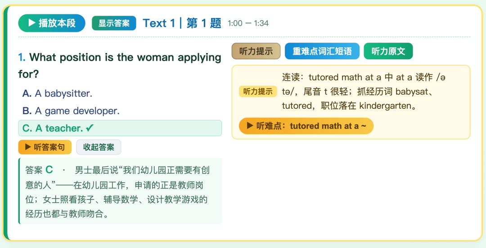
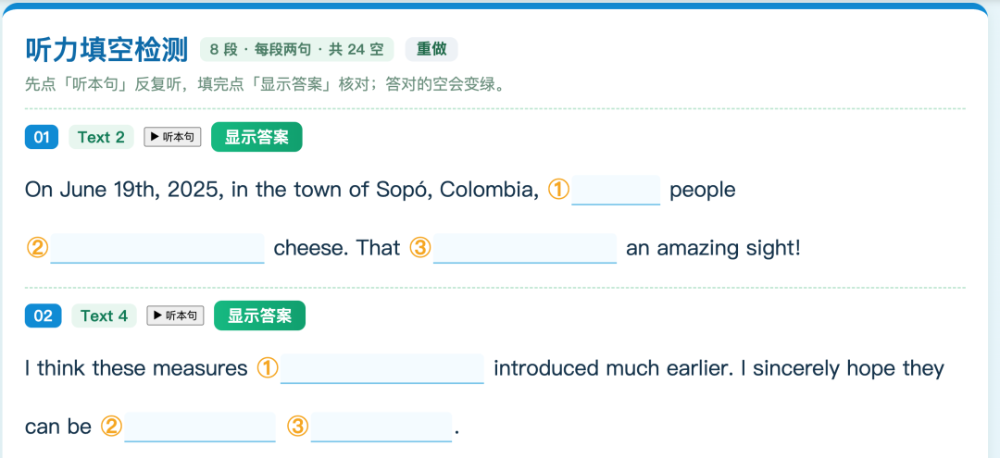

# 听力题的网页课件制作：实测后很齐全、很实用（提供skill）
> 💡 备注属性未写入，可能是备注属性名称或者类型被修改了，建议将字段类型设置为 rich_text，可以在小程序-操作-修改文章数据库页面进行调整
> 💡 原文链接:[https://mp.weixin.qq.com/s?__biz=MzAxMTE2MzcwOA==&mid=2650891974&idx=1&sn=cc2e2bf4f124142ca60060d733911dce&chksm=818fc7a8fc59eb40ab0a077d671dc5a73ca64e6a03c681e03155a3fc674c196e396cf045630a#rd](https://mp.weixin.qq.com/s?__biz=MzAxMTE2MzcwOA%3D%3D&mid=2650891974&idx=1&sn=cc2e2bf4f124142ca60060d733911dce&chksm=818fc7a8fc59eb40ab0a077d671dc5a73ca64e6a03c681e03155a3fc674c196e396cf045630a#rd)
今天对原来的听力测试做了一下改进：
1. 不需要把每一段截成单独的音频，而是按照时间点定位到主音频上；
2. 每一段材料加上听力技能里的连读、弱读等；
3. 加上重点词汇解释，去掉翻译；
4. 加上挖空听力。
挖空主要针对听力技能里的连读等。
这样下来就更有针对性了。
我已经把这一套完整的步骤固化为skill，可以免费下载了。

**我会发在群里，现在AI-英语备课技术群3群满员了，4群成立了（目前已经7000人，4群满员就会一万人）**

其它近期链接：
[简单实用的单元词汇和短语竞赛课件——以译林选择性必修第二册为例](https://mp.weixin.qq.com/s?__biz=MzAxMTE2MzcwOA%3D%3D&mid=2650891953&idx=1&sn=e38b3e0ae0393fd23945ac5a5ac3e722&scene=21#wechat_redirect)
[今日更新：10种外刊命题：阅读、七选五、完形11篇（已达：江苏大市高三一模水平，免费下载）](https://mp.weixin.qq.com/s?__biz=MzAxMTE2MzcwOA%3D%3D&mid=2650891948&idx=1&sn=6f72407cf53dd215948ebc666c9217ff&scene=21#wechat_redirect)
[外刊从命题、解读到完美呈现：今日外刊精读精练（免费下载满血版）](https://mp.weixin.qq.com/s?__biz=MzAxMTE2MzcwOA%3D%3D&mid=2650891940&idx=1&sn=9bb093b6abd12390159b763ea2d872dd&scene=21#wechat_redirect)
[今日更新：外刊12篇精讲（来自每天16本外刊500万字符的精选，直接下载）](https://mp.weixin.qq.com/s?__biz=MzAxMTE2MzcwOA%3D%3D&mid=2650891919&idx=1&sn=9027b77959c0a553460c2c33b16a8d26&scene=21#wechat_redirect)
[英语句型大全（287个）：涵盖所有语法句型+全部写作例句](https://mp.weixin.qq.com/s?__biz=MzAxMTE2MzcwOA%3D%3D&mid=2650891967&idx=1&sn=2c43eba67a6100a3f4500269c8d1e2bd&scene=21#wechat_redirect)
[高中核心句型一本书：17个句型闯天涯（可下载）](https://mp.weixin.qq.com/s?__biz=MzAxMTE2MzcwOA%3D%3D&mid=2650891959&idx=1&sn=7d86e81d8786af09b8e2668f87e82d00&scene=21#wechat_redirect)
