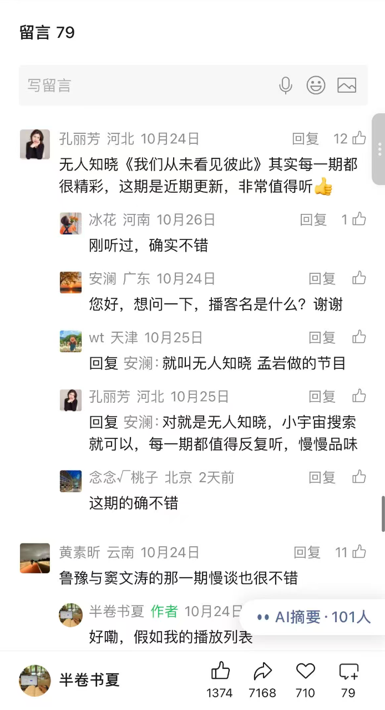
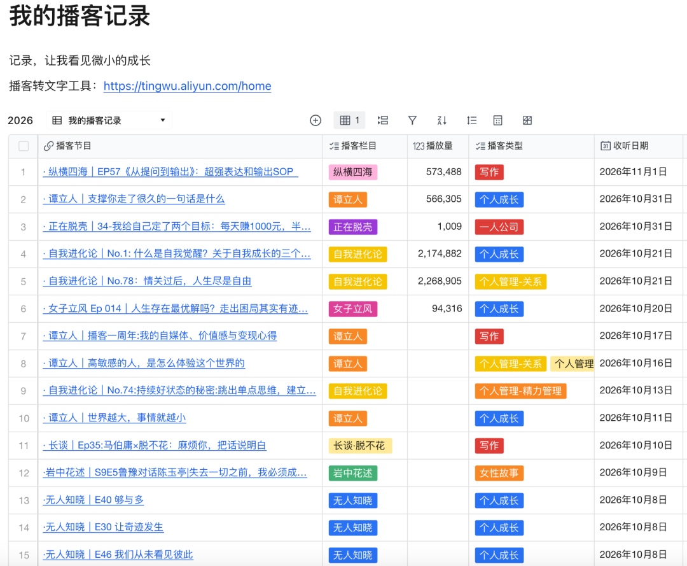
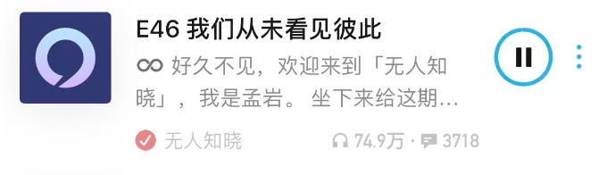
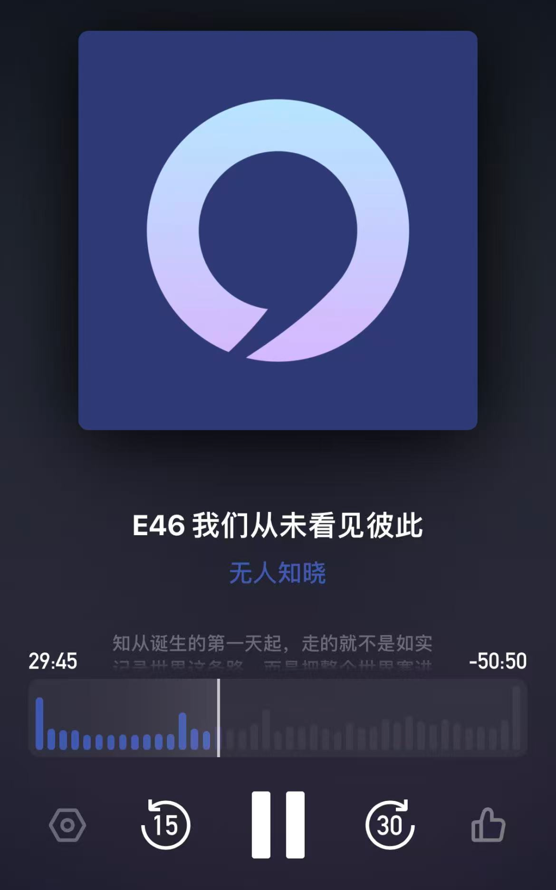
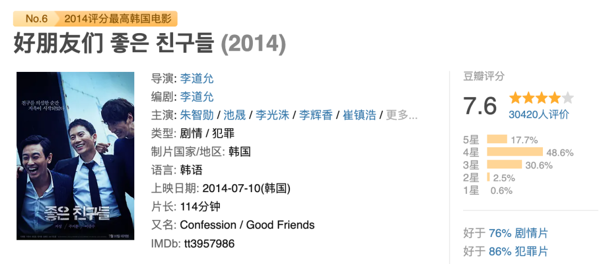
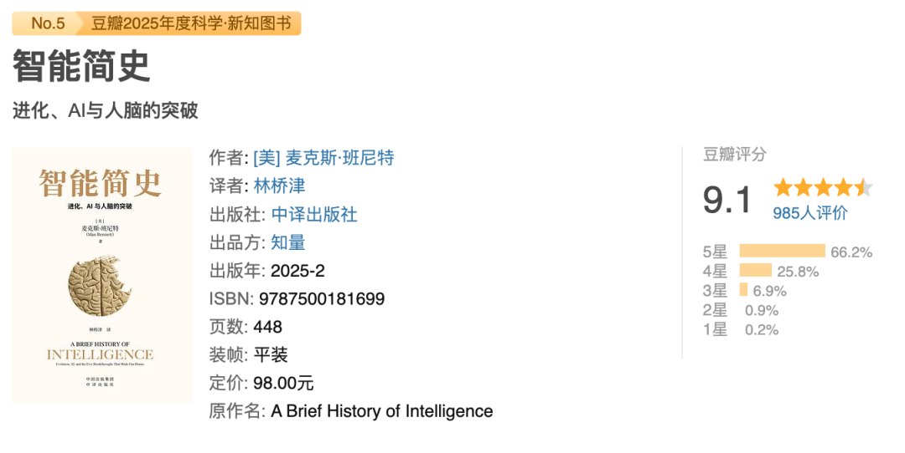
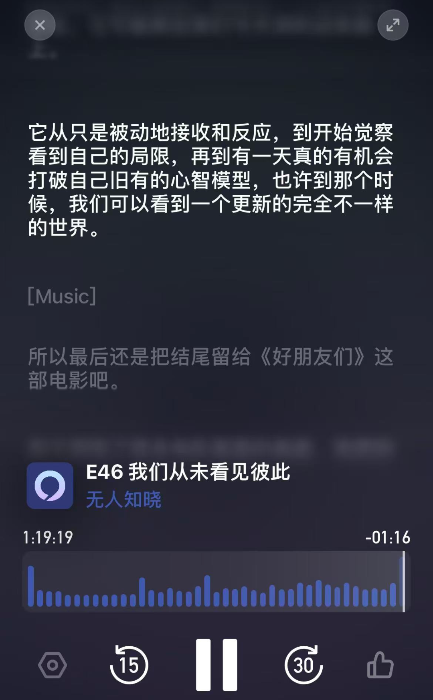

# 听播客1年多，强烈推荐你去听这期播客，又一期封神了！
> 💡 备注属性未写入，可能是备注属性名称或者类型被修改了，建议将字段类型设置为 rich_text，可以在小程序-操作-修改文章数据库页面进行调整
> 💡 原文链接:[https://mp.weixin.qq.com/s?__biz=MzAxNjI3NzAyMw==&mid=2247485478&idx=1&sn=164d0c2148c3955f4554404fa2c75661&chksm=9a97ba3f6b37e4d5f26e1daac43aec329a3e959f3d4b8531c7110b7ea5bc3b0ad0cd0c2d2865#rd](https://mp.weixin.qq.com/s?__biz=MzAxNjI3NzAyMw%3D%3D&mid=2247485478&idx=1&sn=164d0c2148c3955f4554404fa2c75661&chksm=9a97ba3f6b37e4d5f26e1daac43aec329a3e959f3d4b8531c7110b7ea5bc3b0ad0cd0c2d2865#rd)
这是书夏2026年的第35篇原创文章
💚
你好呀～我是书夏。
今天，我又跟大家一起来聊播客啦～
上次发的[《听播客1年，这6期封神》](https://mp.weixin.qq.com/s?__biz=MzAxNjI3NzAyMw%3D%3D&mid=2247485430&idx=1&sn=91d815aa66c06d66027090922884d48b&scene=21#wechat_redirect)这篇文章，得到了很多小伙伴的喜欢和留言。其中最高赞的留言说：“无人知晓《我们从未看见彼此》，其实每一期都很精彩，这期是近期更新，非常值得听👍”

看到这条评论时，我才反应过来，竟然漏掉了这档播客节目，实属不应该呀。因此，今天，我想和你聊聊，听播客1年多，听了190+小时，又一期封神播客节目——《无人知晓｜E46 我们从未看见彼此》。

其实，无人知晓的很多期播客，我都很喜欢。选择这一期节目，是因为这是我近期听的，触动最新的，同时也是大家公认不错的高质量播客节目。
我是在10月8日，一个国庆回深，独自一人大清扫一天的日子里，打开了这期播客。在这期播客中，孟岩试图回答的一个问题是：**“当你面前有一个人，你看了一眼，你看到的是谁？”**
他主要用一部电影、一本书、一个人，串起了对这个问题的主题式研究和分享。（播客中提及了其他很多好书，以及佛学思想）。
**如果你也经常感受到不被看见，或是你也因为忙于生活，无法停下来好好看看身边的人事物，抑或是你独自走了这么远的路，心里也藏着这些疑问：**
· 人为什么会习惯性把事物分成好的和坏的？
· 人为什么永远不满足？人为什么会焦虑？
· 人为什么不敢说出藏在心底的话？
· 站在你面前最亲密的人，有时候为什么会不懂你？· 人又为什么会先看到标签，而不是这个人本身？
· 当我们不被看见的时候，可以如何做？
……
那么，特别推荐你耐心看完后面的内容。相信你看完后，会对自己的大脑有全新的认识；对于上面提到的疑问，也会得到新的答案和解法。

**01.**
** 🎬 一部电影，得到答案 **
**“你眼中的他人，就是你自己。“ **
孟岩先是聊到了一部电影《好朋友》。这里面有三个男的（一个不太聪明A，一个老实B，一个爱耍小聪明C）从小玩到大的友谊故事。
这三个人小时候，经历了一次雪天被困，A的随身听不见了，也受了伤，B陪着A在找到的一个小木屋中等待，C出去找救援。B在发现A的随身听不见了后，脑中有了一个念想，C会不会是丢下他们，不会找人来救他们两个了。
电影最后揭示了两个细节，一是随声听掉在了雪地里，二是B曾经自己独自走出木屋很长一段路，又返回了。故事的结局有些唏嘘，一个自杀了，一个活着，一个被杀了。
孟岩在讲述这部电影时很吸引人，甚至在最后，他提出了一个让我觉得有些可怕的猜想。具体是什么，好奇的小伙伴，可以亲自去听一下。
这里，我就不展开了，直接说在电影结束，孟岩得到的答案是：**“你眼中的他人，就是你自己。“ **
其实，这也是我一开始听到孟岩的提问（当你面前有一个人，你看了一眼，你看到的是谁？），脑子里最先冒出来的答案。
**那么，看到这里，你的答案是什么呢？**

**02.**
** 📖 一本书 揭示为什么会看不见 **
** 人脑的5次关键智能进化 **
对于这个问题，孟岩并没有停留在得到答案和结论这里。他还开展了继续追问：**“为什么会这样呢？你眼中的他人，怎么就会是自己呢？**
孟岩在一本豆瓣高评分，但看的人还不多的书中，找到了答案。这本书的名字是**《智能简史：进化、AI与人脑的突破》，主要回答了一个大家都感兴趣的问题：人的智能是如何从原始动物一步步进化而来的。**
第一次听这期播客，这部分让我最为震撼。因为，这让我再次重新认识了我们的大脑，认识到大脑带给我们的能力，以及这背后藏着的巨大代价。
孟岩在总结的时候，是这样说的：**“人被进化成今天这个样子，从来都不是为了看见彼此，而是作为一个生物能够更好地活下去。所以我们看到的是6亿年前的那个正负号，好或者坏。我们看到的是多巴胺想要的东西，永远去追，永远都不满足。我们看到的是脑子里面自己生成的那个世界，用预测去替代眼睛。我们看到的是用自己的素材拼出来别人恐惧和欲望，带着别人的脸。我们看到的是一个词、一个标签、一段话，是他就是那种人。我们看到的是一面我们以为是窗户，但其实照出了自己的镜子。“**
**下面，就让我们一起去看看这5次关键的大脑智能进化。**

**❶ 第1次突破: 线虫｜正负号｜好的坏的**
第1次突破，大概发生在5亿5000万年前，主角是线虫，一种粒大小的没有腿的小虫子。它用正负号记录看到、闻到的一切东西，这种气味加分，这种温度减分等等。于是，大脑拥有了好坏评判的能力，而这背后的代价是，分别心也随之而来。
如果你养过孩子，孩子的大脑在发育的过程中，也会经历这样的时刻。起初，对孩子来说，一切东西都没有好坏之分，苹果就是苹果，臭臭就是臭臭，甚至很多孩子都很喜欢臭臭。而在很多大人的眼里，臭臭是什么呢？它是难闻的、脏的东西，甚至说出来都觉得不雅的。
正如作者麦克斯·班尼特（Max Bennett）在书中说的那样：**“一种气味，一种温度，它其实没有任何好坏。好坏从来都不是世界的属性，它是神经元里面的正负号，它是大脑的评价。“**
如果你想迅速拉近和3、4岁孩子的距离，特别推荐你和孩子们玩臭臭、屁屁的游戏，当你说“我是超级宇宙无敌大臭屁”的时候，立刻能迎来孩子们快乐的笑声。我想，开心的那一刻，比对臭臭本身的评判更珍贵。
带着这样的价值观，我经常和孩子玩臭屁游戏。如果说，孩子的大脑和长大，一定会进化出正负号，好坏，那我想在他看到事物就是事物本身的时候，多多体验这种简单极致的快乐。
**❷ 第2次突破: 两侧对衬动物｜结果中学习｜多巴胺｜不满足**
第2次突破，大概发生在5亿年前。主角是两侧对称动物的一只后代，长出了脊椎、眼睛、鳃和心脏，它们变成了最早的脊椎动物，长得很像今天的鱼。
它比线虫厉害的是，具备了从结果中学习的能力，就是先做一下，有效的步骤就多做，无效的步骤就少做、不做，它都不需要等到最终结果出来，在过程中就可以运用正负号能力，进行调整。而这背后的代价是，你永远都在寻求更好的，随之而来的不满足，也被写进了大脑的出厂设置中。
完成这个环节，会涉及到大脑的三个东西，基底神经节是执行的机器，下丘脑是裁判，多巴胺是一种化学物质信号。 在这里，孟岩刷新了我对多巴胺的两个认知。
**一是，多巴胺被误解的一种说法是快乐分子。**孟岩说：“多巴胺不是在编码快乐，它是在编码预期误差。如果比预期更好，多巴胺才释放。如果预期一样，那么他就无动于衷。如果比预期差，它直接惩罚你。“ 
**这给我们带来的体验是什么？**你永远要比上一次做得好，才能得到掌声，你的工资要比上个月多，你才容易心生喜悦。
**二是，多巴胺只管想要，不管喜不喜欢。这给我们带来了什么影响呢？**
最普遍的就是，玩手机停不下来，尽管你知道熬夜玩手机到最后，你会产生懊悔、愧疚，但在玩的那一刻，你就是感觉被吸进去了，被操控了，无法停下来。
情况更甚的是，有些人到老去，才发现自己一直追求的东西，原来并不是自己喜欢的，甚至都最后都不是自己想要的了。因此，这句经典的话出现了：“走太久，别忘记当初为什么出发啊！”
又或者你想跳出这个怪圈的时候，可以问问自己；“当我80岁的时候，这件事还会是我喜欢切想要做的吗？”
**
❸ 第3次突破: 1一年前恐龙时代｜小生物｜大脑新皮层｜物理世界建模｜想象｜焦虑**
第3次突破，大概发生在1亿年前，背景是恐龙生活的时代。主角是生活在这当中的小生物，如何能在一击毙命的危险中存活下来。
大脑的新皮层就在这期间诞生了，它在脑子里面搭了一个世界模型，即外面的世界有什么？它可以在行动前，把想象的结果预演一遍，还会把这个想象的结果，拿去打分，获得及时反馈，做还是不做。
比如，下雨天你出门要穿什么鞋，你可以想象穿运动鞋、凉鞋、雨靴、帆布鞋等情况，然后在这些预想中，选择一个更好的方式。
到这里，我都只觉得神奇啊、妙啊。下一步，直接就让我感到震惊和后怕了。孟岩在播客中说：“大脑的新皮层是先自己生成了一个世界，再拿去外面的世界核对。这两个世界的次序和你以为的是相反的。你以为你在看外面的世界，但其实大部分的时候，你看到的是你脑子里面的那一个。我们大脑生成的这个模型越好，我就越不需要去看外面的世界了。“
**这给我们带来了什么体验呢？你是不是也想到了这些：**当一个人积累的经验越多，就更难听得进去别人的建议，或是接收一些新的东西了。当你每天都走在同一条通勤路上，你是不是就越容易忽视掉这一路上的花草树木。当你和一个人生活在一起久了，你就可能越容易忽视这个人的感受以及带给你的价值。
**那这个想象能力和这些体验，背后的代价是什么呢？**它在给我们带来创意、计划、方法的同时，也给我们带来了无尽的猜想、回忆，以及随之而来的忽视、后悔、恐惧、焦虑。
在这一层，我很喜欢孟岩对焦虑的定义，他说：“焦虑，是那些还没有发生的坏事儿，对吧？在大脑的模拟器里面一遍一遍的播放，我要这么做，是不是老板会生气，他为什么没有回我的微信等等。“
**对于这种被大脑循环模拟播放带来的焦虑，如何破解呢？**
孟岩说：”把注意力从（大脑）模拟器的输出暂时拉回到了此刻的感觉输入。“ 冥想就是收回注意力很好的做法。
我突然就想到，上次娃高烧一天一夜，我坐立难安，焦虑的不行的时候，最后是看书让我平静了下来。原来，注意力转移之后，焦虑也会随之变弱了。
**谢谢孟岩的这一层焦虑定义和解说，让我想到了如果下次遇到焦虑的事情，可以去做的3件事是：**
**（1）告诉自己：**你现在脑海里的结果，都只是猜想、预想，并不是已经真实发生的了。
**（2）做一切能做的：**你只能做好当下的事情，并根据当下的反馈及时调整。未来的结果，需要在特定的时候才会到来。
**（3）交给时间：**尽了全力后，结果还是飘渺不定，那就耐心等一等，告诉自己天会亮的。同时，转移注意力，去做一些让给你自己能好起来的事情。比如睡觉，吃饭、看书等。
**❹ 第4次突破: 灵长类群居动物｜大脑更新的皮层｜预测他人｜心智化｜关系**
第4次突破，大概发生在1000万年到3000万年前。这次的主角是灵长类动物，和前面的动物不一样的是，它们是群居动物，可以协同作战，相互照应，这也让我们学会了爱、教育等，而这让我们的生活中开始出现了竞争、关系这些元素。
这时，大脑新皮层的上面又长出了一块更新的皮层，在外面的物理世界中，基于想象的能力上，构建出了另一个心里世界，即能基于我看到的世界，我是如何想的，打算如何干，来预测对方是如何想的，会如何做。孟岩说这就是人的心智化。
**这样的内心世界，有什么特点呢？**一切猜想别人是如何的证据，其实都来自于自己的想法、经历和判断。
听到这里，我就明白了为什么从小到大很长的一段时间，我都会天真的以为，别人和我想的是一样的。很好奇，你曾经也有过这样的时期吗？
孟岩说，更麻烦的一个问题是这一层的模型几乎没有办法去被纠正。它对应的是人际关系模型内建的自我确认机制。孟岩强调了，一个是纠错，一个是确认。
**在这里，我大胆做了一个猜想预测是：**你越在心中认为一个人不好，就越能找到更多的自我预测证据，来说这个人哪里哪里不好。
**这会带来什么问题呢？**我们可能会因为自己内心一些基于别人的未经证实的猜想判定，而与人产生隔阂，或是失去一些开始尝试的机会。
就像孟岩在这期播客结尾说的那样：“我想我们每个人的心里面其实也住着很多很多的忍者，我们每个人的心里面也埋藏着很多很多年都没有对他说出口的那句话。”
当我发现了这一层之后，我不再轻易对别人下判断，我更鼓励自己，亲自找对方去求证，了解对方的真实想法。我也更懂得了，同一件事，不同的经历的人会有不同的视角，而这会让你越来越能理解和接纳不同，人也会变得越来越开阔。
以前，我特别向往心有灵犀的关系，现在，我知道就算是躺在你身边的人，也不能时时刻刻与你想法一致。他和你想得不一样，也并不意味着他不爱你。
**❺ 第5次突破: 人类｜语言｜标签｜压缩**
第5次突破，大概发生在30万年前，主角是人类，发明了语言。
作者麦克斯·班尼特（Max Bennett）说：“语言真正革命性的地方不在于交流，因为其实很多动物都能用各种各样的方式交流。语言真正革命性的地方在于它能让一个人脑子里面的模拟传到另外一个人的脑子里面去。”
**孟岩对这段的诠释，我太喜欢了。他是这样说的：**“我没有去过的地方，你去过你讲给我听，你的经验就会变成我的经验。我没接触过的人你讲给我，那个人就在我的脑海中有了一个印象。我看过的书，看过的电影，经过我的思考讲给你，就变成了你脑海中对这个世界的理解。就这样，知识第一次可以跨越时代、跨越人群去积累。”
这让我重新认识了语言，不止是表面的交流和沟通这么简单，这背后留下的是知识、技能的传承。
**那藏在这一层进化背后的代价是什么呢？**孟岩说，这一层的代价是，语言在传递我们脑中模拟的同时，也在压缩它。一个活生生的人，一件复杂的事儿进入语言之后，会变成一个词，一个标签，最后，你不会看到这个人，而是看到一个标签。就像此刻的你，现在看到我的文章，你最初看到的是什么呢？
其实，我认为标签本身，并不是一件坏事，而是当我们只是凭着标签去看人事物，而不再对这些人事物本身产生好奇，不想去了解背后的信息时，一些偏见、误差就开始涌现了，一些博眼球的事情也出来了。

到这里，我会觉得批判性思维变得尤其重要了。这里需要注意一下，**批判性思维，不是批判别人，而是批判自己的想法是否合理、科学。**
比如，你看到一个人身上有一个标签时，你不是直接去说，他是一个什么样的人，而是开始去思考，我为什么会认为他是这样的？我这个想法对吗？有没有什么是我没见到的，遗漏的，不知道的呢？这当中还有其他可能吗？
书中讲的5次关键进化，到人类发明了语言就结束了。但孟岩的思考和分享没有就此停止。他说：“后面互联网、ai的到来，还在继续加速这种压缩和标签化。”
**在这一部分，孟岩提出了这样一个问题：**”几十亿个脑子里面的世界，每天都在互相投喂着标签和情绪，互相建构着一个非常糟糕的世界。**所以，我们可以真切的去看见一个身边的人吗？有可能吗？“**
**我也想问一句，看到这里的你，你觉得有可能吗？**

**03.**
** 👨 一个人 如何能真切看见 **
** 全然的注意力**
对于刚才的这个问题，我们有可能真切地去看见一个身边的人吗？
**孟岩给出的线索方法是，一个印度哲学家，被誉为20世纪最伟大的心灵导师，克里希那穆提，提出的全然的注意力。**
孟岩认为，全然的注意力，没有训练方法，需要多年的历练，也很难做到，但至少有一件事儿可能没有那么难，甚至他不需要你做任何事情。那就是你此刻就意识到，我正在用意象，看我眼前的这个人，此刻就意识到我的注册器正在工作。当你意识到这件事的那一刻，你全然的注意力，其实已经过来一瞬间了。
**那我自己，对于这个问题的答案是什么呢？**
第一遍听的时候，我听到这里有些难过，有些悲伤，也安慰自己，这也只是世界的一个切片，并不代表着人人都会被标签和情绪带走。而我想做那样的人，我们一定不要被标签和情绪吞没呀！且我始终相信，有问题产生，就会有解法到来。问题的出现，就是创造的开始。
等到第二次听这期播客，对照着逐字稿听到这里时，我突然对克里希那穆提产生了好奇。在搜索这个人的介绍和作品时，我的脑海中突然涌现了一个答案，**自己先看见自己。是的，这是我更新后的答案。**
正如孟岩说的那样，自己先意识到，自己看他人时，大脑会启动标签和意向去看这个人，当你有了这个意识后，你就会更谨慎。
**更重要的是，如果没有人能够真切地看见你，那请你自己先看见自己。**别人贴给你的标签、评价，都只是他们的意向，只是他们认为的样子，甚至还可能夹带着他过往的创伤，投射在了你这里。当你不再活在他人的看见、评价和标准中，你会收获全然自由、专注的自己。
这时，当你开始写作的时候，就只是写作，而不会先去想，我写的这些，别人会怎么看。这不是说我们不要听取别人的建议，而是在一开始的时候，我们要让自己先写起来。写出来后，再理性对待他人的评价和看法。
**04.**
** 写在最后**
今天的这篇播客笔记到这里就结束了。非常谢谢和欣赏能看到最后的你。
当我再回去听这期播客时，发现已经是孟岩8月录的了，不知道他下一期播客会在什么时候更新呢？我现在就已经开始期待「他的下一期更新」啦。
此外，我想说的是，播客笔记再好，也是二手的。特别推荐看到这里的你，亲自去听一听这期播客，收获自己的一手经历和感受。相信你，一定会听到属于你的声音，看见属于你的部分。
在这期播客中，孟岩也提到了他之前录的几期单口播客，一并推荐你放在一起听：
· E37 鱼不存在
· E19 无尽的探索
· E21 所有命运赠送的礼物，早已在暗中标好了价格
最后，祝你祝我，都能拥有既能看见自己，也能看见他人的能力，都能不被标签裹挟，也不标签化他人，勇敢活出自由的自己。
**💚 **
｜end｜
谢谢你看到这里
也很高兴认识你
我是书夏，26年选择不上班，Gap重启做自媒体，探索不上班妈妈的新工作方式。35岁而已，请大大方方如你想象的那样去生活。
在这里，我将与你持续分享：阅读 | 写作 | 学习成长 | 生活方式 | 人生管理。
希望我的文字，能带给你一些方法/启发/力量，那就一起加油吧！
** 往期精彩：**
[记录持续运动6个月：我构建的「运动体系」（持续运动实操版）](https://mp.weixin.qq.com/s?__biz=MzAxNjI3NzAyMw%3D%3D&mid=2247485396&idx=1&sn=8b6372785c82150c278283f2985880d5&scene=21#wechat_redirect)
[听播客1年：我构建的「听播客及笔记流程sop」（附20期高质量播客清单）](https://mp.weixin.qq.com/s?__biz=MzAxNjI3NzAyMw%3D%3D&mid=2247485294&idx=1&sn=b31beeea00e537f56d0d321365d19ff5&scene=21#wechat_redirect)
[践行早睡5个月：我构建的「早睡体系」，入睡从1:00→23:00，提早了2小时](https://mp.weixin.qq.com/s?__biz=MzAxNjI3NzAyMw%3D%3D&mid=2247485205&idx=1&sn=fd481723c8914263e9c8d0a7ed60478d&scene=21#wechat_redirect)
[一年50本书，我的阅读及笔记流程](https://mp.weixin.qq.com/s?__biz=MzAxNjI3NzAyMw%3D%3D&mid=2247484600&idx=1&sn=d61819342d733139235d395256bfeef3&scene=21#wechat_redirect)
