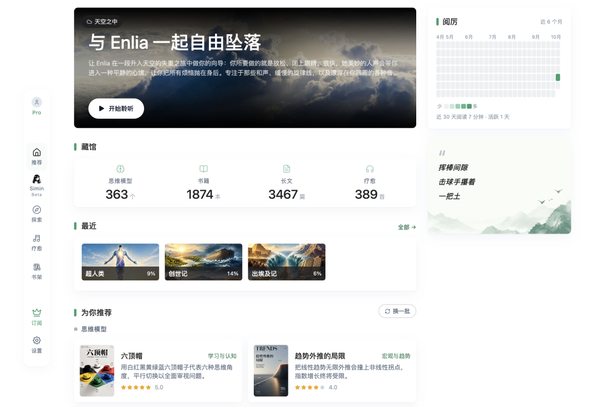
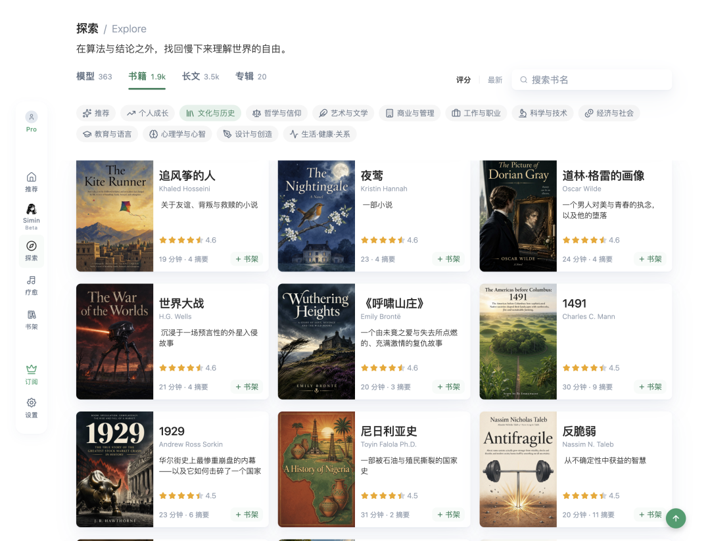
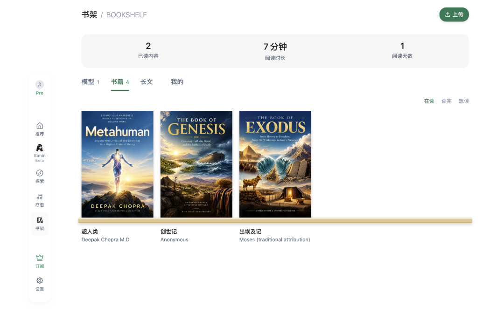

# 告别“读过就忘”｜AI读书工具Simin，帮你真正读透一本书
> 💡 备注属性未写入，可能是备注属性名称或者类型被修改了，建议将字段类型设置为 rich_text，可以在小程序-操作-修改文章数据库页面进行调整
> 💡 原文链接:[https://mp.weixin.qq.com/s?__biz=MzYzNTM5NzQxMw==&mid=2247485518&idx=1&sn=e270549241352c6fd45c1e2355fcc315&chksm=f1e09a1a448433983fa95675e1bd9a76d7e507ad1c68543e581b6bff6a5222cd5d4f9e179c3b#rd](https://mp.weixin.qq.com/s?__biz=MzYzNTM5NzQxMw%3D%3D&mid=2247485518&idx=1&sn=e270549241352c6fd45c1e2355fcc315&chksm=f1e09a1a448433983fa95675e1bd9a76d7e507ad1c68543e581b6bff6a5222cd5d4f9e179c3b#rd)
> 💡 导语：不知道你有没有这种困扰，书读完合上，脑子里空空如也。谈起内容只能够说出一句“我读过了”，但真正需要输出观点、拿来解决问题的时候，什么都想不起来。最近发现了一个很有特点的的读书网站Simin，觉得还不错，推荐一下。

### ✍️ 痛点：大部分阅读，都只是“假读过”
很多时候不是我们没时间读书，而是读完之后留存极低。 厚厚的经典著作啃完，道理仿佛都看懂，等到需要调用书中知识运用的时候，脑袋一片空白。哪怕一个故事，一个理论，讲起来也极为困难。这主要是因为单纯的电子书、听书APP大多只做到“把内容给到你”，缺少梳理脉络、拆解思维、深化记忆这些真正“入心”的步骤。
AI如此发达的现在，如何最大程度地运用，帮我们更好地读书呢？
Simin这款工具，大概有点这个意思了，其核心目标就是解决**读过就忘，看懂不会用**
的问题。

### 📚 Simin能做什么，核心功能一览
#### 1、1300+书籍深度解读，大部头也能轻松消化

内置1300+本书籍资料库，覆盖商业、心理、历史、哲学、人文经典。 每一本书不只是简单摘抄金句，配套**AI深度解读、全书脉络思维导图、完整音频+多版本摘要**。 单本书音频时长约几分钟到半小时，通勤、做家务、碎片时间就可以听完一本厚重经典。哪怕像《出埃及记》这种体量庞大的书籍，也可以快速理清完整情节，掌握大概。
#### 2、360+实用思维模型，不止了解，更要学会使用
这是我很喜欢的一个模块。 包含反脆弱、杠铃策略、避蠢优于求智等大量高频思维工具。 市面上很多产品只是把名词丢给你，而Simin给每一个思维模型配备数万字详解、真实应用场景、配套脉络图。 不再停留在“听过这个词”，搞懂怎么讲出来，什么时候该用。
#### 3、3500+深度好文，5分钟抓取文章核心
收集哲学、心理学、科技、历史各类深度长文，全部附带AI解析。 时间这么少，大家都挺忙的，日常刷长文看不下去，花短短5分钟，就抓住整篇文章的思想大纲，输入效率一下子就变高啦。
#### 4、个人书架+阅读雷达分析，看见自己的阅读版图
自带分类书架，一共52个内容分类，记录全部阅读、收听记录。 特色的阅读雷达图可视化你的阅读倾向，直观看到自己在哪类内容输入更多，同时给出后续阅读建议，帮你补齐知识盲区。

### ✨适合什么样的人呢
这个网站
✅ 读书经常读完就忘，想要把知识真正吸收内化
✅ 通勤碎片时间，希望高效输入，不想看碎片化短视频
✅ 想要学习各类思维模型，但是看不懂晦涩理论，缺少应用案例
✅ 读大部头经典，读不进去，需要脉络梳理辅助理解
### ⚠️客观不足
1. 
定位是**解读辅助工具，不能完全替代原书精读**。如果需要逐字研读原著，还是建议阅读原版书籍；
2. 
目前属于网页端工具，没有独立APP，手机电脑浏览器直接打开使用；
3. 
部分冷门书籍暂时没有收录，主流经典、商业社科覆盖度最好。
### 🎁上线福利
官方正在做上线活动，放出1000个终身Pro名额，Pro解锁全部思维模型、完整思维导图、音频库全部权限，现在还在初创推广阶段，感兴趣可以去体验一下。
### 总结
如果你也常常陷入“读过了，但什么都说不出”的窘境，可以试试Simin。 它不是让你更快“读完更多书”，而是帮助我们把读过的内容真正沉淀下来，把书本知识变成自己的思考工具。
类似的工具肯定很多，但是不试试，怎么知道哪个更适合自己呢，对吧！

我是老猫，一个爱好广泛的中年男。
前前端，略懂代码，沉迷 AI + 效率工具
聊一些能提升自我的 AI 玩法和成长干货～
随缘分享，欢迎关注！
