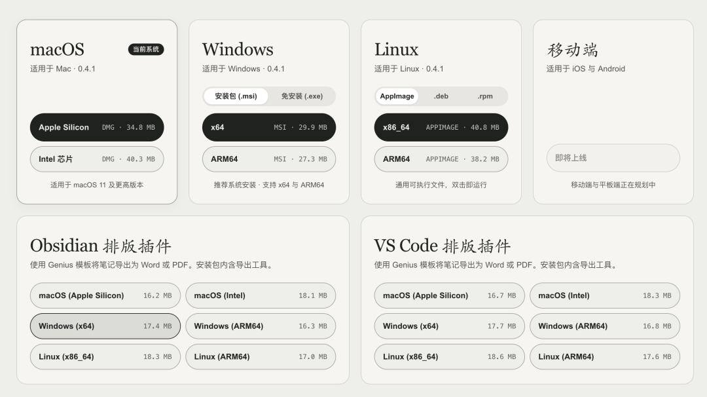
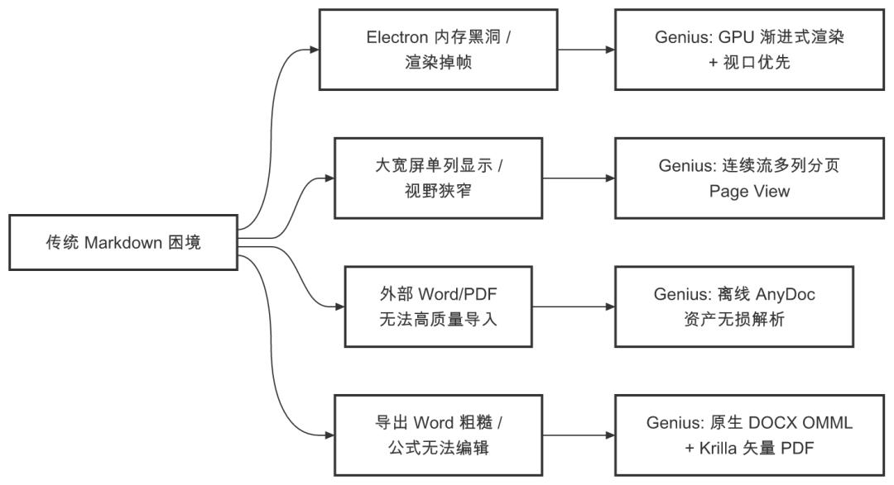
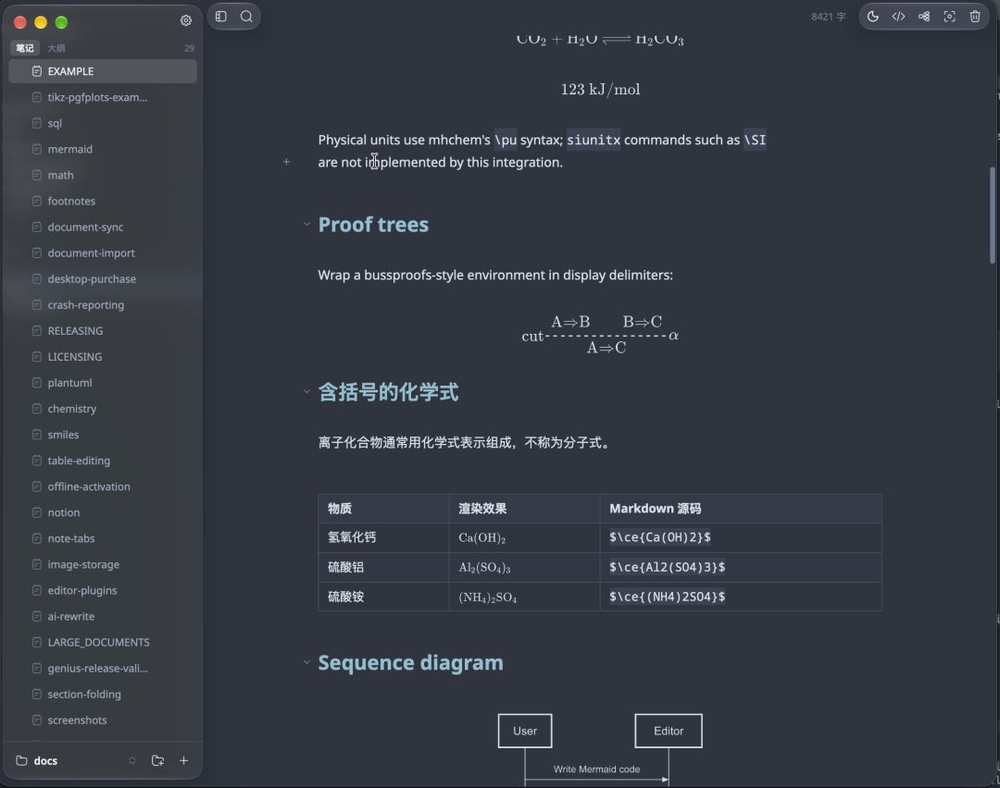
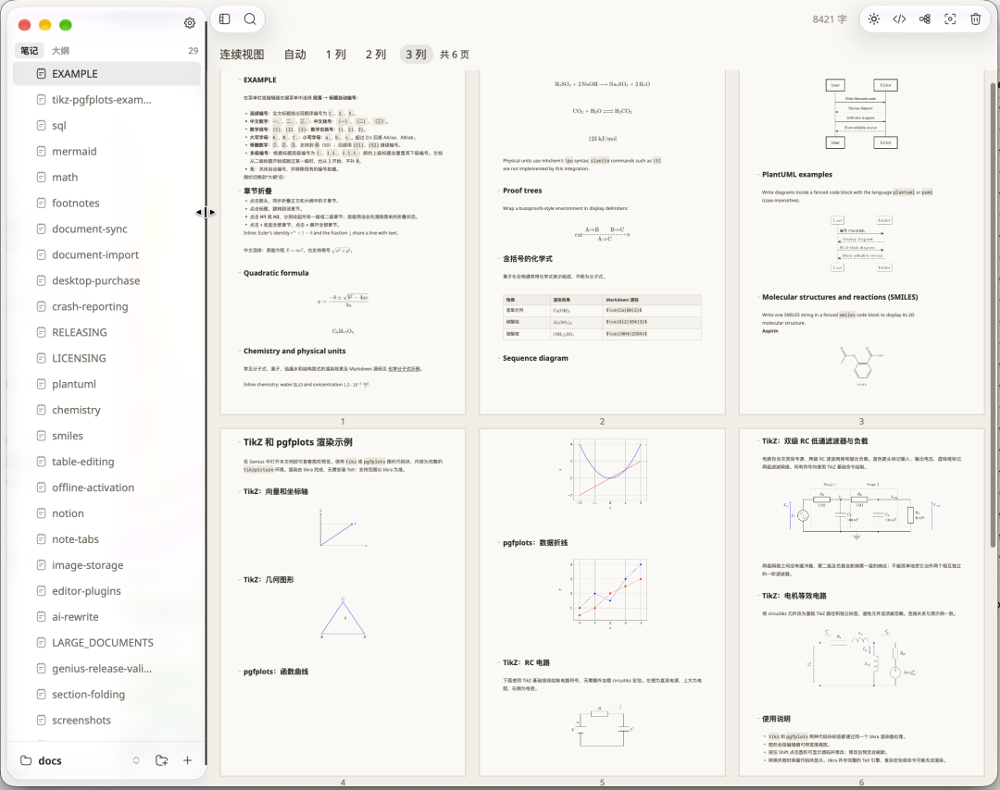
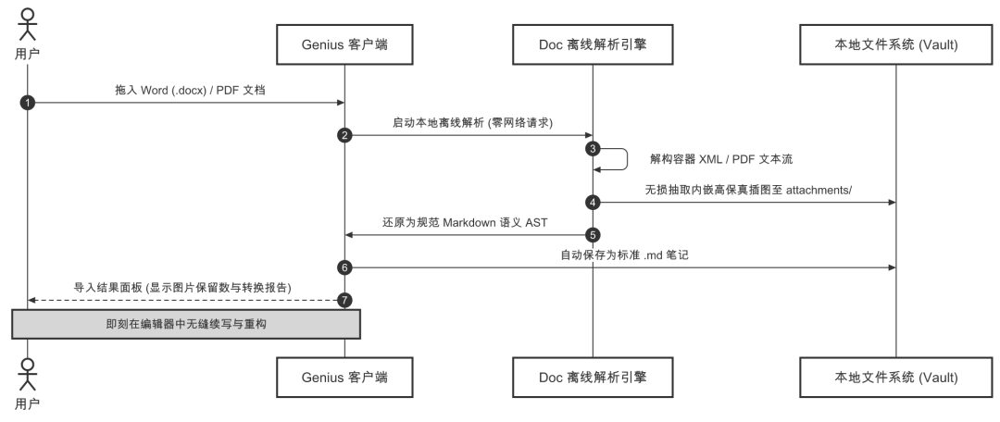
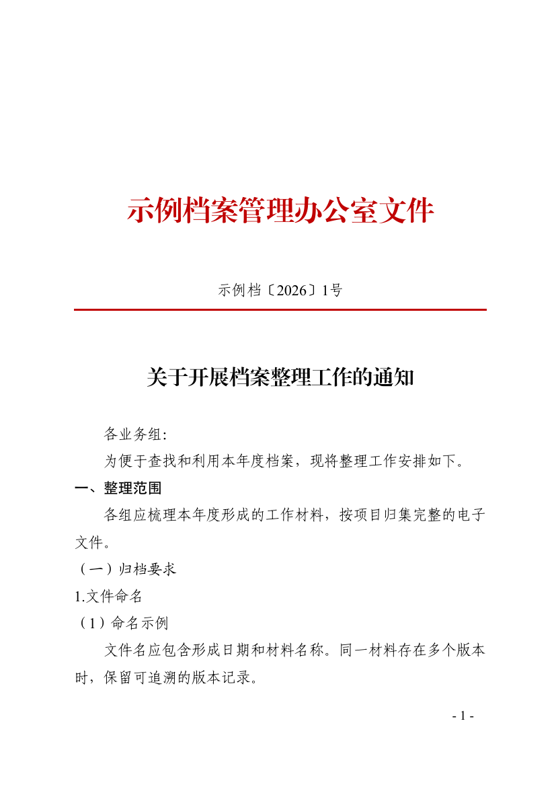
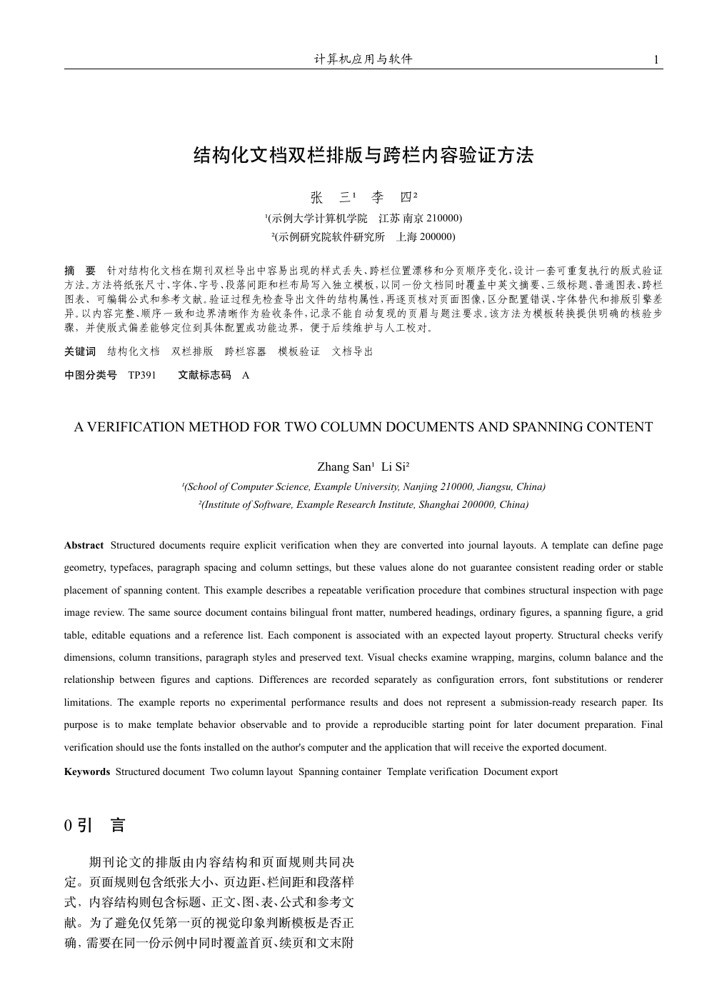
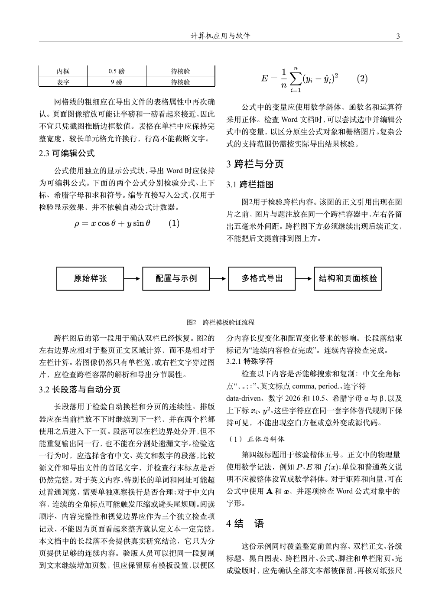
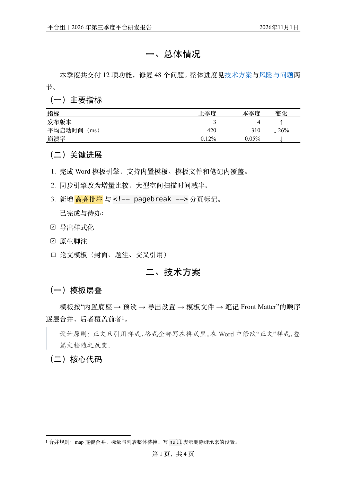
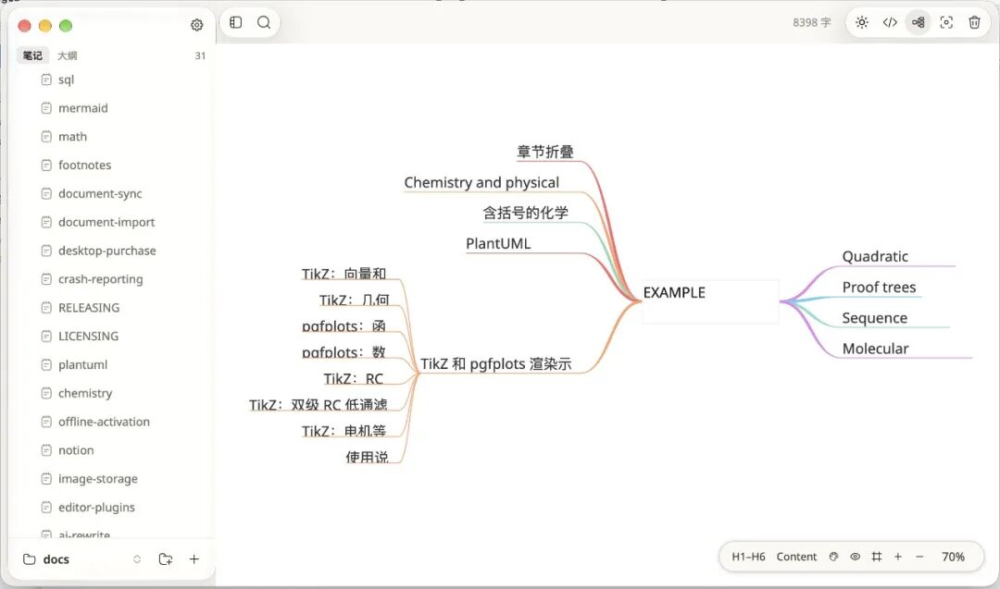

# 告别卡顿与排版妥协：我做了一款全新的高颜值 Markdown 编辑器
> 💡 备注属性未写入，可能是备注属性名称或者类型被修改了，建议将字段类型设置为 rich_text，可以在小程序-操作-修改文章数据库页面进行调整
> 💡 原文链接:[https://mp.weixin.qq.com/s?__biz=MjM5NDEwNDg2OQ==&mid=2447781181&idx=1&sn=adc8f49ccb1d78c9f4416b6cdee3332e&chksm=b3e360c59ac8ba8d9be2a5b6c2896ce496599ca1a03b07b33b9fa38f44cba5921358ed1ea5fc#rd](https://mp.weixin.qq.com/s?__biz=MjM5NDEwNDg2OQ%3D%3D&mid=2447781181&idx=1&sn=adc8f49ccb1d78c9f4416b6cdee3332e&chksm=b3e360c59ac8ba8d9be2a5b6c2896ce496599ca1a03b07b33b9fa38f44cba5921358ed1ea5fc#rd)

## 公众号：一个 pixel
## 一、引言：工具过剩的时代，为什么写作依然痛苦？
 打开电脑，市面上的 Markdown 编辑器两只手都数不过来：轻量如 Typora、双链生态如 Obsidian、程序员最爱的 VS Code、多维表格如 Notion……传统 Markdown 困境Electron 内存爆炸、渲染掉帧；大宽屏单列显示、视野狭窄；外部 Word/PDF无法高质量导入导出 Word 粗糙；公式无法编辑Genius等……
 Markdown 诞生至今已有二十年，它的初衷非常纯粹：用极简的纯文本语法，让创作者远离繁复的排版工具栏，专注于文字本身。然而，当我们的使用场景从“随手写几行便签”迈向长篇架构设计、硕博学术论文、技术白皮书与商业可行性报告时，几乎所有现存的 Markdown 工具都会存在这些问题。尤其是在性能、格式转换、排版、交互等方面还仍有欠缺。

 为了满足这些需求，我做了一款基于Rust语言与现代原生GPU 渲染架构打造的本地优先（Local-first）编辑器——Genius正式登场。
## 二、几万字大文档、海量图表与公式，如丝般顺滑的渲染性能
 当你写一篇动辄三五万字的长篇方案、学术论文或长篇技术规范时，已有的 markdown 编辑器肉眼可见的打字停顿与滚动卡死。**Genius 彻底摒弃了 Web 运行时，基于纯 Rust 原生图形管线，**充分利用多核后台，实现了120 FPS高刷的LaTeX / RaTeX 矢量排版、Mermaid / PlantUML、SMILES 化学结构等学术、工业图标高效渲染，在 70,000 行、40,000 个公式与 2,500 个图表的压力测试下，依然保持即时响应与极低内存占用。
### 下面是实际效果

上图：在深色模式下，即使混排 Proof trees 逻辑推理树、化学式、多行表格与时序图，光标定位与输入依然即时响应，语法高亮随选区自如隐现。
## 2. 拥抱大宽屏，像 Word 一样多列平铺编辑
 在 4K 宽屏或带鱼屏下，传统编辑器中间留一条单薄的垂直文本带，两侧存在巨大留白，若强行铺满，一行文字跨度近一米，眼睛扫视极易疲劳。Genius 在纯文本编辑器中基于**连续文本流的物理几何投影**原生实现了多列分页视图（Page View）。支持自动列数、1 列、2 列、3 列多页画卷并排平铺。在多列视图下，光标跳转、选区拖拽、行内编辑、快捷键操作全部原生联动。
### 实际效果

上图：宽屏环境下开启 3 列画卷视图，6 页文档如实体书刊般平铺展现。复杂公式、电路原理图（TikZ）、函数曲线与表格一览无余，上下文对照修改无需翻页。
## 3. 直接打开PDF、Word ，自带离线解析为原生 Markdown
 面对外部发来的 .docx 项目说明或 .pdf 论文资料，手动复制常出现换行错乱、图片丢失、公式乱码、表格坍塌。依赖在线云端工具，又有商业机密或个人隐私泄露的巨大风险。Genius 集成离线逆向解析引擎，全流程在本地计算机运行。Genius原生支持 Word (.docx)、PPT (.pptx)、Excel (.xlsx)、PDF、EPUB、RTF 等格式的一键批量导入；
 对文字型 PDF 重构段落流，保留层级结构；无法直接内联的图片和矢量附件以恢复列表形式呈现在文末，并生成详尽的诊断面板。

## 4. 设计排版引擎，高精度排版的 Word / PDF 原生导出
 “Markdown 只能写草稿，正式交差还得排 Word”是长期困扰严肃创作者的痛点：现有工具导出 Word，LaTeX 公式被压成模糊的位图截图，协作方双击根本无法编辑；导出 PDF 样式呆板单一，缺失正规公文和学位论文要求的首行缩进（2 字符）、多级标题规范序号、精确页边距与页眉页脚。原生手写 Office Open XML + Krilla 矢量 PDF，Word 原生可编辑公式（OMML）。
 我实现了不依赖任何第三方的办公套件，手写纯正 word/document.xml 生成器。将 LaTeX 公式直接编译为 Word 官方的Office Math (OMML)矢量对象。导出的 .docx 在 Word / WPS 中打开，公式全部支持双击二次修改！
内置排版引擎，导出的 Word 和 PDF 效果
    

**支持三线表、双列排版，奇偶页面，不同标题不同字体格式等等，是正在的学术级排版能力。**
## 三、大纲与思维导图一键切换
 对于长文档，一个屏幕很难看清章节接口，genius 自动基于目录章节自动提取目录树。只需点击右上角的视图按钮，即可将整篇 Markdown 的层级大纲瞬间转换为流畅的思维导图（Mindmap）。

上图：几万字文档的宏观结构以脑图形式全景展开，支持缩放、折叠分支与定位跳转，帮助创作者在宏观构架与微观细节间从容穿梭。
## 四、结语：让 Markdown 真正成为严肃生产力的基石
在富文本协作工具充斥云端的今天，为什么我们依然对纯文本与本地优先如此执着？
**1、数据在你自己手中：**你的笔记就是硬盘里普普通通的 .md 文件与文件夹，无私有格式封锁，十年、二十年后依然能够从容读取；
**2、思维不受网络与卡顿打扰：**系统级原生应用的跟手性能，让键盘敲击的瞬间即是思考延展的瞬间。
 Genius所追求的，并不是否定传统 Markdown，而是用现代系统级工程能力补齐它在现实严肃工作中的最后一块短板：工具足够顺手与强大，写作才真正重归享受。
关注我，发送 genius 免费体验

