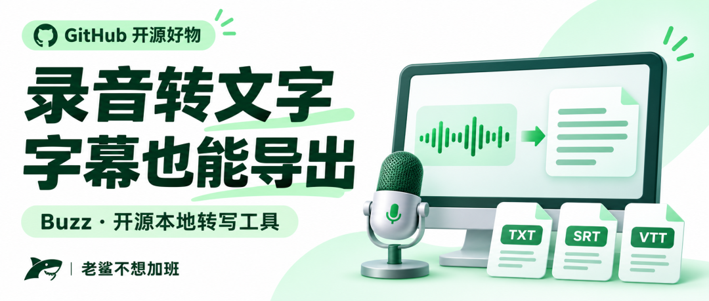
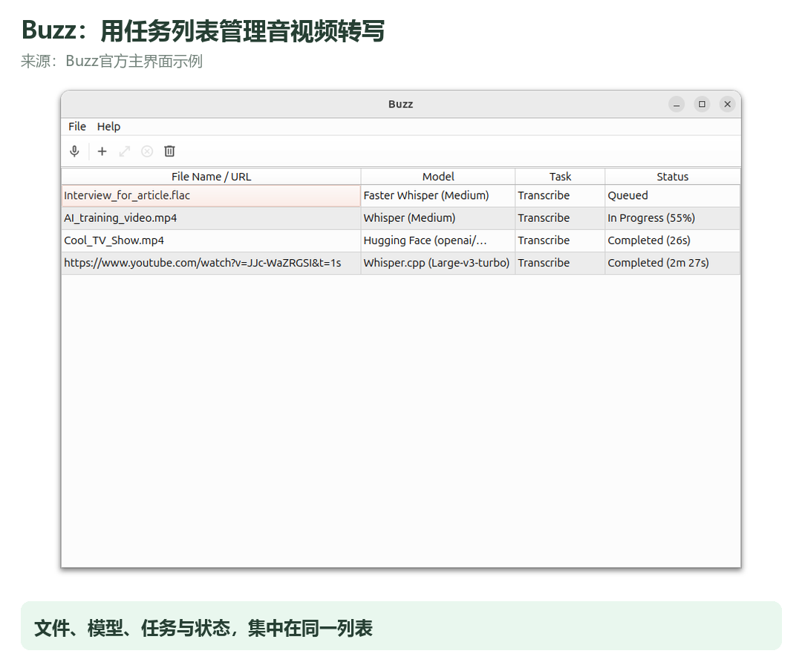
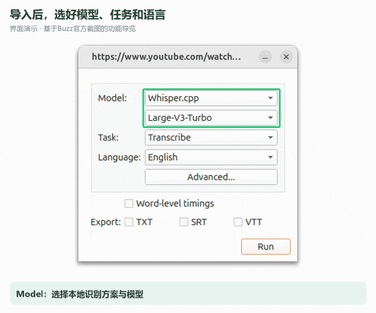
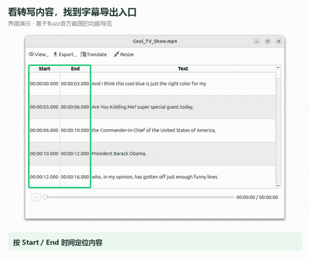

# 哇塞，GitHub超2万Star！录音转文字、视频出字幕，这个开源工具能在电脑上跑
> 💡 备注属性未写入，可能是备注属性名称或者类型被修改了，建议将字段类型设置为 rich_text，可以在小程序-操作-修改文章数据库页面进行调整
> 💡 原文链接:[https://mp.weixin.qq.com/s?__biz=MzY5MTQwNjMyNA==&mid=2247484311&idx=1&sn=7a621c7d41a578b92fb9cc15cc4cf5e7&chksm=f56f497d9fc9724175cb275665c73e3b7224b90626b359e1a1b5ee4438fed9bf3500c96777cc#rd](https://mp.weixin.qq.com/s?__biz=MzY5MTQwNjMyNA%3D%3D&mid=2247484311&idx=1&sn=7a621c7d41a578b92fb9cc15cc4cf5e7&chksm=f56f497d9fc9724175cb275665c73e3b7224b90626b359e1a1b5ee4438fed9bf3500c96777cc#rd)

录了一场会议，想找一句关键结论，却只能拖着进度条来回听。
课程也是。老师讲过的方法明明有用，等到要整理笔记，又得从头找。
如果手里已经有录音或视频，能不能先把里面的话变成文字，再去搜索、摘录和修改？
今天分享一个开源工具：**Buzz**。
它给语音识别模型做了一个桌面界面，能把音视频转成文字，也能导出带时间信息的字幕文件。选用本地模型、准备好模型文件后，可以在自己的电脑上完成转写。
### 01　把“反复听”，变成“先看文字找重点”
Buzz的GitHub仓库已经获得超过2万Star，项目采用MIT开源许可，支持Windows、macOS和Linux。
它适合处理的，是已经保存下来的会议录音、访谈素材、课程视频，以及自己拍摄的视频。
这里最实用的收益，不是让你完全不听录音，而是先有一份可以查找和修改的文字稿。
**找一句话，可以先搜文字；做字幕，可以先拿到时间轴。** 后续整理就有了起点。
软件通过官方安装说明提供下载入口。Windows安装文件要完整下载和解压；如果安装程序旁边配有bin分卷文件，需要一起保留。
Mac安装包要区分Apple Silicon和Intel。官方说明将1.4.5列为最后支持Intel Mac的版本，后续版本的要求要看对应下载说明。

Buzz官方主界面示例，列表为官方样例任务。
### 02　导入文件，先选对这几个设置
打开Buzz，从File菜单选择Import Media File，或者点击工具栏“＋”。Windows也可以用Ctrl＋O，Mac用Command＋O。
选择你已经保存好的音频或视频文件，接着看这三项。
**Model：选择本地识别方案与模型。** 比如Whisper.cpp。首次使用，需要先下载对应模型；不能把“可以离线”理解成刚安装完就不需要任何准备。
**Task：选择Transcribe。** 这是把原音频转成文字。普通转写不用选Translate to English，后者是转为英文。
**Language：按录音实际语言选择。** 中文录音选择Chinese，比把所有任务都交给自动检测更明确。中文内容也不要选名称带“.En”的英语专用模型。
设置好后点击Run。任务完成、状态显示Completed后，双击对应任务，就能打开转写内容。
识别过程需要计算资源，完成时间会随录音长度、模型大小和电脑配置变化。

界面演示：导入设置中的模型、任务与语言。素材来自Buzz官方仓库。
### 03　TXT、SRT、VTT，选对才方便后续使用
Buzz支持导出TXT、SRT和VTT。导入设置里可以选择Export格式，转写查看器也有Export入口。
**TXT适合文字整理。** 用来搜索关键词、摘出访谈片段、整理课程笔记，最直观。
**SRT适合字幕流程。** 文件里带有字幕段落和时间信息，可以交给支持该格式的剪辑软件或播放器继续处理。
**VTT也是字幕格式。** 常见于网页播放器等场景，按你后续使用的平台选择即可。
注意，导出SRT不等于已经把字幕压进视频画面。它首先是一份字幕文件，要在后续软件中导入、校对和调整样式。
文字里的人名、金额、日期、专业词，最好结合原音频检查。把识别结果整理正确，才是后续写纪要或做字幕的基础。

界面演示：转写内容与Export入口。素材来自Buzz官方仓库。
### 04　本地转写，和在线API分开看
Buzz既支持本地模型，也提供在线API相关选项。
**使用本地模型时，转写可以在本机进行；选择在线API，则需要联网，并按对应服务的规则使用。** 两种方式不能混为一谈。
如果你希望离线处理，先把需要的模型下载完整，再选用本地识别方案。模型文件会占用磁盘空间，程序下载包和解压内容也需要预留空间。
模型选择上，体积更大并不代表每台电脑都适合。较大的模型通常需要更多内存和计算资源；配置一般时，可以关注Whisper.cpp及较小模型的取舍。
老旧CPU还要查看兼容要求，官方FAQ提示部分运行路径需要AVX2支持。显卡加速的依赖，也应按所用版本和识别方案配置。
### 05　它给你转写稿，不会自动变成一份好纪要
一句话里有口音、背景声，或者几个人同时讲话，识别就可能出错；安静片段也可能出现不该有的文字。
因此，转写稿和最终稿之间，还需要一次整理。
做会议记录，重点检查结论、负责人和时间；做访谈稿，检查姓名与引用；做字幕，检查断句和时间是否对应画面。
**把重复的听写交给工具，把需要判断的部分留给自己。** 这比单纯追求“识别完就直接交差”，更贴近日常工作的需要。
### 06　写在最后
很多录音真正难用的地方，是里面有内容，却不方便找。
先转成文字，就能更容易找到关键词；先导出字幕文件，就能把素材接进剪辑流程。
Buzz的价值，是让那些录下来以后很少再打开的内容，多一个可以继续整理和使用的出口。
你最想转成文字的，是会议录音、课程视频，还是自己拍摄的口播素材？
### 07　开源与下载入口
项目仓库：https://github.com/chidiwilliams/buzz
官方安装说明：https://chidiwilliams.github.io/buzz/docs/installation
官方说明指定的下载站：https://sourceforge.net/projects/buzz-captions/files/
文件导入教程：https://chidiwilliams.github.io/buzz/docs/usage/file_import
转写查看与导出：https://chidiwilliams.github.io/buzz/docs/usage/transcription_viewer
模型选择与离线使用：https://chidiwilliams.github.io/buzz/docs/faq
**老鲨不想加班**
把GitHub开源好物，讲成普通人能用上的办法。
