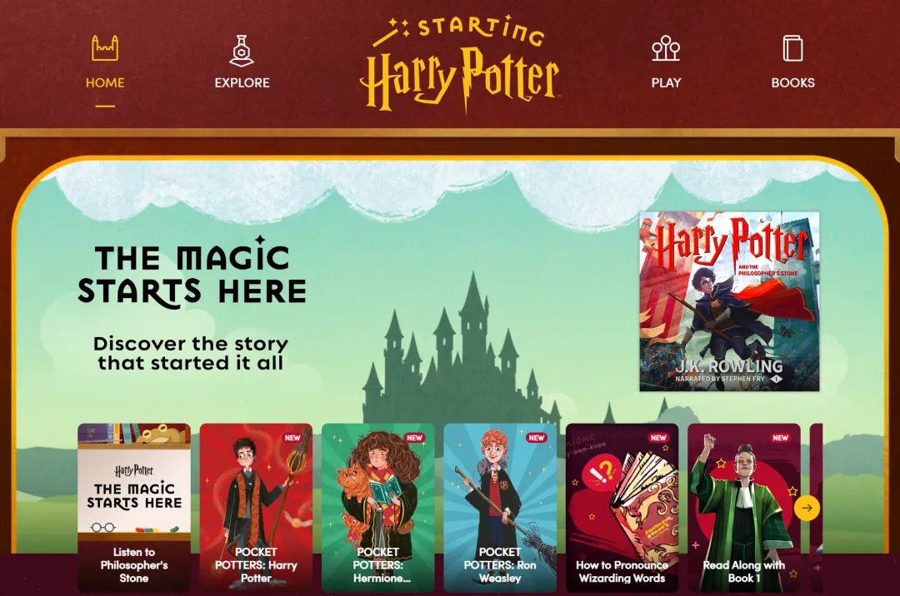
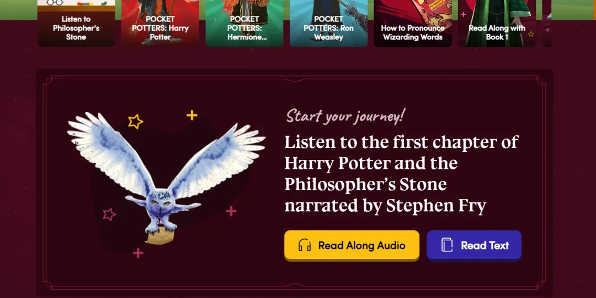
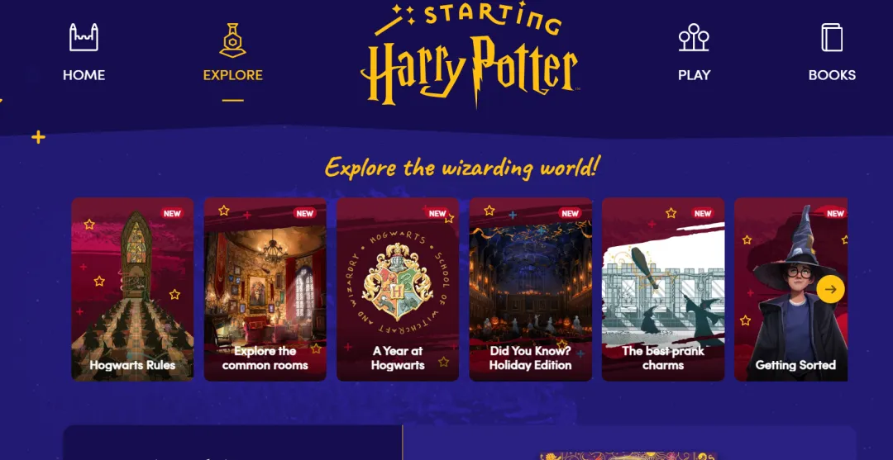
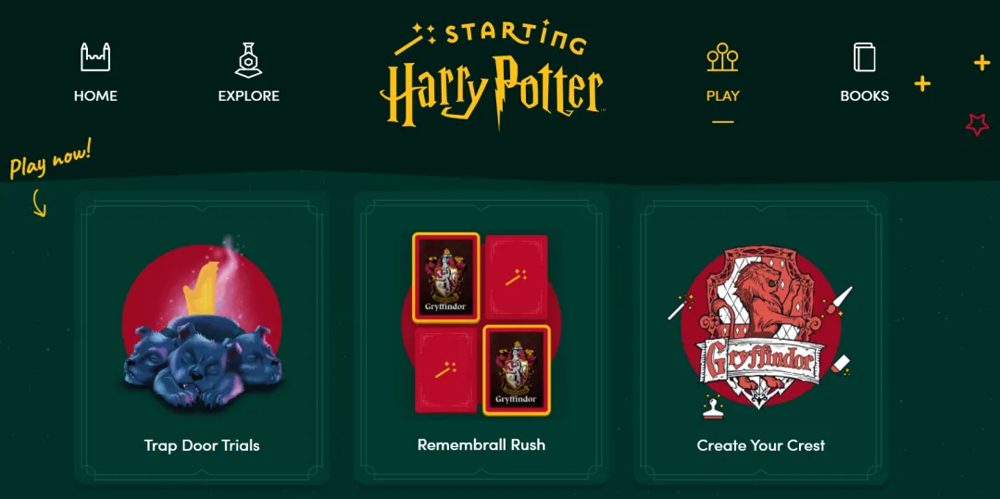
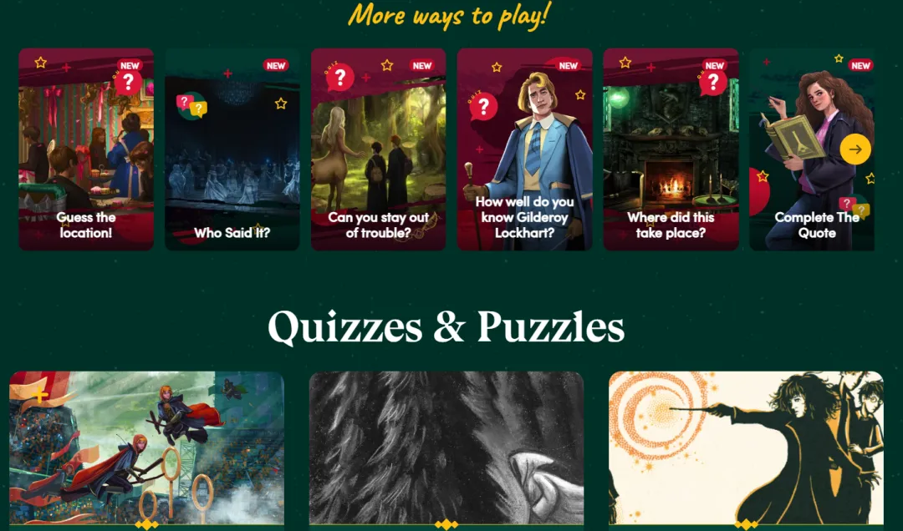
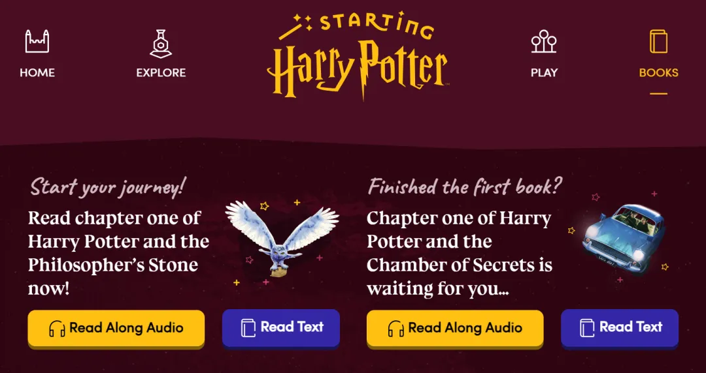

# 哈利波特官方免费网站，英语学习的绝佳神器！
> 💡 备注属性未写入，可能是备注属性名称或者类型被修改了，建议将字段类型设置为 rich_text，可以在小程序-操作-修改文章数据库页面进行调整
> 原文链接:[https://mp.weixin.qq.com/s/544o4vHyNIB_uJVXZqeqRQ](https://mp.weixin.qq.com/s/544o4vHyNIB_uJVXZqeqRQ)
很多孩子把哈利波特中文版翻到书角都卷了边，电影台词张口就来，可一拿起英文原版，第一页就卡住。
不是不喜欢，是生词太多、长句读不顺，硬读只会把人劝退。
想让喜欢哈利波特的孩子顺利过渡英文原版，死啃书本效果很差。
今天分享的 Starting Harry Potter，**是官方 Pottermore 出品的免费学习网站**，全程没有广告，注册简单，专门给母语不是英语的孩子设计，把原版阅读变成有意思的魔法闯关。

**整个网站分成四大板块，分工清晰，孩子可以自主探索。**
**一、Home 板块里有大量原汁原味的英音短视频和音频。**
不用逼着孩子坐下来听写背诵，平时休闲的时候循环播放就行。
长期浸泡，孩子慢慢熟悉英文的语速和语调，语感不知不觉就培养起来，也更愿意开口说。

**二、Explore 板块就是专属魔法知识库。**
魁地奇、麻瓜这类原著独有的词汇，普通字典很难查到。
这里用图片搭配简单英文讲解人物、魔法生物和道具。孩子阅读遇到障碍，来这里看一看，习惯用英文理解内容，不用频繁中断阅读去查词。

**三、Play 板块替代枯燥的阅读理解。**
读完一部分内容，不用安排习题，直接来这里玩英文小问答、字谜小游戏。
答题就像闯关，答对会有魔法特效奖励，孩子在玩耍中巩固刚学到的内容，不会觉得是在学习。

**四、最重要的是 Books 板块，也是原版阅读的核心区。**
官方把七本书拆解好，有无剧透简介、原文节选，还有优质原版有声书。
孩子读文字觉得吃力，可以一边听朗读一边看文字，感受不同角色说话的语气，听力和阅读一起提升。

给大家一个实用小技巧，入门优先选魔法石，难度最低，很适合起步。
阅读时不用遇到生词就停下来查，只要不影响看懂故事，就试着猜意思，保持阅读流畅感更重要。
别再让英文版哈利波特静静躺在书架上积灰啦~
有这个官方宝藏站点当向导，不用艰难硬啃。
跟着那句熟悉的开篇，带着热爱魔法的小朋友，慢慢解锁原汁原味的霍格沃茨，让英语不再是通往魔法世界的阻碍。
**喜欢的话，请点赞分享吧~**
