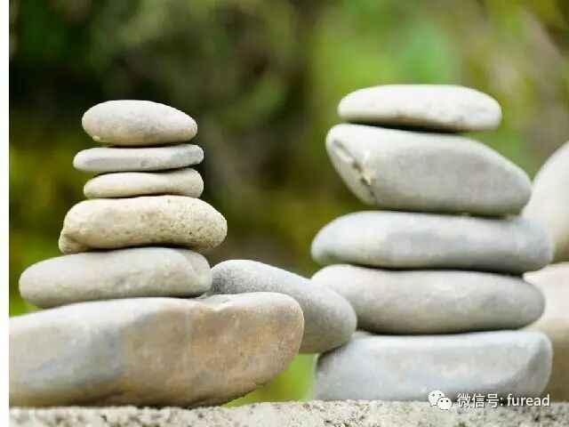

# 哲学家普遍长寿，有什么秘诀？
> 💡 备注属性未写入，可能是备注属性名称或者类型被修改了，建议将字段类型设置为 rich_text，可以在小程序-操作-修改文章数据库页面进行调整
> 💡 原文链接:[https://mp.weixin.qq.com/s?__biz=MjM5OTg0OTcyMQ==&mid=2652449157&idx=2&sn=fd35ea9f25a8a0c1ad480ad57d3ab9b9&chksm=bd9e6dd7e550ed9cfadc99aa67d5b2ddf27f49f9df2ce991795705088e1aa6e74e2df5b29b69#rd](https://mp.weixin.qq.com/s?__biz=MjM5OTg0OTcyMQ%3D%3D&mid=2652449157&idx=2&sn=fd35ea9f25a8a0c1ad480ad57d3ab9b9&chksm=bd9e6dd7e550ed9cfadc99aa67d5b2ddf27f49f9df2ce991795705088e1aa6e74e2df5b29b69#rd)
无论是在中国还是世界，哲学家的长寿一直是人们津津乐道的一个话题，90多岁都非常常见。这一奇观背后，究竟藏着怎样的奥秘？
北大哲学系楼宇烈教授在《文明之旅》节目中谈到，自己虽然年近80岁，但在北大哲学系不敢称老人，因为北大哲学系被公认为“长寿系”。
北大哲学系包括在世的教授，90岁以上的有十余人，冯友兰、梁漱溟、张岱年等都是90多岁的高寿哲人，85岁以上的人更比比皆是，有22人，占有成就的北大哲学系教授近半数。“所谓‘仁者寿’，研究哲学的人明白事理，不斤斤计较，达观所以长寿。”
**秘诀1：不刻意养生**
冯友兰、梁漱溟不怎么运动
谈到哲学家的长寿秘诀，李中华说，冯友兰、梁漱溟、张岱年他们最大的一条就是，平时的生活比较平淡自然，没有刻意养生。“年龄并不是他所追求的，他追求的是安身立命，能够把自己的生命和从事的事业结合在一起，保持非常平和的心态。他们平时生活也很朴素，没有那么多生活上的特殊要求。”
李中华说，他们不怎么“养生”，像冯友兰、梁漱溟先生就不怎么运动。吃的也是很普通，不是什么山珍海味。他说：“他们生活都非常简单，周辅成先生活到98岁，他真的很简单，没有过多欲望、要求。他认为，吃饱了能工作就是最大的福气。 
**秘诀2：心中无块垒**
张岱年历经挫折但一直乐观
“周辅成先生非常平和宽容，对我们这些后辈的年轻人都非常扶持，鼓励后进，待人接物都是很宽厚的长者风度。”李中华说，“我想长寿的秘诀就是儒家所讲的‘以德养寿’，‘仰不愧于天，俯不怍于人’。孟子活到83岁，在古代算是很高寿的，儒家的养生突出‘德’，不做亏心事。”北大哲学系主任王博教授说，哲学系教授长寿是毫无疑问的事实，哲学家长寿可能跟哲学系学科本身的特点有关系，因为哲学是对世界，对生命的一种理解，这种理解很容易让人有一个比较开阔的心灵。
张岱年先生活到95岁，经历那么多的挫折，一直很达观，说起来是6个字“坦荡荡，看得开”。“一个人如果坦荡荡地话，他就会胸中磊落，这样的话他就没有太多的愧疚，他的心态就会变得和乐，看得开。一个人如果能看得开的话，他的胸中就没有垒块，我们经常讲郁闷，郁闷就是胸中垒块。” 
**秘诀3：把事业当生命**
冯友兰最后十年重写七本书
北大哲学系教授李中华认为，哲人高寿还在于他们把自己的生命融到工作当中，他们去世前还在动脑子，思考问题，“不知老之将至”。“张岱年在晚年时，工作起来没有那么有精力，他就觉得不舒服了。这些老先生都是以学术、事业作为生活的主要部分，安身立命。他们离不开工作，把事业当生命，活着就是在创作，不想享乐。
冯友兰先生也非常感人，他创造了世界学术史上一个奇迹，从85岁到95岁，他重新写了七本书，这七本书加起来应该有200万字。第七卷是在他95岁去世前三个月完成的，完成他就放心了，如果没有完成他还会挺着。”“梁漱溟先生上世纪50年代初以后，就不能公开讲话，也不能发表文章，拮据了几十年，但是他还是那么长寿。”李中华说，哲学与智慧相关，不是纯知识的追求，智慧本身总是能让人遇到挫折想得开一些。“挫折是对人最大的考验，有的人却经不起挫折。我们要不以荣辱为念，摆脱名誉、地位对自己思想、精神的束缚。” 
**秘诀4：环境**
远离政治争斗有益养生
李中华说，老先生们的长寿还与北大的环境有关，如果一个环境矛盾百出，钩心斗角，每个人都不愉快，置身其中是很难高寿的。环境是人创造的，反过来环境对人的影响也很大，创造一个和谐的环境非常重要。他说，现在有些人把个人利益看得太重，包括有的人说话尖酸刻薄，火气很大，都不利于自己养生。不发火不代表没有原则，还是有是非善恶。“学术界的人只要远离政治争斗，将书本作为自己的终生伙伴，对养生有非常大的好处。”他说。 

“启示世人”
1、做事恰如其分、不要强拼
楼宇烈自称是不戴假牙的“无齿之徒”，他特别强调做事情要“恰如其分”。他认为，人来到这个世界时是没有牙的，“回去”的时候也应该没有牙。他说，人要自然地生存最好，年纪大了，更要克制自己的饮食欲望。“前人告诉我们，不要用你的胃去磨那些硬的食物，不要用你的胃去暖那些冷的食物。
现实中我们经常强调不要过咸，其实太辣、太甜都是危害身体的，我们要去掉偏食、偏味。”对于都市白领在各种压力下身体透支，楼宇烈说：“说句不客气的话，很多白领身体亚健康，都是自找的。人的一生不要想着没有遗憾，总会有遗憾的，不要强拼，不要放不下。事情是做不完的，过过慢生活，很多事情自己完全可以掌控。”
他认为，我们现在难以做到“日出而作，日落而息”，但是也需要保证睡眠，而且最好有规律。不要让自己过分劳累，要有劳有逸。要打开心扉，参加各种社会活动，让生活充满艺术色彩，喜欢唱歌就唱歌，喜欢跳舞就跳舞……喜静的人可以写字画画，以此来凝神。“歌舞宣泄，书画凝神”，能够动静结合是最好的。
楼宇烈说，中国哲学比较强调平和中庸，做事情不要绝对化，正如孔子所说“乐而不淫，哀而不伤”，否则就会伤害自己。中国哲学相对来讲能够把人生看得透彻一点，把生死看得淡一些。“当然，也不一定适应于每个人，如果勉强去做，变相地克制自己，也不见得就好。人的欲望不是要克制，而是要节制。”他说，学哲学，要进得去，还要出得来。如果研究哲学，却被其中的理念束缚住了出不来，那就适得其反。所以，学哲学的人有长寿，有短寿，也有精神失常的，不能一概而论。 
2、保持心态年轻
近年80岁的楼教授仍在授课，他说：“讲课对我不是负担，要做自己能够做的。老年人要认识到自己身体上的老化，也要保持心态上的年轻。自己能够做的事情尽量自己去做，让自己觉得还是一个有用的人，而不是一个一切需要靠别人的人，心态也就不一样。”
楼宇烈说，心病是有情感的人生的，要以情来治情，服无方之药，即圣人的言语。对于普通老百姓，不一定要读多么深奥的哲理书，多读一些通俗易懂的民间谚语也无不可，比如“平常不做亏心事，半夜不怕鬼敲门”。心安然，生活也就很坦然。
“现在因情绪而引起的疾病越来越多，大喜、大怒、大忧、大恐、大哀都会影响我们的健康。”楼宇烈引用明末清初哲学家王夫之的“六然四看”养生方法：“自处超然，处人蔼然，无事澄然，处事断然，得意淡然，失意泰然”，“大事难事看担当，逆境顺境看襟怀，临喜临怒看涵养，群行群止看识见”。
他说，可能研究哲学的人能够明白事理，知道如何调节、控制自己的欲望，这大概是哲理养生的功效。所以心智的成熟很重要，我们要过平静、有意义的生活，并非刻意拉长寿命，而是尽享天命，寿终正寝。自然地度过自己的生命，不因遇到难事而纠结，保持心态平和的状态。 
3、小亏要常吃，为名利绞尽脑汁有损健康
如今年近70岁的李中华教授退而不休，每天依然工作十几个小时，并参与《儒藏》的编纂。“我受这些老先生影响，不看重名利。有的人会因为文章署名打得不可开交，为了稿费而折腾不已，心中芥蒂太多，放不下。人生都是小事，这些小事都要计较的话，就非常影响人的精神。”他说，“我的体会就是这样，我平时对吃点小亏是毫不在乎。小亏要经常吃，不要斤斤计较。”
对于哲人不刻意养生这一点，李中华说，现在有些人刻意养生，什么都不闻不问，麻木了。“儒家不是这样的，论语说‘仁者乐山，智者乐水’，‘仁者寿，智者乐’。不要带着功利的心态去做事。境界、道德素养对一个人的生命还是有相当大的影响。”
李中华说，人的生命要顺应自然，不能背逆自然。《列子》中说：“不逆命，何羡寿？”刻意去追求寿、名、位、利，对思想反而产生束缚，也就不能逍遥。“当然，在我们的现实生活中，不可能完全摆脱现实去逍遥，但是心态上可以是放松的。平时不感到有什么苦恼，不要让那些小事情影响自己。有的人为了名利绞尽脑汁，对身体特别不好。”
“中国哲学强调的就是人生。哲理可以养生，但是不能分裂了，仅仅当成知识。”李中华说，中国哲学实际上是要解决人生问题，不像西方哲学那样语言分析、逻辑分析，中国哲学重视中庸，不能当成纯知识，而是当成智慧去学习。

## 摘要

（待补充）

## 我的笔记

（待补充）
