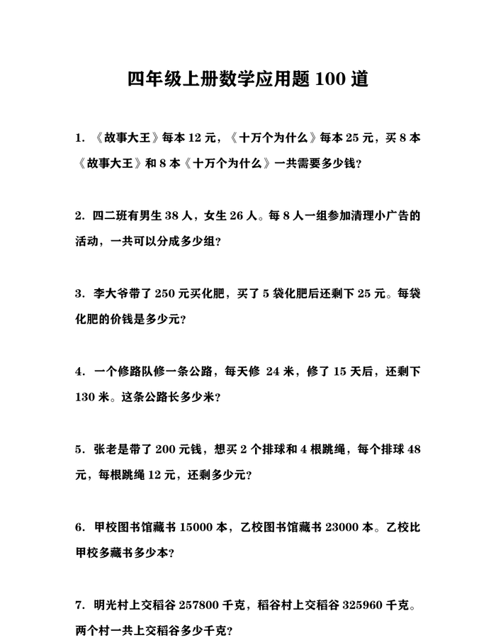
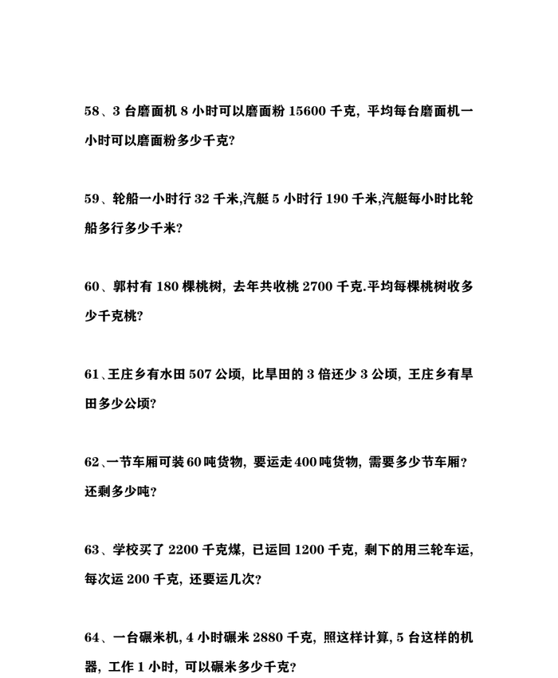

# 四年级上册数学应用题100道：四类模型讲透
> 💡 备注属性未写入，可能是备注属性名称或者类型被修改了，建议将字段类型设置为 rich_text，可以在小程序-操作-修改文章数据库页面进行调整
> 💡 原文链接:[https://mp.weixin.qq.com/s?__biz=MzU2NDk4MTM1Ng==&mid=2247484192&idx=1&sn=a65615332896791bb0b77382a1c1bab0&chksm=fd91beb857bbca450f38bcfb76486b6ef172e362227a9044d625db5004ba1571c1186a6f4934#rd](https://mp.weixin.qq.com/s?__biz=MzU2NDk4MTM1Ng%3D%3D&mid=2247484192&idx=1&sn=a65615332896791bb0b77382a1c1bab0&chksm=fd91beb857bbca450f38bcfb76486b6ef172e362227a9044d625db5004ba1571c1186a6f4934#rd)
「应用题读得懂却列不出式？先把数量关系搭牢。」应用题丢分的孩子，多数不是不会算——数除不错，式子也列得对，问题出在读题那一步：没把数量关系从一堆文字里拎出来。
四年级上册正好是数量关系的集中营，总价、路程、平均数、倍数轮着考。这篇把四上应用题拆成四类模型，每类挑一道原题拆步讲，孩子下次拿到题，先认类型、再套方法：四大模型 · 100 道专项 · 一天一类，先搭架子、逐类拆题一题一法、盯住四个高频失分点，家长辅导三步就够。
01
**Base**
#### 先搭架子：四把钥匙开四类锁
四上的应用题看着五花八门，其实数量关系就四条。做题先判断：这道题在算钱、算份数、算路程，还是算平均？对上号，式子就有了方向：
**
购物类：总价＝单价×数量**
两样东西各买几件，分开算再合，能凑整就先合单价再乘。对应新教材的「乘法模型」
**
归一归总类：先抓「单一量」**
每份数×份数＝总量
**
行程类：路程＝速度×时间**
平均速度＝总路程÷总时间。不是两个速度相加除二
**
平均数与倍数：平均数＝总数量÷总份数；倍数问题先画线段图找「1 份」**
见倍就画图，先定一份
**「四把钥匙：单价×数量、速度×时间、单一量、找「1 份」。」**
02
**Steps**
#### 逐类拆题：一道题讲透一类
**
购物类：分开算再合，凑整就走分配律**
《故事大王》每本12元买8本，《十万个为什么》每本25元买8本：12×8＋25×8＝96＋200＝296元；也可(12＋25)×8＝296元，两样各8本，先合单价更省口算
**
归一归总：先求单一量，再乘再除**
张师傅5天加工160个零件，照这样加工416个要几天：先算每天160÷5＝32个，再算416÷32＝13天；倒过来只给单一量和总量，就用乘法求总天数
**
行程平均：平均速度看总路程÷总时间**
客车前3时行105千米、后2时行80千米：(105＋80)÷(3＋2)＝37千米/时；常见错法是(105÷3＋80÷2)÷2，两段速度加权不同，不能直接平均
**
平均数倍数：先求总数，见倍先找1份**
五科成绩88、96、94、90、82分：(88＋96＋94＋90＋82)÷5＝90分；男工489人、女工是男工的4倍：女工比男工多489×(4−1)＝1467人，多的是3份不是4份
四类的共同点：第一步都是把数量关系写出来——谁乘谁、单一量怎么求、总路程是多少。关系式落在纸上，再代数字，既不容易列错，检查时也有据可循。

资料原件 · 购物与总价类题型
**「列式前先把数量关系写在纸上，再代数字。」**
03
**Pitfalls**
#### 四个高频失分点：改一个稳一类
**！踩坑提示**
**✗ 读完就列式**
✓ 先圈出两个条件和一个问题，口头说出数量关系再动笔；关系说不出来，算得再对也是碰运气
**✗ 有余数不回看实际**
✓ 400吨货每节车厢装60吨：400÷60＝6节余40吨，剩下40吨也得装走，要7节。租车、装箱、装油这类题，答案要进一
**✗ 平均数当成每人都一样**
✓ 平均身高149厘米不代表每个人都149。比较两组高低用平均数比，别拿最高的一个人下结论
**✗ 「大约」当精确算**
✓ 题目问「大约多少」，把数看成整十整百估算，答案写≈；给出一长串精确数，反而说明没读懂要求

资料原件 · 归一归总类题型
**「失分点逐条对号改：一次只改一个病根，改一个稳一类。」**
04
**Practice**
#### 家长怎么辅导：三步就够
**1**
第一步让孩子复述：这道题讲了一件什么事？已知什么、求什么？复述不出来说明没读懂，别急着列式
**2**
第二步画出来：购物画表格，倍数画线段图，行程画一条线段标两头。数量关系上了图，式子自己长出来
**3**
第三步只点第一步：孩子卡住时问「这道题先算什么」，不代他算完。算错让他自己检查，检查也是能力
**✎ 写在最后**
你家孩子应用题卡在哪一步——读不懂题，还是列不出式？留言区聊聊。
这份《四年级上册数学应用题专项训练100道》完整版已整理好，共 15 页、100 道题，四类数量关系全覆盖，适合打印后每天练 10 道。关注公众号后回复「**四上应用题**」即可领取。

**END**

我是 **知拾点集**，专注分享小初高学习资料与学习方法。
**如果觉得今天这篇有收获，欢迎点赞、在看、转发三连，我们下篇见。**
#四年级数学 #小学数学 #应用题
