# 国产开源软件，登顶全球第一 ！
> 💡 备注属性未写入，可能是备注属性名称或者类型被修改了，建议将字段类型设置为 rich_text，可以在小程序-操作-修改文章数据库页面进行调整
> 💡 原文链接:[https://mp.weixin.qq.com/s?__biz=MzAxOTc0NzExNg==&mid=2665553107&idx=1&sn=f2c046ba5c4946648562b42fc0c7d646&chksm=817e0f6a7c84bb18028204b0d91b482e4eea76c1e4a455a774c72820fd698ae2a3669c5ec7d1#rd](https://mp.weixin.qq.com/s?__biz=MzAxOTc0NzExNg%3D%3D&mid=2665553107&idx=1&sn=f2c046ba5c4946648562b42fc0c7d646&chksm=817e0f6a7c84bb18028204b0d91b482e4eea76c1e4a455a774c72820fd698ae2a3669c5ec7d1#rd)
最近看到一个消息，国产开源软件“雷池”在 GitHub 已经是全球第一了，超越了一众老牌Web应用防火墙。
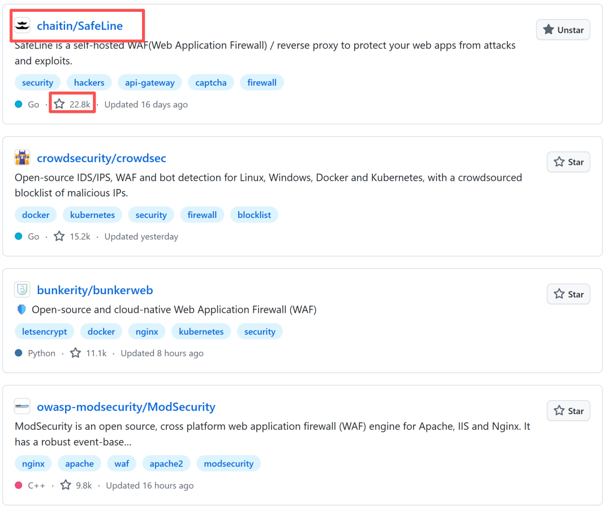
你可能觉得主要是中国人在用，其实不然。
这个软件老外也很喜欢，在没有国际版的时候，老外就顶着Google机翻去看文档，然后提issue，要求提供英文版。
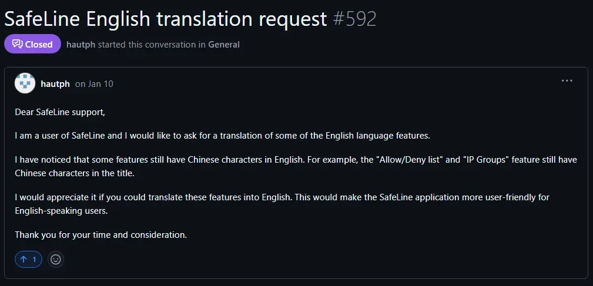
甚至有些老外，历经“历经磨难”注册支付宝来购买产品的Pro版。
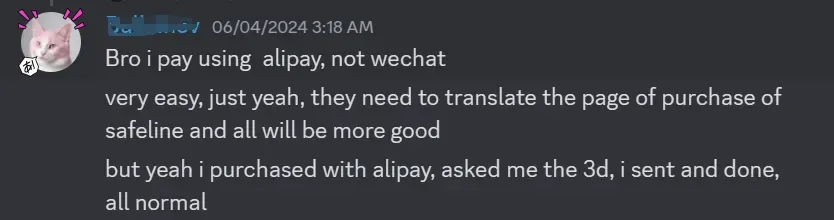
有个德国用户，写了很多篇博客讲解，堪称连续剧，还有个越南大哥，给很多越南的大学都装上了这个软件，流量大到云服务都快扛不住了，以一己之力带动了软件在越南的普及。
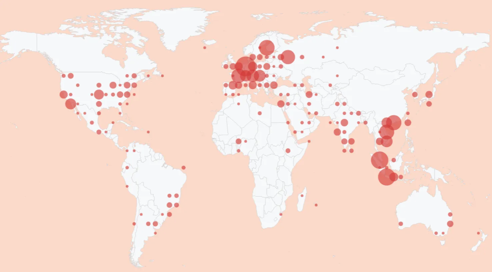
作为一款开源Web应用防火墙，雷池不但能有效防御各类Web攻击，还能提供访问频率限制、人机验证、动态防护等功能。
它的原理很简单：以反向代理方式接入，优先于网站服务器接收流量，对流量中的攻击行为进行检测和清洗，将清洗过后的流量转发给网站服务器。
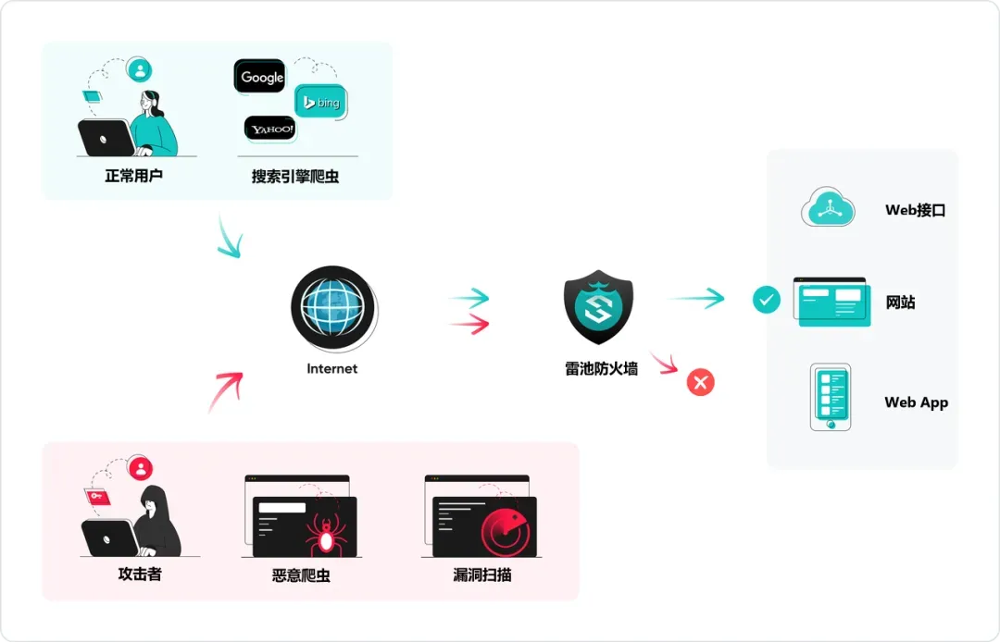
现在雷池的装机量已经达到 73万+， GitHub 22.8K , 发展速度非常迅猛。
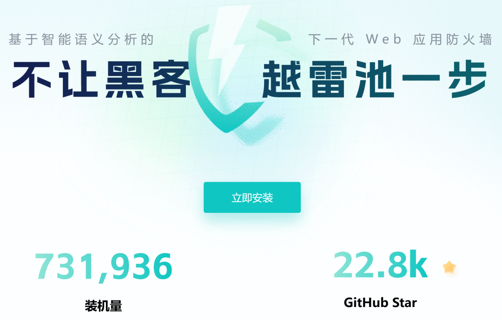
**01**
**轻松安装**
雷池防火墙的安装已经做到了极致，在Linux上，一条命令就够了：
```bash
bash -c "$(curl -fsSLk https://waf-ce.chaitin.cn/release/latest/manager.sh)"
```
安装成功以后，就可以打开浏览器访问雷池控制台：
https://:9443/ 
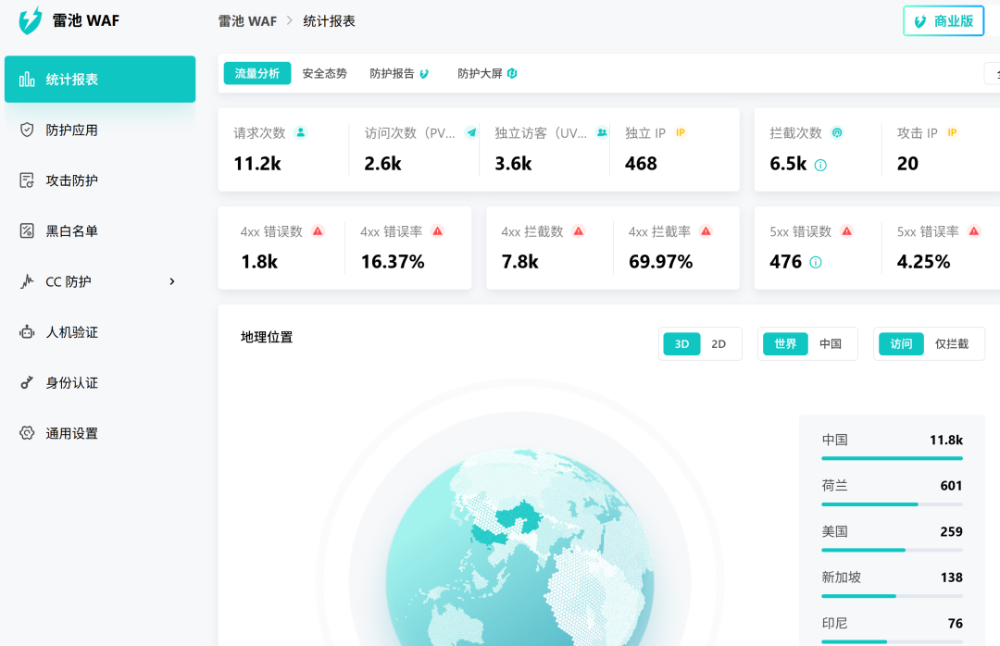
这种便捷的安装方式，可以让中小网站迅速把一张安全网给拉起来，大家非常喜欢。
**02**
**语义分析算法**
Web 应用防火墙，肯定具备对 SQL 注入、XSS、 代码注入、命令注入、CRLF 注入、ldap 注入等各种攻击的防护能力， 这里我就不再展开了。
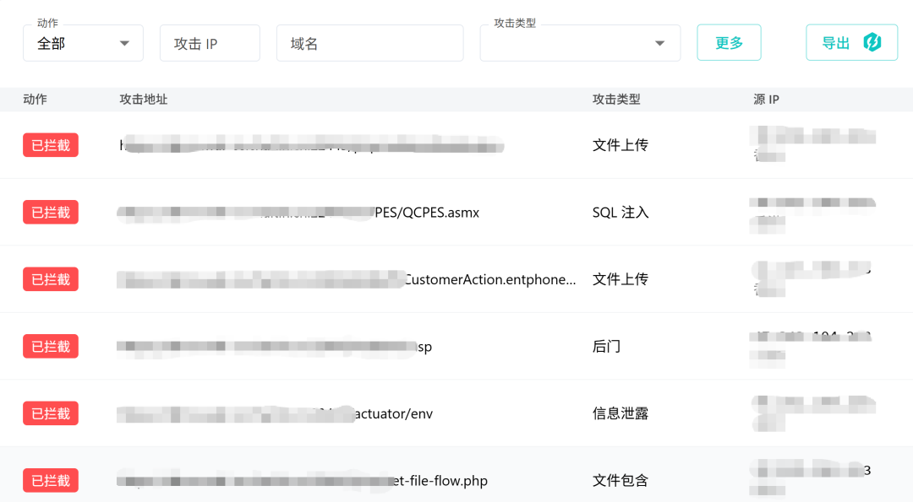
我想重点说说的是雷池的独门绝技：语义分析算法。
雷池使用语义分析算法来分析潜在攻击行为，主要是因为传统WAF使用的正则表达式很容易被黑客绕过。
比如，传统WAF 会定义这么一个规则：union[\w\s]*?select 。 
表示流量中只要包含 union 和 select 这两个单词，就会被认为是 SQL 注入 攻击。
但是，黑客可以在 union 和 select 中间插入了注释字符：union /**/ select ，破坏了关键字特征，那个正则表达式就无法匹配，也就发现不了攻击了。
不仅如此, 正则表达式还会造成大量的误报，影响用户使用，例如这个句子：
The union select members from each department to form a committee.
它也命中了上面的规则，被认为是攻击，但其实就是个普通句子。
雷池的语义分析则会真正理解流量中的用户输入, 深层分析潜在的攻击行为，例如对于SQL 攻击，它会判断流量中是不是存在符合语法的SQL语句，如果有，再看看它有没有恶意，然后再决定是否拦截。
所以雷池内部内置了常用编程语言的编译器，可以对HTTP流量进行解码，按照其语言类型匹配相应语法编译器，进而匹配威胁模型得到威胁评级，阻断或允许访问请求。
这样一来，准确率一下子就上去了，误报率降到了极低的水平。
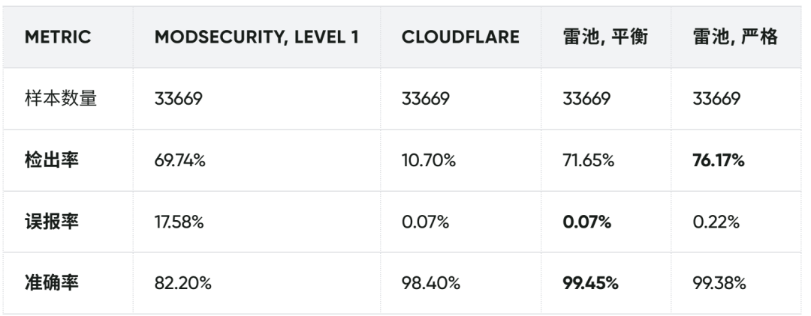
**03**
**CC 防护**
在 Web 世界上，有一种让所有站长都头疼的恶意攻击：CC 攻击（Challenge Collapsar）。
攻击者会操控海量的“肉鸡”（受控计算机）或代理服务器，伪装成真实用户的浏览器，疯狂轰炸网站的首页、搜索框或核心接口。
这些垃圾请求拥有完美的 User-Agent、Referer 和 Cookie，表面上挑不出任何毛病，但由于数量极其庞大，它们会在瞬间榨干服务器资源，导致数据库阻塞、网页卡死，甚至整个服务直接崩溃。
由于请求伪装得天衣无缝，传统的防御手段很难将其精准拦截。
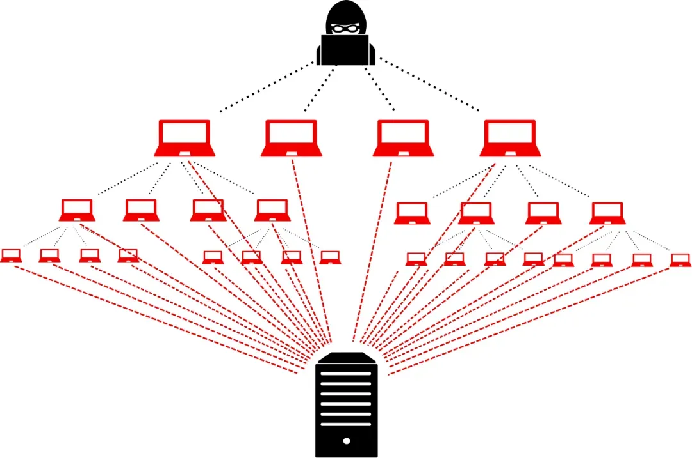
面对这种“合法伪装”的流量洪水，雷池 WAF 提供了强效的“频率限制”功能。
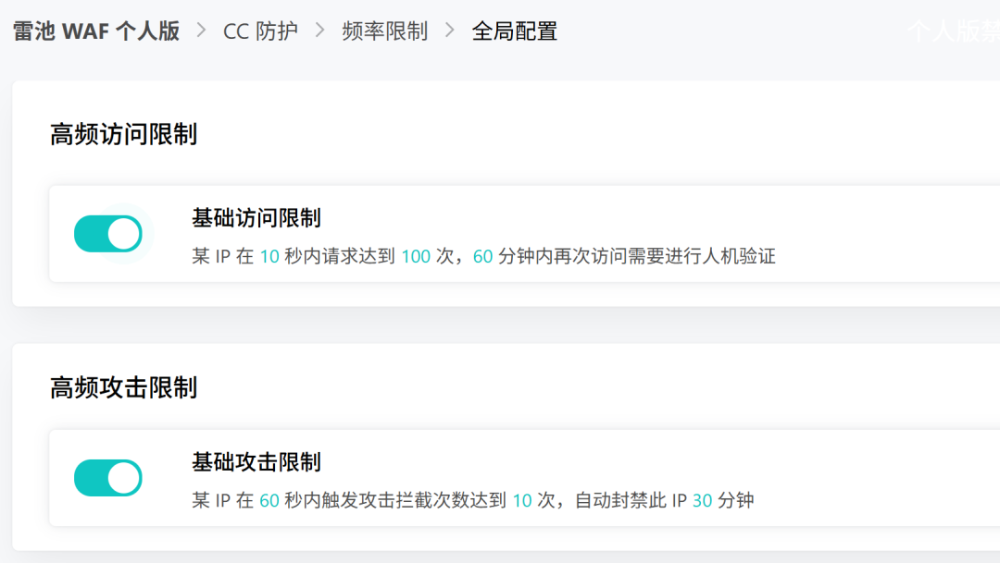
一旦监测到某个 IP 在极短时间内发起了高频 HTTP 请求，雷池就果断阻断它的后续所有访问，并强制弹出人机验证（如验证码）。
只有通过了验证、证明自己是“真人”，才会被允许继续访问。
另外，很多合法的业务场景也会迎来恐怖的“流量海啸”，比如抢票、秒杀促销、或是突发的热点新闻。如果缺乏合理的限流机制，瞬间涌入的海量请求会瞬间冲垮整个系统。
过去，程序员想实现限流，必须深入网站代码底层去一行行修改，不仅开发成本高，还容易引入新的 Bug。
雷池提供了一个“等待室”的功能进行限流排队，例如，一旦配置系统最大在线人数为 100 人，当第 101 位用户发起访问时，雷池会自动将其引导至排队等待页面。
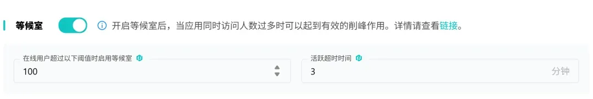
为了保证排队通道的公平与高效，已经进入系统的用户如果超过 3 分钟没有任何网页操作，雷池就会自动将其请出系统。
想要继续使用？对不起，请去等待室重新排队。
**04**
**Bot 防护**
现在的AI爬虫越来越厉害了，有很多爬虫根本不遵守robots.txt协议，让很多网站很苦恼。
雷池提供了一个叫做“人机验证”的功能：
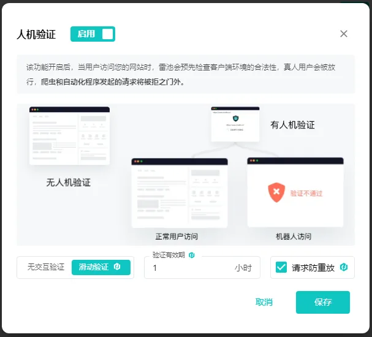
启用后，当有“人”访问网站时，雷池就会检测客户端环境，通过行为特征来判断： 鼠标轨迹、操作节奏、页面交互是否像一个真实的人。
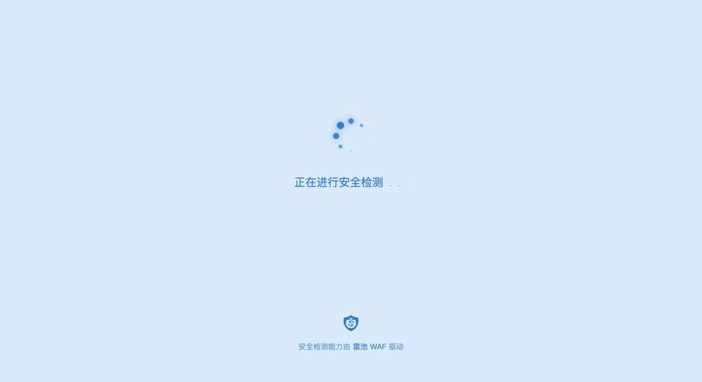
如果是真人就会被放行，否则就可以把他踢出去。
在内容上，雷池也可以对 HTML、JS 进行动态处理，让浏览器每一次访问看到的代码形态都不完全一样。
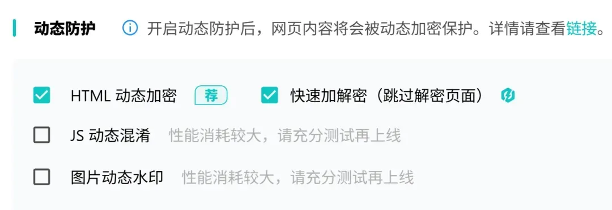
这样一来，爬虫和自动化脚本就很难通过“静态规则”来理解页面结构，也就没法爬内容了。
比如这个HTML代码：
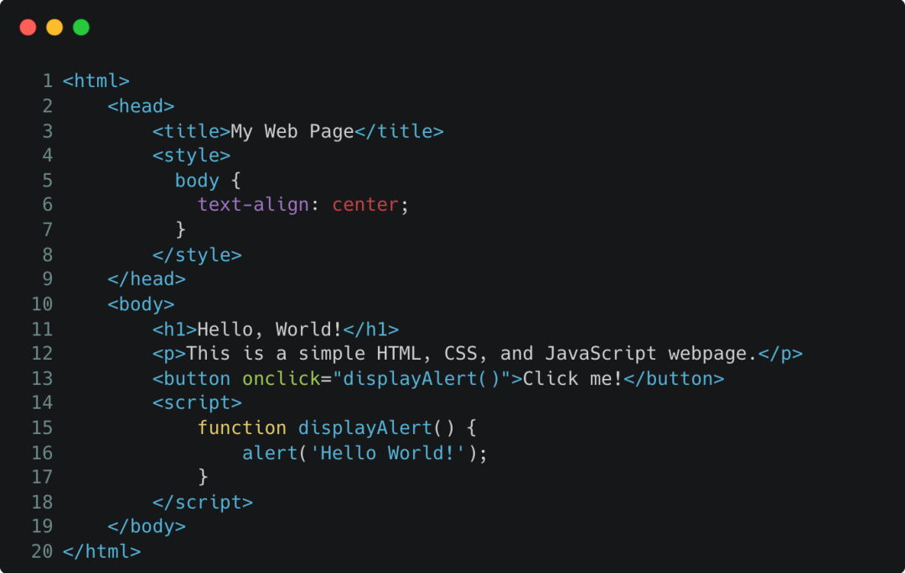
被雷池进行动态加密以后变成了这个样子，很难辨认了。
**05**
**专业版的高级功能**
当站点超过10个，或者有一定业务属性，追求更稳更专业的防护，一般都会升级成专业版，享受更多的增值服务。
比如这个“安全防护监控大屏”，放到公司大屏幕上，抬头就可以看到实时的 Web 攻击，一目了然。
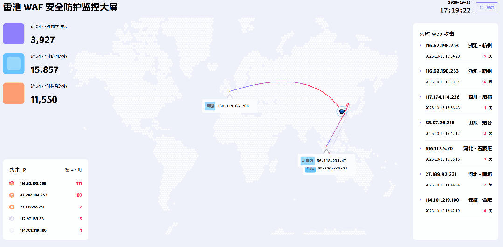
针对某个应用，还可以查看应用防护报告：
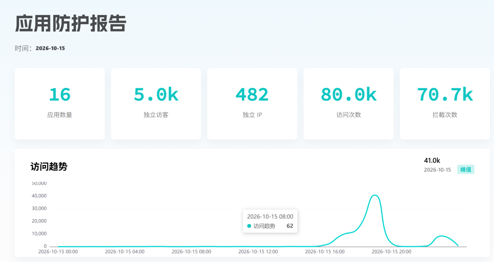
将攻击日志，导出成CSV文件，下载到本地详细分析：
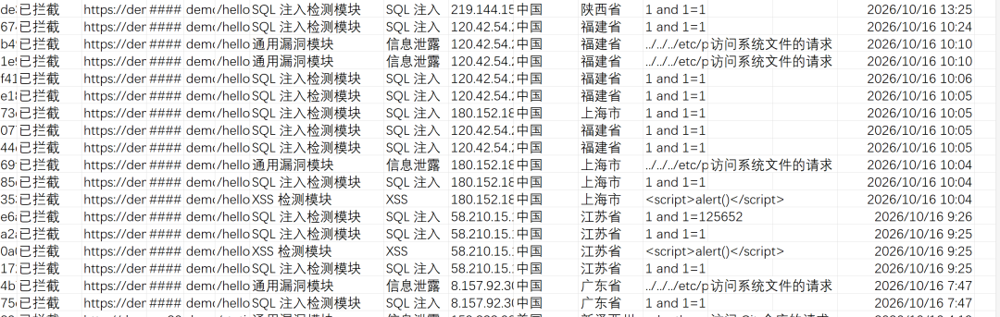
在语义分析的基础上，针对一些特殊的业务漏洞、框架漏洞，还可以进行加强防护，包括shiro 权限绕过、Apache Log4j 远程命令执行漏洞、Java 代码注入、PHP FastCGI 解析漏洞等等。
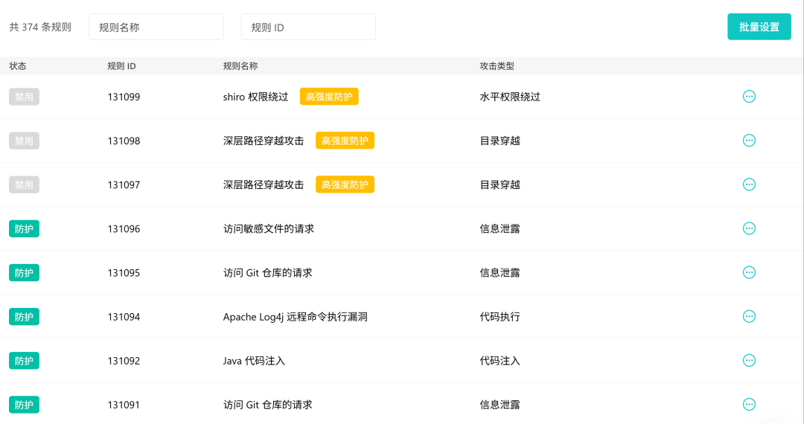
除了这些之外，专业版还支持自定义拦截页面、高级限频配置、基于地理位置的拦截等很有用的功能，绝对物有所值。

**06**
**总结**
雷池能够登顶全球第一，凭借的是扎实的技术能力，它的语义分析算法、Bot防护、CC防护、身份认证等功能，会让你的网站高枕无忧。
如果你也有Web网站要上线，务必要把安全防护做好，强烈建议考虑下雷池这个非常优秀的开源的WAF。
个人站点用雷池个人版就够了，但是个人版难免还是会有不稳定的时候，如果有稳定的用户和业务，为了避免业务损失，最好试试专业版，正好最近专业版也在打折，最高可省3024元！
访问下面链接或者直接点击阅读原文可以直达专业版：
https://waf-ce.chaitin.cn/trial-apply
最后，有什么问题和建议，欢迎大家加群交流：

也欢迎大家到GitHub，给雷池点个小星星，支持下国产的WAF:
https://github.com/chaitin/SafeLine

