# 国家中小学智慧教育平台：个性化教师AI助手，超多AI工具！免费好用！
> 💡 备注属性未写入，可能是备注属性名称或者类型被修改了，建议将字段类型设置为 rich_text，可以在小程序-操作-修改文章数据库页面进行调整
> 💡 原文链接:[https://mp.weixin.qq.com/s?__biz=MzU5NTYzMDk3NQ==&mid=2247486688&idx=1&sn=11156b5d726f6e5ec3f2b606d176f71a&chksm=ff01f8eaecd6100514dfaf08f9f41f91351aa0e86a170801baf1de236e18a4b3f904a647e9f5#rd](https://mp.weixin.qq.com/s?__biz=MzU5NTYzMDk3NQ%3D%3D&mid=2247486688&idx=1&sn=11156b5d726f6e5ec3f2b606d176f71a&chksm=ff01f8eaecd6100514dfaf08f9f41f91351aa0e86a170801baf1de236e18a4b3f904a647e9f5#rd)
 各位老师，国际中小学智慧教育平台上，上线了个性化在线教学服务平台，教师可以在此平台进行备课。下面告诉大家如何进入这个平台进行备课，并使用教师AI助手。
**一、入口**
地址：https://basic.smartedu.cn
在页面的右边栏中，就能看到一个图标。
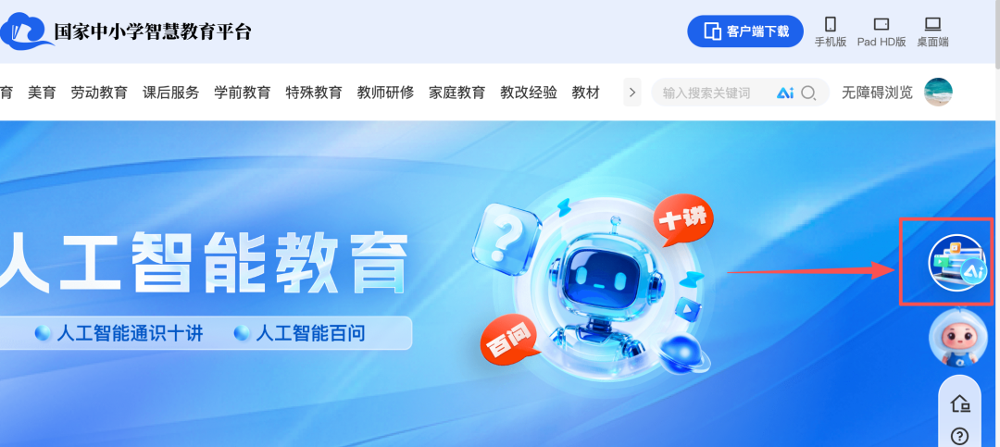
这样就进入了，个性化在线教学服务平台。里面功能非常多，有智能备课、智能出题、教师Ai助手等等。
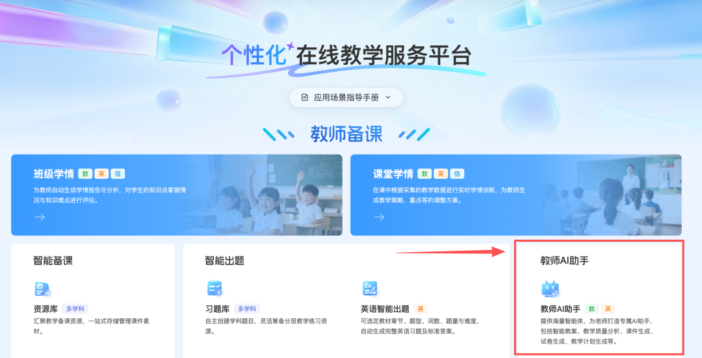
**2.进入教师AI助手**，可以进入“九章爱学”，属于原来的“老师帮”。
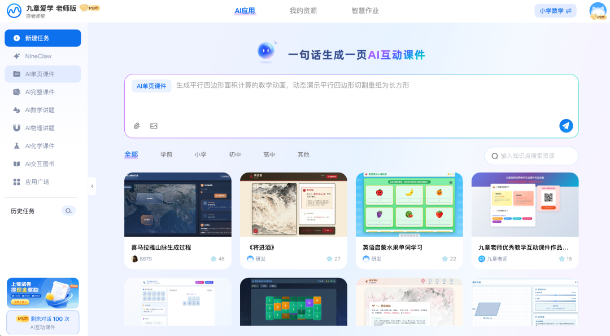
可以制作单页的课件，html格式的。

可以制作完整的课件。

还可以做其他很多的内容，数学讲题、物理讲题、化学课件、Ai交互图书。
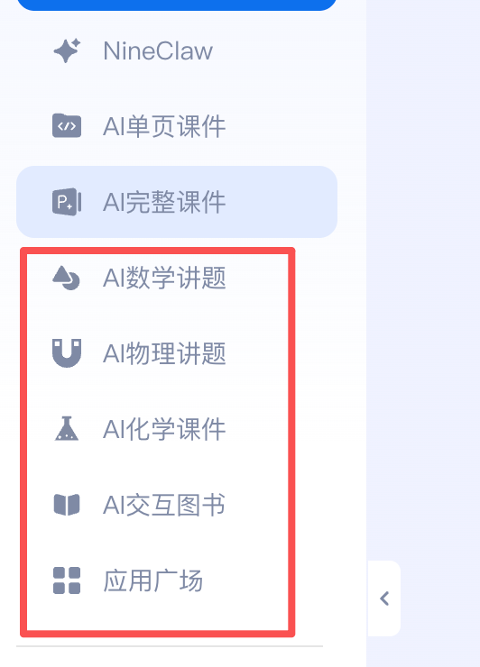
当你通过国家中小学智慧教育平台登录的，就会有**1年的会员赠送**。
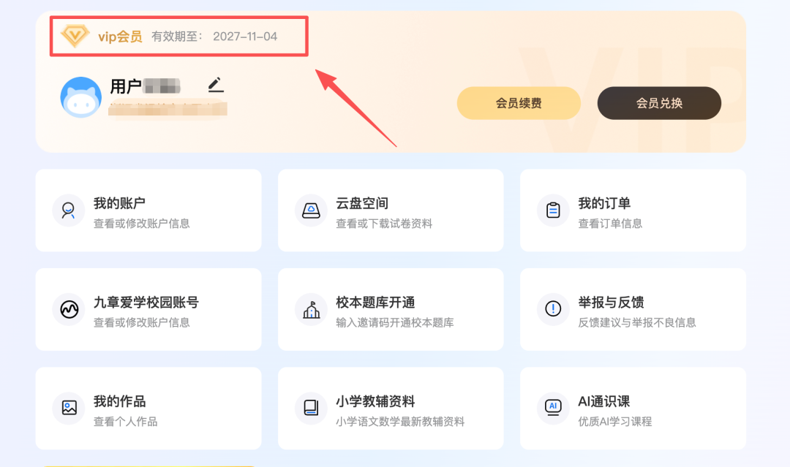
这些功能，大家都可以尝试用一下。
另外还有**一个AI宝藏库：应用广场**。
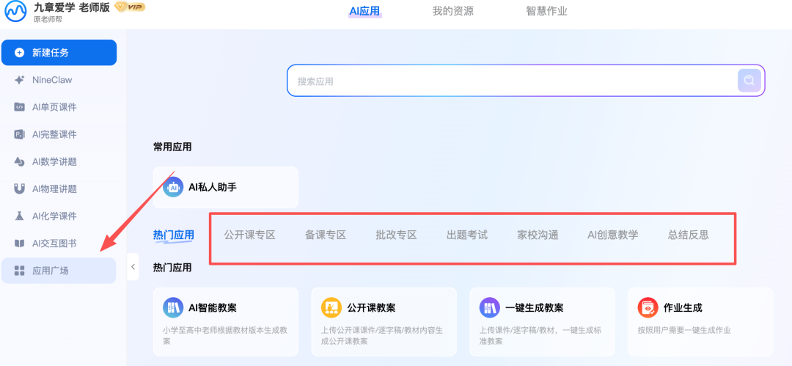
里面有**“公开课专区”、“备课专区”、“批改专区”、“出题考试”、“家校沟通”、Ai创意教学、总结反思。大家可以仔细看看，有没有需要的使用Ai工具。**
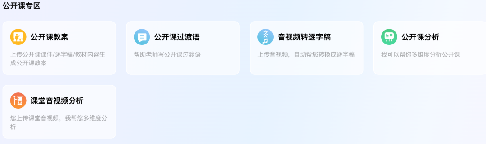
音视频可以转逐字稿，还有课堂音视频分析。
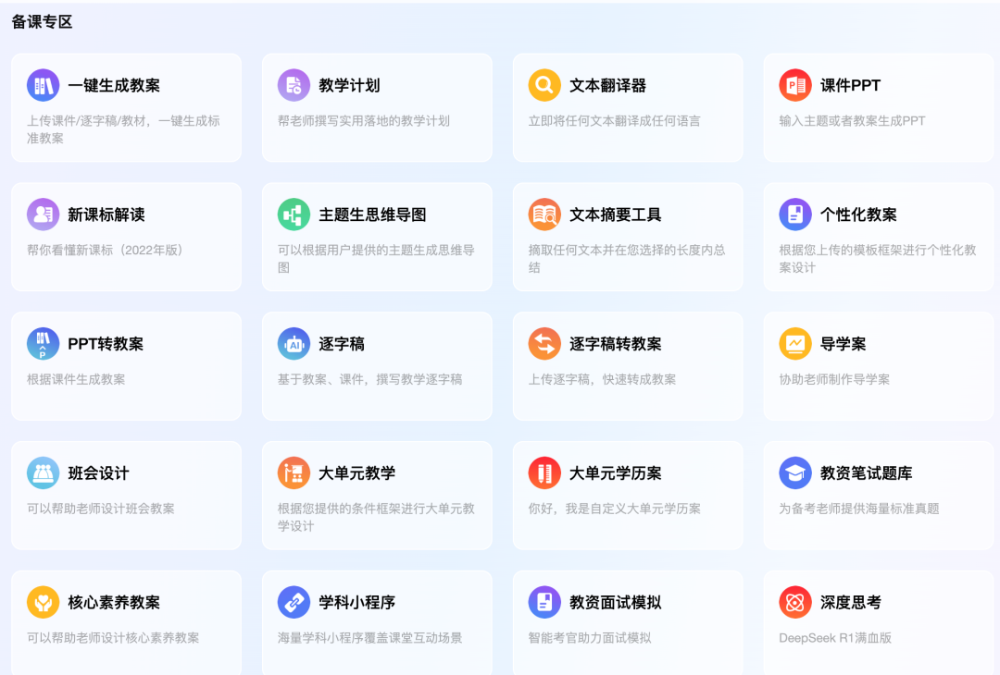
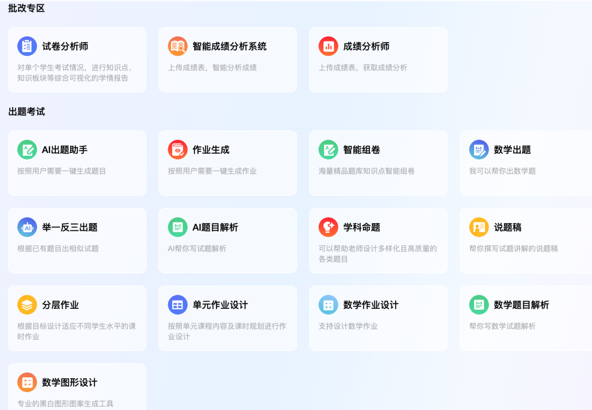
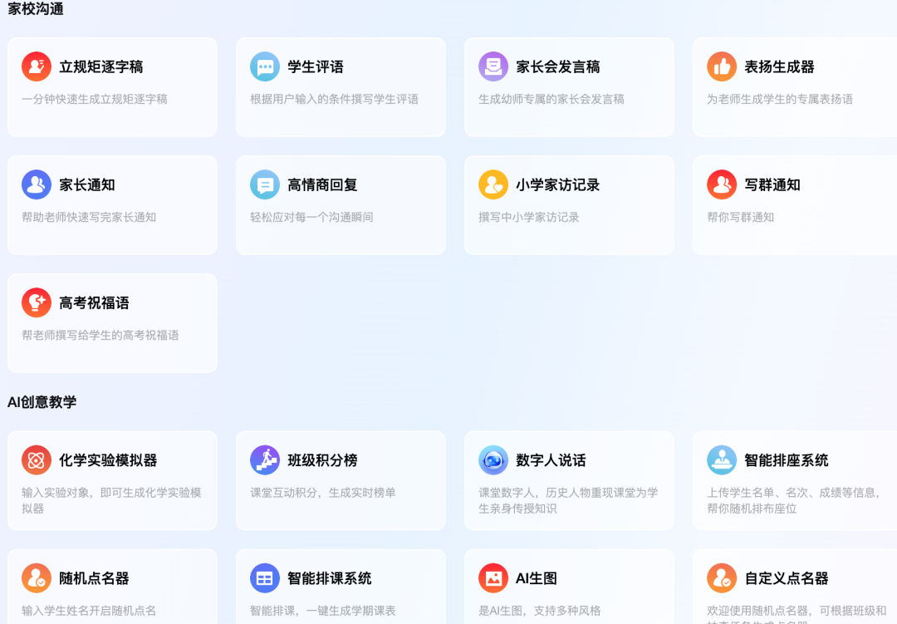
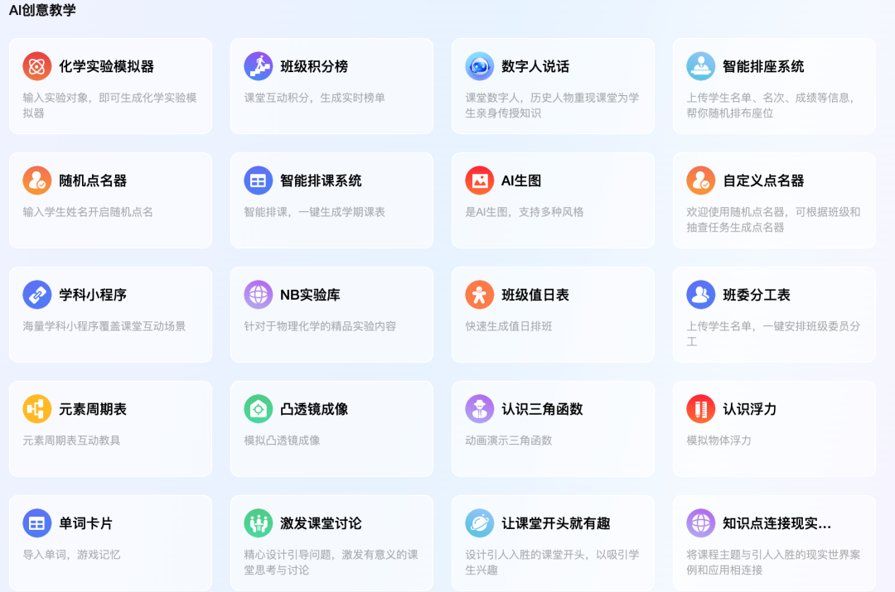
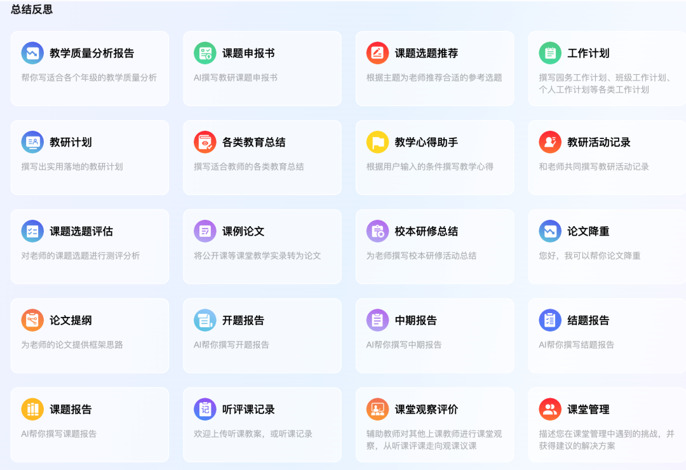
你们看，上面的功能还很齐全哈！
     各位老师，与AI同行，与时代同步。感谢转发、收藏一下，下次能找到这个入口。
