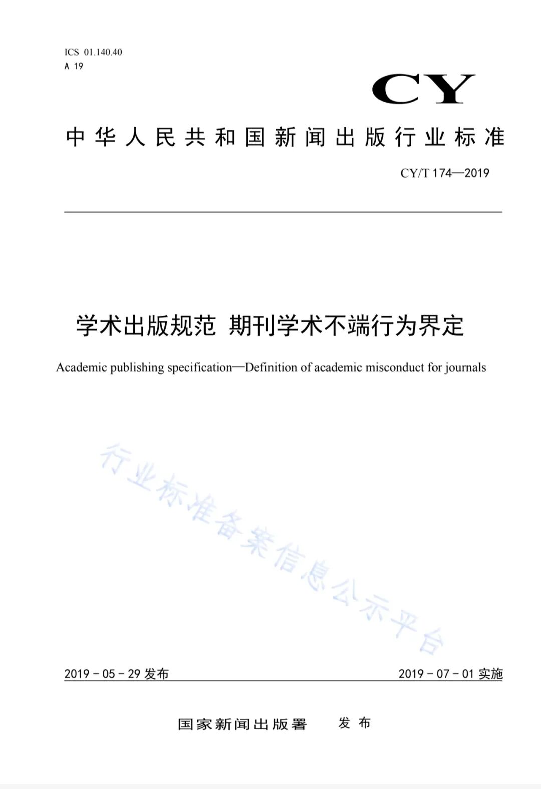
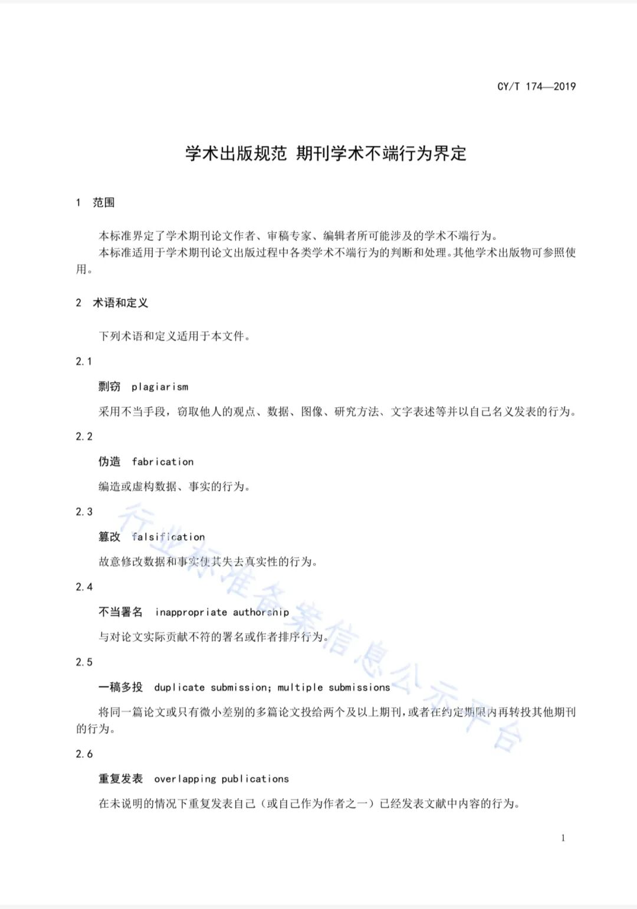
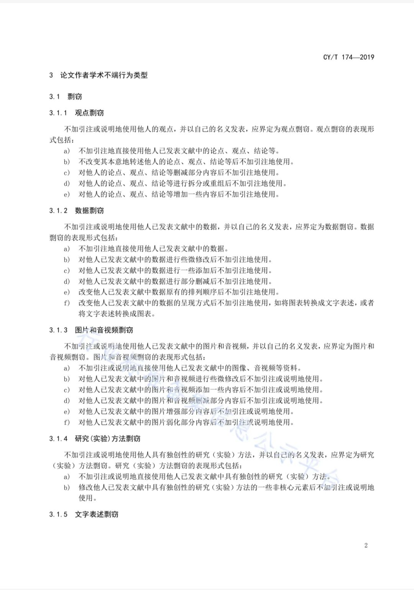
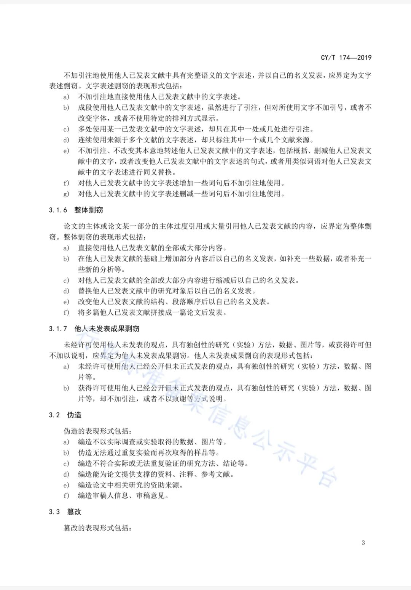
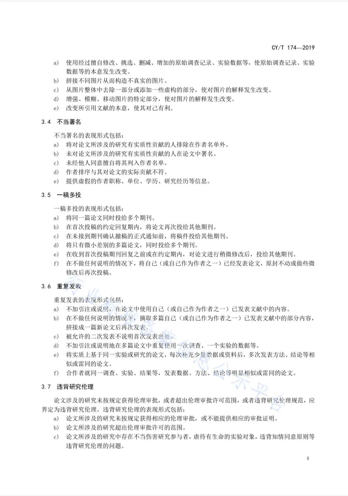
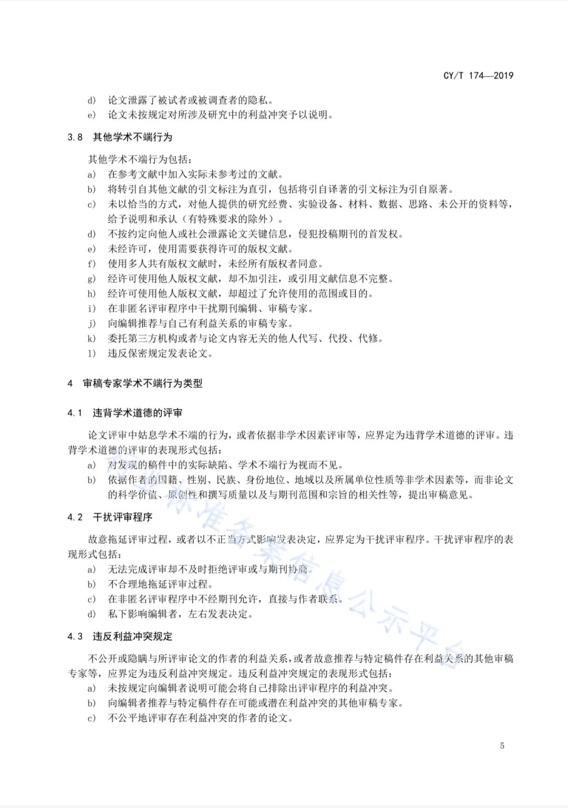
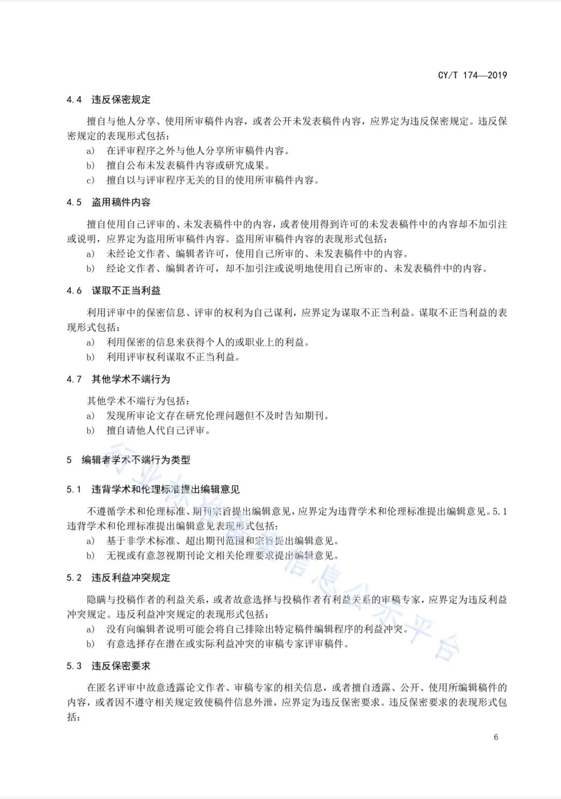
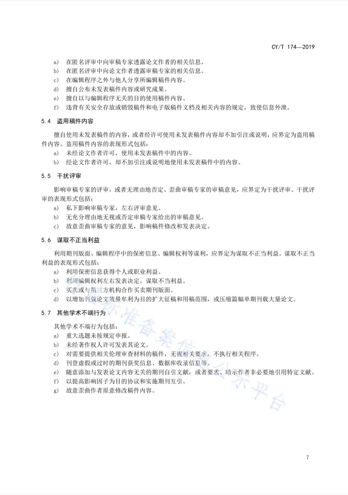

# 国家新闻出版署《学术出版规范 期刊学术不端行为界定》
> 💡 备注属性未写入，可能是备注属性名称或者类型被修改了，建议将字段类型设置为 rich_text，可以在小程序-操作-修改文章数据库页面进行调整
> 💡 原文链接:[https://mp.weixin.qq.com/s?__biz=Mzg2NTY3MzA4OA==&mid=2247484228&idx=1&sn=708481791a04eede06971b872ab782ba&chksm=cfb6f52789a11132f5027ba5927509cd2ad496f80400633ee7f6dc37d53c954348718a2b5f00#rd](https://mp.weixin.qq.com/s?__biz=Mzg2NTY3MzA4OA%3D%3D&mid=2247484228&idx=1&sn=708481791a04eede06971b872ab782ba&chksm=cfb6f52789a11132f5027ba5927509cd2ad496f80400633ee7f6dc37d53c954348718a2b5f00#rd)

## 摘要

（待补充）

## 我的笔记

（待补充）
