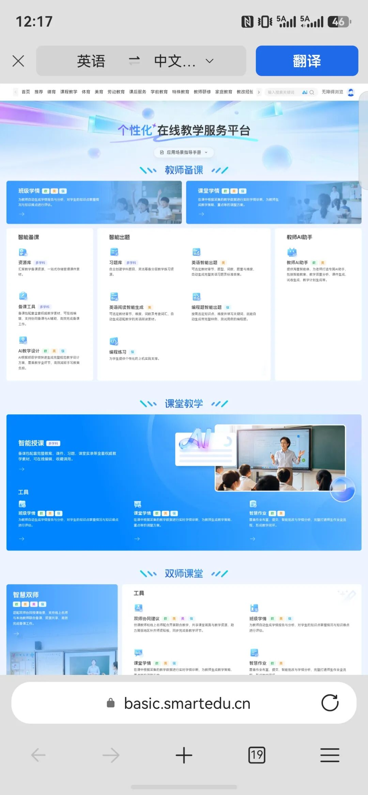
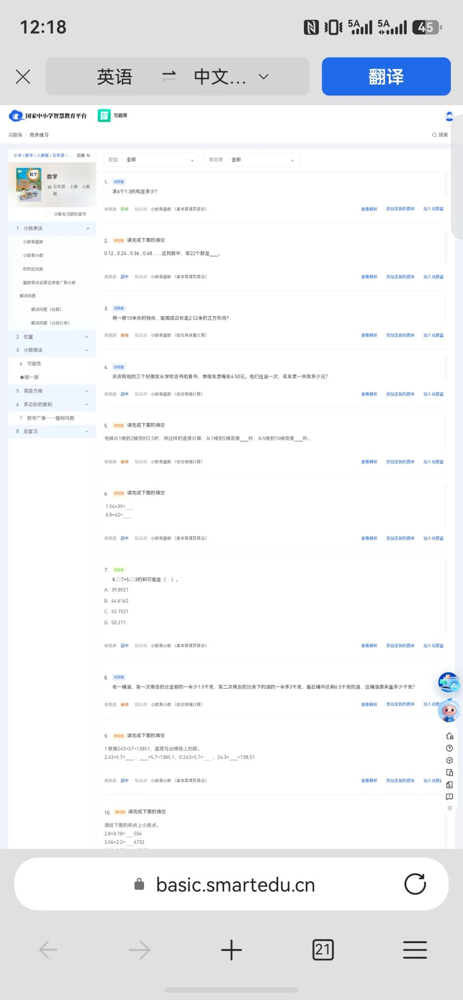
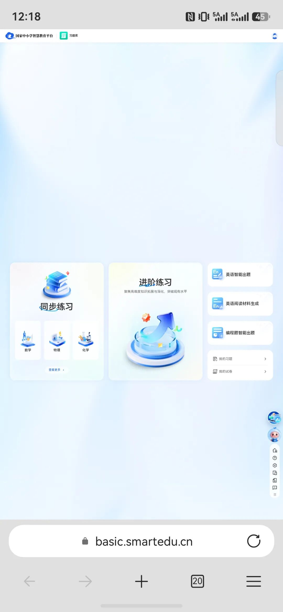
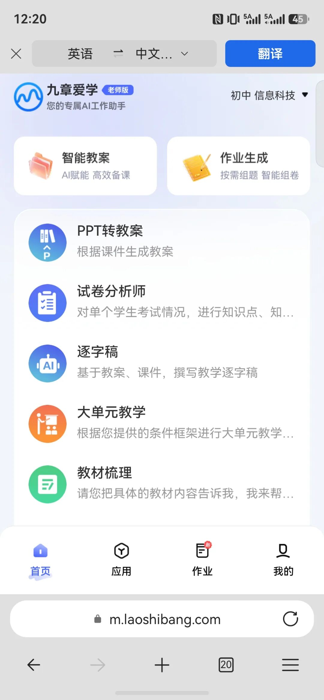
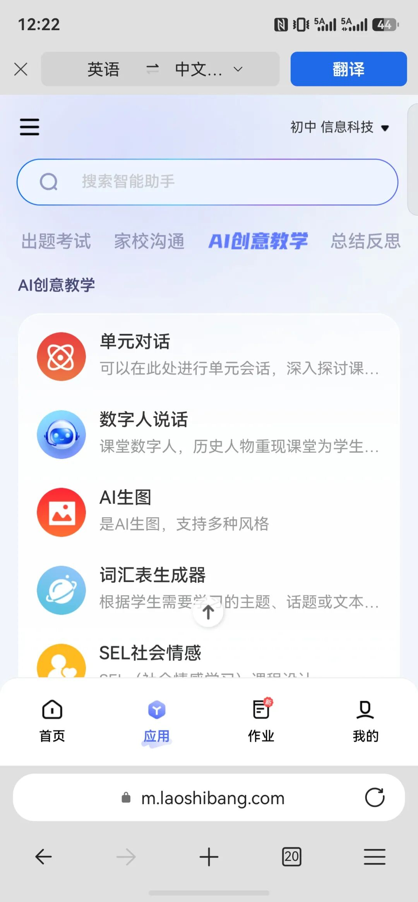

# 国家队下场了：免费、好用、不用折腾的教师AI工具，我替你试完了
> 💡 备注属性未写入，可能是备注属性名称或者类型被修改了，建议将字段类型设置为 rich_text，可以在小程序-操作-修改文章数据库页面进行调整
> 💡 原文链接:[https://mp.weixin.qq.com/s?__biz=MzcwOTQ1Mjc0NA==&mid=2247484952&idx=1&sn=70a48540ec6c92535dbd9ec8a26dfaaa&chksm=f44d52c475cc6b29d315e77eece272926fe0374002346eb847c84d8f6940aa8ff76ef111b8fc#rd](https://mp.weixin.qq.com/s?__biz=MzcwOTQ1Mjc0NA%3D%3D&mid=2247484952&idx=1&sn=70a48540ec6c92535dbd9ec8a26dfaaa&chksm=f44d52c475cc6b29d315e77eece272926fe0374002346eb847c84d8f6940aa8ff76ef111b8fc#rd)
国家中小学智慧教育平台上的教师AI助手挺好用。我照着给大家点了一遍。
点「教师AI助手」，网址从 basic.smartedu.cn 跳到了 m.laoshibang.com。我愣了一下，还以为点进了什么第三方页面。后来才反应过来，这就是「九章爱学」，原来叫「老师帮」，域名里那串 laoshibang 就是它。官方接进来的，没点错。
01入口到底怎么走
先把路说清楚，免得下次找不到：打开 basic.smartedu.cn 登录，顶部导航点「人工智能教育」，进「个性化在线教学服务平台」，再看「教师备课」。

图1｜从顶部导航进「人工智能教育」专区
里面摆着智能备课、智能出题、教师AI助手三样，往下还有课堂教学、双师课堂和工具。我这次从专区进去，比在页面右边找那个图标顺手。
图2｜

「教师备课」下的备课三件套
02授权那一步，看一眼再点
第一次进九章爱学会弹一个授权：姓名、性别、所属学校、省市区、通行证ID，全选默认勾着，还要同意平台服务协议。不是坑，但值得看一眼再点。
图3

｜首次进入会要这些信息，看清再同意
我把右上角学段学科切成了 「初中 信息科技」，后面生成的东西才对得上我自己的课。
03里面能用的东西
进去之后，首页两个大卡是智能教案、作业生成，往下依次是 PPT转教案、试卷分析师、逐字稿、大单元教学、教材梳理。
图4

｜首页往下，功能比想象中密
底下还有个「应用」页，能搜智能助手，分热门应用、公开课专区、备课专区、批改专区，找具体工具比在首页翻快。
图6

｜按专区挑，比在首页一个个翻省事
04逐字稿那两个框别空着
我试了「逐字稿」。上传教案或课件，pdf、doc、docx、ppt、pptx 都行，单个不超 200M，最多 5 个；再选逐字稿形式、讲授所需时间、年级、学科。把时间填成一节课的 40 分钟，出来的稿子才对得上节奏。
图5

｜必填项里，「讲授所需时间」最容易被忽略
旁边「PPT转教案」是反着来的：课件已经有了，让它补一份教案，里面 「其他要求」 那个框别空着，填具体了才不是通用模板。我教初中信息科技，还兼着劳动课，教材版本不统一的时候，把学情和课时写清楚，出来的东西才不像模板。
它把「对着空白文档发呆」变成了「改一改就能用」，这一步省下来的时间是真的。
说实话，AI 生成的教案和题目我还是要 自己过一遍，数值、答案、知识点都得核。省下来的那一步是真的，剩下的活还是我的。
入口和限制都写在上面了，收藏一下，下次别找不到。
