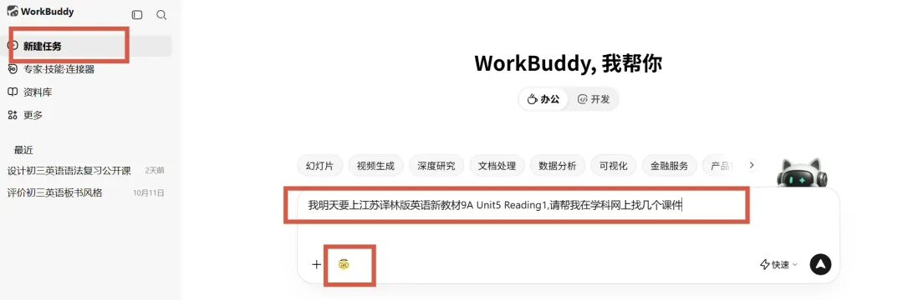
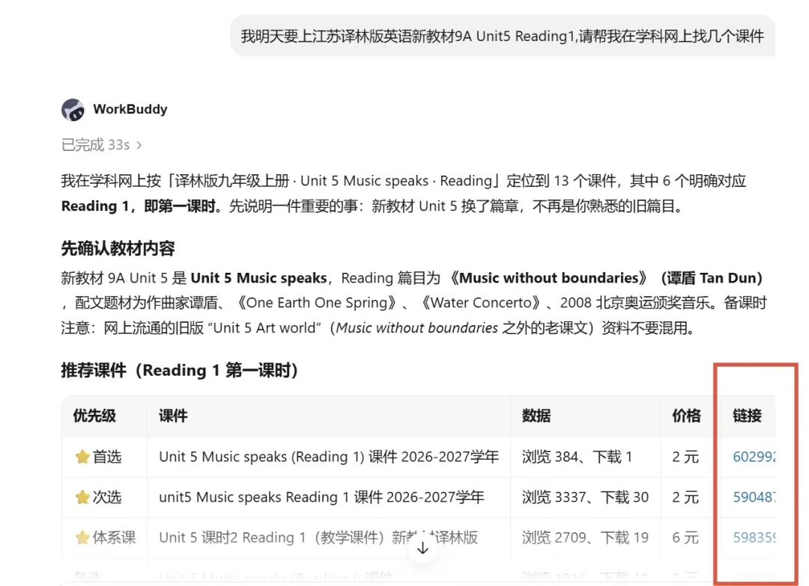
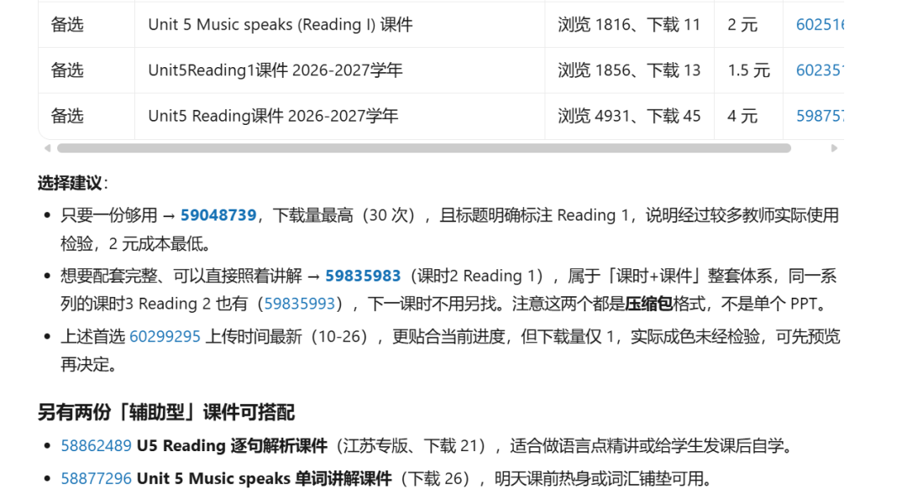

# 备课提效｜WorkBuddy接入学科网，一键检索课件、教案、试卷
> 💡 备注属性未写入，可能是备注属性名称或者类型被修改了，建议将字段类型设置为 rich_text，可以在小程序-操作-修改文章数据库页面进行调整
> 💡 原文链接:[https://mp.weixin.qq.com/s?__biz=MzYyMTY5Mzc0MA==&mid=2247485062&idx=1&sn=8264210b6a4e21698d320315110dadf7&chksm=fea2588ca50ef32e0ce3b43115d61eefee2a453846f672c402c5caf0641ac4dc531349e9d60c#rd](https://mp.weixin.qq.com/s?__biz=MzYyMTY5Mzc0MA%3D%3D&mid=2247485062&idx=1&sn=8264210b6a4e21698d320315110dadf7&chksm=fea2588ca50ef32e0ce3b43115d61eefee2a453846f672c402c5caf0641ac4dc531349e9d60c#rd)
备课的时候，是不是常常在学科网来回翻找课件？版本多、资源杂，很耗时间。
今天分享保姆级操作：在WorkBuddy上安装学科网连接器，让AI帮我们检索筛选课件、教案、试卷等学科网资源，快速锁定适配教材的优质资源。
✨适用：电脑客户端 / 网页版WorkBuddy
**📌 安装步骤**
**步骤1：登录WorkBuddy**
打开WorkBuddy网页版（https://www.workbuddy.cn）或者电脑客户端，微信扫码登录。
**步骤2：进入连接器页面**
在左侧菜单栏找到【**专家·技能·连接器**】，点击后，在弹出的选项里选择 **连接器**。

**步骤3：添加学科网连接器**
右上角搜索框输入：**学科网**，找到学科网连接器，点卡片上的「**+**」，登录学科网，**完成授权**。连接器就安装好了。

**步骤4：进入技能面板，添加配套技能**
再次点开左侧【**专家·技能·连接器**】，这次选择 **技能** 栏目。

**步骤5：添加两个学科网配套技能**
搜索框继续输入 **学科网**，会出现两个技能：**班主任工作助手、教师专业发展助手**，依次点「**+**」添加。

✅ 到这里，连接器+配套技能全部安装完成！
**📌 使用方法**
回到首页，点击左侧【**新建任务**】，在对话框里直接输入你的备课需求。
**示例：**
**我明天要上江苏译林版英语新教材9A Unit5 Reading1，请帮我在学科网上找几个课件**
别忘了点输入框旁边这个学科网小图标，唤起技能。

发送指令之后，WorkBuddy会自动检索，生成清晰的资源汇总表格：
✅ 标注推荐优先级，帮你筛选优质资源
✅ 显示浏览量、下载量，参考大家的选择
✅ 清晰标注免费 / 付费、具体价格
✅ 最后一列**附带直达链接**，**点击直接跳转学科网下载页面**

**课件、学案、教案、试卷，所有学科网的备课资料都可以这样搜索。**
💡 重要提醒
跳转之后的下载权限，依旧遵循学科网账号本身的规则：免费资源可直接下载；付费资源，需要按照学科网要求购买点数。这个连接器只负责检索、整理资源，不能绕过付费哦。
**不用大海捞针式翻页，不用一个个点开预览踩坑，把筛选工作交给工具，省下更多时间打磨教学设计。**
#教师备课工具 #WorkBuddy #学科网 #初中英语备课 #教研工具 #高效备课
