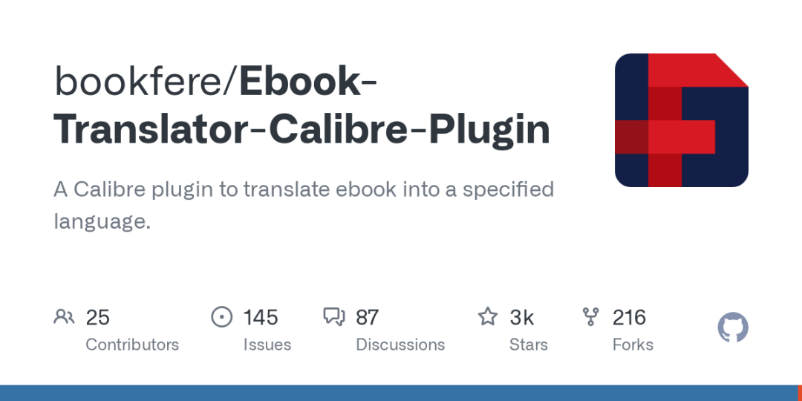

# 外文电子书一键做成中英对照版，这个免费插件不用填key
> 💡 备注属性未写入，可能是备注属性名称或者类型被修改了，建议将字段类型设置为 rich_text，可以在小程序-操作-修改文章数据库页面进行调整
> 💡 原文链接:[https://mp.weixin.qq.com/s?__biz=MzA5NjkxMzc1NA==&mid=2247484416&idx=1&sn=c5bad3c33922d161866e9d91a91cc7af&chksm=91d9f70bebc3e976884b1f3a42496d0396fe417c97d2132e8e6cea3955ab99f0c27ec04f7435#rd](https://mp.weixin.qq.com/s?__biz=MzA5NjkxMzc1NA%3D%3D&mid=2247484416&idx=1&sn=c5bad3c33922d161866e9d91a91cc7af&chksm=91d9f70bebc3e976884b1f3a42496d0396fe417c97d2132e8e6cea3955ab99f0c27ec04f7435#rd)
冷门 AI 工具 · 第 5 期
下载了一本英文电子书，读两页就卡住；复制一段去翻译网站，再切回来接着看，来回几十次就不想读了。其实可以让电脑把整本书翻好，做成一段原文一段中文的“中英对照版”。

**能解决什么麻烦**
- 外文小说、教材、说明书想对照着读
- 整本书一段段复制去翻译太累
- 想保留原文，方便对照查词
**用哪个工具**
Ebook Translator（电子书翻译器），是免费电子书管理软件 Calibre 的一个开源插件，GPL-3.0 许可证，GitHub 上约 2700 星，最近一次更新在 10 月下旬。它能把电子书翻译成指定语言，可以选择保留原文，做成原文、译文对照的版本。
Calibre 能读写的格式它都能处理（官方写的是输入 48 种、输出 20 种），比如放进 PDF，输出 PDF 或 DOCX；放进 TXT，输出 EPUB。还支持 .srt 字幕文件。
**怎么用（按官方手册）**
1. 先装好 Calibre（在浏览器搜索 Calibre 官网下载，免费）。
1. 打开 Calibre，点【首选项 → 插件 → 获取新的插件】，选中 Ebook Translator，点【安装】；第一次安装时选择把图标放在主工具栏上。
1. 把电子书拖进 Calibre 书库，选中它，点工具栏上的【翻译书籍】。
1. 第一次会让你选模式：想一键翻完选“批量模式”，选好输入格式、输出格式和目标语言，点【翻译】；想边翻边改选“高级模式”，可以只翻选中的段落，翻完还能在“校对”区改译文再输出。
1. 进度在 Calibre 右下角【任务】里看，翻好的书默认放回 Calibre 书库。
**免费能用到什么程度**
插件本身免费。翻译要用“翻译引擎”：手册里写明免费的有 Google (Free)、DeepL (Free，频率有限制)、Microsoft Edge (Free)；ChatGPT、DeepSeek、有道、百度这些要自己申请 API 密钥，可能收费。
**关键一步：**插件默认用的是 Google (Free)，谷歌翻译在国内一般连不上。在插件设置的“引擎”里换成 Microsoft Edge (Free)，不用填任何 key。
插件会缓存已经翻好的内容，网络断了或请求失败，重新开始时不用从头翻。
**局限和不适合谁**
- 要先装 Calibre，再装插件，比打开网页多两步；只用手机看书的人不适合。
- 免费引擎是机器翻译，长难句、专业词要自己核对，正式交付的翻译稿别直接用。
- Edge 免费引擎有没有次数或字数上限，官方没写；整本大书可能翻得比较慢，失败了可以利用缓存接着翻。
- 翻译时书里的文字会发给你选的翻译服务，涉密、内部资料别拿来翻。
- 只给自己读；有版权的书，翻译版别拿去传播。
想找它：在 GitHub 搜索 Ebook-Translator-Calibre-Plugin，或在 Calibre 的“获取新的插件”里直接搜 Ebook Translator。
关注我，每天一个大多数人没听说过的免费 AI 工具。你最想把哪本外文书翻成中文？评论区说说。
