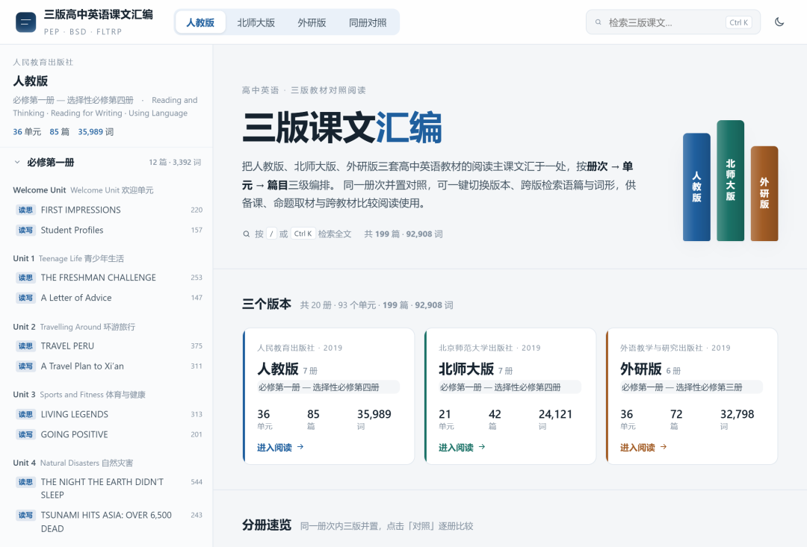
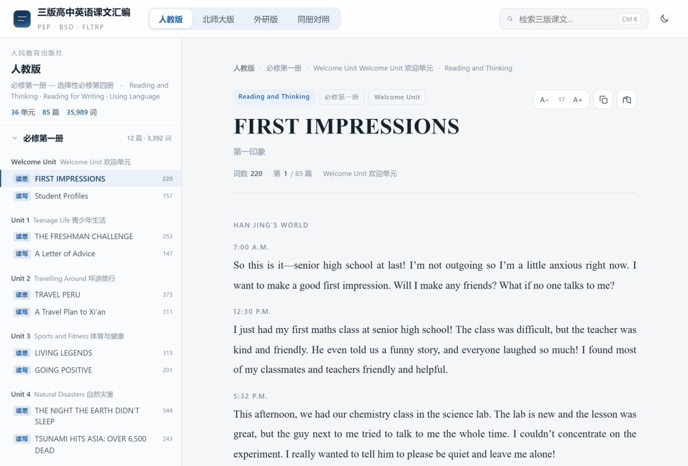
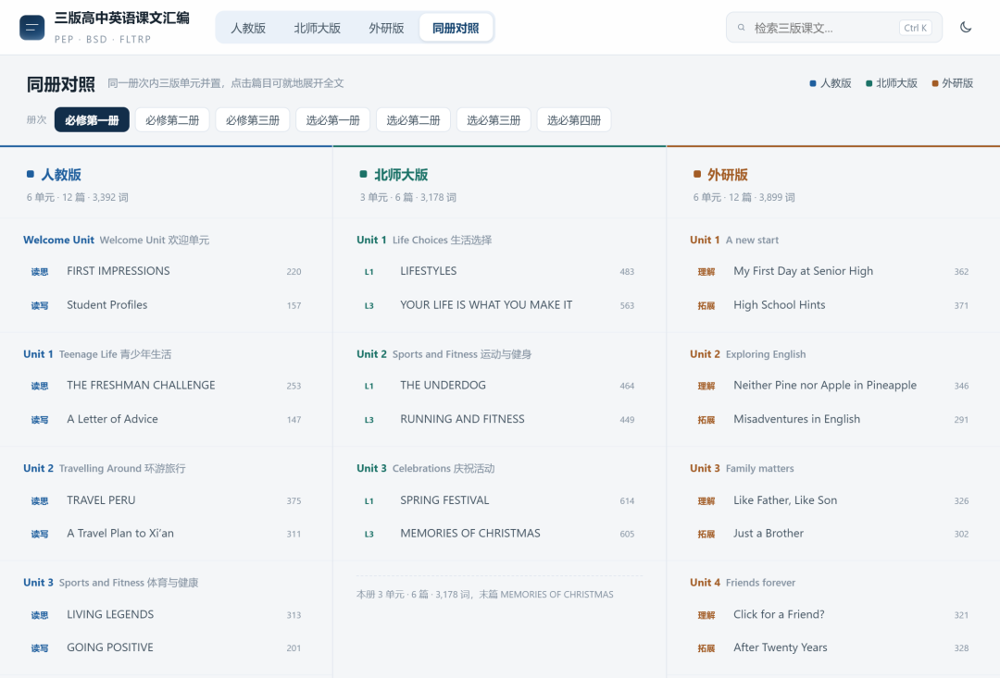
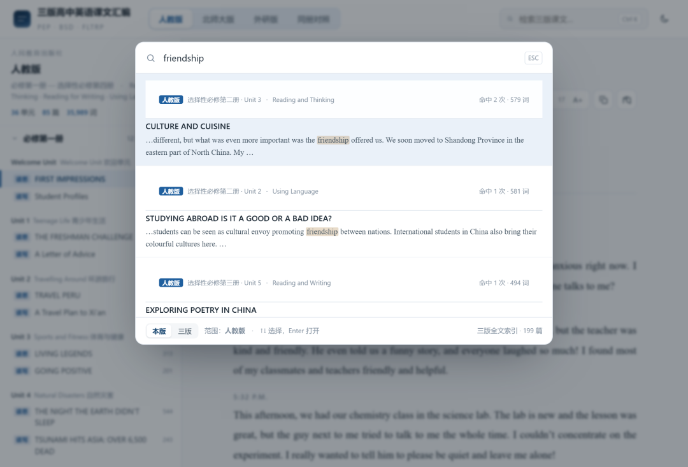

# 外研版·人教版·北师大版｜93个单元、199篇文本、92908词，三版高中英语课文一页读尽
> 💡 备注属性未写入，可能是备注属性名称或者类型被修改了，建议将字段类型设置为 rich_text，可以在小程序-操作-修改文章数据库页面进行调整
> 💡 原文链接:[https://mp.weixin.qq.com/s?__biz=MzkzODQyNTc5Nw==&mid=2247484669&idx=1&sn=6266c6ced66093e61daf6187e7a86f31&chksm=c33bc3fd6bec1547273890ee9728ca8612c2893112776136aa8dc821ee17b68dde54898b9cf4#rd](https://mp.weixin.qq.com/s?__biz=MzkzODQyNTc5Nw%3D%3D&mid=2247484669&idx=1&sn=6266c6ced66093e61daf6187e7a86f31&chksm=c33bc3fd6bec1547273890ee9728ca8612c2893112776136aa8dc821ee17b68dde54898b9cf4#rd)
耗时一整天，耗费近1000积分，在网上找了三种教材的课文进行汇总。
接下来我也会把这个作为语料库做更多的研究了。
三个版本、二十册书，同一话题散在不同单元；想横向比对，得摊开三本书来回翻。做阅读命题、做群文阅读、做新教材衔接，这一步总是绕不过去。
我把三套教材的阅读课文全部抽出来，做成一个单文件网页：93 个单元、199 篇文本、92,908 词，外研版、人教版、北师大版按册 — 单元 — 篇目三级排好，一个页面读完。
## 一、收进来的到底是什么
| **版本** | **册数** | **单元** | **篇目** | **词数** |
| 人教版 | 7 | 36 | 85 | 35,989 |
| 北师大版 | 7 | 21 | 42 | 24,121 |
| 外研版 | 6 | 36 | 72 | 32,798 |
| 合计 | 20 | 93 | 199 | 92,908 |
收录口径：人教版取各单元 Reading / Reading and Thinking / Reading for Writing / Using Language 板块；北师大取 Lesson 1 与 Lesson 3 的阅读主课文；外研取 Understanding ideas 与 Developing ideas。练习册与 Workbook 拓展篇目暂未收录。
差异一眼看出来：北师大七册只有 21 个单元，单元少、单篇长——必修一 Unit 1 的 LIFESTYLES 一篇就 483 词。人教与外研单元数相同（都是 36），但人教篇目更多（85 对 72），说明人教把阅读板块切得更细。
## 二、首页：三版摊开

图 1｜首页：三版并列，数字一次摊开
三个入口各带自己的颜色：人教深蓝、北师大墨绿、外研赭棕。这个色系从头贯穿到尾，看颜色就知道自己在哪一版。
## 三、读单篇：左边目录，右边正文

图 2｜阅读页：左目录，右正文
每篇上方带完整标签：版本 · 册次 · Unit 编号 · 中英标题 · 板块 · 词数。找一篇的时间，从“翻目录”降到“点两下”。目录常驻不收起，读到哪儿标到哪儿。
## 四、同册对照：三个版本并排

图 3｜同册对照：三版必修一并排
这一屏是整套东西最有用的地方。人教版必修一 Unit 1 是 Teenage Life，北师大同册 Unit 1 是 Life Choices，外研同册 Unit 1 是 A new start——同一学段、同一话题，三种编法。做初高中衔接、做跨教材群文，直接从这一屏取材。
注意北师大那一列短一截：必修一只有 3 个单元，翻到底就没有了。这不是数据缺漏，是教材结构本身不同。
## 五、检索：一个词，三版一起搜

图 4｜全文检索：命中位置一览
“friendship”在全库命中 11 篇，跨人教、北师大、外研三版，按册次列出，点一条直接跳到那篇的对应位置。做同义词群、做主题词频、做“这个词在哪几册复现”，几秒钟的事。
## 六、篇末的跨版跳转

图 5｜篇末跨版跳转（深色模式）
读完人教必修一 Unit 1，篇末直接给出北师大 Unit 1 和外研 Unit 1 的入口，不用退回目录。深色模式、字号三档，看晚自习投影也不刺眼。
## 七、给教研的四个用法
备课找语篇：按话题定位，三版横向看谁的处理更适合本校学情
命题取材：199 篇原始语料，词数、册次、板块齐全，改编写题不用再翻书
初高中衔接：必修一三版同册对照，一个暑假的量
新教材培训：给老师看“同一话题三种编法”，比讲理念有效
分享：
通过网盘分享的文件：高中英语三版课文汇编.html
链接: https://pan.baidu.com/s/19_5iNOU8Xh_J-66OJZcoIg 提取码: exrp 
##
