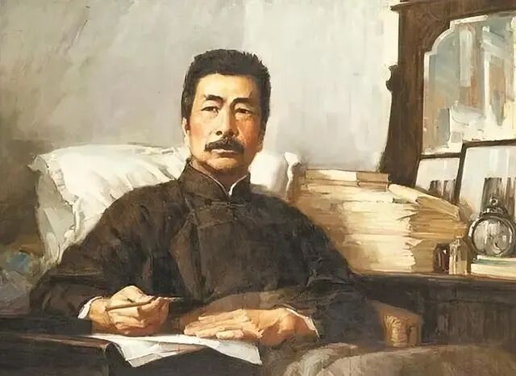

# 大中文系才子的读书方法：阅读，原来可以这么好玩！
> 💡 备注属性未写入，可能是备注属性名称或者类型被修改了，建议将字段类型设置为 rich_text，可以在小程序-操作-修改文章数据库页面进行调整
> 原文链接:[https://mp.weixin.qq.com/s/4yXgyEuygIl90CAcyY7i7g](https://mp.weixin.qq.com/s/4yXgyEuygIl90CAcyY7i7g)

把一道阅读理解题拍给AI，几秒钟，它就可以交付一个条理清晰、论证翔实的答案，主旨提炼、人物分析、金句赏析样样齐全，看上去要比“标准答案”还要周密全面。
这是当下许多孩子在面对语文作业时会采取的策略。
与数学、物理等科目不同，语文题特别是阅读理解题，很大程度上只有一个“软”答案。与其每次做题都花时间仔细读几遍文章，直接从AI获取答案并加以反复模仿，似乎是更有效率的选择。
这就引出了一个困惑着不少家长和学生的问题：当答案本身唾手可得，甚至连获取答案的能力都已不再稀缺，我们还需要一字一句地读书吗？
《古文观止有意思》作者、曾被评为**“最受欢迎语文老师”的邵鑫**，在其新书**《像侦探一样阅读》**中给出的回答是：比过去更需要。
AI可以帮助我们快速抓取信息，但如何提出问题、做出判断，如何透过文字与另一时空的写作者感同身受，仍需要对文本的慢读、精读。
在北大中文系求学7年并深耕青少年阅读教育5年后，邵鑫首次系统地梳理了“邵鑫读书”的核心方法论，在直面学生、家长对阅读的诸多具体困惑的同时，也回应了一个与当下每个人有关的问题：**当工具越来越聪明，我们该如何继续保持独立的判断和丰富的感受？**
**点击图片即可查看详情**

阅读，原来可以这么好玩！
来源 | 中信出版

**“最受欢迎的语文老师”**
**把阅读变成了破案**
邵鑫从小喜欢读书，小学到高中，一直是班上的语文课代表。由于太喜欢语文，高考填志愿时，“比较头铁”的邵鑫竟然把三个志愿全填了北大中文系。
本科到硕士，整整7年，邵鑫都在燕园度过，做过中文系辩论队队长，还曾是北大文学社的社长。
毕业后，他曾进入一家国企供职，但这种生活终究不太符合他的个性，于是他毅然决然辞职，放手写作、讲演，创立了“邵鑫读书”，用传播古诗文来弘扬传统文化。

■ 邵鑫
2022年，在山东卫视推出的国内首档大语文公开课节目《超级语文课》中，邵鑫从众多职业语文老师中脱颖而出，成为第一季总冠军，获得**“2022最受欢迎语文老师”**称号。
作为公开课现场评委，同时也是学界前辈的南京师范大学**郦波教授**就曾对邵鑫的表现感慨道：**“他对经典文本的解读能力，连我都非常佩服。”**
**这种犀利的解读能力，用邵鑫自己的话说，就像是一个侦探在破案。**

■ “真相永远只有一个”
侦探来到现场，要仔细观察那些容易被忽略的细节：某本书为什么被撕了一页，抽屉的位置怎么换了，现场为什么多出一颗不该出现的钉子……阅读也一样，值得追问的细节，常常就藏在某个很不起眼的“小角落”。
在他的阅读世界里，文本就是案发现场，读者就是侦探。糊涂的侦探总是遗漏关键信息，聪明的侦探却能从蛛丝马迹入手，一步步还原出作者真正的“手法”与“动机”。
在《像侦探一样阅读》一书中，他把这个“探案”过程拆成了四个步骤：**（1）观察细节，捕捉线索；（2）发现疑点，提出问题；（3）挖掘线索，合理推断；（4）反复验证，整体判断。**对文本的细致推敲，就是他对“案发现场”的勘察过程。
**点击图片即可查看详情**

**AI可以给你所有答案**
**除了这两件事**
在AI时代，我会觉得提出问题的能力太重要了，发现问题的能力太重要了，判断能力太重要了，解决问题反而不是多难的事情。
今天AI可以告诉你太多太多的答案了，它无法替代的只有两件事情，第一件事情是，你提一个什么样的问题给它，第二件事情是，当它给你一堆答案的时候，你到底选择哪一个。
这是前不久邵鑫在参加一席演讲时关于AI与阅读的思考，也是他在本书第二章“阅读与AI：AI时代更需要深度阅读”所讨论的核心问题——怎样追问，如何辨别信息、理解人情？
知道得足够多，并不等于理解就足够深刻，判断就足够准确。工具的便捷度越高，提问方式和对答案的判断力就越发重要。

书里有一个关于“答案判断”的古典范本，那就是我们在中学时都学过的《邹忌讽齐王纳谏》。
邹忌梳妆打扮后问自己的妻子、妾和门客：我和徐公谁更美？三人都回答说他更美。整个故事很简单，似乎一目了然，邵鑫却在这里停下来问：既然意思相同，三个人为什么用了不同的语气？
妻子说：“君美甚，徐公何能及君也？”先感叹，后反问，语气十分笃定；妾说：“徐公何能及君也？”少了一层感叹；门客说：“徐公不若君之美也。”换成了较为平淡的陈述语气。
那这些话能不能互换呢？顺着人物的动机去想，差别就出来了：妻“私我也”，是出于偏爱；妾“畏我也”，是出于恐惧；客“欲有求于我也”，是出于利益考量。措辞和语气，对应了三种不同的心境。

■ 图源：一席少年
于是，看上去很明了的一篇古文故事，竟然与我们的日常生活有了切实的联系：同样一句夸赞，可能来自偏爱，也可能出于顾虑或别有所求。
**点击图片即可查看详情**

**读懂文字的“心跳”**
在语文的四项根本能力——语言、思维、审美，以及对文化的理解和传承——之中，邵鑫认为，审美尤其需要读者在具体的文字里停留。
AI可以告诉你“这里连用动词，生动形象”，也可以给出一段很完整的赏析话术。可一句话究竟好在哪里，我们仍要亲自读过、体会过，才会明白。
《水浒传》里，九纹龙史进大战跳涧虎陈达的故事，其中有这样一段描写：
史进轻舒猿臂，款扭狼腰，只一挟，把陈达轻轻摘离了嵌花鞍，款款揪住了线搭膊，丢在马前受降。
关于史进将陈达从马上弄过来的这个具体动作，如果由你来写，会选择用哪个字？
有人想到“掀”，有人想到“挑”，还有人想到“捉离了马鞍”。可《水浒传》原文用的，却是轻轻一个“摘”字。
想一想，我们会在什么场景使用“摘”这个字？摘花、摘叶片、摘果子，这些动作有一个共同的特点，都轻巧而不费力。施耐庵让史进去“摘”一位绰号“跳涧虎”的好汉，这个动词一出，史进的轻松自如、两人武艺的高下，便都跃然纸上了。

完整的打斗描写里，还有“闪”“舒”“扭”“挟”“揪”等动词，以及两处“轻”、两处“款”。只顾着看胜负，这些文字便容易一掠而过。**读慢一些，才能领会动作的节奏、人物的神采、作者的匠心。**

■ 98版《水浒传》史进（郭军饰）
有人或许会问：一本书、一段故事的文字那么多，我们为什么要那么费劲地去逐字“品读”呢？真的有必要吗？
这里不得不提到邵鑫自己读鲁迅《秋夜》一文的经历。这篇文章有一个极其有名的开头：
在我的后园，可以看见墙外有两株树，一株是枣树，还有一株也是枣树。
小时候，他也不理解这句话：直接写“有两株枣树”不就行了吗？何必再重复一遍？
直到有一次，他外出旅行时忘了带钱，摸摸左口袋，是空的；再摸摸右口袋，也是空的。那一刻的失落与无奈，让他忽然理解了鲁迅的表达。
“我今天没带钱”，只是说出了结果；把摸遍两个口袋的过程写出来，情绪便随着一而再的落空自然浮现出来了。
在邵鑫的理解里，“一株是枣树，还有一株也是枣树”也有这样的意味。视线从一株树移到另一株，眼前仍是同样的景象，那份孤独与无奈便从鲁迅心里传递到了读者心中。

这就是审美的价值。邵鑫将它与共情联系起来：试着将心比心，去感受别人的感受。理解表达的方式，也要进入表达者当时的心境。
AI可以快速给到答案，但关于生命的理解、情感的共振和内心的触动只能是个人的、当下的，甚至是只可意会，却难以真正公共表达的。
**“教育具有长期性和滞后性，就像是一个闭环。多年后你有一个瞬间突然意识到了什么，那就是子弹命中的瞬间，此时才是教育的完成。”**这段曾经刷屏的文案，某种程度上可以作为上面那个问题的回应。
**点击图片即可查看详情**

**于无声处听惊雷**
还有一些文字，初读时并不显眼，要等到后面，才能体会它的分量。
《史记·项羽本纪》开篇写道：“初起时，年二十四。”二十四岁，放到今天也不过是刚走出校门的年纪，项羽却已经卷入灭秦的大事，并很快站到了风暴中心。
看似平常的背景信息，可能藏着作者对人物的态度。
写到项羽少年往事：学书不成，去学剑，又不成；改学兵法，“籍大喜，略知其意，又不肯竟学”。
邵鑫追问：既然“大喜”，为什么又“不肯竟学”呢？问题藏在“略知”里。项羽未必是学不会，而是刚刚明白了大意，便容易觉得自己已经完全掌握，不肯继续学。

■ 电视剧《楚汉传奇》项羽（何润东饰）
再后来，他进入关中后，急于衣锦还乡；分封诸侯时，按亲疏和个人好恶安排天下，引起不满；平定齐地时，虽打了胜仗，但大肆烧杀又招来反叛。他能凭武力打开局面，却不具备足够的智慧去妥善安排后续。
到了兵败之际，他仍坚信自己的善战，将失败归结为“天之亡我，非战之罪也”。至此，再回头去看他少年时的“不肯竟学”，就会恍然，原来司马迁在最开始的记述中就留下了关于他性格的伏笔。
一条线索刚刚出现时，我们未必能立刻知道它有多重要……既不能随手丢掉，也不能急着下结论。不妨先把它记下来，继续往后看。
有些关键细节，要经过反复对照才能显现。这是侦探的耐心，也是阅读的妙趣所在。
**点击图片即可查看详情**

**功到自然成**
《像侦探一样阅读》全书分为上下两篇。上篇主要讨论阅读方法，以及阅读与AI、语文、经典和教育的关系；下篇走进具体的阅读实践，收录《木兰诗》《阿长与〈山海经〉》《背影》《干将莫邪》等课堂实录，以及家长、学生的现场问答——
写作文没有灵感怎么办？阅读理解为什么答不到点上？怎么判断自己是不是想多了？到底要不要刷题？读得慢该怎么改善？有没有适合普通孩子的方法？
从“教语文”到“教读书”，邵鑫始终认为，语文关系到一个孩子怎样理解别人、认识自己、看待世界，又怎样把心里的话准确地说出来。考试当然重要，但这些能力的意义会在他离开考场以后，依然在现实生活中延续、生长。
