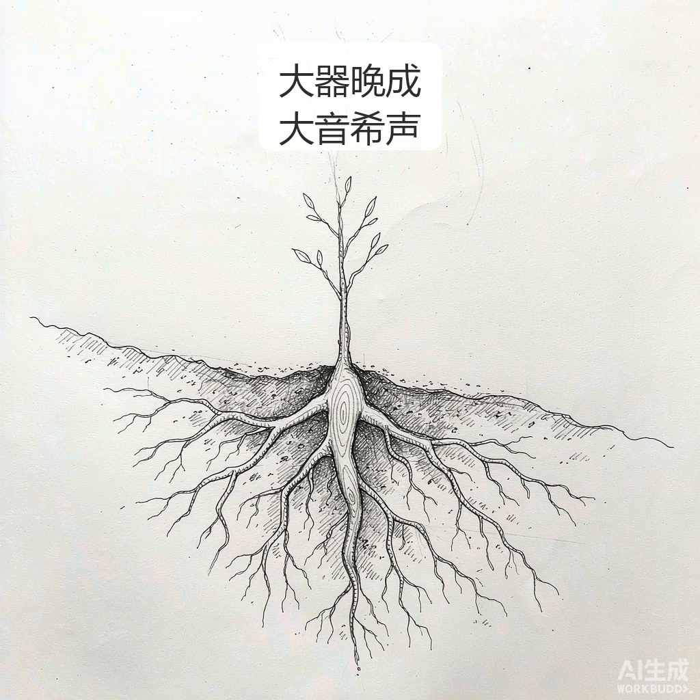
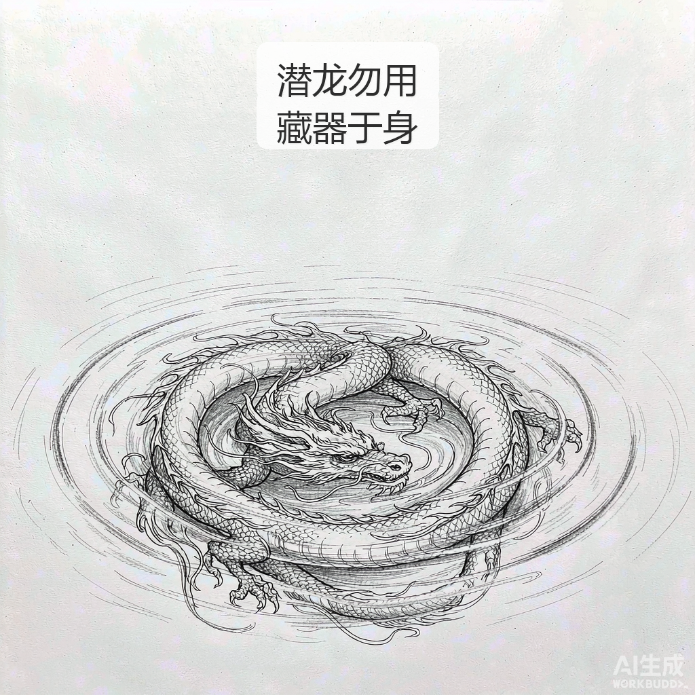
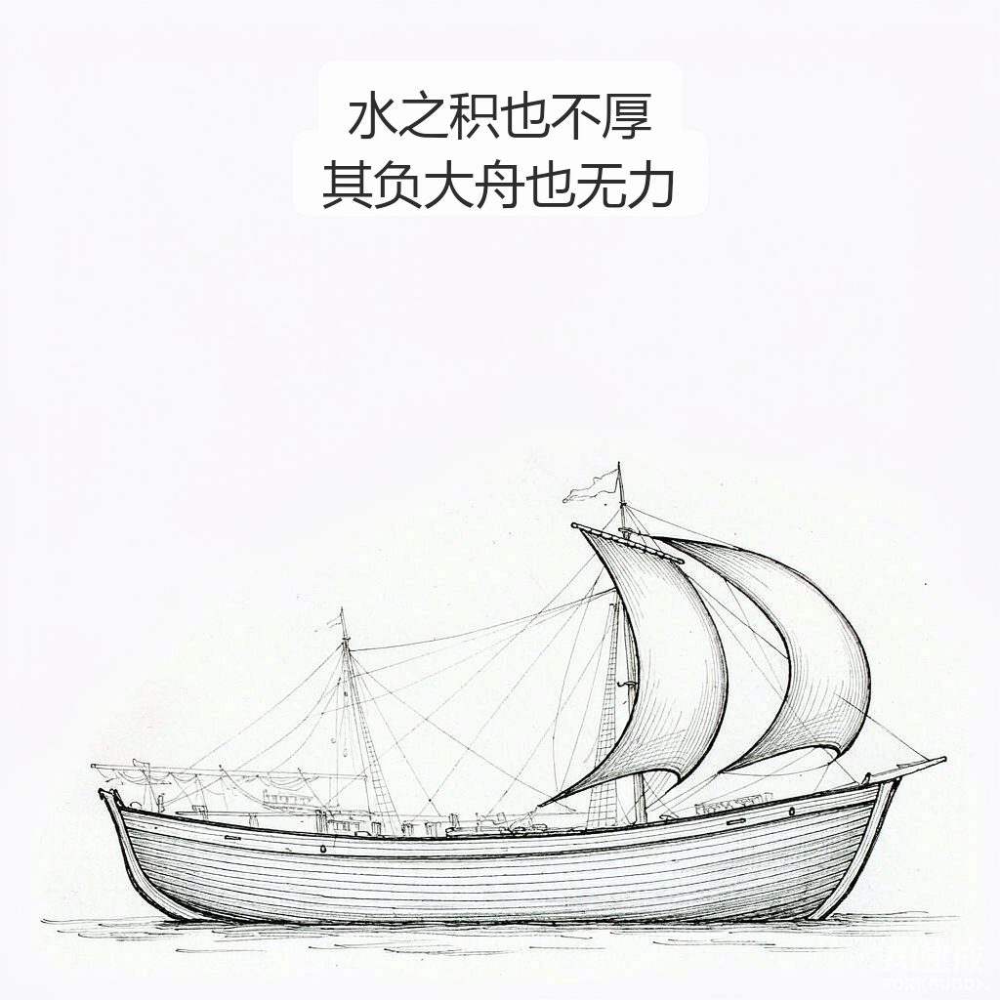

# 大器晚成
> 💡 备注属性未写入，可能是备注属性名称或者类型被修改了，建议将字段类型设置为 rich_text，可以在小程序-操作-修改文章数据库页面进行调整
> 原文链接:[https://mp.weixin.qq.com/s/FN2VhWdtWLj2vEgArgpRfg](https://mp.weixin.qq.com/s/FN2VhWdtWLj2vEgArgpRfg)
## 大器晚成

《老子》说："大器晚成，大音希声。"真正的重器，从来不赶工期。别人三五年成的东西，你用十年去做，未必是你慢，而是这块料本就更沉更实。别拿别人的时间表，度量自己的节奏——根系扎得深的树，出土才慢，立得才稳。

《周易》乾卦初九："潜龙勿用。"沉在水底的龙，不是没有力量，是还没到用的时候。藏器于身，待时而动。沉潜不是停滞，是把力气攒在该发的地方；无人喝彩的那段日子，恰恰是长本事的日子。

庄子说："水之积也不厚，则其负大舟也无力。"杯水浮不起一艘船，浅薄也撑不起大任。今天无人看见的每一次积累，都是明日托起巨舟的水。厚积者不必喧哗，深浅自会替你说话。

## 摘要

（待补充）

## 我的笔记

（待补充）
