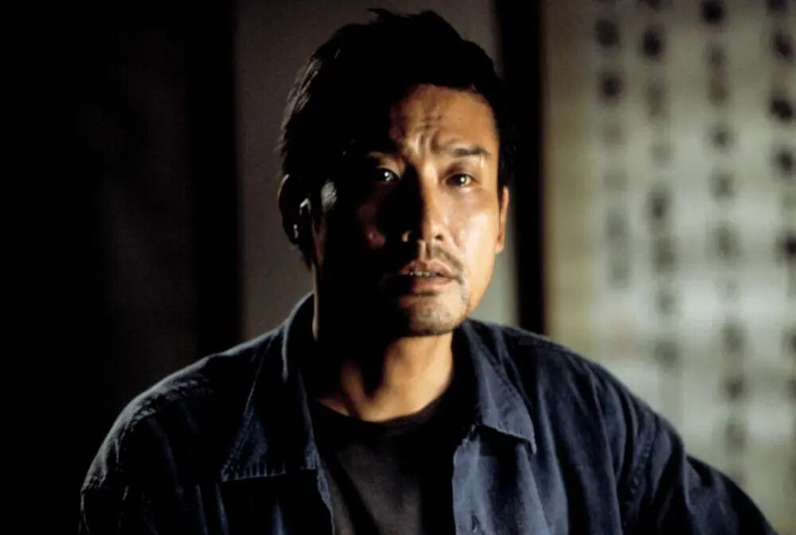
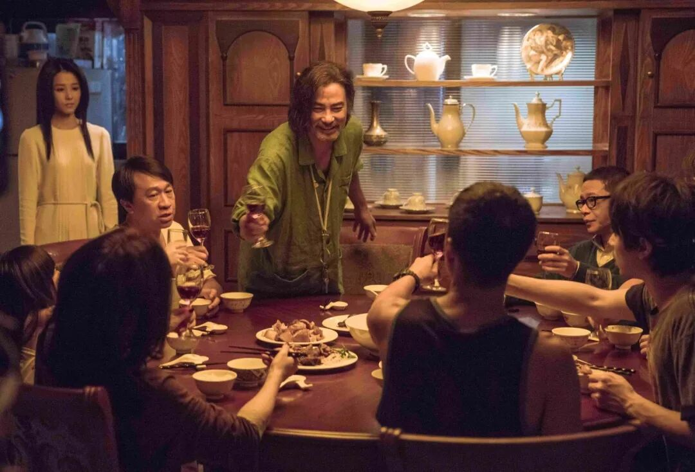
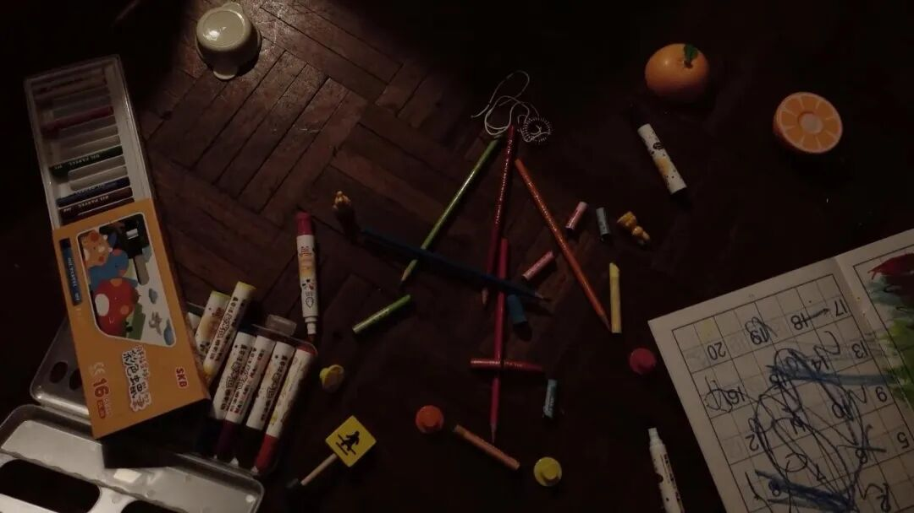
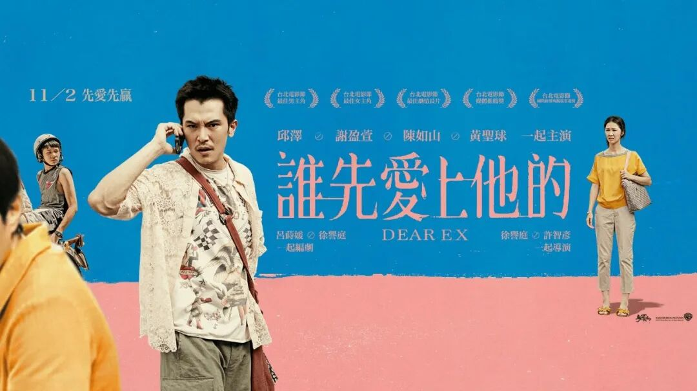
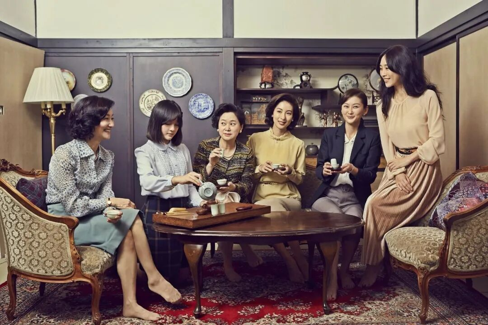
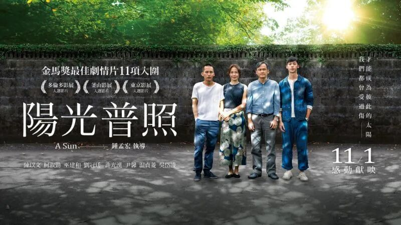
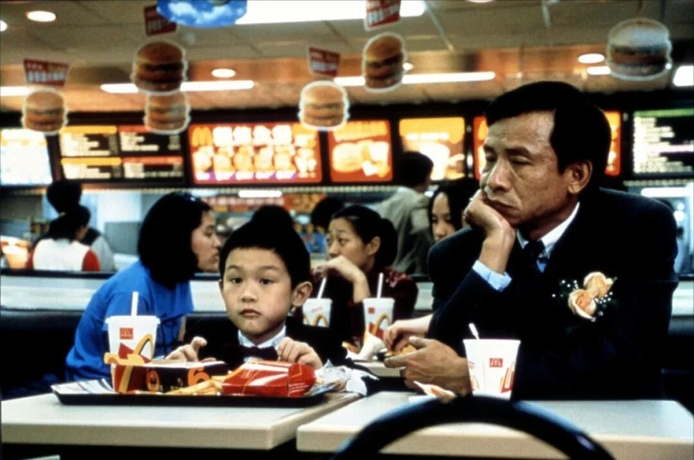

# 大陆不能上映的10部台湾电影，想看只能在硬盘里
> 💡 备注属性未写入，可能是备注属性名称或者类型被修改了，建议将字段类型设置为 rich_text，可以在小程序-操作-修改文章数据库页面进行调整
> 原文链接:[https://mp.weixin.qq.com/s/L9rpttLx9U9v_ACocoBSVQ](https://mp.weixin.qq.com/s/L9rpttLx9U9v_ACocoBSVQ)
大陆不能上映的10部台湾电影，想看只能在硬盘里
今天盘点10部大陆无法上映的台湾电影，它们因为种种原因都没有在大陆院线上映过。
那么，这10部电影，你看过几部呢？
本次盘点排名不分先后
**1、双瞳**

该片讲述了一名美国联邦调查局探员凯文莱特与台北警察黄火土共同合作追缉一名台北市连续杀人犯的故事。
该片巧妙地利用中国神秘的古老文化来编织恐怖凶杀的故事情节，
以道教“寒冰狱、火坑狱、抽肠狱、剜心狱、拔舌狱”五重地狱为杀人蓝图，
将**连环凶案转化为一场血腥的修仙仪式。**
全片阴气森森，电影离奇与恐怖甚至可以和**经典的《七宗罪》一较高下。**
梁家辉真是演什么像什么，无愧千面影帝的称号
梁家辉以垮塌的体态与失焦的眼神诠释一个内心处于高度焦虑和紧张的警察角色，他在雨中道观追凶时的喘息给人带来强烈的窒息感。
而这部电影因为恐怖的尺度，也注定无缘当年的内地院线
**2、楼下的房客**

故事发生在一栋老式公寓内，房东（任达华 饰）贴出了招租启示，以极低的价格将公寓里的6间房租了出去
然而，天底下哪有白捡便宜的道理呢，被低价吸引而来的租客想要在这里生活，自然还要付出金钱之外的东西.....
电影改编自作家九把刀的小说，原著本身就以“重口味”著称。
**电影版更是把那种病态的窥视欲和极端的人性实验推到了极限。**
房东偷窥每一个房客的生活，然后像上帝一样操纵他们走向疯狂和毁灭
这部电影尺度太大，而且涉及多重敏感题材，自然也就无缘大陆院线了。
**3、咒**

本片灵感来源于中国台湾高雄地区吴氏家族的真实事件，
电影以“伪纪录片”形式展现，由女主角李若男第一人称拍摄、剪辑而成
讲述了一位单亲妈妈因职业原因触及诅咒，遭其纠缠，祸及家人朋友的故事
《咒》把电影营造出来的恐怖感，成功地渗透进了每个人的日常生活当中
不过这部电影争议也很大，因为电影里有意全程引导观众去念咒语和记下手势。
哪怕导演解释这些都是瞎编的，也让不少观众感到很不舒服
甚至有人评价
**“第一次看到给观众下咒的恐怖片”**
**4、军中乐园**

钮承泽导演，阮经天、万茜、陈建斌主演。
故事设定在1960年代的金门，一个被时代困住的年轻士兵，和军中茶室的女子之间发生了一段注定没有结果的关系。
看起来是讲历史，实际讲的是人在历史夹缝里的身不由己
片尾男主抛弃了对自己的承诺，变成一个像曾经学长一样油嘴滑舌、唱黄歌哀伤自娱的人。
这就更让人唏嘘不已。
**5、艋舺**

2010年台湾最卖座的电影之一。
阮经天、赵又廷、凤小岳，几个年轻人从校园走进黑帮，在艋舺的街头完成了他们的成人礼。
它拍的是青春的暴力，是兄弟情义在利益面前的碎裂，是那种“一旦走上这条路就回不了头”的宿命感
而这个题材也注定无法在大陆上映了。
**6、谁先爱上他的**

电影从一个女人的视角展开：丈夫去世后，把保险金留给了另一个男人。
她带着儿子去讨说法，却在和那个“小三”（邱泽饰）的周旋中，慢慢拼凑出丈夫生前的秘密。
**它用喜剧的壳子，讲了一个关于同妻、关于原谅、关于“爱到底是什么”的故事**
**7、血观音**

电影里棠家三代女性在政商交织的权力游戏中，将亲情、友情、爱情尽数化为算计与筹码。
一桩灭门悬案，揭开了血色家族的层层秘密
**一部恶女大戏，演的是人性的贪婪与扭曲**
惠英红、吴可熙、文淇，三个女人，一台戏。
棠家三代女性在政商勾结的灰色地带里游走，表面上做的是古董生意，背地里干的是权钱交易和灭门勾当。
**全片没有一个真正意义上的好人，每个人都戴着面具，每句话都藏着刀子。**
**8、阳光普照**

**台湾电影这几年似乎很喜欢挖掘中国人家庭里隐藏着的绝望悲伤和恶。**
一个普通家庭因小儿子即将被送入少年观护所而分崩离析，
曾被寄予厚望的大儿子又做出震惊之举。
导演用冷峻的现实主义风格，拍出了家庭在创伤与救赎中的挣扎。
把家庭内部的裂痕拍得像一把钝刀，一点一点割开你的耐心和防备。
**9、大佛普拉斯**

黑白的画面，闽南语的旁白，两个底层小人物的故事
夜间保安菜埔和捡破烂的朋友肚财，偷看老板的行车记录仪，意外发现政商勾结、杀人藏尸的秘密。
结果看到了不该看的东西。
它用最荒诞的方式，讲了一个最残酷的阶级故事：
**有钱人的世界是彩色的，穷人的世界是黑白的。**
这个设定很黑色也很现实，这部电影虽然有不少笑料
但笑着笑着，你会发现笑不出来了
**10、一一**

杨德昌用近三个小时的篇幅，讲了一个家庭里每个人都无处逃离的现实。
他把童年、中年、老年的迷茫和孤寂融进了电影里
**有意思的是这部电影一直到17年后才在台湾上映**
原因是杨德昌对当时的台湾电影发行生态极度不满，宁可不上映，也不愿让自己的作品被草草对待。
至于内地，2025年平潭影展原本计划放映4K修复版，号称“首次在大陆进行官方放映”，最终因“临时授权变更”取消
以上就是10部不能在内地上映的电影，你看过几部呢？
#台湾电影#禁片
