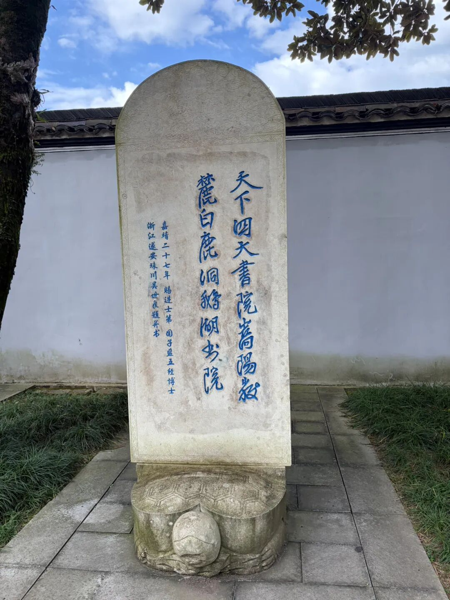
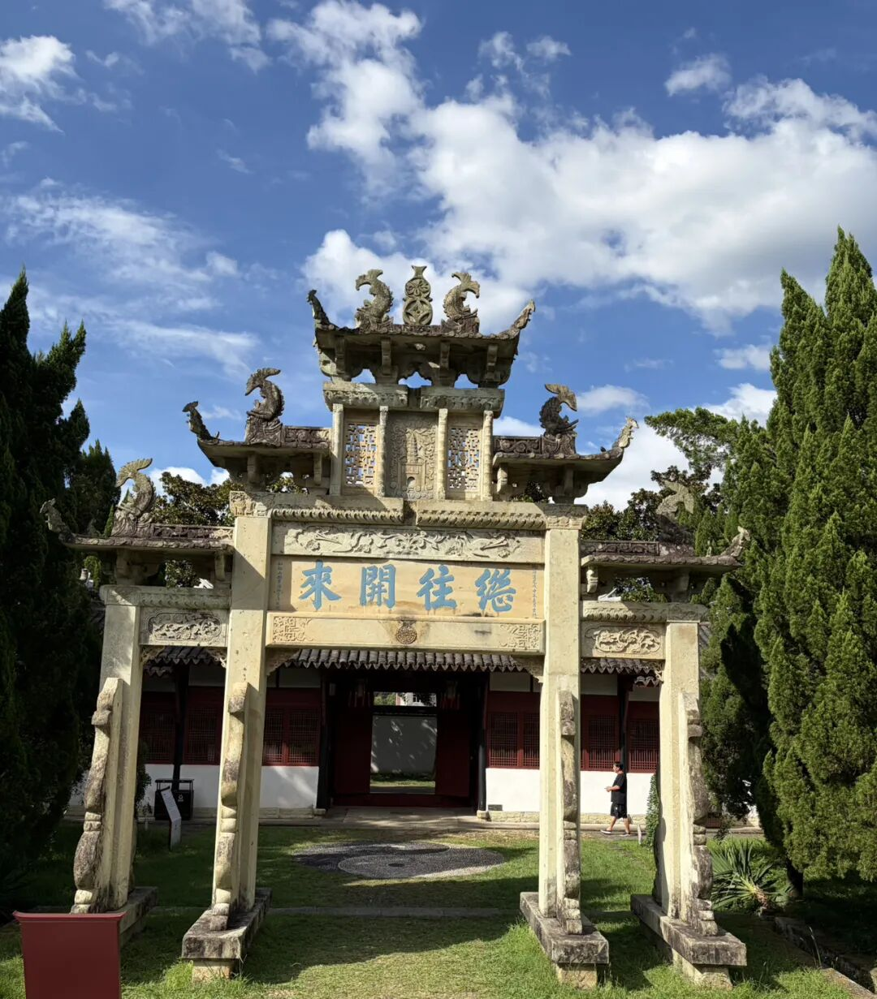
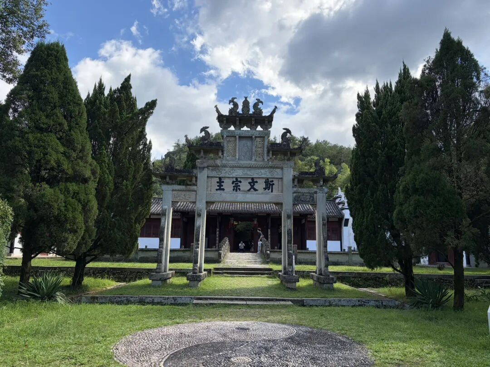
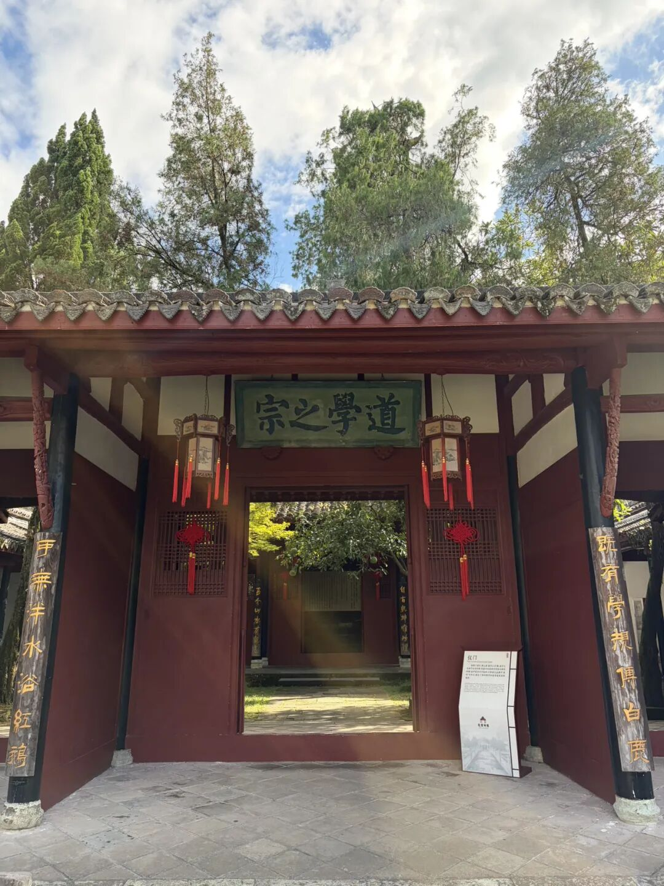
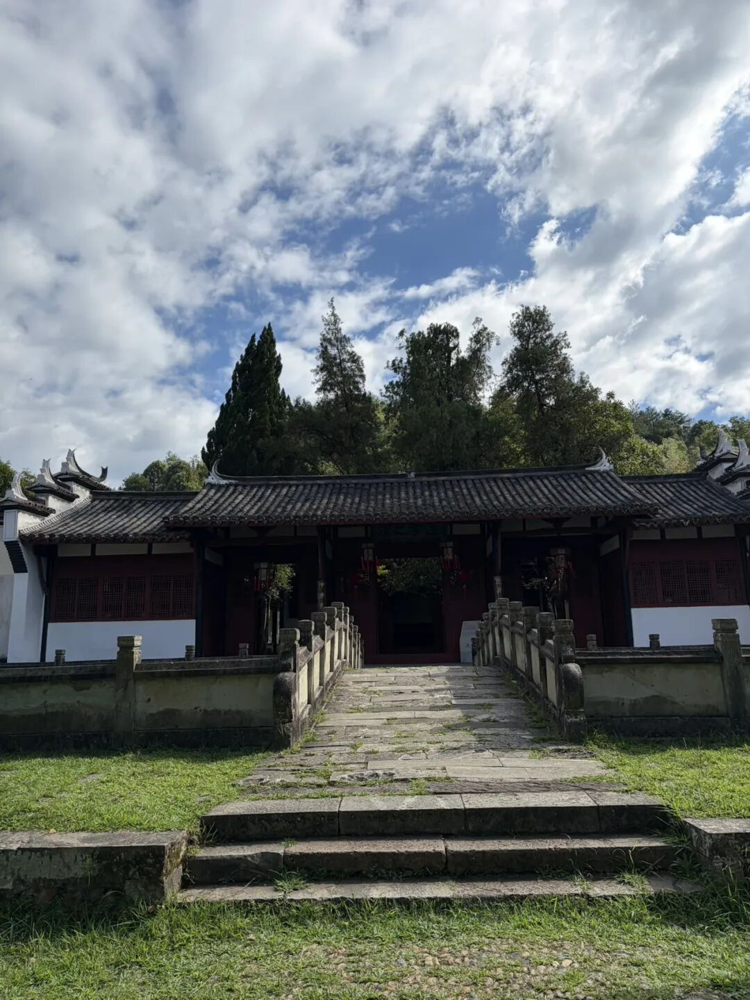
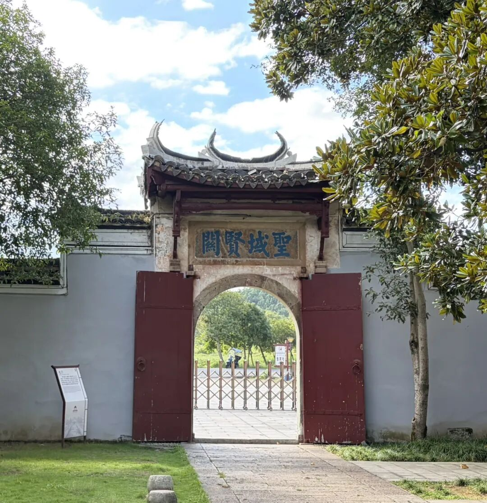
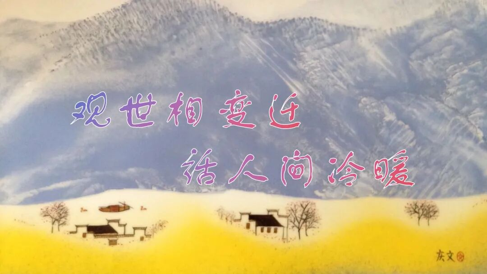

# 天下四大书院｜千年鹅湖，一院藏尽宋明理学风骨
> 💡 备注属性未写入，可能是备注属性名称或者类型被修改了，建议将字段类型设置为 rich_text，可以在小程序-操作-修改文章数据库页面进行调整
> 💡 原文链接:[https://mp.weixin.qq.com/s?__biz=MzYzMzMxOTEyMQ==&mid=2247484004&idx=1&sn=6111fea08dd93a979b276d864b5eb929&chksm=f1f16c9a22e4e5837568936db661d15fe0d5bb1372b15583d1b2653c94d6ebd53faa3a93e763#rd](https://mp.weixin.qq.com/s?__biz=MzYzMzMxOTEyMQ%3D%3D&mid=2247484004&idx=1&sn=6111fea08dd93a979b276d864b5eb929&chksm=f1f16c9a22e4e5837568936db661d15fe0d5bb1372b15583d1b2653c94d6ebd53faa3a93e763#rd)
 中华文脉源流长远。书院藏山水风骨，载古今道统。世人公认的天下四大书院中，嵩阳承河洛底蕴，岳麓振湖湘学风，白鹿洞传朱子规制，而隐匿于赣东北铅山县群山之中的鹅湖书院，凭一场旷世思想论辩，坐稳千年文脉席位，成为江南理学最独特的精神地标。

 鹅湖书院的分量，早已被时光镌刻留存。院内矗立一方明代嘉靖石碑
（碑文是嘉靖二十七年，賜進士第 國子監五經博士，浙江遂安珠川吳世良題并書），字墨苍劲，清晰镌刻 “天下四大书院” 之名，将鹅湖及另三大书院悉数载入史迹。历经数百年风雨冲刷，碑文字迹依旧清晰，龟趺底座沉稳厚重，是明清两代官方对鹅湖书院历史地位最确凿的认可，也是这座山野书院千年荣光的最好见证。

 鹅湖书院之名垂青史，皆因一场震烁古今的**鹅湖之会**。南宋淳熙二年，吕祖谦邀约朱熹、陆九渊两大儒者于此相聚论道，意在调和学术分歧。朱熹主张 “格物致知”，认为真理当向外求索，于万事万物中探寻天理；陆九渊秉持 “发明本心”，倡导向内观照，从自我本心洞悉大道。

 两大学派连日辩难、各抒己见，针锋相对却彬彬有礼，彼此论辩却互不诋毁。这场千古论战最终未有输赢，却打破了学派固步自封的桎梏，催生了兼容并包的学术新风。自此，鹅湖从一方山间古寺，一跃成为南宋理学交锋、融汇的核心要地，跻身天下四大书院。

 相较于其他书院深耕讲学、传承规制，鹅湖书院最珍稀的内核，是**思辨与包容**。这里不独尊一派、不固守一言，允许思想碰撞，接纳学说差异，这份开阔的学术气度，正是中华文脉生生不息的源泉。自宋之后，元明清历代皆对书院修缮扩建，朝廷屡赐匾额典籍，文人墨客接踵而至，莘莘学子于此潜心问道，文脉代代接续、从未断绝。

 今日的鹅湖书院，白墙黛瓦藏于茂林青山之间，泮池、讲堂、斋舍格局完整，古韵悠然。褪去旧时论辩讲学之喧嚣，独留静谧深远之文气。四大书院各有风骨，嵩阳厚重、岳麓豪迈、白鹿洞清雅，而鹅湖独以思辨木秀。

 千载岁月浮沉，山河更迭，鹅湖青山依旧，文脉绵长。这座藏于山水间的千年书院，不仅是古代治学育人的圣地，更留存着中国人求真、包容、善思的文人风骨，让跨越八百年的理学风华，静静流淌于华夏之川。

