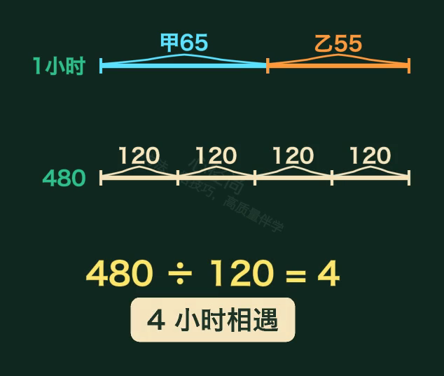
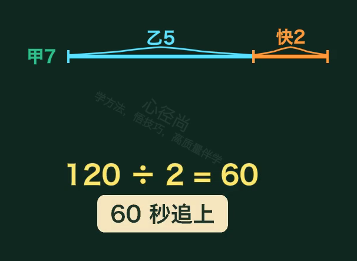
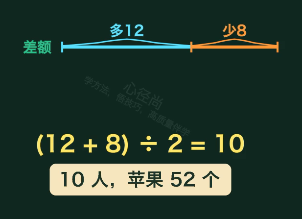
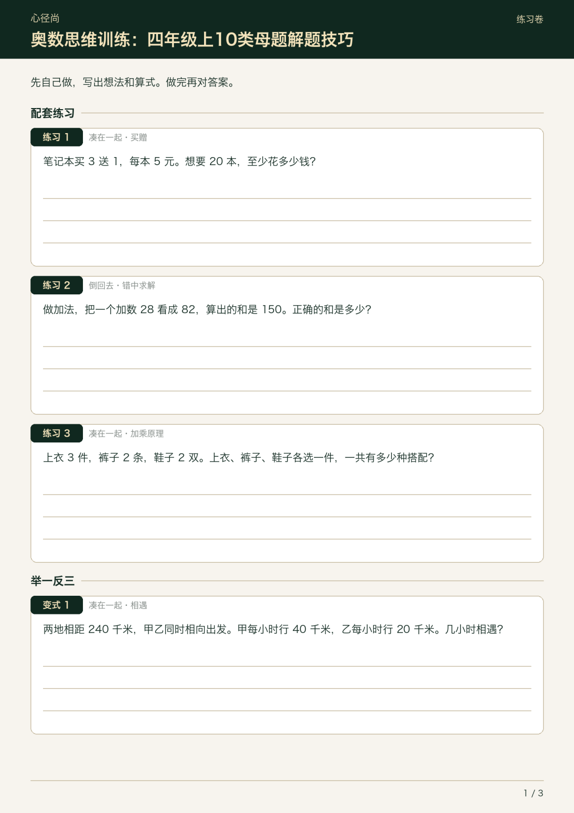

# 奥数思维训练：四年级上10类母题解题技巧
> 💡 备注属性未写入，可能是备注属性名称或者类型被修改了，建议将字段类型设置为 rich_text，可以在小程序-操作-修改文章数据库页面进行调整
> 💡 原文链接:[https://mp.weixin.qq.com/s?__biz=MzUxOTUwMDE2OQ==&mid=2247484985&idx=1&sn=381d5ff69e6183c1fbbbcf4e0f478baa&chksm=f820dd8e522ac83a2922fb73b92533cac83258932a5fc11fdae66f4762c24899719dfdc61e38#rd](https://mp.weixin.qq.com/s?__biz=MzUxOTUwMDE2OQ%3D%3D&mid=2247484985&idx=1&sn=381d5ff69e6183c1fbbbcf4e0f478baa&chksm=f820dd8e522ac83a2922fb73b92533cac83258932a5fc11fdae66f4762c24899719dfdc61e38#rd)
孩子做四年级上的应用题，常常是这样：相遇刚会，换成追及又把速度加起来；盈亏背熟了，碰上买赠又从头想。一册 10 类母题，像 10 道坎，一类一类背，背到一半就混了。
其实这 10 类的第一问只有一句。两个量，是凑在一起，还是差开了。凑在一起用加，差开了用减。剩下几类，是把看错的倒回去，或把新写法翻译回原来的运算。
**01思维模型**
四年级上的 10 类母题，按动手前的**第一个动作**分，是 4 招。
| **招式** | **这一招干什么** |
| 凑在一起 | 两样合成一个总量，再除或再乘 |
| 差开了 | 多出来的那一截，除以每份的差 |
| 倒回去 | 看错了多少、空着哪一位，从结果里补上 |
| 换一种写法 | 新符号、接近整千的数，先翻译成原来的运算 |
这 4 招各自覆盖哪 10 类，文末带走里有一张完整对照表，可以直接保存。
**为什么凑和差是同一刀**
4 招里最常混的是前两招。相遇和追及都是两个人在走，孩子一看见速度就相加。差别只有方向：面对面，两条路凑成全程，速度相加；同向追，快的每秒只比慢的多出一截，速度相减。
盈亏看起来不走路，用的却是追及这一刀。每人多分 2 个，多出来的苹果和不够的苹果合在一起，就是这 2 个的差。**凑着用加，差开了用减，是同一件事的两个方向。**
买赠、图形计数、加乘原理，都是凑：先把能配成一组的配完，再乘。错中求解和算式谜是倒回去。定义新运算、多位数计算是先换回原来的加减乘。
下面三道母题看清这一刀。相遇是凑，追及是差，盈亏是差离开了路程以后还是那一截。
**母题一 · 相遇（凑在一起）**
题目
甲乙两辆汽车从相距 480 千米的两地同时相向开出。甲车每小时行 65 千米，乙车每小时行 55 千米。经过几小时两车相遇？
常见错法
**480 ÷ 65**（小时）。只除了甲的速度，乙同时在走的那一段没有算进去。
面对面走，1 小时合在一起的路，是两人速度相加。

相遇：速度加在一起
• 甲 65 千米，乙 55 千米，1 小时合走 65 + 55 = 120 千米。
• 全程 480 千米里有几个 120。
• 480 ÷ 120 = 4 小时相遇。

相遇模型图
速度和 = 65 + 55 = 120（千米）
时间 = 480 ÷ 120 = 4（小时）
验算：4 × 65 + 4 × 55 = 480 ✓
通法：相向相遇，时间 = 总路程 ÷ 速度和。
**母题二 · 追及（差开了）**
题目
甲乙两人同向跑步，一开始相距 120 米。甲每秒跑 7 米，乙每秒跑 5 米，甲在后面追乙。多少秒可以追上？
常见错法
**120 ÷ (7 + 5) = 10**（秒）。同向追不能把速度加起来，加起来是面对面那一招。
同向走，每秒真正缩短的距离，只是快的比慢的多出来的那一截。

追及：每秒只多出 2 米
• 甲 7 米，乙 5 米，每秒多追 7 − 5 = 2 米。
• 一开始拉开的 120 米，要几个 2 米才补上。
• 120 ÷ 2 = 60 秒追上。

追及模型图
速度差 = 7 − 5 = 2（米）
时间 = 120 ÷ 2 = 60（秒）
验算：60 × 7 = 420，60 × 5 = 300，420 − 300 = 120 ✓
通法：同向追及，时间 = 距离差 ÷ 速度差。
**母题三 · 盈亏（差离开了路程）**
题目
把一些苹果分给小朋友。每人分 4 个，多 12 个；每人分 6 个，少 8 个。有多少个小朋友？多少个苹果？
常见错法
**(12 − 8) ÷ (6 − 4) = 2**（人）。一盈一亏，多的和少的要加，不能相减。
每人多分 2 个。多出来的 12 个和不够的 8 个，都是这 2 个造成的。

盈亏：多的和少的加在一起
• 每人从 4 个改到 6 个，多了 2 个。
• 12 + 8 = 20，这 20 个正好是每人那 2 个。
• 20 ÷ 2 = 10 人。苹果 = 10 × 4 + 12 = 52 个。

盈亏模型图
人数 = (12 + 8) ÷ (6 − 4) = 10（人）
苹果 = 10 × 4 + 12 = 52（个）
验算：10 × 6 − 8 = 52 ✓
通法：一盈一亏，人数 =（盈 + 亏）÷ 每人相差的个数。
三道放在一起看：相遇把两段路加起来，追及和盈亏都是拿差去除。方向反了，运算就反了。
**02带走**
把这张表存下来。孩子做题前先问一句：这两个量，是凑在一起，还是差开了？
| **招式** | **管哪些题** | **一句话口诀** |
| 凑在一起 | 相遇·买赠·图形计数·加乘原理 | 合成一个总量，再除或再乘 |
| 差开了 | 追及·盈亏 | 多出来的那一截，除以每份的差 |
| 倒回去 | 错中求解·算式谜 | 看错多少、空着哪一位，从结果里补 |
| 换一种写法 | 定义新运算·多位数计算 | 先翻译成原来的加减乘 |
买赠是凑：4 支送 1 支，5 支成一组，先求有几组，再乘要付钱的支数。图形计数是凑：一条线段由两个端点配成，6 个点是 6 × 5 ÷ 2 = 15 条。加乘原理是凑：上衣、裤子、鞋子各选一件，种数相乘。
错中求解是倒：加数 35 看成 53，和写成 92，多看了 18，正确的和是 92 − 18 = 74。算式谜是一位一位把这个差补上，先看个位进不进位。
定义新运算是换写法：a★b = 2 × a + b，就是先乘 2 再加。多位数也是换写法：999 × 24 = (1000 − 1) × 24，先乘 1000 再减一个 24。
家长这样讲
咱们做题前先别急着套公式，先问这句：这两个量是凑在一起，还是差开了？相遇是两人的路加起来，追及是每秒只多出来的那一截。盈亏不走路，也是这一截：每人多分的个数，去除多的加少的。先分清加还是减，再动笔。
**03练一练**
每道题先想用哪招，再动笔。答案就在题目下面，先盖住自己做。
**变式 1：凑在一起·相遇**
题目
两地相距 240 千米，甲乙同时相向出发。甲每小时行 40 千米，乙每小时行 20 千米。几小时相遇？
答案
**用哪招：** 凑在一起。速度和 = 40 + 20 = 60 千米，时间 = 240 ÷ 60 = 4 小时。
**变式 2：差开了·追及**
题目
猎狗追前方的兔子，一开始相距 150 米。猎狗每秒跑 9 米，兔子每秒跑 6 米。几秒追上？
答案
**用哪招：** 差开了。速度差 = 9 − 6 = 3 米，时间 = 150 ÷ 3 = 50 秒。
**变式 3：差开了·盈亏**
题目
分橘子。每人 2 个，多 10 个；每人 5 个，少 8 个。有多少人？多少个橘子？
答案
**用哪招：** 差开了。每人相差 3 个，(10 + 8) ÷ 3 = 6 人。橘子 = 6 × 2 + 10 = 22 个。验算：6 × 5 − 8 = 22。
下面这一页是 A4 练习卷，长按保存或打开 PDF 打印。

配套练习，可保存打印
**练习 1：凑在一起·买赠**
题目
笔记本买 3 送 1，每本 5 元。想要 20 本，至少花多少钱？
答案
**用哪招：** 凑在一起。3 本加送的 1 本是一组，20 ÷ 4 = 5 组。付钱的是 5 × 3 = 15 本，15 × 5 = 75 元。
**练习 2：倒回去·错中求解**
题目
做加法，把一个加数 28 看成 82，算出的和是 150。正确的和是多少？
答案
**用哪招：** 倒回去。多看了 82 − 28 = 54，正确的和 = 150 − 54 = 96。
**练习 3：凑在一起·加乘原理**
题目
上衣 3 件，裤子 2 条，鞋子 2 双。上衣、裤子、鞋子各选一件，一共有多少种搭配？
答案
**用哪招：** 凑在一起。三步各选一件，3 × 2 × 2 = 12 种。
**知识点小便签**
考的是两个量凑在一起，还是差开了。
面对面、配成一组、几步连着选，用加或乘。同向追、两种分法，用差去除。
看错了就倒回去。新符号和接近整千的数，先翻译成原来的运算。
**学方法，悟技巧，高质量伴学。**
