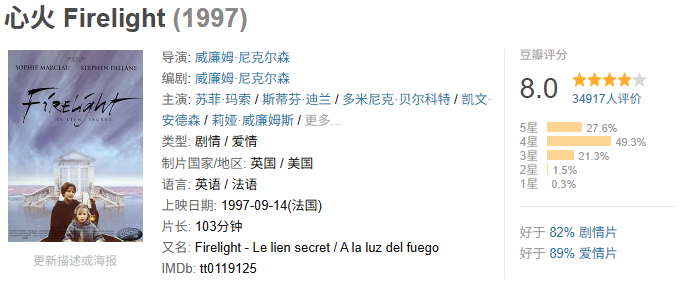
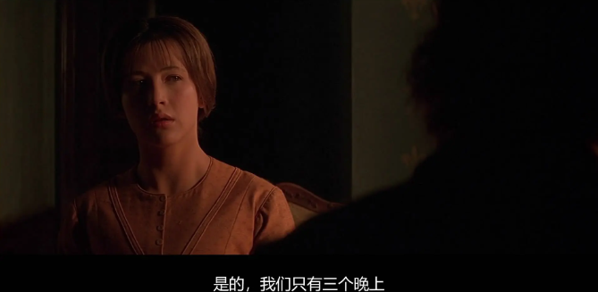
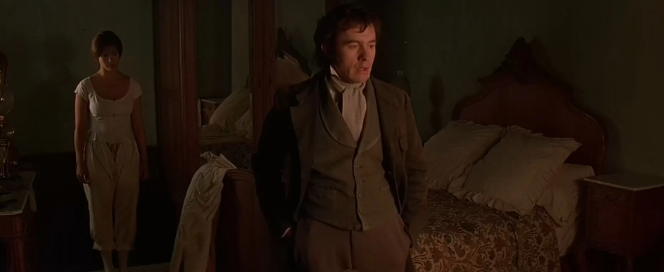
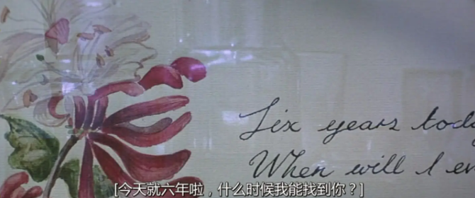
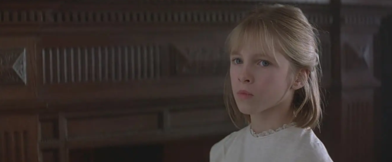
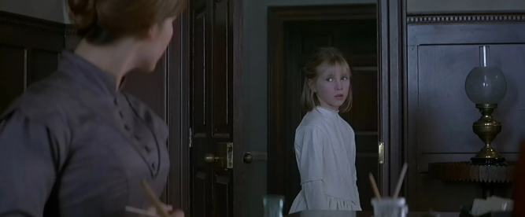
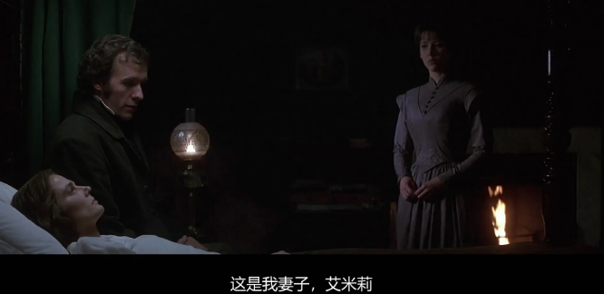
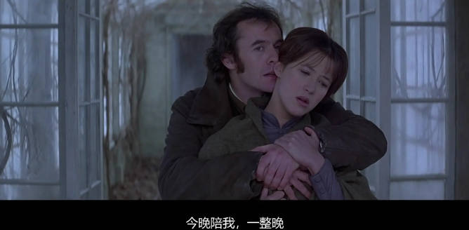
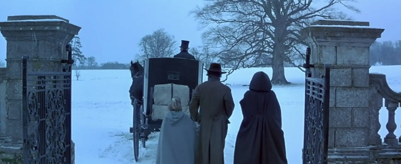

# 女神的“未删减”影片，后劲真大
> 💡 备注属性未写入，可能是备注属性名称或者类型被修改了，建议将字段类型设置为 rich_text，可以在小程序-操作-修改文章数据库页面进行调整
> 💡 原文链接:[https://mp.weixin.qq.com/s?__biz=MzI0NzQ3NDYzNg==&mid=2247511432&idx=1&sn=55ef3dabdf28e8fec2b5ca90c2f1f49e&chksm=e8a176641d5d7eba862779e21088496320948f670c1263f1db72a43e74da78358dffcf7087fc#rd](https://mp.weixin.qq.com/s?__biz=MzI0NzQ3NDYzNg%3D%3D&mid=2247511432&idx=1&sn=55ef3dabdf28e8fec2b5ca90c2f1f49e&chksm=e8a176641d5d7eba862779e21088496320948f670c1263f1db72a43e74da78358dffcf7087fc#rd)
1837年，一个女人用三个晚上换了500英镑.
条件是生下孩子就消失，终生不再出现。
**《心火》**讲的是这笔交易的后半段。

1997年上映的英法合拍剧情片，导演是威廉姆·尼科尔森，著名编剧。

写过《角斗士》和《悲惨世界》，这是唯一一次执导。
主演**苏菲·玛索**，拍这片那年31岁。

**伊丽莎白**接这笔交易，是因为父亲的债。
500英镑，19世纪，还不上的家庭会滑向哪里，当时的人比现在清楚。
牵线人把条件讲得很干净，三个晚上，生一个孩子，然后消失。

对面那位贵族全程匿名，连名字都是到了诺曼底那家偏僻旅馆才对上的号。
三个晚上，片子拍得极省。
第一晚，两个人隔着半个房间坐着，谁也不看谁。
第二晚，她哭了，没出声，他背过身去。
第三晚过后，两人最后一次一起站在海边，没有交流，就此分别。
这段没什么台词，全靠火光、脚步声和停顿撑着。

多年后看，删掉这三个晚上，后面的全都不成立。
十个月后她生下一个女孩。
孩子当天被抱走，她连脸都没看清。
按合同，这个孩子从此与她无关。
头一年她还能说服自己认了。
第二年她开始打听孩子的下落，打听不到。
她能做的只剩一件，每年女儿的生日，在画簿上画一幅画，写几句话。

第七本画满的时候，她查到了那座苏塞克斯庄园。
她以家庭教师的身份应聘进去。**
**
**查尔斯**开门认出她，当场要赶她走。
她说她只教课，别的什么都不问。
僵到最后谈下来一个月期限。
他要她教的**露易莎**，是他的女儿，七岁，赶走过好几任家庭教师，谁的话都不听。

庄园里没人知道，这个新来的教师在给谁上课。
孩子不好对付，顶嘴，逃课，把新教师当空气。
伊丽莎白不哄也不罚。
她比谁都清楚这孩子在气什么。

露易莎问过她一些大人答不上来的问题，每一次回答，她都在心里过一遍不能说的那一半。
一个月没到，孩子服了，开始学琴，学规矩，睡前会道晚安。
庄园里还锁着一个人。
阁楼上是查尔斯的妻子，十年前骑马摔的，之后没有醒来。

他每周上去坐一会儿，擦脸，梳头，十年没断过。
当年那笔交易就发生在这之后。
他要一个孩子，妻子给不了，离不掉，也放不下。
这个人的处境，比他的选择更早锁死了他。
一个月里，孩子变了，两个大人也没守住界线。
教完课的晚上，两人在壁炉边说话，说的都是孩子，说着说着就不是了。

片名直译是火光，伊丽莎白教过露易莎一套规则，炉火熄了，时间停住，规矩作废，想做什么都可以。
火再点起来，一切照旧，发生过的事等于没发生。
旅馆那三晚，两个人用的就是这条规则。
然后是结尾。

查尔斯走上阁楼，打开窗户，熄了炉火。
他昏迷了十年的妻子在睡梦里离世。
之后他向全家公开了露易莎生母的身份，带着母女俩离开庄园。

## 摘要

（待补充）

## 我的笔记

（待补充）
