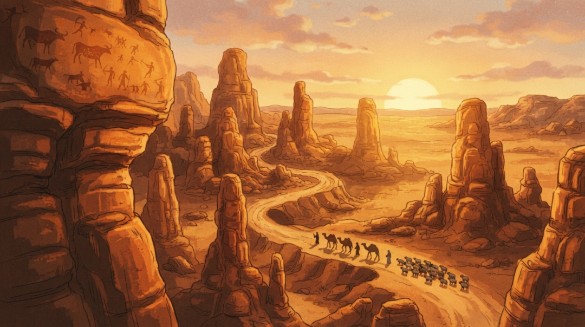
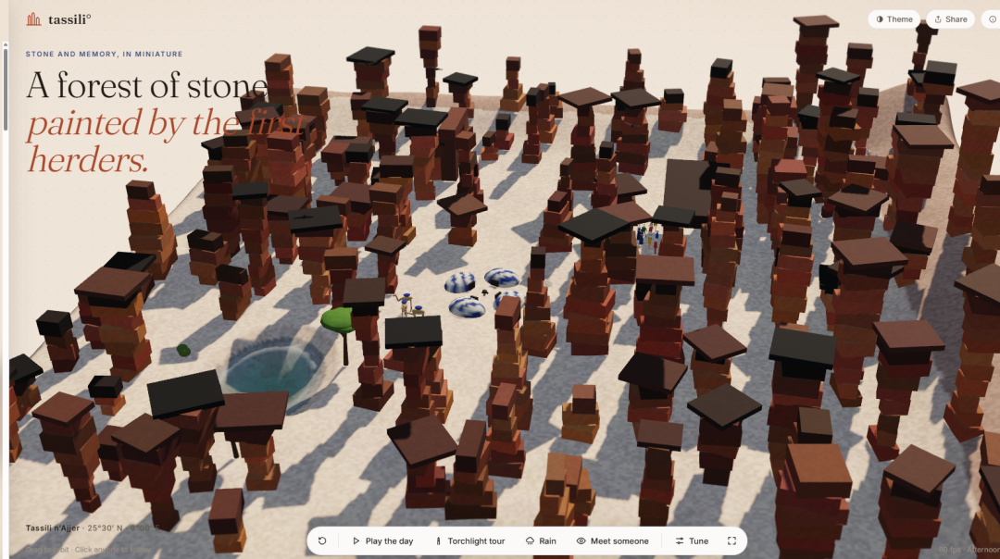
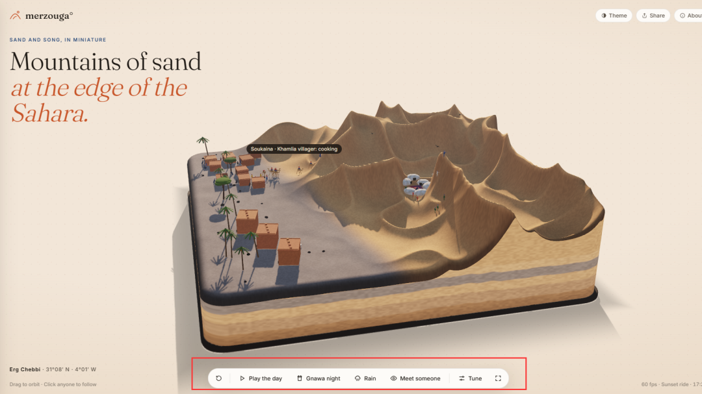
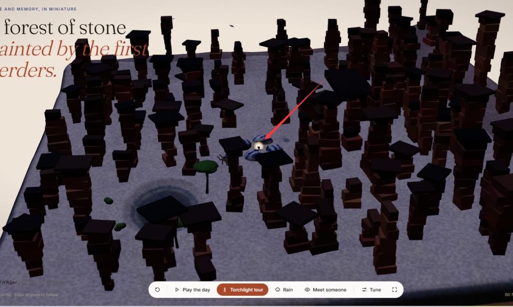
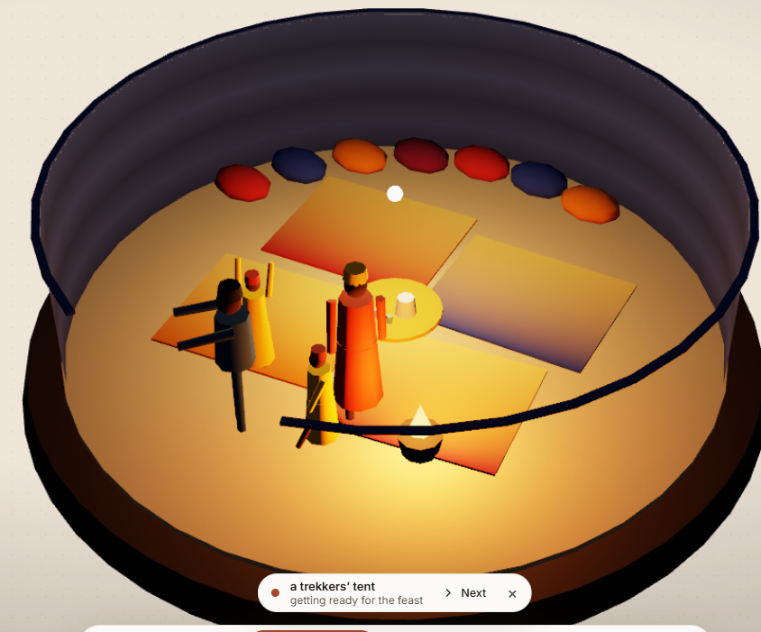
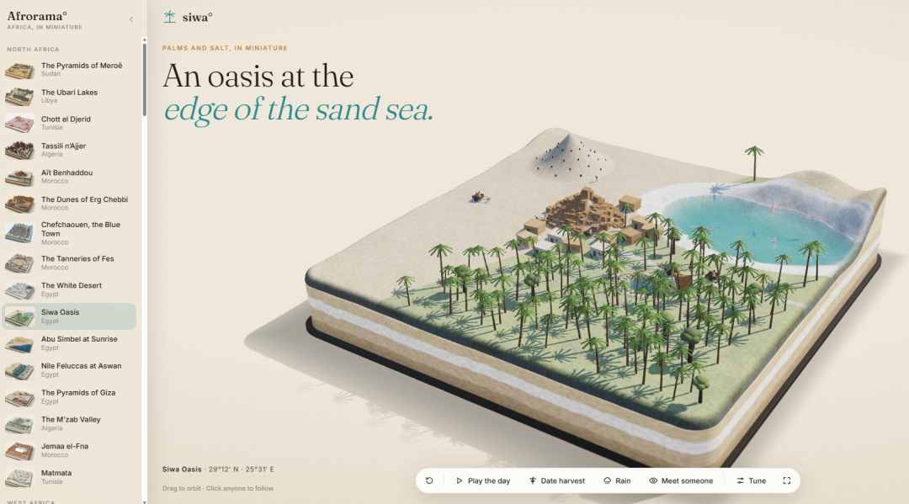

# 好玩，一百个非洲奇观，全塞进一个免费网页，还可以互动
> 💡 备注属性未写入，可能是备注属性名称或者类型被修改了，建议将字段类型设置为 rich_text，可以在小程序-操作-修改文章数据库页面进行调整
> 原文链接:[https://mp.weixin.qq.com/s/oaU6gY02tCoQYpLDJCQLRw](https://mp.weixin.qq.com/s/oaU6gY02tCoQYpLDJCQLRw)
半夜刷短视频刷腻了，我打开一个英文网页，屏幕里忽然立起一整片石头塔林。
拖一下，视角就绕着那些歪歪扭扭的砂岩转。塔与塔之间是窄走廊，沙地起伏，偶尔能看见藏在缝里的水洼，还有几棵快绝种的撒哈拉扁柏。这不是航拍纪录片，是浏览器里实时算出来的小世界。

站点口号：Africa, in miniature。作者用纯代码堆了一百个非洲奇观的迷你三维世界，没有模型文件，也没有贴图，全靠 WebGL 2 现场生成。本期我只钻进其中一处——Tassili n’Ajjer，阿尔及利亚东南、靠近 Djanet 的那片高原。页面上标着坐标：大约北纬二十五度半、东经九度。
真实的 Tassili 被风化成所谓的石之林：塔、拱门、细长走廊，岩棚里藏着一万五千多幅岩画与刻画，画的是绿撒哈拉时代的牛群、长颈鹿、猎人、舞者。

一进来就能拖着转。上方几个按钮我几乎全按过：Play the day 把一天快进；Torchlight tour 天黑后拿手电逛；Rain 下雨；Meet someone 碰上谁跟谁；Tune 调速度、昼夜、雨云、太阳方位，还有一点 tilt-shift，景深一拧，整片沙盘更像桌上的模型。
最上头的是点人。页面写着 Drag to orbit，Click anyone to follow。羊在塔缝里挑路走，旅人在篝火边扎营，天一黑有人往回走，一下雨有人往棚子里钻。点谁就跟谁，按 Eyes 还能钻进对方视角；点家里，能看一眼屋里的人。它管这套叫 life engine——不是摆死的小人偶，是有日常作息的小生命。

我故意把时间拧到傍晚，再点 Torchlight tour。石塔轮廓变黑，手电筒光一圈圈扫过去，岩棚上的牛群、牧人、长颈鹿轮廓被照亮。那一刻你会忽然意识到：这些画不是博物馆玻璃柜里的复制品说明，而是有人在绿撒哈拉还没变成沙漠时，就近画在石头上的生活。
About 里的 How it’s made 也值得扫一眼。石塔是一层层略微错位的毛边岩块堆起来的，模仿砂岩沿层理风化，再罩一层沙漠漆似的暗色；走廊是 heightfield 撑出来的起伏沙地；岩画按 cattle period 的风格复刻。人物、牲畜都跑在同一套生活引擎上：天黑回家，下雨躲雨，有事就聚过来。

天黑后，点开这个亮光的地方，会发现有小人在跳舞

整站免费，不用注册。虽然界面是英文，但是基本上看图就知道怎么操作了。除了石林，还有很多场景，不同场景点击下方的操作按钮对应的效果也是不一样的，可以点点左边不同的场景看看效果

官网：https://afrorama.amaete.com/
