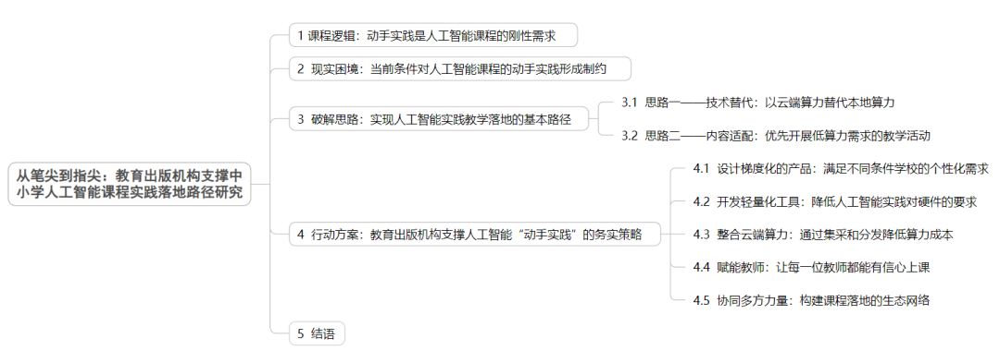

# 姜涛 | 从笔尖到指尖：教育出版机构支撑中小学人工智能课程实践落地路径研究
> 💡 备注属性未写入，可能是备注属性名称或者类型被修改了，建议将字段类型设置为 rich_text，可以在小程序-操作-修改文章数据库页面进行调整
> 💡 原文链接:[https://mp.weixin.qq.com/s?__biz=MzA4MjE0MDYyNg==&mid=2694699305&idx=1&sn=f3589c1450eb1b89731d690302a6e7ef&chksm=bb95e3d3814067139cd22cffd4e03f49f9b6f44303787c5ea97b590d759804daa46123f2198b#rd](https://mp.weixin.qq.com/s?__biz=MzA4MjE0MDYyNg%3D%3D&mid=2694699305&idx=1&sn=f3589c1450eb1b89731d690302a6e7ef&chksm=bb95e3d3814067139cd22cffd4e03f49f9b6f44303787c5ea97b590d759804daa46123f2198b#rd)
点击蓝字关注
了解更多精彩
ABOUT

（点击查看思维导图）
**GB/T 7714-2025**
**CITE**
**姜涛.从笔尖到指尖：教育出版机构支撑中小学人工智能课程实践落地路径研究[J].科技与出版，2026（9）：82-88.**
**摘 要  **
中小学人工智能课程的核心目标是培养学生人工智能素养，这一目标的实现高度依赖学生从“笔尖”（知识学习）到“指尖”（实践操作）的能力跨越。然而，当前大量中小学校面临设备老旧、算力匮乏等现实瓶颈，导致动手要求难以落地。本文分析了动手实践的刚性需求与现实瓶颈之间的根本矛盾，从技术替代、内容适配两个方面提出了现有条件下支撑人工智能实践落地的基本思路，并在此基础上，结合北京师范大学出版集团、浙江教育出版社、四川教育出版社等机构的实践案例，对教育出版机构系统性支撑课程实践落地的五大路径进行了探讨。
**关键词 **
人工智能教育；教育出版；实践瓶颈；动手实践；课程落地

新一代人工智能技术的快速发展，正在深刻重塑经济社会各领域的运行逻辑。党中央、国务院在国家战略层面对加强中小学人工智能教育作出了全面部署。2025年4月，习近平总书记在中共中央政治局第二十次集体学习时明确要求“推进人工智能全学段教育和全社会通识教育”，为中小学人工智能课程提供了最高层级的根本遵循；5月，教育部基础教育教学指导委员会正式发布《中小学人工智能通识教育指南（2025年版）》（以下简称《指南》）；2026年4月，教育部等五部门联合印发《“人工智能+教育”行动计划》，要求开齐开足开好人工智能相关课程，加快普及中小学生人工智能教育。
在地方层面，《北京市中小学人工智能教育地方课程纲要（试行）（2025年版）》将人工智能明确定位为“面向人人的普及性课程”，要求“面向全体学生提供人人必学、人人可学、人人愿学的基础性内容”，黑龙江省率先在全省范围内推进人工智能通识教育试点，人工智能课程在很多省份已成为中小学生必修课程。北京、上海、广东等地已启动人工智能教育实验区、实验校建设。中小学人工智能教育现已从“试点探索”迈入“全面普及”的新阶段，成为教育强国建设的重要组成部分。
人工智能课程具有实践性强、跨学科融合度高、内容更新迭代迅速等显著特征，其中学生的动手实践环节是课程实施的必要组成部分。教育出版机构作为中小学课程资源的传统建设者与提供者，在推动人工智能课程落地实践的过程中承担着不可替代的职责，与传统纸质课程资源不同，人工智能课程资源建设必须有效回应课程的实践性要求，如何为中小学生提供切实可行的动手实践支撑，已成为教育出版机构建设相关课程资源时亟须解决的关键问题。然而，检视既有研究发现，尚无关于教育出版机构支撑中小学人工智能课程动手实践落地的系统论述，教育领域虽有若干涉及中小学人工智能实践教学的成果，但其关注重点多集中于教学实践层面，未能真正触及出版机构在资源开发、内容迭代、技术适配等方面的现实痛点。有鉴于此，本文立足出版机构的既有优势与现实条件，从动手实践的刚性要求、现实困境、解决思路和务实策略四个层面进行体系化的梳理与阐释，以期为教育出版机构在有限资源下建设人工智能课程体系、有效满足动手实践需求提供切实可行的思路与借鉴。
**1**
**课程逻辑：动手实践是人工智能课程的刚性需求**
中小学人工智能教育的核心目标是培养学生的“人工智能素养”，《指南》将其分解为知识、技能、思维和价值观四个维度，其中技能与思维的培养尤其依赖动手操作。《指南》在各学段均嵌入了动手要求：小学通过技术体验建立认知雏形并完成简单编程；初中掌握机器学习基本流程并完成项目式学习；高中构建算法模型并开发综合解决方案。若没有动手环节，各学段的培养目标都无法真正达成。
人工智能课程专业性极强，对中小学生而言，若从底层概念、算法、模型入手，难度大且易引发畏难情绪。因此，当前中小学人工智能教学多采用“做中学”的方式——即通过亲身动手实践来建构知识、形成理解。这种方式遵循“体验—感知—探究—理解”的认知生成逻辑，以动手实践为根本驱动力，非常适合人工智能教育。当代人工智能应用的基本流程为“数据—训练—模型—预测”，学习者只有通过亲手操作才能领会其中的原理，这正体现了教学从传统的“笔尖”学习（听讲、记笔记）向“指尖”学习（编写代码、训练模型、调试程序）的转变。
从认知规律看，这种“做中学”决定了人工智能课程具有鲜明的动手实践属性。从人才培养的战略高度看，人工智能教育旨在培养全体学生的创新意识与工程思维，而动手操作正是实现这一目标的关键载体。动手不仅是理解与应用人工智能原理的必经之路，也是激发学生兴趣、建立技术自信的重要方式。如果学生从未亲手训练过一个模型、从未调试过一行代码，他们就很难真正体会人工智能的思维方式，也无法判断自己是否对这一领域产生持续的兴趣。
因此，无论是课程本身的刚性要求、认知规律的内在逻辑，还是面向全体学生的素养培育目标，动手操作都是人工智能课程不可动摇的核心特征。然而在现实中，这一特征却遭遇了普遍的实践瓶颈。
**2**
**现实困境：当前条件对人工智能课程的动手实践形成制约**
“十四五”期间，我国教育信息化建设成效显著。据教育部新闻发布会数据，全国中小学（含教学点）互联网接入率已达100%，99.5%的学校拥有多媒体教室，国家智慧教育公共服务平台用户总量突破1.78亿。
然而，随着人工智能技术近些年的爆发式发展，一个深层的结构性矛盾日益凸显：当前中小学校的计算机配置及网络等硬件设施，并非为人工智能课程的“体验—感知—探究—理解”生成逻辑所设计。传统信息科技课程以讲授软件操作、培养基础信息素养为主要目标，对硬件、算力等并无严苛要求。而在人工智能课程中，深度学习模型的训练、推理与应用，核心依赖于GPU（图形处理器）的并行计算能力，普通电脑的集成显卡根本无法胜任。有研究者指出：中小学在推进人工智能实践教学的过程中，算力匮乏始终是制约课程开展的关键瓶颈。
与硬件瓶颈相伴的，是师资力量的严重短缺。目前中小学人工智能课程主要由信息科技或科学教师授课，这些教师大多缺乏人工智能专业的系统训练，对机器学习、物联网等核心概念的理解深度有限，在教学实践中常常感到力不从心。师资短板已成为制约课程质量提升的最关键因素。从这个角度看，即便部分学校硬件升级到位，缺乏具备人工智能专业背景的教师来进行课程设计和实验指导，动手实践的教学目标同样难以高质量实现。
以教育信息化水平处于全国领先地位的北京市为例，2025年9月，北京市开始在全市中小学普及人工智能通识课程，同年11月，北京教育科学研究院面向全市中小学进行了人工智能通识课程实施情况的调研，结果显示，在课程实施过程中存在诸多问题，主要集中在教师人工智能教学胜任力不足、人工智能课程资源不足、区域与学校之间课程发展基础差距较大等方面，其中学生无法进行高质量的人工智能直观体验和实践操作成为问题反馈较多的领域。从数据上看，在调研的1 000多所学校中，27.6%建设了人工智能实验室，47.08%升级了学校计算机、网络、多媒体教学设备等基础设施，31.16%配置了专用服务器、智能机器人等人工智能教学装备，但仍有相当多的学校缺乏人工智能专用实验室及相关设备，学生无法进行直观体验与实践操作，难以构建有效的学习情境。
因此，当前的根本矛盾是：课程本身对动手操作有刚性需求，而很多学校的硬件设施、算力资源和师资能力尚无法支撑高质量的动手教学，形成了制约课程顺利实施的实践瓶颈。这意味着，如果仅仅停留在“笔尖”层面的知识传递——学生读懂了教材、记住了概念——他们仍然无法完成“指尖”层面的实践操作，人工智能素养的核心目标也就难以实现。
**3**
**破解思路：实现人工智能实践教学落地的基本路径**
在当前条件下，推动中小学人工智能实践教学落地，应从两条基本思路出发：一是技术替代，二是内容适配。这两条思路并非具体操作方案，而是为学校在硬件不足、算力有限的现实情况下，灵活、创造性地达成课程动手要求提供方向性指引。
**3.1 思路一——技术替代：以云端算力替代本地算力**
技术替代的核心逻辑是“计算与终端分离”：将高算力需求的模型训练、数据处理等任务迁移到云端服务器完成，本地设备仅承担显示、输入和网络通信功能。这一思路的可行性基于云计算的共享机制——多所学校、多个教室可以共用一套云端算力集群，从而大幅降低对每一台学生终端硬件性能的要求。只要学校具备稳定的网络连接和基本的浏览器运行环境，即使使用五年前配置的老旧电脑，也能完成原本需要高性能工作站才能支撑的人工智能实验。这一方向使“指尖”实践在硬件条件有限的普通教室里具备了可行性。
落实这一思路，需要关注两个关键问题：一是区域性的云端算力建设，二是学校的网络带宽支撑。首先是算力来源，可以采用区域（如以区县为单位）集中部署算力节点、各学校通过专线或互联网接入的“中心+节点”架构，四川乐山夹江县就实施了这种云教室模式——该县在城区部署一套算力平台（中心），24所乡镇学校配置轻量级云终端（节点），通过网络接入算力平台，峰值可承载2 000名学生同时在线。网络带宽方面，绝大多数基础实验的数据传输量并不大，可以通过课前缓存、数据预处理等方式降低带宽压力。
**3.2 思路二——内容适配：优先开展低算力需求的教学活动**
内容适配的核心逻辑是“按算力需求分级教学”：在不同学段的人工智能通识课程中，不同知识点和技能点对硬件条件的要求差异很大。指导方向是教师根据本校实际拥有的计算资源，优先选择算力需求低、教学效果好的内容模块，将对算力需求较高的内容后置或做简化处理，从而在不增加硬件投入的前提下，让学生掌握人工智能的核心原理与基本方法。遵循这一思路，学生可从“笔尖”的文本阅读直接过渡到“指尖”的代码编写与模型调试，使整个学习过程保持连贯，实践环节不被硬件条件限制。
从操作方向上，可重点关注以下路径。
第一，优先选用低算力要求的文本型任务。相较于图像识别、视频分析等对算力需求较高的任务，文本分类、关键词提取、简单问答系统等自然语言处理基础任务在同等条件下所需的计算资源显著更少。因此，在算力有限的校园环境中，教师应优先引导学生选取文本型任务开展实践，以较低的资源成本建立对机器学习流程的直观认识，体验“数据输入—模型处理—结果输出”的基本工作流程。
第二，使用预训练模型进行迁移学习。从零训练深度网络需要海量数据和专业算力，在中小学校环境中很难实现。迁移学习利用已在大型数据集上预训练好的模型，学生仅需采集每类15~30张图片进行微调，即可在普通电脑上数分钟内完成训练，该方法将数据需求从数万张降至百张量级，训练时间从数小时压缩至几分钟，且无需GPU支持。课堂实践表明，学生可在单节课内完成“数据采集—模型微调—效果测试”的完整闭环，如垃圾分类识别准确率可达94%以上。这一方向为中小学人工智能教育提供了一条低算力依赖的技术路径。
第三，设计“不插电”的模拟实验。“不插电”计算机科学教育是一种著名的教育理念，指通过游戏、谜题和身体活动来教授计算机科学概念，完全不依赖电脑。在中小学人工智能教学过程中，对于极端缺乏条件、连稳定网络都没有的学校，教师可以用角色扮演、纸笔推演等方式模拟机器学习的核心流程。例如，将全班学生分成“数据组”“训练组”“测试组”，用卡片代表数据样本，用手工计算代表模型参数更新。这种活动不依赖任何电子设备，却能让学生深入理解机器学习的基本逻辑，为日后进入真实的“指尖”实践打下认知基础。
上述技术替代与内容适配两条思路，为中小学校在当前信息化条件下开展人工智能动手实践提供了指导方向，是帮助学校和教师根据自身硬件、网络、师资等现实条件灵活选择路径的指导思想。作为中小学课程资源传统的重要建设者和提供者，教育出版机构应在此基础上进一步将这些思路转化为可操作的具体行动方案，从而为学生在人工智能课程中完成从“笔尖”到“指尖”的跨越搭建切实可行的支撑通道。
**4**
**行动方案：教育出版机构支撑人工智能“动手实践”的务实策略**
不同于人工智能领域的科技企业，教育出版机构的优势在于内容研发能力、编校规范、与一线教学的紧密联系以及成熟的渠道网络；劣势在于技术实力相对薄弱、资金投入有限。教育出版机构破解实践瓶颈的关键，不是去和科技企业比拼技术，而是发挥内容与渠道优势，整合外部资源，做“课程生态的组织者”，可以从以下五个方面展开具体的行动。
**4.1 设计梯度化的产品：满足不同条件学校的个性化需求**
梯度化产品设计的基本思路是“条件适配”：我国中小学校教育信息化硬件条件的差异客观存在且短期内难以消除。出版机构应针对不同条件进行梯度化的产品设计——开发建设“普惠版—标准版—增强版”的产品矩阵。普惠版：纸质教材加配套数字资源（含云端基础算力服务），面向广大县域和薄弱学校，目标是“保基本、能动手”，确保学生至少能够完成从“笔尖”到“指尖”的基础跨越。标准版：增加配套实验套件（开源硬件模块、传感器包），预算控制在每校一定额度内（如每校5 000元以内）。增强版：面向条件较好的学校，提供完整的人工智能实验室方案（含硬件推荐清单和采购参数，可以整合、推荐第三方的硬件产品）。分层设计的关键是“提供多种选择”，学校可根据自身条件选择不同产品。
北京师范大学出版集团在中小学人工智能课程建设过程中，针对不同学校条件的现实差异，在支撑学生动手实践方面提供了多层次、可选择的资源支持方案：面向硬件配置极低且无法联网的学校，提供标准化教师实操演示录屏和独立离线资源安装包，保障基础教学推进；面向网络条件达标但算力不足的学校，搭建通用基础教学平台，提前存储课程专用训练模型，学生凭激活码直接登录调用，无需本地训练；面向条件较好的学校，则整合完整实验套件和云端算力，支持深度的项目式学习。这种分层供给的做法，正是“普惠版—标准版—增强版”产品矩阵的雏形。
**4.2 开发轻量化工具：降低人工智能实践对硬件的要求**
轻量化工具开发的基本思路是“降低计算开销”：通过技术优化，将原本需要高性能硬件支持的人工智能实验，压缩到普通浏览器即可运行的轻量级版本。技术上有两条路径：一是基于网页汇编技术的浏览器端机器学习，使机器学习库直接运行于浏览器中，无须安装任何插件；二是离线实验包方案，将轻量级实验封装成几十兆的离线网页包，教师用U盘拷贝到每台学生电脑上即可使用。这些轻量化工具的核心价值在于：即便学校的电脑仍是五年前配置的“笔尖”时代产物，学生也能在上面完成“指尖”级别的编程与调试任务。
浙江教育出版社在课程落地中为这一路径提供了有益参照。该社《人工智能》系列教材，每册均包含教材、活动手册和丰富的数字资源包。配套的数字资源包（含实验程序、操作视频和基础知识）将核心实验封装为轻量级网页应用，无须安装任何软件，在普通浏览器中即可运行，极大地降低了教学门槛。实践表明，通过将实验内容封装为轻量级数字资源，即便硬件条件普通的学校也能顺利开展人工智能教学，验证了轻量化工具在基层学校的可行性。
**4.3 整合云端算力：通过集采和分发降低算力成本**
出版机构可采取“集中采购、分摊成本、封装分发”的方式，为学校提供包含云端基础算力的数字资源。具体操作上，出版机构与云服务商或算力平台签订整体购买协议，以大批量采购的形式获得相对廉价的算力资源，从而显著降低单校、单学生的使用均价。随后，出版机构将这些算力以“封装好的服务形态”嵌入配套数字资源（如虚拟实验环境、在线编程平台等），通过纸质教材中的激活码或统一账号分发给各中小学校。学校师生在使用教材附带的数字资源时，无须自行购买或配置算力，可直接调用封装内的云端基础算力完成实验、训练等教学任务。这种模式既发挥了出版机构的整合与分发优势，也减轻了学校自建算力基础设施的负担。
2025年2月，四川教育出版社联合纳米盒、腾讯云合作建设“汇学AI云”平台。该平台依托出版机构与云服务商达成的集中采购协议，批量获取腾讯云的算力资源，并将云端AI能力封装为可分发、可商用的个性化学习产品，通过教材配套账号或激活码触达学校和学生，实现了算力资源的规模化供应与低成本使用，是“集采—封装—分发”模式的典型实践。接力出版社在中小学《人工智能》媒体融合出版项目中，虽未直接采用云端算力集采模式，但其自主研发的在线虚拟仿真与测评系统（AI教室）同样体现了“封装服务、降低门槛”的核心逻辑。该平台以虚拟仿真实验替代实体教具，将原本需要学校自行承担的硬件投入和本地算力需求，通过云端模拟平台加以承载，学校仅需机房环境即可开展教学。尽管实现路径不同，其本质依然是通过出版机构的技术封装，将高成本的硬件配置转化为轻量化的数字服务，从而大幅降低学校开展人工智能教学的初始投入，与集采分发的降本目标高度一致。
**4.4 赋能教师：让每一位教师都能有信心上课**
主动赋能教师的基本思路是“降低教学门槛”：教师用不好人工智能课程，往往不是因为能力不足，而是因为缺乏在有限条件下开展教学的实战指导。具体措施包括：在教师用书中编写“低配置教学建议”，对每一节课提供高配置和低配置两套方案；录制“在普通电脑室里如何完成人工智能实验”的示范课视频；建立教师在线答疑社群；定期组织线下培训，重点培训“在有限条件下开展动手教学”的技能。通过这些举措，帮助教师建立从“笔尖”讲授转向“指尖”指导的信心与能力。
为提高教师指导学生进行动手实践的能力，北师大出版集团在教师培训过程中设计了专门的“低门槛、可落地”的培训方案。培训内容涵盖三个层面：理念层面，引导教师树立“用好现有资源、设计可执行任务”的教学观；教材内容层面，逐单元解析如何用低成本、本地化方案替代高算力需求的项目；教学能力层面，通过案例教学与实操演练，指导教师使用离线编程、图形化人工智能平台等简易手段完成数据采集、模型训练等核心环节，从而有效破解“师资薄弱、硬件受限”的双重瓶颈，确保学生的人工智能实践操作真正落地。
**4.5 协同多方力量：构建课程落地的生态网络**
主动协同多方力量的基本思路是“专业化分工”：出版机构的核心能力是内容研发和渠道分发，而算力基础设施、硬件设备供应、教师培训实施、教研指导等工作，应由更专业的各方主体来承担。具体协同方向：与云服务商协同设计“买课程送算力”产品包；与硬件厂商协同建立“课程认证硬件”体系；与公益组织协同，对极端落后学校开展定点帮扶；与教研部门和高校协同，共同开发教师培训课程和教学案例库。这将充分发挥教育出版机构长期积累的整合资源的能力，构建多方共赢、惠及学生的生态网络，共同保障学生“指尖”实践的顺利落地。
北师大出版集团在中小学人工智能课程建设的过程中，先后与科大讯飞等科技企业以及北京航空航天大学计算机学院等科研机构开展合作：出版集团和科研机构负责知识体系搭建与教材编写出版，科大讯飞负责将语音识别、自然语言处理等前沿人工智能核心技术进行教学化改造适配，同步完成配套教学平台开发；科研机构还发挥研究优势，针对硬件老旧、网络薄弱的基层学校实际，设计了轻量化实验模块，并引入虚拟现实技术，使学生能在模拟环境中完成关键操作体验。这种合作有效弥补了出版集团在技术实现能力上的短板，为人工智能课程的学生实践提供了有力支持。
**5**
**结语**
现实中设备老旧、算力不足、网络不稳定、教师缺乏培训等因素直接限制了人工智能课程中动手实践的开展，但这些问题并非无法解决。教育出版机构作为基础教育课程资源的传统建设者和提供者，尤其是要在落实人工智能课程的动手实践方面发挥积极作用。在建设过程中，教育出版机构不应该在硬件、技术等自身短板方面去与科技企业竞争，而是应该发挥自身对课程内容的准确理解、对一线需求痛点的敏锐把握，以及对发行渠道的熟悉等优势，通过设计梯度化产品、开发轻量化工具、整合云端算力、提供教师支持等方式，成为“课程生态的构建者”，最终让更多普通学校的学生，从在纸上抄写人工智能的概念，转向真正动手敲代码、跑模型——完成从笔尖到指尖的跨越。
**参 考 文 献**
（上滑查看）
[1] 教育部.教育部部署加强中小学人工智能教育[EB/OL].(2024-11-20)[2026-08-03].https://hudong.moe.gov.cn/jyb_xwfb/gzdt_gzdt/s5987/202412/t20241202_1165500.html.

[2] 教育部基础教育教学指导委员会.《中小学人工智能通识教育指南（2025年版）》发布！[EB/OL].（2025-05-12）[2026-09-04].https://www.eol.cn/zhengce/wenjian/202505/t20250512_2667827.shtml.
[3] 国务院.教育部等五部门关于印发《“人工智能+教育”行动计划》的通知[EB/OL].（2026-04-02）[2026-
08-03].https://www.gov.cn/zhengce/zhengceku/202604/content_7065138.htm.
[4] 王振强.北京市中小学人工智能通识课程现状与问题应对[J].中小学信息技术教育，2026（4）：39-41.
[5] 人民网.从“黑板”到“云端”：传统教育装上智慧引擎[EB/OL].（2025-11-21）[2026-09-04].http://sc.people.com.cn/n2/2025/1121/c345167-41419258.html#1#1#1.
[6] 钟柏昌.普及中小学人工智能教育需要注意的六对关系[J].人民教育，2026（3）：78-81.
**AUTHOR**
**  姜涛**
**北京师范大学出版集团**

**END**

