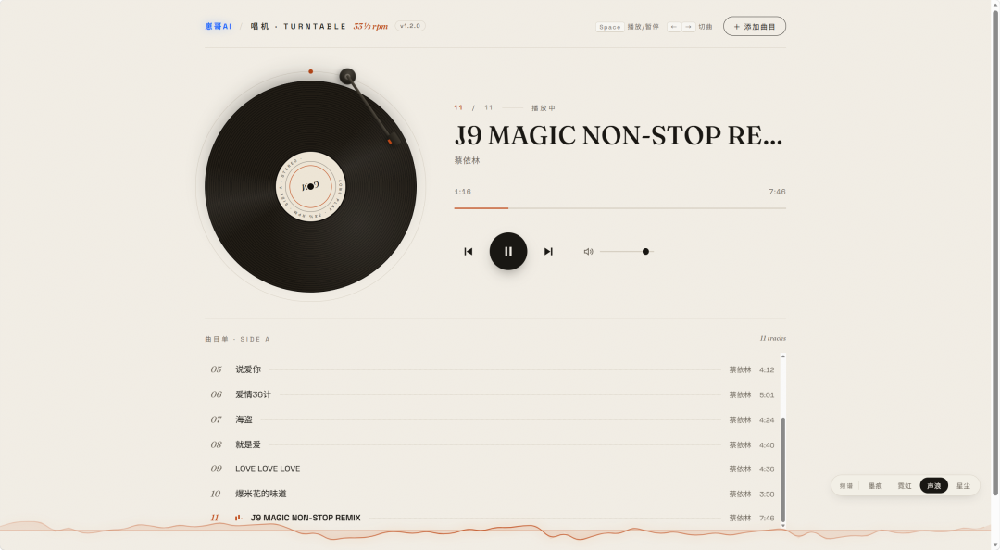

# 娱乐 轻量 网页版 音乐播放器 免费耍起
> 💡 备注属性未写入，可能是备注属性名称或者类型被修改了，建议将字段类型设置为 rich_text，可以在小程序-操作-修改文章数据库页面进行调整
> 💡 原文链接:[https://mp.weixin.qq.com/s?__biz=MzI2ODIyODY5MQ==&mid=2247486082&idx=1&sn=a76c1bbe806d72066fe5a5b4fcac2e17&chksm=ebc8f50a4aa51d59b217f7a38fee76fc2feb2cb12967d43ec0866b8ca003ee059f4b2b7cb7d7#rd](https://mp.weixin.qq.com/s?__biz=MzI2ODIyODY5MQ%3D%3D&mid=2247486082&idx=1&sn=a76c1bbe806d72066fe5a5b4fcac2e17&chksm=ebc8f50a4aa51d59b217f7a38fee76fc2feb2cb12967d43ec0866b8ca003ee059f4b2b7cb7d7#rd)
AI无所不能，做一个播放器把硬盘里面的音乐听起走，下载见文末

网页版音乐播放器，双击打开，加载音乐，播放。主打一个简单操作。
主要功能：
| 🎵 基础播放 | 添加/拖入音频、播放、暂停、进度拖动、上/下一首、音量、空格与方向键快捷键 |
| 💿 黑胶唱机 | 唱片按 33⅓ RPM 真实转速旋转，暂停惯性减速，封面显示在唱片中心标签 |
| 🎯 唱臂真实循迹 | 按歌曲时长从外圈到内圈线性移动，暂停抬臂，拖进度即时跟随 |
| 📋 曲目单 | 自动连播、循环列表、点击切歌、跳动的播放指示条 |
| 🏷️ 标签读取 | 读取 mp3 内嵌的歌名/歌手/封面，失败自动回退文件名 |
| 🌈 频谱 4 样式 | 墨痕 / 霓虹 / 声浪 / 星尘，右下角随时切换 |
通过网盘分享的文件：Musicplayer.html 下载得到一个HTML网页，双击打开即可操作播放音乐。
耍起链接:
https://pan.baidu.com/s/1MpK0rCExSwekA2OB6i-iUQ?pwd=wmpk 提取码: wmpk 
听歌的同时还可以试一试 AI平台：
[电磁环境 AI 智库本地客户端今日升级](https://mp.weixin.qq.com/s?__biz=MzI2ODIyODY5MQ%3D%3D&mid=2247486073&idx=1&sn=e481cdad021f464b286c6e7eb7502e59&scene=21#wechat_redirect)
（完）
