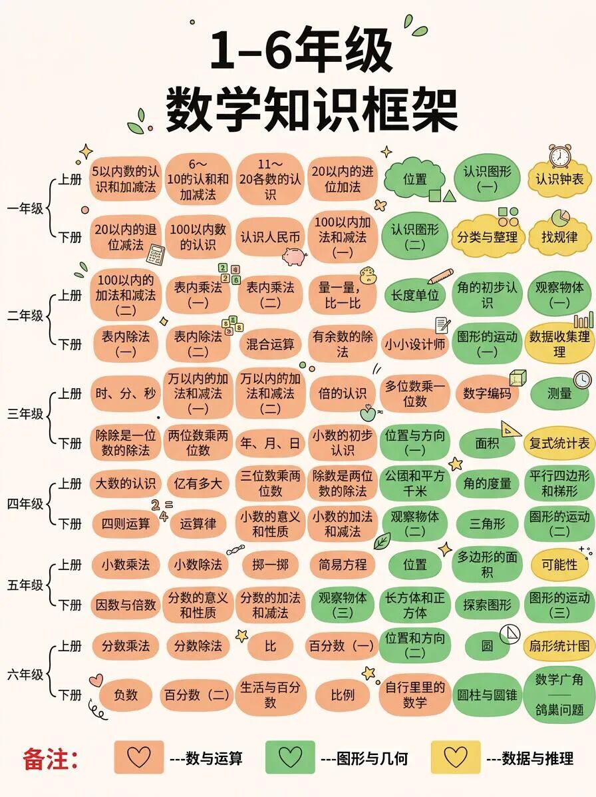
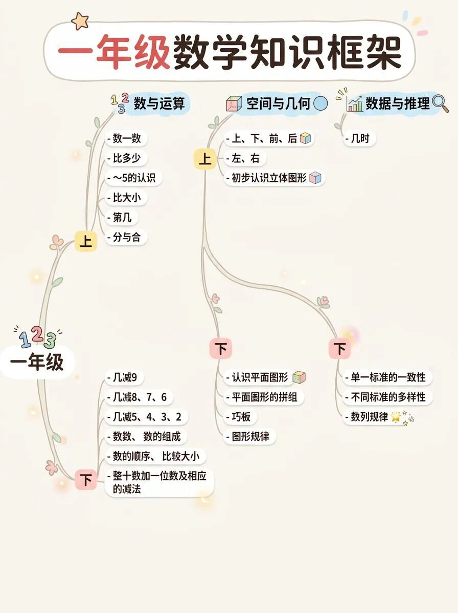
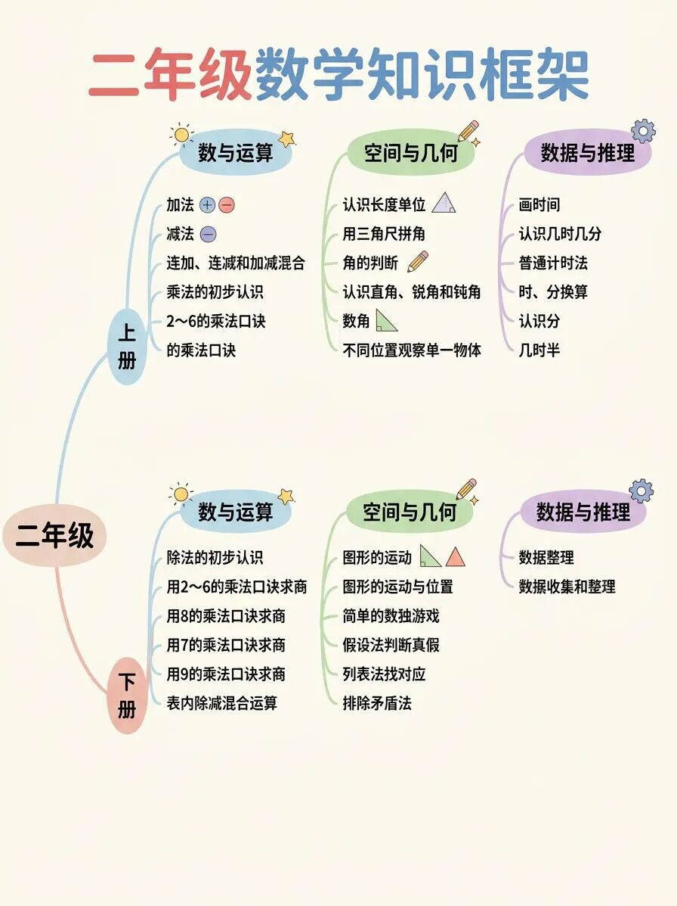
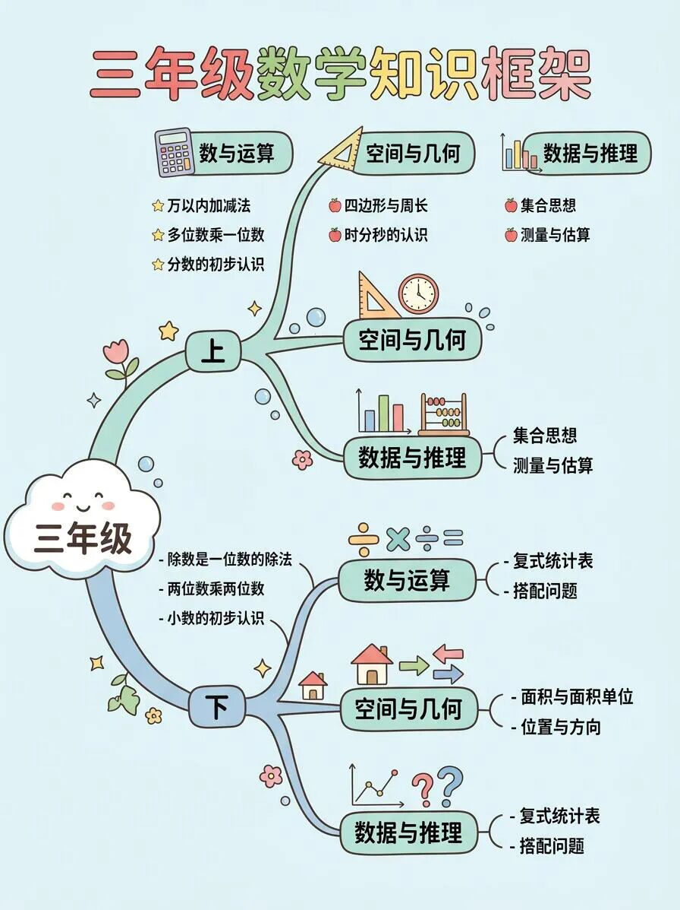
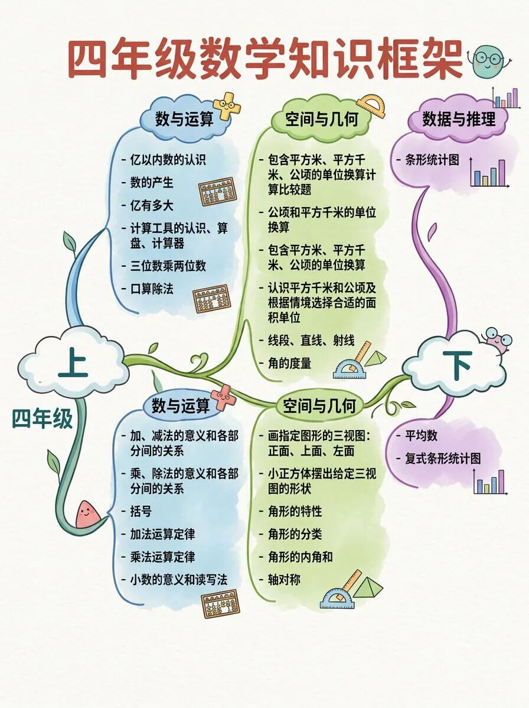
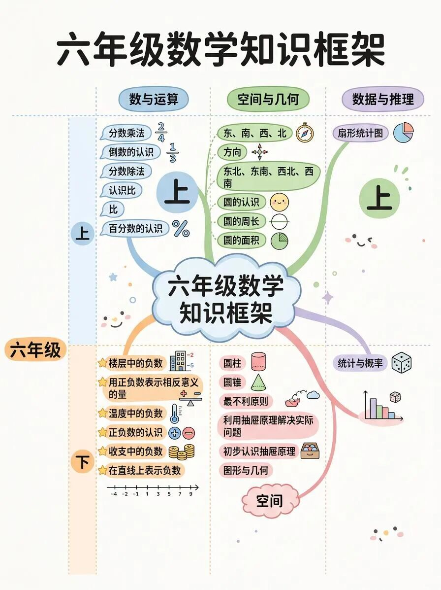

# 学霸学习法【超前学】1-6年级数学知识框架
> 💡 备注属性未写入，可能是备注属性名称或者类型被修改了，建议将字段类型设置为 rich_text，可以在小程序-操作-修改文章数据库页面进行调整
> 💡 原文链接:[https://mp.weixin.qq.com/s?__biz=MzA3MTgwMTM4OQ==&mid=2247484659&idx=1&sn=461fbaf1d79859314ab4ad690e618516&chksm=9ebb26d7717886ef2c94b4aa0b2c7767a2a4f7f7844c575665766dcc211c1c9d676dc64681c3#rd](https://mp.weixin.qq.com/s?__biz=MzA3MTgwMTM4OQ%3D%3D&mid=2247484659&idx=1&sn=461fbaf1d79859314ab4ad690e618516&chksm=9ebb26d7717886ef2c94b4aa0b2c7767a2a4f7f7844c575665766dcc211c1c9d676dc64681c3#rd)

⬆️1-2年级：不是学计算，是学读题。很多孩子数学差，是语文阅读理解差。每天精读2道应用题，圈出关键词（“一共”“多多少”“还剩”），比刷100道口算题还管用10倍。

⬆️3年级：重点不是分数和小数，是错题归因。数学开始需要逻辑了，你得教他把错题分成三类：粗心错（抄错数）、思路错（没理解）和方法错（公式用反）。分类比做题重要，这3个月训练分类，比提前学四年级内容更抗遗忘。

⬆️4年级：核心是用图表说话。这个阶段抽象思维刚萌芽，超前提练画线段图、画表格整理条件，能秒杀所有行程和方案题。3个月练下来，孩子遇到难题第一反应是“我画个图看看”，而不是“我不会”。

⬆️5年级：分数应用题是分水岭。超前学的重点在于单位1的转换。这不是靠刷题，是靠多问一句跟谁比。每天找一道题，只训练找标准量，3个月后他的分数题会稳到你怀疑人生。

⬆️6年级：真正的衔接不是学七年级的负数，而是用方程思维解鸡兔同笼。这3个月如果能把“未知数当已知数用”这个思维打通，初中数学的前三个月会轻松得不像话。

