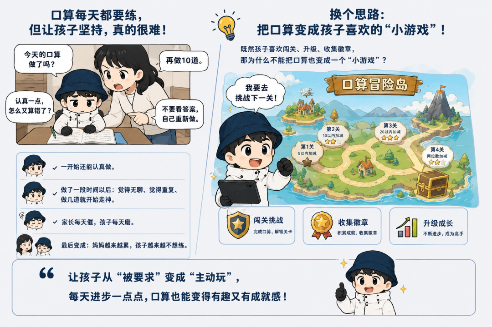
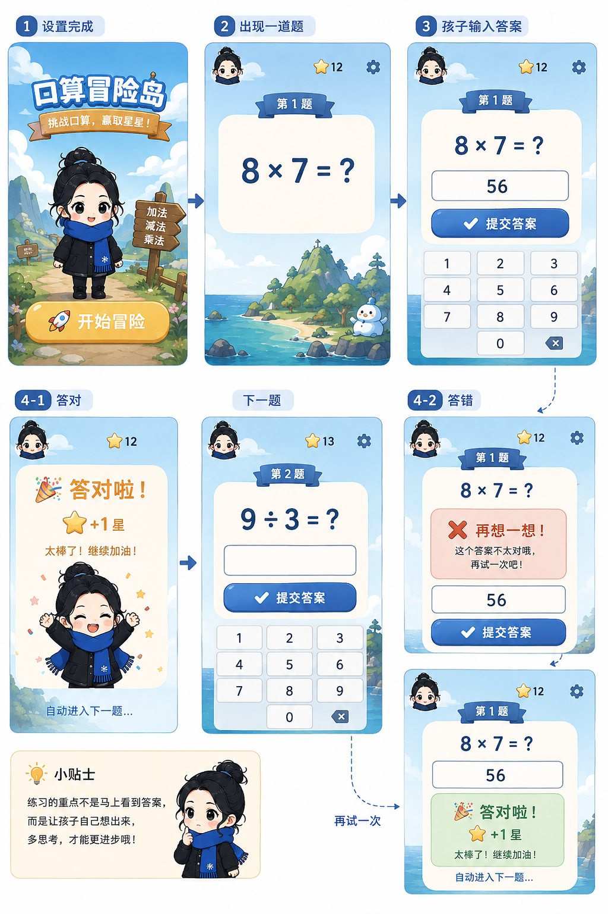

# 孩子不爱练口算？用AI把它做成了一场“闯关游戏”
> 💡 备注属性未写入，可能是备注属性名称或者类型被修改了，建议将字段类型设置为 rich_text，可以在小程序-操作-修改文章数据库页面进行调整
> 💡 原文链接:[https://mp.weixin.qq.com/s?__biz=MzI2NDM5MzAwMA==&mid=2247484404&idx=1&sn=4c3738c3c1071c2281802b0a0b022e17&chksm=ebd43f2077190a714f130fb53fa451e58e891dd4801b061b8cb4e954de9a649dc93ebe0fca12#rd](https://mp.weixin.qq.com/s?__biz=MzI2NDM5MzAwMA%3D%3D&mid=2247484404&idx=1&sn=4c3738c3c1071c2281802b0a0b022e17&chksm=ebd43f2077190a714f130fb53fa451e58e891dd4801b061b8cb4e954de9a649dc93ebe0fca12#rd)

TECHNOLOGY TOWARDS GOODNESS
科技向善 AI 赋能生活与职场
AI 驱动生产力全面升级

 小学阶段的100以内加减乘除，孩子每天都要练，但最让家长头疼的不是题难，而是孩子不愿意坚持。与其每天催着“再做10道”，不如把口算练习变成一场闯关游戏。答对得星、连续打卡、解锁地图，还能挑战Boss，让孩子在玩中坚持练口算。
**「不看文章可以直接在文章最后面复制提示词到workbuddy一键生成」**
01
每天催孩子练口算，真的太难了


“今天的口算做了吗？”“再做10道。”“认真一点，怎么又算错了？”“不要看答案，自己重新做。”……
对于很多小学阶段的孩子来说，口算几乎每天都要练，但问题是：口算不一定难，难的是让孩子愿意每天坚持。
一开始还能认真做。做了一段时间以后：觉得无聊、觉得重复、做几道就开始走神、家长每天催、孩子每天磨。
最后变成：妈妈越来越累，孩子越来越不想练。
所以这次我换了一个思路：既然孩子喜欢闯关、升级、收集徽章，那为什么不能把口算也变成一个“小游戏”？于是，我用 WorkBuddy 做了一个：“口算冒险岛”让孩子每天不是：“妈妈让我做20道口算。”而是：“我要去挑战下一关！”
02
这个小工具能干什么？

1. 今天练什么，孩子自己选
首页直接显示：

### 
2. 想做多少题和范围，自己决定
可选择题目数量：10 题｜20 题｜30 题｜50 题｜100 题，也支持自定义输入题量，上限 100 题。
- 日常练习：10 题
- 状态较好：20 题
- 自我挑战：100 题挑战！
可选配置包含：10｜20｜50｜100｜自定义。 示例：加法 + 20 以内 + 10 题，即可生成一套 20 以内加法习题；孩子熟练后，可设置混算 + 100 以内 + 30 题进行练习；想要练习特殊数字范围，直接选用自定义，自行输入练习数值区间。 工具适配多学段，一年级、二年级、三年级均可使用。
3. 开始挑战，一次只做一道题
设置完成以后：
点击：🚀 开始冒险，屏幕不会一下出现几十道题，而是一次只出现一道：8 × 7 = ?

4. 练习完了，还能看看自己进步了多少
每个月结束以后，系统可以生成一份，这个工具不只是让孩子做题，还会帮孩子记录：今天做了多少题、答对多少题、正确率是多少、连续挑战了多少天、最快用了多久、最好的成绩是多少。
比如：
#### 📊 我的口算成绩
今日完成：20题
答对：18题
正确率：90%
连续挑战：🔥 **7天**
最快记录：⏱ **2分18秒**
下面还可以看到：最近7天练习变化
让孩子慢慢发现：昨天90%、今天92%、下次争取95%。
5. 答错的题，也不会白做
每一道答错的题，都会自动进入：❌ 我的错题
例如：24 × 3 = 82
会记录我的答案：82
正确答案：72
日期：9月3日
下次可以直接点击：🔄 重新挑战
答对以后：🎉 **这道题终于攻克啦！**
这样整个过程就变成：练习 → 发现错误 → 再练 → 掌握
03
娱乐式学习口算的目的

1.解决的不是“口算不会”，而是孩子不愿意坚持
“每天练20道口算。”对于孩子来说：是任务，但是：“今天我要闯过数字森林。”“我要把巨龙打败。”“我要拿到今天的宝箱。”就变成了：挑战。
答对一题：⭐ 得一颗星。
连续答对：🔥 连击。
完成一关：🎉 通关。
坚持7天：🏆 获得徽章。
孩子关注的也会慢慢从：“什么时候可以做完？”变成：“我下一关是什么？”
04
怎么制作这个“口算冒险岛”？

以前我们想到一个需求，第一反应可能是：“我要不要找人开发一个？”
现在其实可以换一种方式：把需求说清楚 → 让AI直接做出来，家庭积分系统可以做、阅读成长地图可以做、儿童零花钱管理工具也可以做。
这些看起来像“小功能”的东西，其实完全可以让 WorkBuddy 先帮你做成一个能直接使用的小工具。
下面这段提示词，直接复制给 WorkBuddy 就可以开始。
```markdown
请直接生成一个完整、漂亮、可运行的单文件HTML「口算冒险岛」儿童手机小游戏。
## 一、定位
面向小学1-6年级儿童，把口算练习做成“冒险闯关游戏”，而不是普通练习网站。
要求：
- 单HTML文件，CSS/JS全部内置
- 无API、Token、后端、登录、安装、第三方服务
- LocalStorage持久化数据
- 所有按钮、计算、答题、奖励、闯关逻辑真实可用
- 手机端优先，大按钮、大数字、少文字
- 游戏感 > 简单易懂 > 功能数量 > 数据复杂度
核心体验：
选择练习 → 开始挑战 → 答题 → 即时反馈 → 获得星星/金币 → 闯关 → 解锁新关 → 连续打卡 → 获得徽章。
## 二、视觉
主题：儿童冒险岛。
可使用：⭐星星、🪙金币、💎宝石、☁️云朵、🌲森林、🐰兔子、🌋火山、🐉巨龙、🏰城堡、🎁宝箱。
采用圆角卡片、柔和阴影、轻动画、清晰层级。
首页不要堆信息，让孩子一眼知道“今天做什么”。
## 三、首页
显示：
👋 Hi，小明
8岁 · 二年级
⭐ 126星  🪙58金币  🔥连续7天
核心：
🗺️ 我的口算冒险
当前关卡：🌲数字森林
进度：8/10
“再答对2题就通关啦！”
按钮：🚀 开始挑战
下方：
🎁 今日宝箱
🏆 我的徽章
以及简洁的成长进度。
## 四、挑战设置
标题：🎮 今天练什么？
运算符可多选：
＋ 加法 / － 减法 / × 乘法 / ÷ 除法 / 混算
题目数量：
10/20/30/50/100题，也支持1-100自定义。
数字范围：
10/20/50/100，也支持1-1000自定义。
默认设置可按年级推荐：
一年级：加减、10以内、10题
二年级：加减乘、20以内、10题
三年级：乘除混算、100以内、20题
家长可随时修改。
按钮：🚀 开始冒险
## 五、题目生成
根据运算符、数量、数字范围随机生成。
要求：
- 加减答案合理，默认不出现负数
- 除法默认整除
- 乘法符合儿童难度
- 混算真正随机
- 尽量避免重复
- 每道答案必须准确
## 六、答题
一次只显示一道：
8 × 7 = ?
[ 输入答案 ]
顶部：
第4/10题
⭐3
❤️❤️❤️
🔥连胜3
答对：
🎉 答对啦！⭐+1
轻动画后进入下一题。
答错：
❌ 再想一想！
第一次错误不公布答案，允许再次回答。
第二次仍错，显示正确答案及一句鼓励，然后进入下一题。
## 七、生命与连胜
初始❤️❤️❤️。
答对不扣生命；答错-1。
连续答对3题恢复1颗生命。
连胜奖励：
2题：🔥连续2题
3题：🔥连续3题
5题：⚡5连胜
8题：💥超级连击
10题：🏆完美挑战
生命耗尽不要直接失败，显示：
“💪 差一点！还要再试一次吗？”
按钮：🔄 再挑战一次
## 八、冒险地图
不要只显示“第1关、第2关”，做成冒险地图：
🏠 口算村
↓
🐰 胡萝卜挑战
↓
🌲 数字森林
↓
🌉 口算独木桥
↓
🌋 火山挑战
↓
🐉 巨龙决战
↓
🏰 宝藏城堡
已完成点亮，未完成锁定。
关卡规则：
1. 🐰胡萝卜挑战：10题，答对收集胡萝卜，正确率≥80%通关，奖励10星+10金币。
2. 🌲数字森林：答对前进1步，连对3题加速，完成后通关。
3. 🌉独木桥：10块桥板，每答对点亮1块，完成后过桥。
4. 🌋火山挑战：60秒倒计时，初始100%能量；答对-10%，答错+5%，降到0%通关。
5. 🐉巨龙决战：巨龙10HP，每答对-1HP；连对3次连续攻击，连对5次必杀；击败后奖励30星+30金币+巨龙徽章。
6. 🏰宝藏城堡：根据成绩获得⭐/⭐⭐/⭐⭐⭐宝箱，随机获得星星、金币、宝石、徽章碎片。
## 九、等级
按累计星星：
Lv.1 口算小新手：0-99
Lv.2 计算小能手：100-299
Lv.3 口算达人：300-599
Lv.4 速度达人：600-999
Lv.5 口算王者：1000+
首页显示等级、星星、距离下一等级还差多少，并配进度条。
## 十、徽章
🌱第一次挑战
🔥坚持3天
⚡坚持7天
🏆坚持21天
🎯百题挑战
💯满分挑战
⚡速度达人
🐉巨龙勇士
未解锁：灰色+锁定；已解锁：彩色+发光。
## 十一、每日打卡/宝箱
每天第一次完成挑战自动打卡并增加连续天数。
显示：
1天：今天迈出了第一步！
3天：已经连续3天啦！
7天：坚持一周，太棒了！
14天：你越来越厉害啦！
21天：21天挑战成功！
每天首次完成挑战获得一个宝箱，同一天只能领取一次。
奖励随机：
⭐5星、⭐10星、🪙10金币、💎1宝石、🎖徽章碎片。
## 十二、错题本
自动保存所有错题，显示：
题目 / 我的答案 / 正确答案 / 日期 / 运算符 / 数字范围。
支持“重新挑战”。
重新答对后标记“🎉 这道题终于攻克啦！”
## 十三、成长记录
用简单数据卡显示：
今日完成20题
正确率90%
累计完成356题
累计正确率92%
最长连续12天
最好成绩100%
最快挑战2分18秒
提供最近7天正确率趋势，使用原生HTML/CSS/SVG/JS，不依赖图表库。
## 十四、个人设置
支持修改：
姓名、年龄、年级、头像、默认运算符、题量、数字范围。
## 十五、数据持久化
LocalStorage保存：
孩子信息、设置、星星、金币、宝石、等级、关卡进度、挑战记录、连续打卡、徽章、错题、最佳成绩、7天记录等。
刷新页面后数据不能丢失。
## 十六、默认演示数据
预置：
小明，8岁，二年级
Lv.2 计算小能手
126星、58金币、5宝石
连续7天、累计128题、正确率92%
已解锁：第一次挑战、坚持3天、坚持7天、百题挑战
当前关卡：🌲数字森林
同时预置近期练习记录、错题和部分已点亮关卡，让首次打开页面就有完整效果。
## 十七、最终要求
请不要生成设计方案或伪代码，直接输出完整可运行HTML。
所有交互必须真实有效：
开始挑战→生成题目→提交答案→判断对错→奖励→错题记录→挑战结束→计算成绩→更新关卡/徽章/打卡/宝箱→LocalStorage保存。
最终效果必须像：
“孩子自己的口算冒险游戏”
而不是：
“普通口算练习网站”。
```

