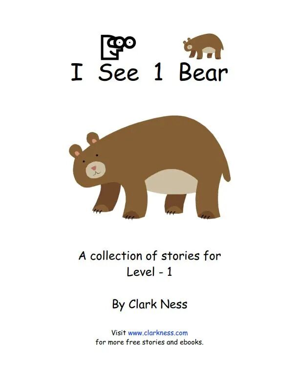
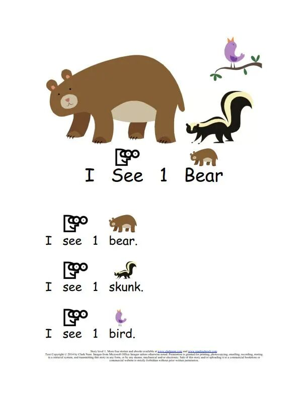
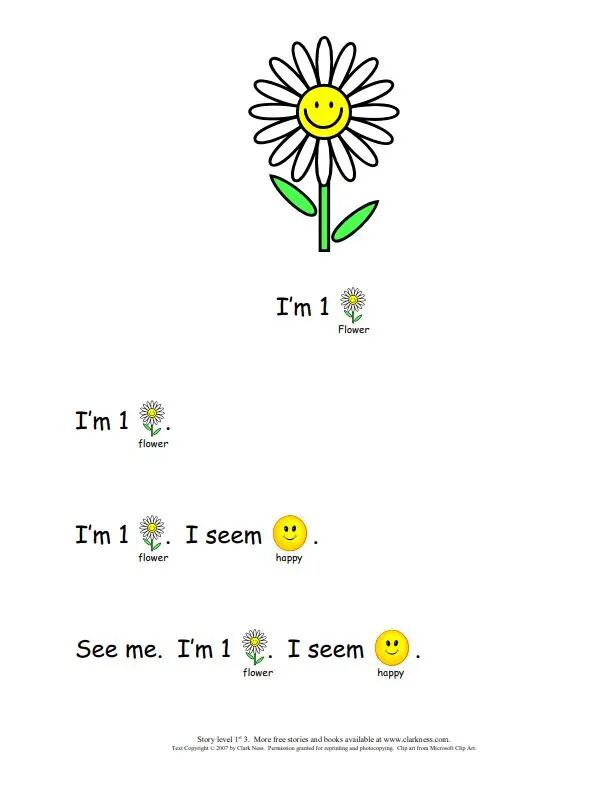
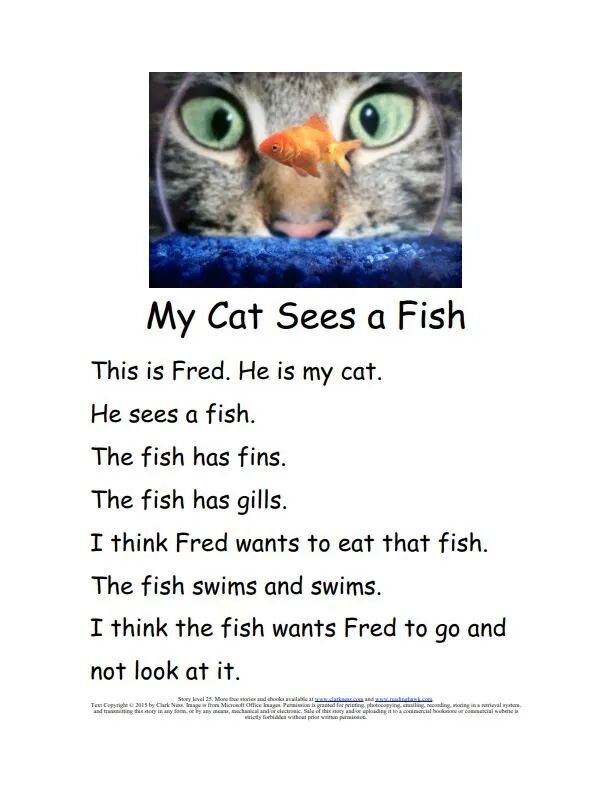
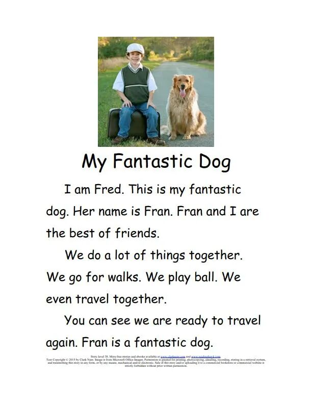

# 孩子晨读不知道读什么？这套免费分级小故事最合适不过了
> 💡 备注属性未写入，可能是备注属性名称或者类型被修改了，建议将字段类型设置为 rich_text，可以在小程序-操作-修改文章数据库页面进行调整
> 💡 原文链接:[https://mp.weixin.qq.com/s?__biz=MzkxMjY5NTgwNg==&mid=2247485158&idx=1&sn=1aca7e4e25ee8bdcc8d43e039cd6b581&chksm=c0d9f724bcbf77006d5c6e221c6ea70045a4e0f6e2f110675cdb1b2953ad6b8b1f9911fd144b#rd](https://mp.weixin.qq.com/s?__biz=MzkxMjY5NTgwNg%3D%3D&mid=2247485158&idx=1&sn=1aca7e4e25ee8bdcc8d43e039cd6b581&chksm=c0d9f724bcbf77006d5c6e221c6ea70045a4e0f6e2f110675cdb1b2953ad6b8b1f9911fd144b#rd)
**点击上方蓝色关注我，在陪娃路上一起加油！**
每次说到「英语晨读」，后台问得最多的就是：**到底让孩子读什么？**
读绘本吧，句子太长，起步的孩子看着看着就走了神；读课本吧，太枯燥；网上找的资源吧，不是太杂乱不成体系，就是看着看着版权心里直打鼓。
今天给大家推荐一套**免费分级晨读小故事**——起步阶段的孩子从「一页一句话」读到「一页一小段」，难度爬坡非常平缓。
**🍊 免费分级晨读故事 **
### 📚 它是什么：一位美国老师写了 38 个级别的免费小故事
这套材料的作者 Clark Ness 是一位美国小学老师，几十年来一直在自己的网站上免费分享他为起步阅读的孩子写的小故事，目前已累积**几百个小故事、38 个难度级别**，从「一词一图」的启蒙级，到能读完整小段落的进阶级，全部免费开放。
它有四个特点：
**① 句式高度重复，读起来像儿歌**
一个小故事只练一个句型，比如整个故事都是「I see 1 bear. I see 1 skunk. I see 1 bird.」，读到第三页孩子已经自己抢答了。
**② 一个主题词贯穿始终**
每篇围绕一个主题词展开（比如 bear、dinosaur、flower），一本读完这个词就刻进脑子里了，不用刻意背。
**③ 图片就是释义，不用查字典**
每句话都配着对应的图，孩子看图就能猜出单词意思，「猜词」本身就是最自然的学法。
**④ 难度爬坡平缓，38 级慢慢升级**
从一页一个词，到一页一句话，再到几句话的小段落，每一步都踩得上，不会突然卡住。
### 👀 内页长什么样（从易到难）
下面样张均来自作者官网公开的免费电子书：

最简单级别的封面：一个小故事集，作者署名与官网都印在书上

一页一句话、一页一张图：「I see 1 bear.」

再简单一点的：一词一图，适合零基础起步

进阶后变成几句连贯的小故事：My Cat Sees a Fish

更高一级：整段整段的叙述，衔接章节书阅读
### 🕐 我们家的晨读五步法
**第 1 步：选对起点。** 别从第 1 级硬刷，先挑一个孩子「能顺口读下来」的级别起步，略高于当前水平又不至于磕巴，兴趣才守得住。
**第 2 步：固定 10 分钟。** 每天早餐后 10 分钟，固定时间比固定时长更重要，习惯是靠「每天都有」喂出来的。
**第 3 步：先看图再开口。** 读之前先一起翻图猜一猜：这页讲什么？猜完再读，读对的成就感翻倍。
**第 4 步：指读出声。** 手指指着单词逐个读出声，眼睛、嘴巴、手指一起动，音形对应就在这 10 分钟里悄悄完成。
**第 5 步：录音回放。** 读完录一小段，第二天先放昨天的录音当「复习」，孩子听到自己的声音特别来劲，复述欲望直线上升。
🍊 **使用小贴士：**家里有打印机的话打成 A5 小册子，一册一故事；打成散页贴冰箱上也行，读一页撕一页。一个级别不用全读完，孩子读得顺就往上走，读得费劲就回退一级。
**🔗 官网地址：https://www.clarkness.com**
声明：本文为个人学习心得分享与网站测评，文中图片均截取自该网站公开页面，仅供学习交流参考，版权归原网站所有；网站功能与内容以其官方页面为准，与本人无任何利益关联。

[这份1000词练习表，让每个单词都住进句子里](https://mp.weixin.qq.com/s?__biz=MzkxMjY5NTgwNg%3D%3D&mid=2247484894&idx=1&sn=f8a5f888551291b0c5a11bb5779f6b75&scene=21#wechat_redirect)
[这份2000词默写纸，测出孩子的真实词汇量](https://mp.weixin.qq.com/s?__biz=MzkxMjY5NTgwNg%3D%3D&mid=2247484905&idx=1&sn=0e07526666cb01bac124f8c48c66f6b3&scene=21#wechat_redirect)
[这套4000词默写纸，中译英+英译中双向检测，把"假会"看得明明白白](https://mp.weixin.qq.com/s?__biz=MzkxMjY5NTgwNg%3D%3D&mid=2247484926&idx=1&sn=cc215d0387ae332715e3672c6613f475&scene=21#wechat_redirect)
**📄 资料领取方式见文末菜单栏**
第一步：识别下方二维码关注公众号

第二步：在对话框**回复“晨读小故事”**领取，**点赞、分享**

END
