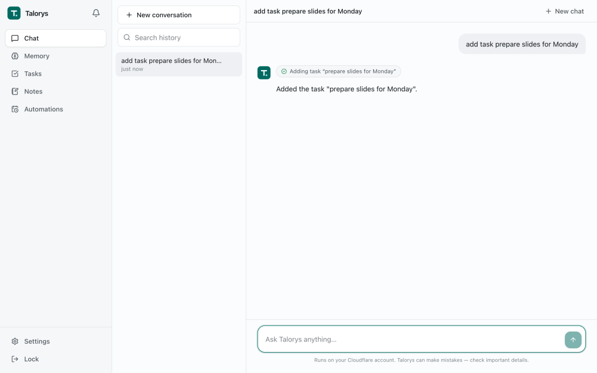
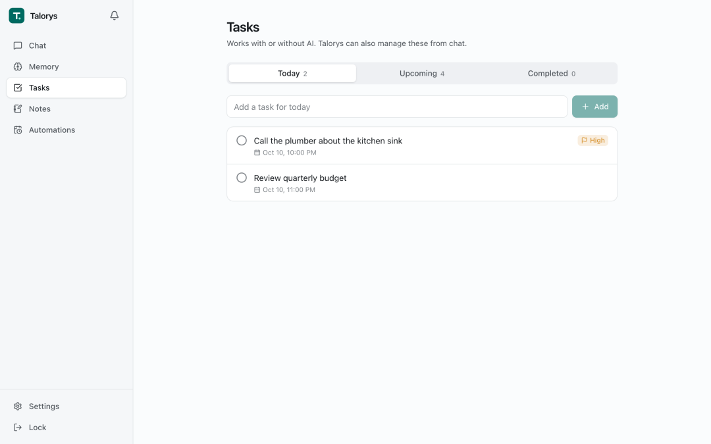
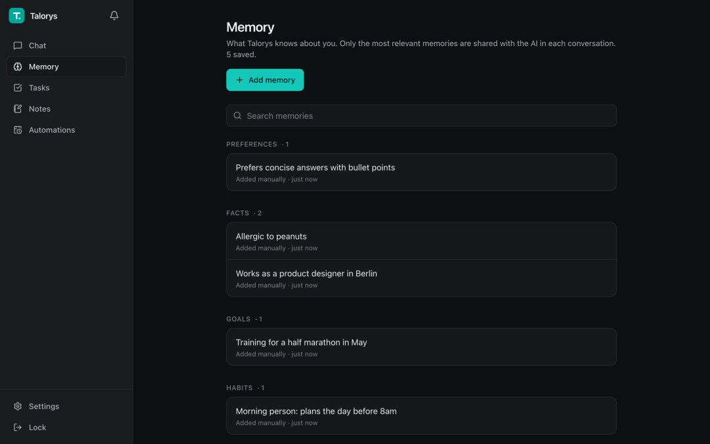
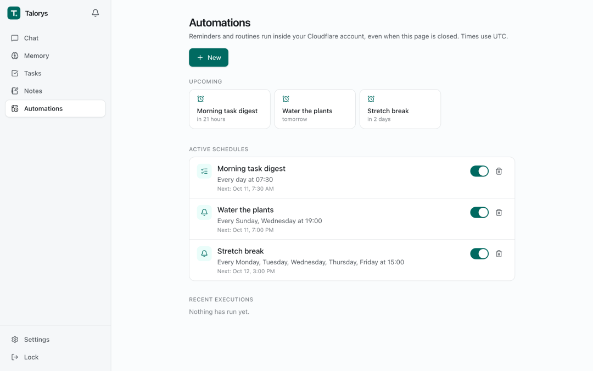

# 完全部署在cf上的AI助手，0服务器成本搞定
> 💡 备注属性未写入，可能是备注属性名称或者类型被修改了，建议将字段类型设置为 rich_text，可以在小程序-操作-修改文章数据库页面进行调整
> 💡 原文链接:[https://mp.weixin.qq.com/s?__biz=Mzk1NzQyNDc3OQ==&mid=2247488003&idx=1&sn=2e5d4ef0f599305df4443c4a11cf2690&chksm=c212555f0aa8e2fc882d31cd0d212581c2fac030f079973bd22b8dbf17a2f2fa670436a4a78e#rd](https://mp.weixin.qq.com/s?__biz=Mzk1NzQyNDc3OQ%3D%3D&mid=2247488003&idx=1&sn=2e5d4ef0f599305df4443c4a11cf2690&chksm=c212555f0aa8e2fc882d31cd0d212581c2fac030f079973bd22b8dbf17a2f2fa670436a4a78e#rd)
折腾过本地 AI 助手的人，大多体会过那种维护成本盖过使用价值。
想让助手全天候待命，通常要在 NAS 上堆好几个容器：模型、向量库、缓存与前端。
常年开机费电不说，机器断网或休眠重启，预设的早报提醒直接中断。
开源项目 **Talorys** 最近在 Hacker News 露面，引发了一场争论。
0 台服务器，0 个外部数据库，连后台常驻进程都砍掉。
一条命令引导授权，就把聊天、长效记忆、待办和定时提醒，全套跑进 Cloudflare 免费账户里。
---
### #连数据库都省了
常规 Agent 项目一旦存状态，架构图立刻变沉重，得单独配 PostgreSQL 和向量库。
Talorys 在存储上很克制：没申请 D1、KV 或 R2，核心状态全落在 Agents SDK 的持久对象（Durable Object）里。
整个助手仅由一个名为 personal-agent 的对象承载。
对象内部原生集成 SQLite，对话、待办、笔记与提醒全写在这张本地表里。
浏览器打开专属域名并输入密码即可进入面板：

前端聊天走 SSE 流式返回，调用工具时动态展开卡片，直观显示执行动作。
切到任务看板，增删改查全走本地 SQLite 逻辑：

没有跨网络延迟，点开页面秒开。
后端 Worker 关闭了公网路由，没有暴露接口，全靠 Pages 前端通过私有 Service Binding 转发。
---
### #给记忆加上确定性生命周期
很多私人助理用几天就吃灰，症结出在粗糙的记忆机制。
项目讨论区提过一个很经典的测试：
先告诉助手“我的车是老甲壳虫”，过几天更新说“换成了特斯拉”。接着问“我现在开什么车？”，常规检索多半回答甲壳虫——旧记录带“车”字，新记录只有品牌。
全塞进向量库，矛盾的新旧事实就会在上下文里冲突。
Talorys 加了一套记忆生命周期。
提取新事实时，流水线会先核验逻辑关联。
一旦新事实取代了旧记录，旧数据被打上历史标签（historical）归档。
点开侧边栏记忆面板，当前生效的事实与偏好一目了然：

平时聊天只带当前有效事实进提示词。
只有主动追问过去，历史档案才会被调出，避免过时背景干扰问答。
---
### #靠边缘原生闹钟唤醒
私人助理必须能在指定时间主动发声。
自建方案为了跑定时提醒，后台总要常驻轮询进程，随时担心被系统误杀。
Talorys 借用了 Durable Object 原生闹钟（Alarms）。
在自动化配置页面，能随手添加日程提醒或每日任务简报：

每个任务在后台注册为一个时间戳。
触发前边缘端没有任何实例运行，CPU 与内存占用归零；到点瞬间唤醒对象执行，推完通知立刻睡下。
哪怕电脑关机手机离线，云端日程依然准点生效。
当天免费推理额度用完，纯文本提醒与任务简报依然照常发出。
---
### #动手部署前，有几处妥协与限制需要了解
省去服务器运维，也伴随着边缘运行时的客观约束：
1. 纯单人定位：无多租户与团队权限，只认一把主人密码；
1. 免费 AI 额度约束：调用 Workers AI 每日配额，高频长篇对话可能触碰上限；
1. 语义检索默认未开：默认依赖 FTS5 搜索，向量语义召回需在设置中手动开启；
1. 冷启动微延迟：长期闲置后首次唤醒，偶发伴随几百毫秒等待。
---
### #一种轻量且克制的 Agent 落地路径
在这场围绕“自建定义”的社区大讨论背后，Talorys 给出了一种很务实的启发。
个人 AI 助理不一定非要在本地堆硬件，或者在云端租用昂贵的常驻服务器。
通过把单对象存储、原生闹钟和私有网络绑定组合起来，复杂的多模块系统同样能被压缩进无服务器环境之中。
对不想折腾家庭服务器、又格外在意数据隐私的开发者来说，这套方案值得一试。
```

开源地址：https://github.com/rociiu/talorys

```

## 摘要

（待补充）

## 我的笔记

（待补充）
