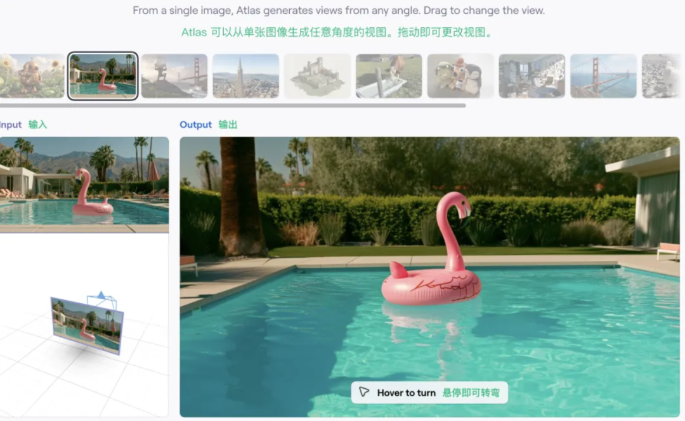
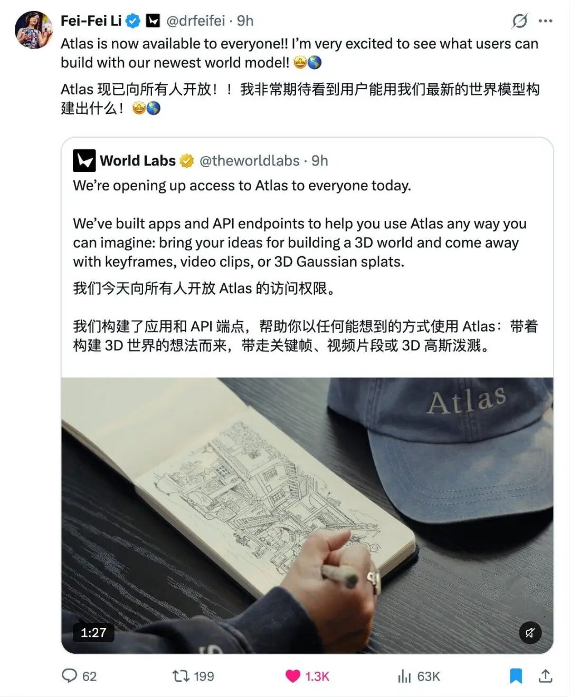
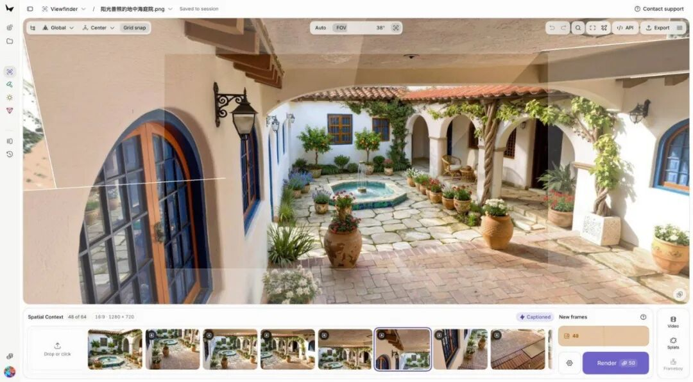
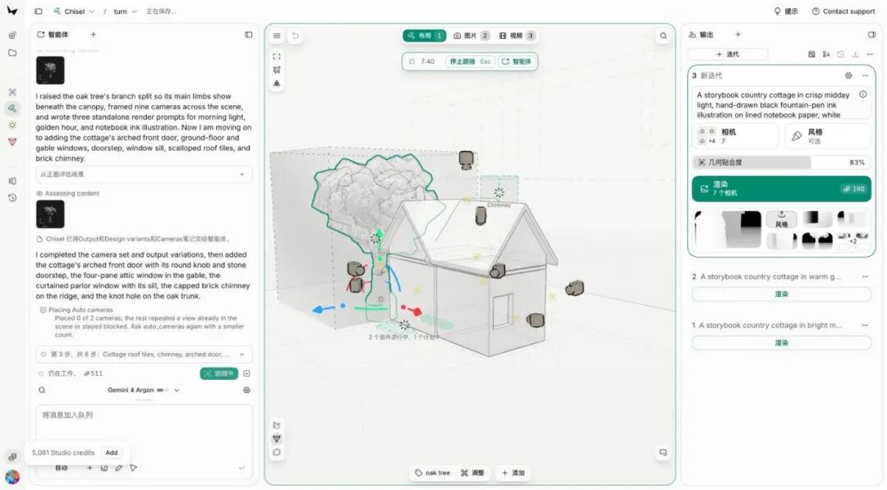
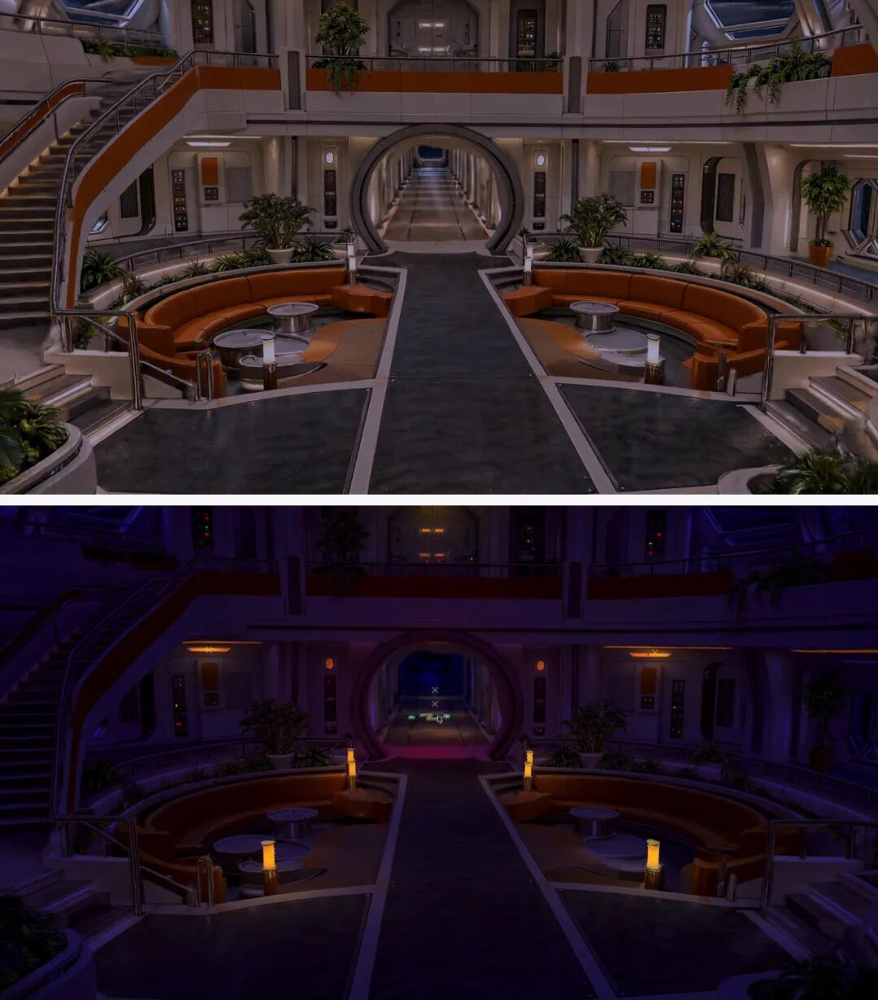
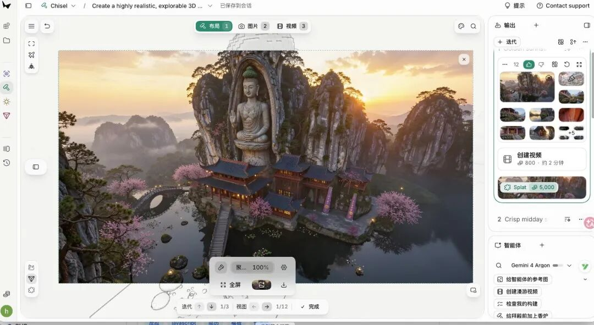
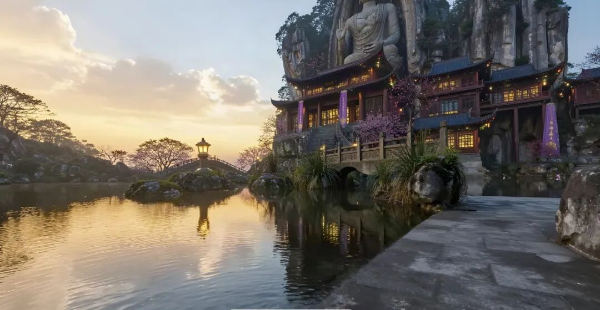
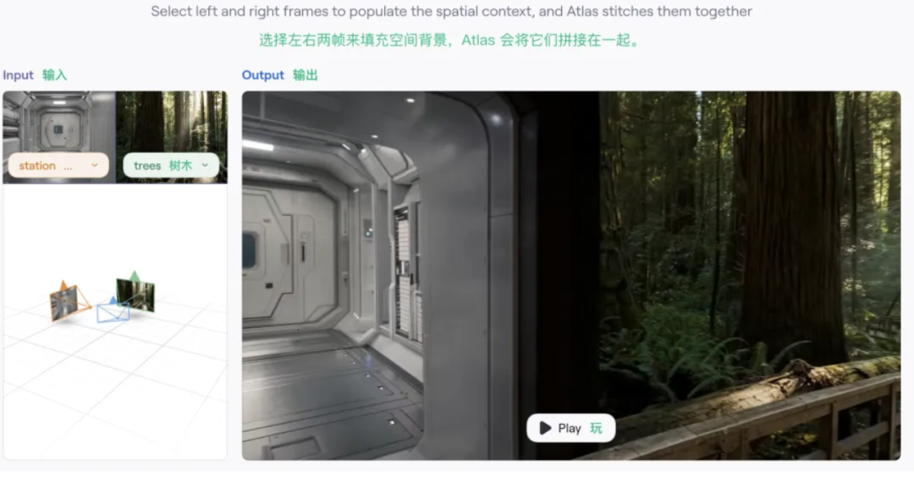
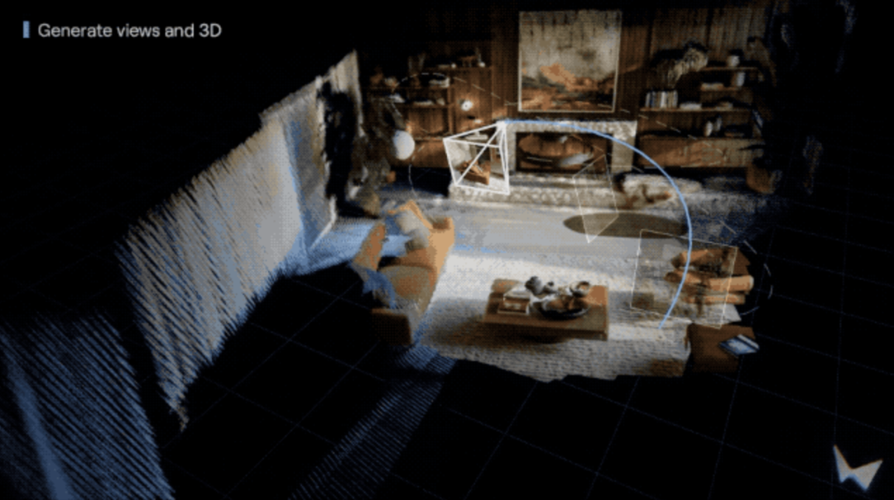

# 实测！李飞飞世界模型正式开放，我试着在悬崖上造了一座古寺
> 💡 备注属性未写入，可能是备注属性名称或者类型被修改了，建议将字段类型设置为 rich_text，可以在小程序-操作-修改文章数据库页面进行调整
> 💡 原文链接:[https://mp.weixin.qq.com/s?__biz=MzY4ODQ5MjQ0Mw==&mid=2247483966&idx=1&sn=e192f752bcdc174deff048d9a361f256&chksm=f2a1198ed9e268af8ba8dbfd6eccf39c5619c04692dce7b83c259629107d217be7469113d8ce#rd](https://mp.weixin.qq.com/s?__biz=MzY4ODQ5MjQ0Mw%3D%3D&mid=2247483966&idx=1&sn=e192f752bcdc174deff048d9a361f256&chksm=f2a1198ed9e268af8ba8dbfd6eccf39c5619c04692dce7b83c259629107d217be7469113d8ce#rd)
李飞飞世界模型正式开放，普通人也能开始造世界了
最近，由「AI 教母」李飞飞创办的 World Labs 正式向公众开放了新一代世界模型 Atlas，同步推出网页创作工具和开发者 API。
**新用户注册即送 10000 积分，体验地址：https://atlas.worldlabs.ai**
过去一年，我们已经见过 AI 写文章、生成图片、制作视频，甚至一句话开发网站和小游戏。
但现在，AI 开始尝试另一件更复杂的事，把一张平面的图片，变成能够从不同角度观察的三维世界。
**Atlas 其实早在今年 9 月就已经发布，当时 World Labs 展示了一系列让人印象深刻的案例。**
例如，只提供一张房间照片，模型就能推测照片之外的空间；给它几张不同角度的图片，还能重建场景、规划相机路径，生成连续的镜头画面。

**这次最大的变化是，**
**普通用户终于能亲自上手了。**
**World Labs 把世界模型封装成了一套网页工具，用户可以上传照片、输入提示词，尝试生成场景、调整布局，甚至把结果导出到 Blender 等专业软件继续加工。**
李飞飞也转发了官方开放的消息，表示非常期待看到用户利用最新世界模型创造出什么。
a16z 合伙人 Martin Casado 则给予了很高的评价，将其视为生成式 AI 兴起以来，三维生成与重建领域的重要进展。

我觉得这次开放最有意思的地方，是它让世界模型开始接近普通人的创作流程。
以前看到那些精美的三维演示，更多是在感叹模型能力有多强。
现在我们终于可以亲自验证，一张脑海中的概念图，究竟能被 AI 还原到什么程度。
**01 **
**四款工具，让普通人也能用 AI 构建三维世界**
打开 Atlas，最值得关注的是 Viewfinder、Chisel、Relight 和 Splats to Mesh 四款工具。
名字听起来有些专业，但它们解决的问题很好理解。
一个负责从图片推测空间，一个负责搭建和调整场景，另外两个则负责光照处理以及三维资产转换。
**先来看 Viewfinder。**
假设你有一张客厅照片，画面里只拍到了沙发、茶几和窗户。
你想知道从窗户旁边看向房间是什么样子，甚至想拍一段从门口慢慢走向沙发的视频。
过去，你需要重新建模，或者真的走进那个房间拍摄。
Viewfinder 则允许用户上传图片，通过模型推测新的观察视角，并设计镜头运动轨迹。
当然，照片没有拍到的沙发背面、门后空间，AI 仍然需要根据已有信息进行推测。所以，对于现实场景，提供多个角度的照片通常能减少模型的想象空间，提高还原程度。

**第二款 Chisel，是我这次主要体验的工具。**
可以把它理解成一个能听懂自然语言的三维场景搭建助手。
用户可以提供参考图，再用文字描述场景布局，例如在山崖上建造寺庙、增加石阶、调整建筑位置。智能体可以参与搭建场景的基础几何结构，再结合 Atlas 生成相应的视觉效果。
传统三维制作往往需要先用 Blender 等软件搭建白模，确定建筑体量和物体位置，再逐步处理材质、灯光与细节。Chisel 正在尝试让这些步骤更多地通过自然语言和智能体协作完成。

**第三款 Relight 负责调整光照。**
比如，同一座山寺，清晨可以有穿过云雾的金色阳光，到了黄昏则可能呈现完全不同的氛围。Relight 能够对高斯溅射场景重新布光，让创作者在已有场景的基础上调整视觉效果。
**第四款 Splats to Mesh 则更偏向专业创作。**
Atlas 可以生成 Gaussian Splats，也就是三维高斯溅射场景。这种表示方式能够呈现丰富的视觉细节，但与游戏引擎常用的多边形网格存在区别。
Splats to Mesh 能将其转换为带有几何结构的 Mesh，并导出到其他三维软件继续加工。对于想制作游戏或交互场景的开发者来说，这一步相当关键。

把这些工具放在一起看，Atlas 已经初步覆盖了从图片输入、空间搭建、镜头生成到资产导出的多个环节。
不过，这些功能并不代表用户输入一句话，就能直接得到一张可以投入正式游戏的完整地图。真实的游戏场景仍然需要碰撞检测、角色寻路、性能优化和交互开发。
带着这个疑问，我决定亲自试试 Chisel。
**02 **
**实测 Atlas，我试着在悬崖峭壁上建一座宏伟古寺**
这次我选了一个比较有挑战性的场景：
一座修建在悬崖峭壁之间的中国传统佛教古寺。
我先用 ChatGPT 生成了一张参考图片。
画面里，巨大的佛像坐落在山崖之间，层层叠叠的中式殿宇依山而建，远处有云海、瀑布和亭台楼阁，近处则是石桥、莲池、樱花与古老的木结构建筑。
整张图的氛围相当漂亮，尤其是建筑沿着山势向远处延伸的纵深感，很接近我想要的那种宏伟中式幻想场景。

接下来，我把这张图片上传到 Chisel，并输入了一段英文提示词。
Create a highly realistic, explorable 3D environment of a traditional Chinese Buddhist mountain temple based on the reference image.The scene features a magnificent ancient temple complex built into steep mountain cliffs, with traditional wooden architecture, curved tiled roofs, stone staircases, interconnected pavilions, carved stone bridges, a lotus pond, waterfalls, ancient pine trees, cherry blossoms, and a towering Buddha statue carved into the mountainside.Design a complete, spatially coherent environment withaccessible courtyards, walkable pathways, a main worship hall, meditation pavilion, wishing tree, and peaceful garden.Use photorealistic PBR materials, weathered stone, aged wood, moss, detailed roof tiles, natural vegetation, realistic water reflections, soft morning sunlight, volumetric mountain mist, and cinematic lighting.Maintain architectural consistency, accurate proportions, natural terrain integration, and realistic spatial depth. AAA open-world game environment quality, inspired byhigh-end Chinese historical fantasy games.No cyberpunk, no neon lights, no futuristic elements, no cartoon aesthetics. Prioritize realistic architecture and a peaceful Buddhist atmosphere.

[晨雾金光中的樱花古刹.png]
那其实这段提示词也是ChatGPT写的。
我要求它根据参考图生成一个高度写实、能够探索的三维山寺环境，保留传统木结构建筑、飞檐瓦顶、石阶、连接不同建筑的桥梁、莲池、瀑布和山体佛像。
考虑到三维场景与普通图片的区别，**我还特别强调了空间连贯性，希望各个庭院之间有合理的道路连接，建筑能够自然融入山体，并使用 PBR 写实材质、风化石材、旧木结构、自然水面反射和晨雾光照。**
甚至连 AAA 级开放世界游戏的环境品质，我也写进了提示词。
要求确实不少，我想看看模型最终会如何取舍。

接下来从最终结果来看，Chisel 确实抓住了参考图最有辨识度的几个元素。
山体中央保留了一尊巨大的佛像，下方是一组传统中式寺庙建筑。寺庙前方有水面、石桥，周围分布着樱花和山石。暖色夕阳照在建筑和岩壁上，远处还有层叠的群山与云雾。
只看最终画面，整体氛围还是比较完整的。

整个过程是这样的
但把两张图片放在一起对比，差异也很明显。
原始参考图中的寺庙建筑沿着山崖层层展开，远景与近景之间有丰富的空间层次。Chisel 生成的结果则把大量内容集中到了山体佛像附近，原本宏伟的建筑群变成了一处相对紧凑的寺院景观。
原图里非常醒目的瀑布、远处亭台和复杂栈道，也没有被完整保留下来。镜头视角从原本带有强烈沉浸感的地面构图，变成了更适合展示整个场景的俯瞰视角。

这里有个很有意思的细节。
我的提示词里写了很多建筑和景观元素，但没有明确规定主殿必须建在哪里、山路应该怎样延伸，以及各组建筑之间应该保持多远的距离。
最终，模型保住了佛像、古寺、石桥和樱花这些关键视觉元素，却重新组织了它们之间的关系。
从视觉表现看，这已经是一张质量不错的三维场景渲染结果。
只是距离我最初想象中的大型悬崖寺庙建筑群，仍然有不小的差距。
Chisel 界面中还提供了多个镜头预览和不同的渲染方案，可以继续查看场景的视觉效果。但在我的这次体验里，尚未验证完整的实时自由漫游、可用的碰撞结构以及复杂角色交互。
**这次实测让我开始重新理解世界模型的难点。**
生成一张宏伟的寺庙图片，AI 可以自由安排构图。可一旦需要把它转换成具有空间关系的场景，建筑的位置、体量和连接方式都需要更加明确。
原图中的漂亮构图，也未必能直接转化成合理的三维布局。
Atlas 已经能够辅助完成这一步，但如何在复杂空间中保留创作者的意图，依然是一个需要解决的问题。
**03**
**Atlas 的技术突破，AI 开始学习如何理解空间**
为什么一张图片生成三维世界，比普通 AI 生图复杂得多？
先想象一个简单的场景。
你站在寺庙大门前拍了一张照片，照片里能看到殿宇正面、屋顶和石阶，却看不到建筑背面，也不知道院墙后面有没有其他房间。
传统图像生成模型能够依据提示词重新生成一张漂亮的寺庙图片。但如果要求它连续改变观察角度，还要保证殿宇始终位于原来的位置，任务就复杂多了。
模型需要处理三维位置、遮挡关系以及相机移动时画面的变化。遇到原始图片没有展示的区域，还需要推测合理的结构。
这也是李飞飞一直推动 Spatial Intelligence，也就是空间智能研究的重要原因。
她在 World Labs 的研究中强调，理解真实世界需要超越语言本身。物体拥有形状和位置，人与环境之间存在空间关系，真实世界还会随着时间不断变化。
**Atlas 正是在这样的研究方向下诞生的。**
根据 World Labs 官方技术博客，Atlas 采用了一种名为 **Multimodal Autoregressive Diffusion Transformer** 的架构，中文可以理解为多模态自回归扩散 Transformer。
这个名字有些长，拆开就容易理解了。
**首先是多模态。**
Atlas 可以处理文本、图片、相机位姿以及三维深度图等不同形式的信息。
其中，相机位姿非常关键。
它告诉模型观察者处在空间的什么位置，镜头朝向哪里。深度信息则帮助模型表达画面中物体与相机之间的空间关系。
这些信息被组织成共享的 Spatial Context，也就是空间上下文。

**其次是自回归。**
大家熟悉的大语言模型，会根据前面的内容逐步预测后续 Token。
Atlas 采用了类似的序列生成思路，只不过生成对象变成了包含不同数据类型的多模态序列。
模型生成新的视角时，可以参考此前的图像、深度与相机信息，尽量让不同画面之间保持一致。
扩散模型则负责生成高维视觉内容。
Atlas 具体采用 Rectified Flow 技术，通过逐步去噪生成图像等输出；Transformer 负责处理这些序列信息。
这样一来，模型能够把场景内容和相机位置联系起来，让创作者对观察角度拥有更明确的控制能力。
官方展示过一个很有代表性的能力。
给 Atlas 输入少量参考图片，再规划不同的相机运动轨迹，它可以生成多个视角下的画面。即使相机从地面移动到高处，也能尽量维持场景的一致性。
当然，模型对看不见的区域仍然需要进行推测。所谓空间一致性，也不意味着每一处几何结构都能被精确还原。

**还有一个值得关注的技术是 3D Gaussian Splatting，也就是三维高斯溅射。**
简单理解，它通过分布在三维空间中的大量高斯基元来表现场景的颜色、透明度和视觉细节。
相比传统的多边形建模，这种方式在某些真实场景的视觉重建上很有优势。
但高斯溅射本身不等于完整的游戏网格。要让角色站在地面上、碰到墙壁会停下，或者沿着石阶自动寻路，还需要处理实际几何结构和游戏逻辑。
Atlas 提供 Splats to Mesh，也是为了让生成结果进一步进入已有的三维制作流程。
从更长远的研究方向看，World Labs 还在探索世界模型用于机器人模拟、视频重新取景和现实环境重建等任务。
机器人需要理解周围空间，预测移动后可能看到什么，这与世界模型研究有直接联系。
不过，空间重建能力和完整的物理世界模拟之间仍有距离。
眼下的 Atlas 已经展示出相当有潜力的生成与重建能力，距离准确理解所有现实物理规则还有很长的路要走。
这也解释了我在古寺实测中遇到的问题。
模型能够提取场景的主要视觉内容，并尝试重新组织空间，但复杂建筑之间的精确关系，仍然需要更明确的约束和后续人工调整。
**04 **
**当 AI 会写代码，也会创造世界，人类的价值还剩下什么？**
看完 Atlas 的能力，我想到的第一个应用场景就是**游戏开发**。
最近 AI 编程工具的发展已经非常快。通过自然语言，AI Agent 可以帮助开发者编写代码、设计页面、调用工具，甚至完成一部分自动测试工作。
但如果想制作一款拥有完整三维场景的游戏，事情会复杂很多。
程序可以帮助角色移动，却不能自动解决所有场景资产问题。山体怎么建、建筑如何排列、材质是否真实、灯光怎样布置，都需要投入制作成本。
而世界模型正在尝试参与这些工作。
**未来，编程 Agent 可以负责生成代码、组织项目和实现交互，世界模型辅助制作环境、生成场景视角，再借助 Blender、Three.js 或游戏引擎完成进一步开发。**
这套工作方式目前还需要大量调试，但已经让个人开发者有机会尝试过去需要多人协作才能完成的项目。
影视制作也一样。导演可以利用概念图生成初步场景，尝试不同的镜头运动；建筑设计师可以更快展示空间构想；独立游戏开发者则有望缩短场景原型制作的时间。
不过，我觉得创作门槛降低之后，人类的价值反而会变得更加清晰。
回到我生成的那座古寺。
ChatGPT 能够帮我画出宏伟的寺庙概念图，Chisel 可以依据图片和提示词搭建场景，但它们并不知道我为什么要创造这座寺庙。
如果这是一款游戏，玩家应该从哪里进入？沿着石阶往上走时，最先看到哪座殿宇？寺庙里的和尚应该怎样与玩家交流？许愿树放在什么位置，才能让整个空间的体验更加自然？
**这些问题涉及创意、空间设计和用户体验，需要创作者做出判断。**
**即使模型能够提出方案，人仍然需要决定哪些方案值得保留。**
AI 的确会让越来越多的技术操作变得容易。
但当更多人都能生成精美的场景时，作品之间的差异也会越来越取决于创作者的审美、想象力，以及对内容本身的理解。
我很期待世界模型继续发展，尤其是它与 AI Agent、游戏引擎和专业创作软件结合之后，会出现怎样的新工具。
也许有一天，一个人真的可以通过自然语言完成一款拥有完整三维世界的游戏，从最初的场景构想到最后的交互实现，都有 AI 参与。
到了那个时候，创作者依然需要面对一个问题。
**当 AI 已经能够帮助我们建造任何想象中的世界，我们究竟想创造一个怎样的世界，又为什么值得让别人走进去？**
