# 家务管理神器：Donetick，一键安装部署及使用技巧
> 💡 备注属性未写入，可能是备注属性名称或者类型被修改了，建议将字段类型设置为 rich_text，可以在小程序-操作-修改文章数据库页面进行调整
> 💡 原文链接:[https://mp.weixin.qq.com/s?__biz=Mzg4MzUxMzA5OQ==&mid=2247489614&idx=1&sn=a6d0c1b10cbdefc7c4f3eca56c849047&chksm=ce586b9adebf0787d2b112cff4b1e8821c18bb173910a22e0692cb6520cf11d522514b0ef10f#rd](https://mp.weixin.qq.com/s?__biz=Mzg4MzUxMzA5OQ%3D%3D&mid=2247489614&idx=1&sn=a6d0c1b10cbdefc7c4f3eca56c849047&chksm=ce586b9adebf0787d2b112cff4b1e8821c18bb173910a22e0692cb6520cf11d522514b0ef10f#rd)
## 家务管理神器：Donetick，Docker一键安装部署及使用技巧
### 一、Donetick 应用是什么？
Donetick 是一款开源可自建部署的任务与家务管理工具，主打家庭、小团队共享事务管理，支持智能周期排期、公平自动分配任务，搭配多渠道消息提醒、NFC快速完成、API自动化集成，数据可完全自建托管，无第三方平台数据锁定，适合家庭家务分摊、小组轮值事务、周期性运维巡检等场景。
#### 1.1、功能特点
- 自然语言创建任务，自动识别周期、时间与重复规则
- 支持固定周期与自适应智能排期，根据历史完成记录自动调整任务到期时间
- 多策略自动分配任务：轮询、最少工作量优先、随机分配，保障任务分摊公平
- 支持嵌套子任务、优先级分级、自定义标签与任务模板
- 任务可附加图片附件，支持本地存储对接对象存储
- NFC标签扫码一键标记任务完成，实现物理触发操作
- 内置任务工时统计与数据看板，生成完成率、耗时分析报表
- 多渠道消息推送：移动端App、Telegram、Discord、Webhook
- 完整REST API与Webhook，可对接Home Assistant等自动化平台
- 支持本地账号、OIDC第三方登录，配备TOTP二次验证
- 采用SQLite单文件数据库，部署轻量化，资源占用极低
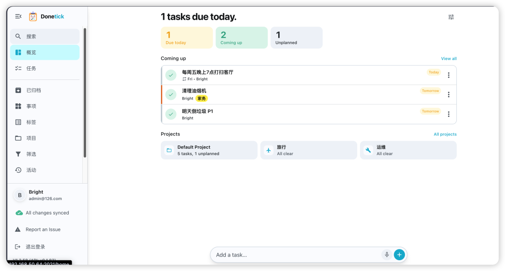
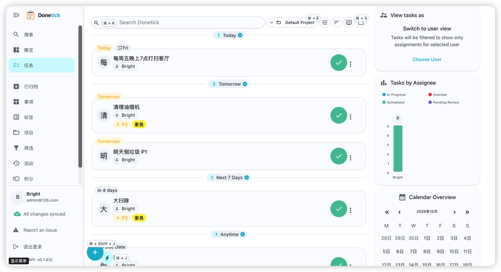
#### 1.2、使用场景介绍
1. 家庭家务管理：家庭成员共享家务清单，系统自动轮换分配打扫、采购、倒垃圾等日常事务，到期自动推送提醒，记录完成情况
1. 小团队轮值排班：运维值班、设备巡检、小组值日，自动均衡人员工作量，避免人工排班纠纷
1. 周期性个人事务：固定周期健身、保养、还款、设备定期维护，依靠自适应排期灵活调整任务时间
1. 自动化联动场景：通过API与Webhook对接智能家居、服务器监控，触发条件自动生成任务 结合平板和电脑，将设备放置在厨房、工位，作为公共任务看板，全员实时查看任务进度
#### 1.3、同类别产品对比
- 对比Trello/Notion：Donetick专注周期性事务与自动分摊，没有复杂看板，轻量化、启动快，更适合家务与轮值管理；自建部署成本更低，无需订阅费用。
- 对比Todoist/滴答清单：Donetick支持任务自动公平分配、NFC硬件联动、本地私有化部署，数据完全自主掌控，不受云端账号限制。
- 对比Nextcloud Tasks：Nextcloud任务仅支持基础待办，缺少智能排期、自动分摊、多渠道通知与API自动化能力，事务协作能力较弱。
**项目地址：**https://github.com/donetick/donetick
### 二、Donetick 安装部署
`Donetick`使用基于 `YAML`的配置系统，通过环境变量和`selfhosted.yaml`文件进行管理
**官方示例：**https://github.com/donetick/donetick/blob/main/config/selfhosted.yaml
#### 2.1、创建本地文件夹目录
在`/opt`目录下创建应用目录、数据持久化目录与配置目录，执行以下命令：
```
mkdir -p /opt/donetick/{data,config}
cd /opt/donetick
```
- data目录：存放SQLite数据库文件、任务图片附件
- config目录：存放程序运行配置文件
#### 2.2、Docker Compose 配置
在`/opt/donetick`目录新建`docker-compose.yml`，写入以下配置内容：
```
version: "3.9"
services:
  donetick:
    image: donetick/donetick
    container_name: donetick
    restart: unless-stopped
    ports:
      - "2021:2021"
    volumes:
      - ./data:/donetick-data
      - ./config:/config
    environment:
      - DT_ENV=selfhosted
      - DT_SQLITE_PATH=/donetick-data/donetick.db
```
**参数说明**
- image 指定官方Docker镜像名称
- container_name 自定义容器名称便于运维管理
- restart 设置容器异常退出后自动重启
- ports 主机端口映射容器内部2021端口
- volumes 将主机目录挂载至容器，保证数据持久化，容器删除数据不丢失
- DT_ENV 设定为自建托管模式，加载对应配置文件
- DT_SQLITE_PATH 指定SQLite数据库文件存放路径
启动与停止命令：
```
# 启动服务
docker-compose up -d
# 查看运行日志
docker-compose logs -f donetick
# 停止服务
docker-compose down
```
默认sqlite数据库，如果你要使用 `postgres`数据库，邮件、或者通知，可以看看参数的详细说明：https://docs.donetick.com/getting-started/configration
配置文件路径：config目录selfhosted.yaml
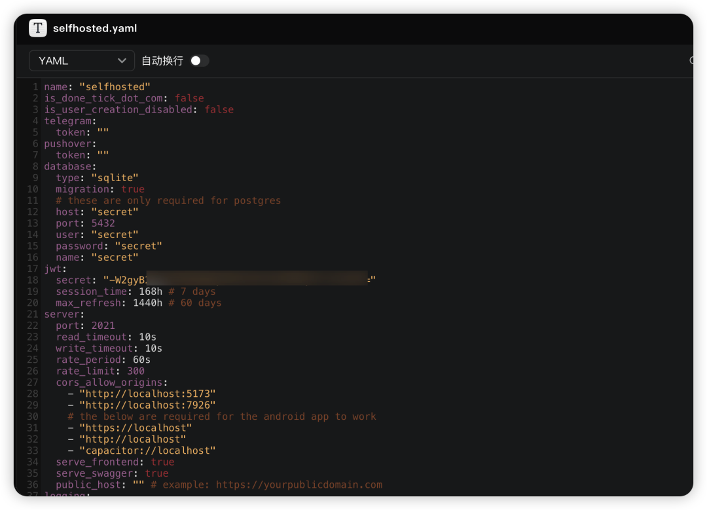
#### 2.3、Docker 命令安装方式
直接使用docker run命令一键拉起容器，无需编写yml文件，执行如下命令：
```
docker run -d \
  --name donetick \
  --restart unless-stopped \
  -p 2021:2021 \
  -v /opt/donetick/data:/donetick-data \
  -v /opt/donetick/config:/config \
  -e DT_ENV=selfhosted \
  -e DT_SQLITE_PATH=/donetick-data/donetick.db \
  donetick/donetick
```
**参数说明**
- -d 后台守护进程运行容器
- --name 设定容器名称
- --restart 容器退出策略
- -p 主机与容器端口映射
- -v 挂载主机目录实现数据持久化
- -e 注入环境变量，指定运行模式与数据库路径
### 三、使用教程
#### 3.1、登录访问
容器启动完成后，浏览器打开地址：`http://服务器IP:2021`，首次进入会跳转至注册页面
1. 新建管理员账号，设置用户名与登录密码；如需关闭新用户注册，可修改配置文件设置注册开关
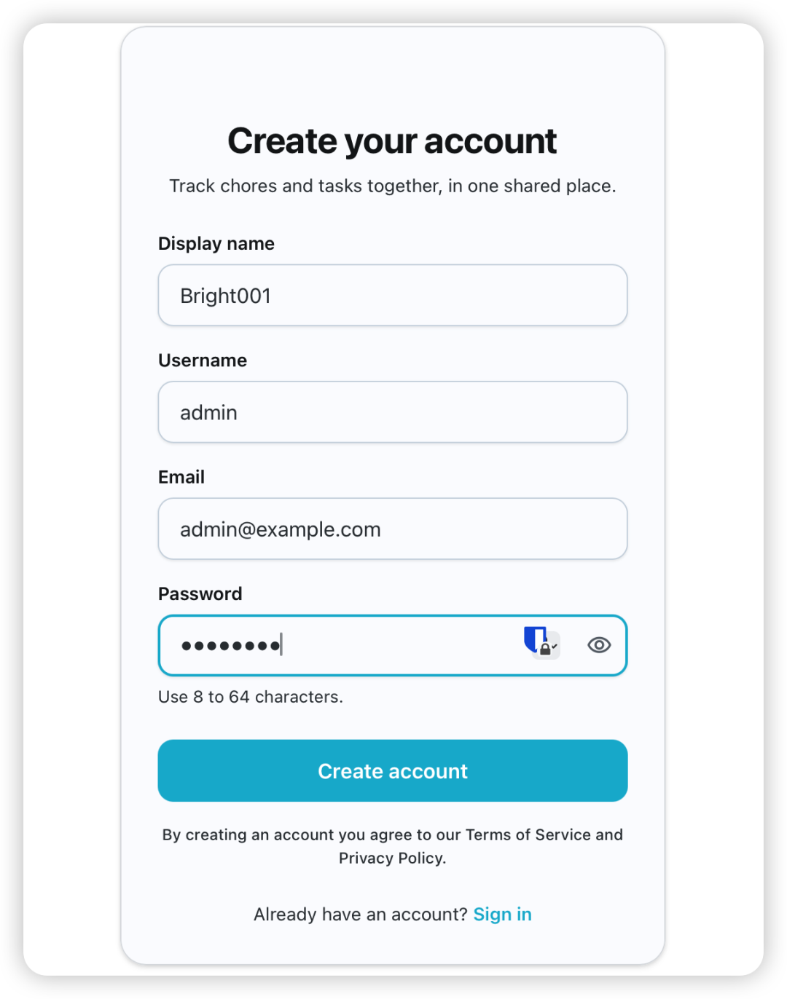
1. 登录进入主界面，默认展示全部待办任务、今日任务与周期性事务看板
1. 修改界面语言、时区，主题 点击侧边栏Settings-Localization
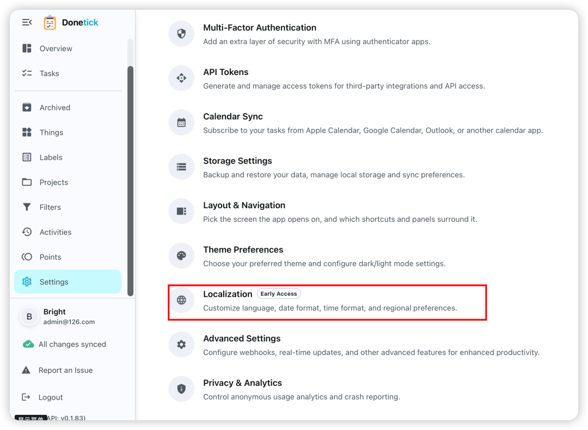
修改语言Language为中文
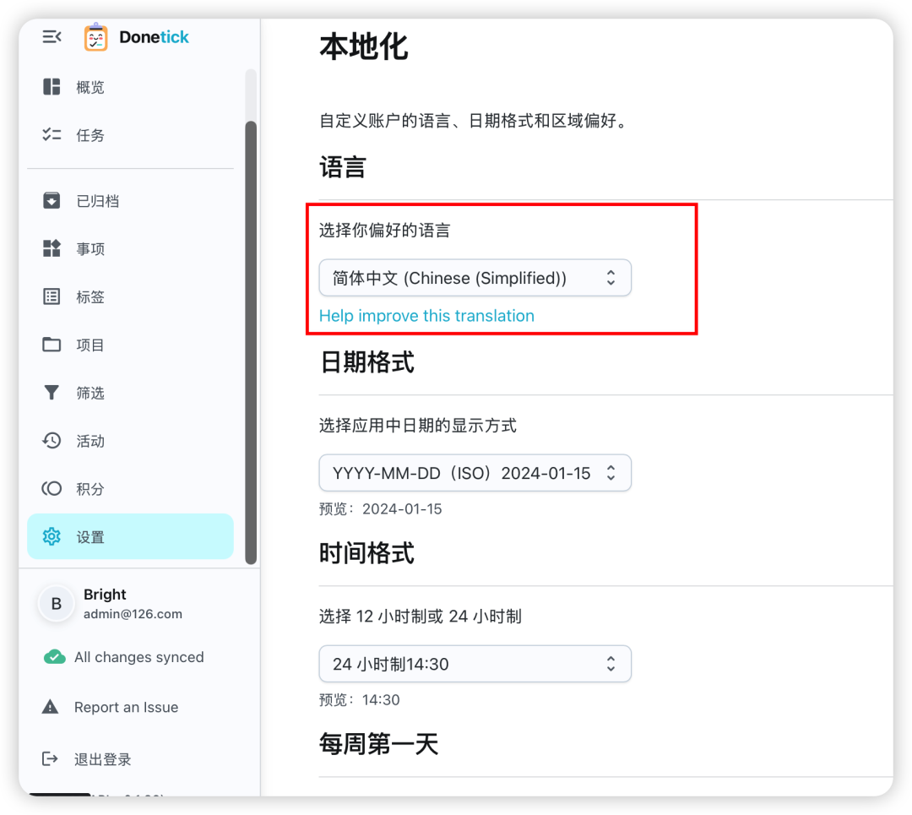
#### 3.2、初始化基础配置
1. 新建协作圈子：创建家庭/团队共享空间，邀请其他成员加入圈子，共享任务列表
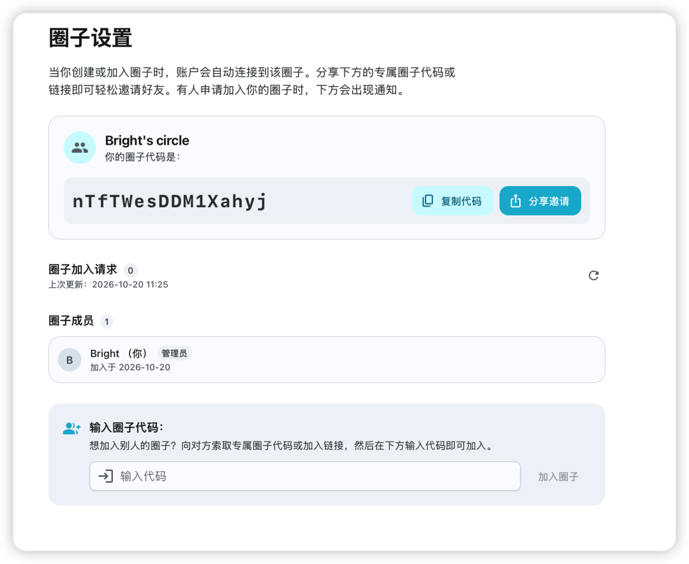
1. 配置通知渠道：进入设置页面，开启App推送、Telegram机器人通知，填写对应Token与会话ID
1. 基础参数调整：设置任务默认优先级、完成窗口、自动分配规则
#### 3.3、创建项目
点击侧边栏项目-+号按钮，支持创建多个项目
填入项目名称、项目描述、项目图标、项目颜色等信息，项目权限
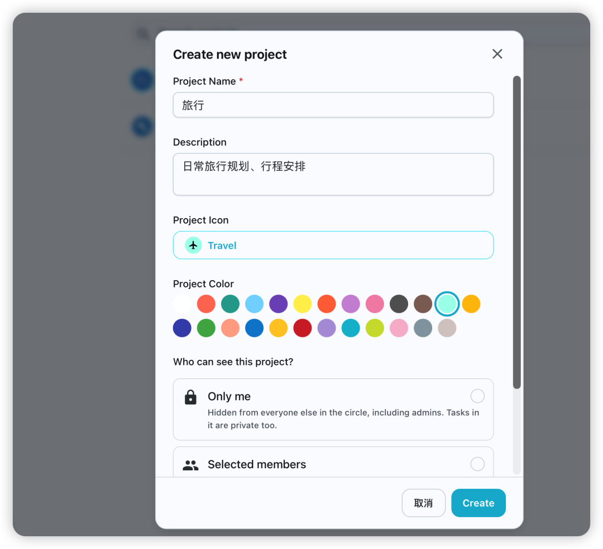
#### 3.4、任务创建与操作
1. 新建任务：在任务输入框直接用自然语言输入，例如“每周五晚上7点打扫客厅”
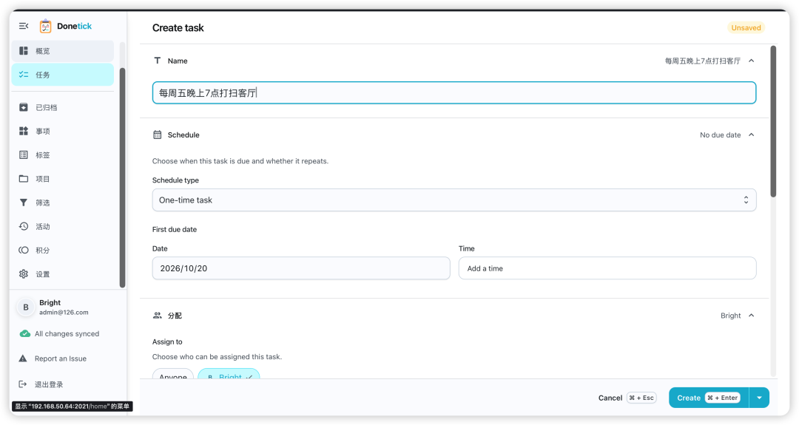
支持智能任务创建，意思就是 `Donetick`能自动解析简单的自然语言的句子，来创建任务
**例如：**
```
明天倒垃圾 tomorrow P1
给植物浇水 every Monday
买杂货 next Friday at 5pm
```
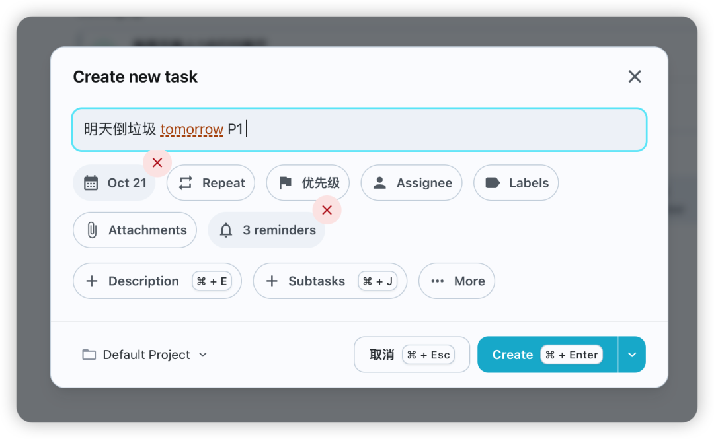
智能解析器会在您键入时以不同的颜色突出显示识别的元素，以便您了解它理解的内容
缺点：智能语法对中文支持不是很友好
语法：
### 优先级
-
**！P1
**- 最高优先级
-
**！P2
**，
**！P3
**，
**！P4
**- 较低的优先级
### 截止日期
顿涅茨克理解自然语言日期：
-

，

，

-

-

，

### 频率模式
自动设置重复任务：
-

，

，

，

-

- 

1. 分配任务：手动选择负责人，或开启自动分配，选择轮询/最少工作量模式，系统自动指派成员
1. 任务管理：给任务添加子任务、标签、优先级，上传照片作为任务验收凭证
1. 完成操作：点击一键标记完成；配置NFC标签后，扫码即可快速完成任务
1. 数据查看：打开数据统计页面，查看任务完成率、工时消耗与历史记录
#### 3.5、标签
点击侧边栏-标签，创建、修改、删除标签
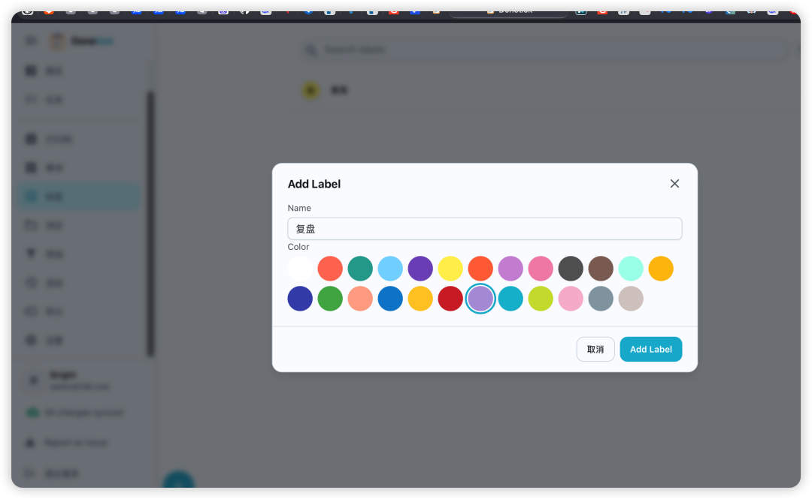
#### 3.6、活动管理
**任务执行日志**
每完成 / 跳过一次 Chore，就会自动生成一条 Activity 记录
- 记录内容：执行人、完成时间、耗时、填写的备注、上传的图片附件
- 可查看历史：比如「倒垃圾」过去半年是谁完成、哪天完成
- 支持时间追踪：开始 / 暂停计时，统计单次任务耗时
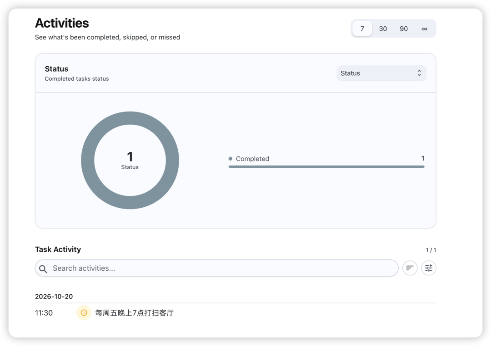
#### 3.7、事项Things
状态变量 / 触发器对象
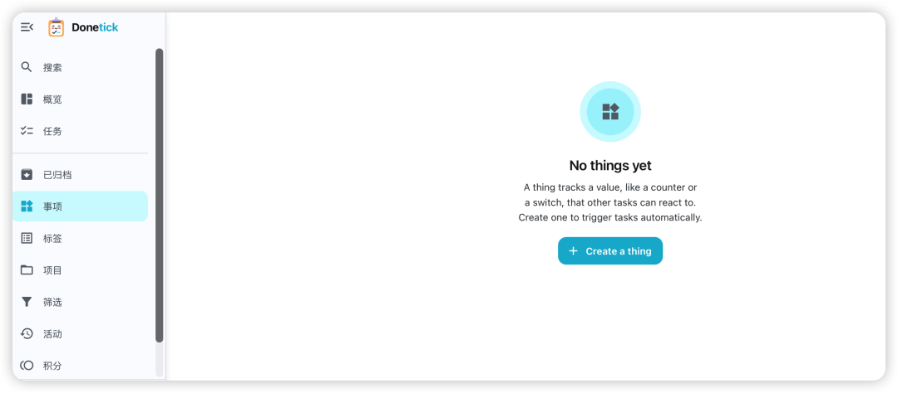
### Things 两种类型
- Switch 开关（布尔值）：只有 开启/关闭两种状态。例：洗衣机是否运行、车库门开关状态、水箱水位是否满
- Counter 计数器（数字）：可以递增 / 递减的数字。例：过滤桶使用次数、垃圾袋剩余数量、空调开机次数
当 Thing 的值发生变化 → 自动创建 / 触发 Chore 任务
**场景示例：**
1. 计数器：垃圾袋计数器，每消耗一袋，计数 - 1；**当计数 = 0，自动触发任务：购买垃圾袋**
1. 开关：鱼缸水位传感器，水位低，Switch 变为 ON → **自动触发任务：给鱼缸加水**
#### 3.8、积分
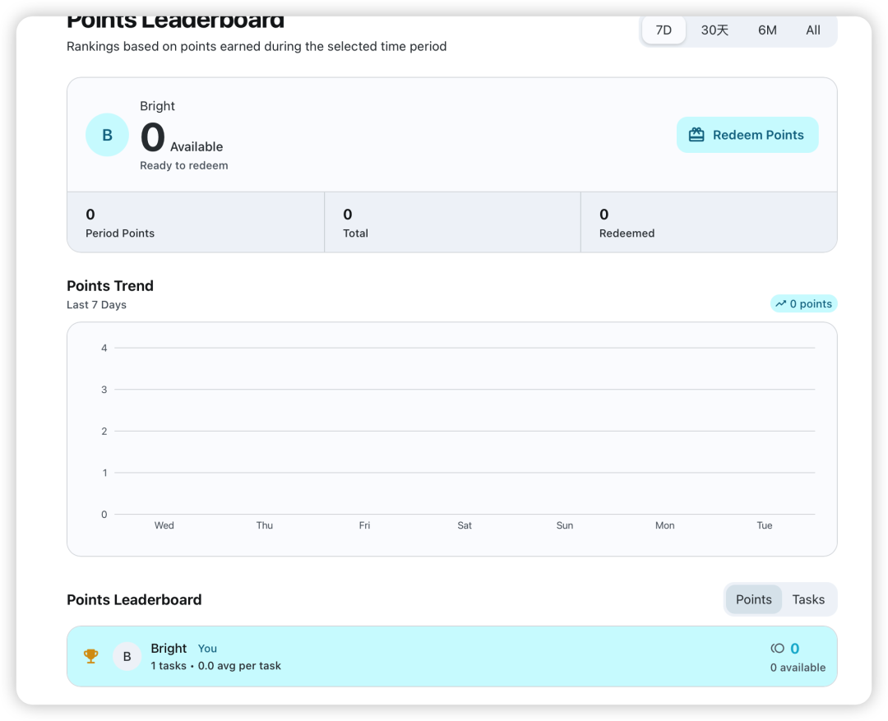
### 四、Donetick 使用技巧
#### 4.1、配置文件优化
自建部署模式下，在config目录新建`selfhosted.yaml`配置文件，可关闭用户注册、开启HTTPS、限制登录IP，同时自定义网页名称、附件大小上限，修改完成后重启容器生效。
#### 4.2、数据备份
Donetick采用单文件SQLite数据库，直接定时备份`/opt/donetick/data/donetick.db`文件即可；可编写定时脚本，每日凌晨自动打包数据库文件同步到异地存储，防止数据丢失。
#### 4.3、外网访问
1. 端口放行：防火墙开放主机2021端口；
1. 反向代理：配置Nginx/Caddy反向代理，绑定域名并配置SSL证书，实现HTTPS加密访问；
1. 内网穿透：无公网IP时，使用FRP、Cloudflare Tunnel做内网穿透，外网随时随地访问任务面板。
#### 4.4、自动化联动玩法
在设置中生成API访问令牌，结合Webhook把Donetick对接Home Assistant、服务器监控脚本；当监控触发告警时，自动调用接口生成运维巡检任务，实现告警自动转待办事务
#### 4.5、存储设置
支持S3对象存储和本地存储
持使用S3兼容存储服务进行文件上传、个人资料图片和其他资产的对象存储。这包括亚马逊S3、Cloudflare R2、MinIO和其他与S3兼容的提供商。
这用于存储您附加到任务的照片、个人资料图片，将来可能还有（其他资产）
**1）S3 对象存储配置**
在配置存储之前，请确保您有：
1. 与S3兼容的存储提供商（Amazon S3、Cloudflare R2、MinIO等）
1. 访问凭据（访问密钥和密钥或API令牌）
1. 为Donetick资产创建的存储桶
您可以通过环境变量或`config.yaml`文件配置存储
```
storage:
  storage_type: "remote"
  bucket_name: "your-bucket-name"
  region: "us-east-1"
  base_path: "assets"
  access_key: "your-access-key"
  secret_key: "your-secret-key"
  endpoint: "https://your-endpoint.com"
  public_host: "https://your-cdn.com"  # Optional
  max_user_storage: 104857600  # 100MB
  max_file_size: 2097152       # 2MB
```
**环境变量：**
```
DT_STORAGE_STORAGE_TYPE=remote
DT_STORAGE_BUCKET_NAME=your-bucket-name
DT_STORAGE_REGION=us-east-1
DT_STORAGE_BASE_PATH=assets
DT_STORAGE_ACCESS_KEY=your-access-key
DT_STORAGE_SECRET_KEY=your-secret-key
DT_STORAGE_ENDPOINT=https://your-endpoint.com
DT_STORAGE_PUBLIC_HOST=https://your-cdn.com  # Optional
DT_STORAGE_MAX_USER_STORAGE=104857600
DT_STORAGE_MAX_FILE_SIZE=2097152
```
**2）本地存储设置**
不建议用于生产，但可用于测试或开发环境。请暂时不要使用它
> 重要提示：在
> 具有本地存储的Docker中运行Donetick时，您必须挂载持久卷以避免数据丢失。如果没有适当的卷装载，如果容器被删除或重新创建，上传的文件将丢失。
> 
本地挂载示例：
```
    volumes:
      - ./data:/donetick-data
      - ./config:/config
      - ./assets:/app/assets
    environment:
      - DT_ENV=selfhosted
      - DT_SQLITE_PATH=/donetick-data/donetick.db
      #存储设置
      - DT_STORAGE_STORAGE_TYPE=local
      - DT_STORAGE_MAX_USER_STORAGE=104857600
      - DT_STORAGE_MAX_FILE_SIZE=2097152
```
参考：https://docs.donetick.com/advance-settings/storage-setup
