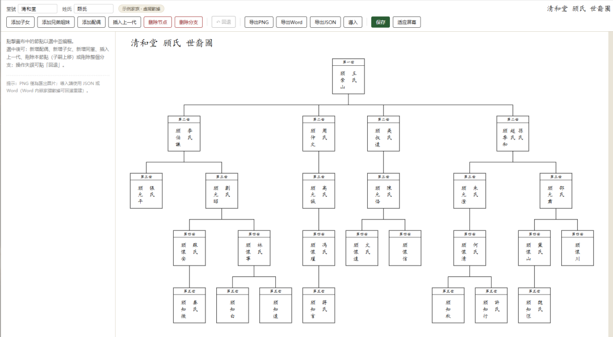

# 家谱编辑器#WorkBuddy#1024程序员节
> 💡 备注属性未写入，可能是备注属性名称或者类型被修改了，建议将字段类型设置为 rich_text，可以在小程序-操作-修改文章数据库页面进行调整
> 💡 原文链接:[https://mp.weixin.qq.com/s?__biz=MzY5NTQ2OTQwMQ==&mid=2247483821&idx=1&sn=9765abac5e0e25b56c40e24da3aa2345&chksm=f52205ccc250e6430297a12bb07eb2052fbaa98a1a782763465bbf31bf625d678f7c7d4218a2#rd](https://mp.weixin.qq.com/s?__biz=MzY5NTQ2OTQwMQ%3D%3D&mid=2247483821&idx=1&sn=9765abac5e0e25b56c40e24da3aa2345&chksm=f52205ccc250e6430297a12bb07eb2052fbaa98a1a782763465bbf31bf625d678f7c7d4218a2#rd)
抱歉，在技术性文章中插播一条广告。缘由是父亲正在整理家谱，用Word弄不出好看的树状图，最近一个多月又每天在测WorkBuddy，上午顺便甩给它几句提示词，很快就做出一个可以生成漂亮家谱的小程序了，虽然功能很幼稚，但至少能帮到一些像我父亲一样有这方面需求的人，还是有意义的。索性在截稿日之前投稿给#WorkBuddy#1024程序员节，希望大家支持一下！你的赞美是我努力的动力！
零编程，尝试完全用人机对话形式做了个小程序，实现轻松编辑家谱树状图，记录氏族人物关系，一键上手，欢迎来体验。
体验网址：https://family-tree-chart-49783.app.workbuddy.host/?sharecode=WG747R7MPJ
需要在网页端复制该链接进浏览器打开编辑。

心得：WorkBuddy应该是腾讯自QQ、微信之后第三个可以说具有跨时代意义的产品！
家谱编辑器 #WorkBuddy #1024程序员节
