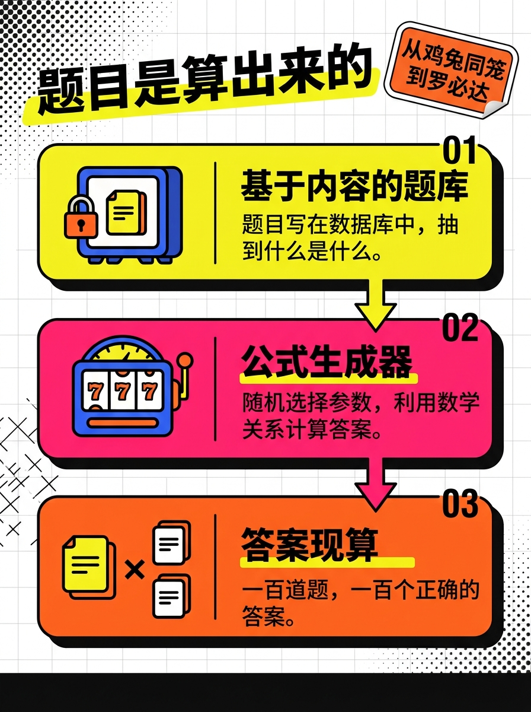
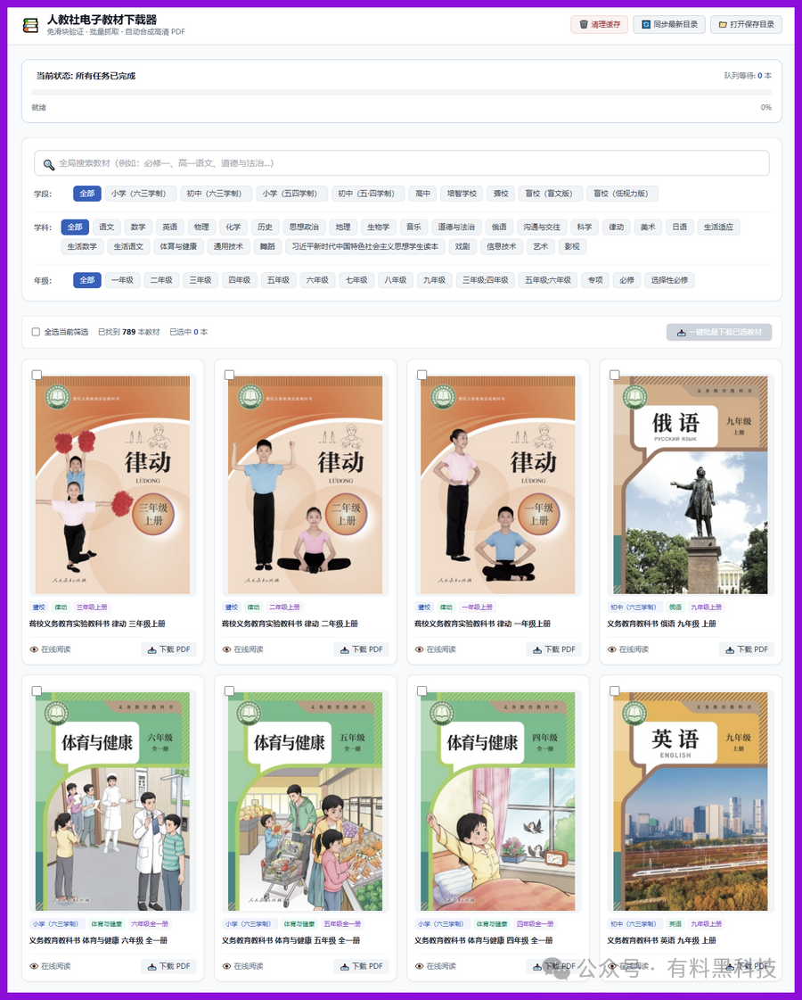

# 小初高81个数学方法，塞进一个不用装、不联网的网页里
> 💡 备注属性未写入，可能是备注属性名称或者类型被修改了，建议将字段类型设置为 rich_text，可以在小程序-操作-修改文章数据库页面进行调整
> 💡 原文链接:[https://mp.weixin.qq.com/s?__biz=MzA4OTY3ODQzNw==&mid=2448503798&idx=1&sn=c8546ee15d1fe3e98348b22ef72c54f6&chksm=85525bc238ac25e236f5f43d12eea3d2126719e4305790c740554caf4e06d7d25ed281f41bc8#rd](https://mp.weixin.qq.com/s?__biz=MzA4OTY3ODQzNw%3D%3D&mid=2448503798&idx=1&sn=c8546ee15d1fe3e98348b22ef72c54f6&chksm=85525bc238ac25e236f5f43d12eea3d2126719e4305790c740554caf4e06d7d25ed281f41bc8#rd)

一个 1.4KB 的 HTML 文件，双击打开，里面是从鸡兔同笼到洛必达法则的 81 个数学方法。不用装 App，不用注册，断网也能跑。
但 81 这个数字不值钱。81 个方法印成册子，也就是一本薄薄的复习资料。
值钱的是另一件事。这些方法能自己出题——同一类题做一百遍，题面一百次都不一样，答案一百次都对。
### 其一 · 练习册的死结在第二页
大多数孩子学数学卡在同一个地方：课上听懂了，回家做题还是不会。
家长通常把这归结为不认真。换个角度想——课上听懂的是老师讲的那一道，回家要做的是换了数字的另一道。这两道题在家长眼里是同一道，在孩子脑子里是两道。他记住的是数字和步骤的先后顺序，不是方法。
晚上你留意一下：孩子把练习册翻回做过的那一页，答案栏里还留着上次的铅笔印。

练习册解决不了这件事。同一类方法通常只配三五道题，做第二遍时答案已经记住了，再刷一遍测不出任何东西。刷题 App 好一些，题库同样是写死的，刷到后面开始重复。
**所以真正的缺口不是题不够多，是同一类题没有足够的变体。** 这才是"一听就会、一做就废"的病根。
### 其二 · 81种分法全解析
math-mastery 是个开源项目，作者王维，代码在 GitHub 上，README 声明 MIT 协议。整个应用分三层。
**方法路径。** 81 个方法按学段排成一条线：
小学 10 个，鸡兔同笼、植树问题、盈亏、相遇追及； 初中 15 个，一元一次方程、全等与相似、勾股定理、二次函数； 高中 24 个，导数、数列、圆锥曲线、空间向量。

另有 32 个拓展专题，一路到泰勒级数、柯西不等式、贝叶斯、傅里叶级数。
**出题引擎。** 三个文件：`qgen.js` 33KB、`qgen_junior.js` 27KB、`qgen_high.js` 94KB。每个方法配一个 `qgen(n)` 生成器，调用一次换一组参数，题干就变一次。
**闯关与薄弱点。** 每个方法有闯关模式，答错的题自动进薄弱点，可以反复练到清空。练完点「返回路径」，会自己跳回刚才练的那个节点。
### 其三 · 我怎么看出来的
先数方法——README 里四张表，小学 10 行、初中 15 行、高中 24 行、拓展专题 32 行，加起来 81。仓库宣传里常写的数字是 49，那是 10+15+24，课内核心的部分。剩下 32 个拓展专题同样接了出题引擎，只是没被算进去。

再看数据——`data.js` 里带年级标记的条目一共 114 条，比 81 多出 33 条。多出来的这部分，是只有静态题、还没接上生成器的方法。所以 81 不是全部，是已经能自己出题的那部分。
最后看提交记录——8 月 25 日初始版本；8 月 27 日一天加完小学、初中、高中三个引擎；9 月 1 日从 05:41 到 06:37，四个 commit，每个塞进 8 个拓展方法，56 分钟写完了从洛必达到傅里叶级数。
这个速度本身就是答案：出题不难，难的是出完之后那一步。
### 其四 · 原理：把"题"从内容变成公式
题目有两种存法。
第一种当**内容**存——一道题写死在题库里，拿出来是什么就是什么。第二种当**公式**存——先随机生成一组参数，再用数学关系把正确答案算出来。
math-mastery 做的是第二种。以鸡兔同笼为例：生成器随机取一个头数和一个脚数，反推出鸡兔各多少只，再把这两个数填进题干。答案是算出来的，不是存进去的，所以不需要人工校对。

这套机制有两条绕不开的约束。
第一条，只有答案唯一、能用参数表示的题型才进得来。选择、填空、计算可以，证明题、开放题不行。
第二条，配图不能剧透。题目配的 SVG 只画题给的数据和结构关系，答案不出现在图上。这条比出题本身还难守——图一旦把结果画进去，练习就废了。
仓库里躺着三个 Python 脚本：`verify.py、transform_grades.py、inject_highschool.py。`出完题之后，还得有人验一遍。
### 其五 · 谁该用，谁别用
该用：
- 小学高年级到高中，方法听懂了、但练得不够的孩子
- 想省下练习册钱的家庭
- 网不好，或者不想往孩子手机里装 App 的场景
别用：
- 方法还没听懂的孩子。这工具只管练不管教，不会从头给你讲一遍鸡兔同笼为什么这么假设
- 指望它替代课堂和老师的家长
- 需要写过程的解答题
三个坑：
1. 进度存在浏览器的 localStorage 里，清缓存就丢，换设备不同步。重要的进度自己另记一笔。
1. 项目 8 月 25 日才建，31 个 star，32 个拓展方法是 9 月 1 日一天内批量生成的。覆盖面有了，深度还没经过时间检验。
1. 仓库里没有 LICENSE 文件，虽然 README 写了 MIT。要拿去改了再发，建议先跟作者说一声。
### 其六 · 开学季怎么用
每天 15 分钟，只攻薄弱点，别从头刷。这套设计最值钱的地方就在这儿——它把"孩子到底卡在哪"变成了一个能点开看的列表，家长不懂数学也能看明白。
小学阶段建议家长陪着，初中以上可以放手。断网场景把文件夹拷进 U 盘，任何一台有浏览器的电脑都能打开。
入口：
- GitHub：https://github.com/kenowong/math-mastery
- Gitee（国内更快）：https://gitee.com/kenowong/math-mastery
下载后双击 `index.html` 就行。
---
一本练习册最贵的部分，是第二遍就不好使的那部分。
而这个网页里最便宜的那部分——1.4KB 的入口——恰恰是能一直用下去的那个。
这里再分享一款可以下载780本人教版教材的工具：
[开学第一天，FreePEP把780本人教版教材装进了一台电脑](https://mp.weixin.qq.com/s?__biz=MzUxNDAxMzQyMw%3D%3D&mid=2247496386&idx=1&sn=0724d380cf1dcb0c35b30bd4e03ecaa4&scene=21#wechat_redirect)
覆盖范围从小学（六三学制、五四学制）一直到高中，还包括三类很少被工具照顾到的学段：培智学校、聋校、盲校——后两者细到盲文版和低视力版。

