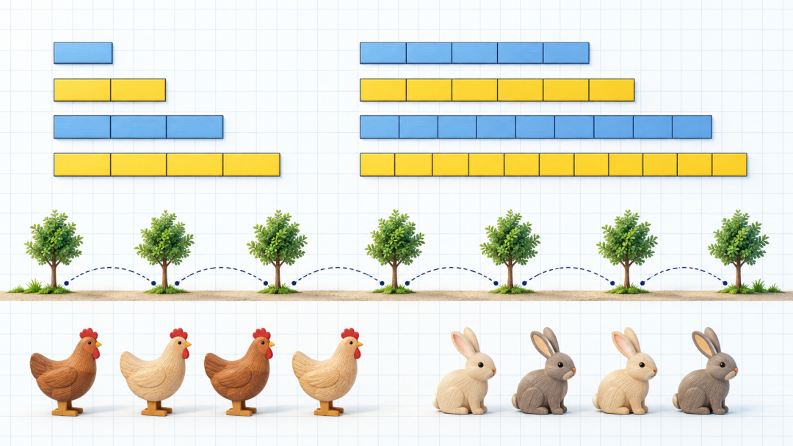

# 小学1—6年级应用题必背数量关系：20类常考题型一次整理清楚！
> 💡 备注属性未写入，可能是备注属性名称或者类型被修改了，建议将字段类型设置为 rich_text，可以在小程序-操作-修改文章数据库页面进行调整
> 💡 原文链接:[https://mp.weixin.qq.com/s?__biz=MzIyMTY1OTc5Mw==&mid=2247531549&idx=1&sn=88ba22c53c6c65e2fb5c94400bcdd6a7&chksm=e92972f7860f25ee223f0ad7c3bd33f881fe54854eb3010219a00ce01a39741f1b194eaa9697#rd](https://mp.weixin.qq.com/s?__biz=MzIyMTY1OTc5Mw%3D%3D&mid=2247531549&idx=1&sn=88ba22c53c6c65e2fb5c94400bcdd6a7&chksm=e92972f7860f25ee223f0ad7c3bd33f881fe54854eb3010219a00ce01a39741f1b194eaa9697#rd)
 很多孩子计算没有问题，一做应用题却不知道该用加法、减法，还是乘除法。原因往往不是不会算，而是没有看懂题目里的数量关系。今天把小学1—6年级常见的20类应用题整理在一起。建议家长先收藏，需要时再带孩子对照复习。
### 第一部分　基础数量关系

#### 01　总数与部分数
**数量关系：**
部分数＋部分数＝总数
总数－一个部分数＝另一个部分数
**例：**图书角有故事书38本、科普书27本，一共有38＋27＝65（本）。
**易错点：**“还剩”“用去”“取出”通常表示从总数中减去一部分。
#### 02　相差关系
较大数－较小数＝相差数
较小数＋相差数＝较大数
较大数－相差数＝较小数
**提醒：**“比……多”求大数用加法；“比……少”求小数用减法。
#### 03　单价、数量与总价
单价×数量＝总价
总价÷数量＝单价
总价÷单价＝数量
**例：**每本练习册8元，买6本需要8×6＝48（元）。
#### 04　单产量、数量与总产量
单产量×数量＝总产量
总产量÷数量＝单产量
总产量÷单产量＝数量
**关键词：**每棵、每箱、每台、每天完成多少。
#### 05　平均数问题
平均数＝总数量÷总份数
总数量＝平均数×总份数
总份数＝总数量÷平均数
**易错点：**平均数不是把两个平均数直接相加再除以2，除非两组的份数相同。
### 第二部分　倍数与典型应用题

#### 06　求一个数的几倍
标准量×倍数＝比较量
比较量÷标准量＝倍数
**例：**小明有8本书，小红的书是小明的3倍，小红有8×3＝24（本）。
#### 07　和差问题
较大数＝（两数和＋两数差）÷2
较小数＝（两数和－两数差）÷2
**例：**两数和是50，差是8。大数是（50＋8）÷2＝29，小数是21。
#### 08　和倍问题
小数＝两数和÷（倍数＋1）
大数＝小数×倍数
**识别方法：**题目同时告诉“两个数的和”以及“一个数是另一个数的几倍”。
#### 09　差倍问题
小数＝两数差÷（倍数－1）
大数＝小数×倍数
**易错点：**和倍用“倍数＋1”，差倍用“倍数－1”。
#### 10　年龄问题
两人的年龄差始终不变。
几年后，每个人的年龄都增加同样的数。
几年前，每个人的年龄都减少同样的数。
**易错点：**年龄差不变，但年龄的倍数关系会变化。
#### 11　盈亏问题
一盈一亏时：
人数＝（盈数＋亏数）÷两次每人分配数的差
总数＝每人分配数×人数＋盈数
**提醒：**“还剩”是盈，“还差”是亏；先统一判断正负。
#### 12　鸡兔同笼
假设全是鸡：
兔数＝（总脚数－总头数×2）÷（4－2）
鸡数＝总头数－兔数
**例：**共有10个头、28只脚，兔有（28－10×2）÷2＝4（只），鸡有6只。
#### 13　植树与间隔问题
间隔数＝总长度÷间隔长度
两端都栽：棵数＝间隔数＋1
只栽一端：棵数＝间隔数
两端都不栽：棵数＝间隔数－1
封闭图形一周栽树：棵数＝间隔数
### 第三部分　归一、归总与行程问题

#### 14　归一问题
先求一份是多少，再求若干份是多少。
总数量÷份数＝每份数量
**例：**4盒彩笔共48支，每盒有48÷4＝12（支），7盒有12×7＝84（支）。
#### 15　归总问题
先求总量，再按新的条件重新平均分。
每份数量×份数＝总数量
**例：**每组6人，分成8组，共有48人；改成每组4人，可以分成12组。
#### 16　基本行程问题
速度×时间＝路程
路程÷时间＝速度
路程÷速度＝时间
**易错点：**千米、米，小时、分钟、秒必须先统一单位。
#### 17　相遇问题
相遇路程＝甲走的路程＋乙走的路程
相遇时间＝总路程÷速度和
总路程＝速度和×相遇时间
**关键词：**同时出发、相向而行、相遇。
#### 18　追及问题
追及路程＝原来的距离差
追及时间＝距离差÷速度差
距离差＝速度差×追及时间
**关键词：**同向而行、后面追前面、追上。
### 第四部分　分数、百分数与比例

#### 19　分数应用题
单位“1”的量×对应分率＝比较量
比较量÷对应分率＝单位“1”的量
比较量÷单位“1”的量＝对应分率
**判断方法：**“谁的几分之几”，谁通常就是单位“1”。已知单位“1”用乘法，求单位“1”用除法或方程。
#### 20　百分数与按比例分配
部分量÷总量＝百分率
总量×百分率＝部分量
部分量÷百分率＝总量
按比例分配：总量÷总份数＝每份数量
**易错点：**“增加20%”是原来的120%；“降低20%”是原来的80%；增加20%后再降低20%，不能回到原数。
### 做应用题时，按这4步检查
1. 题目已知什么，要求什么？
1. 谁是标准量，谁是比较量？
1. 数量之间是和、差、倍数，还是速度关系？
1. 单位是否统一，答案是否符合实际？
数量关系不是让孩子死背公式。真正有用的方法，是先说清楚每个数表示什么，再列式计算。
**这份内容建议收藏，也可以打印出来，遇到不会的应用题时按题型查找。**
**你家孩子最容易在哪一种应用题上丢分？**
欢迎留言，也可以转给身边需要的家长。
