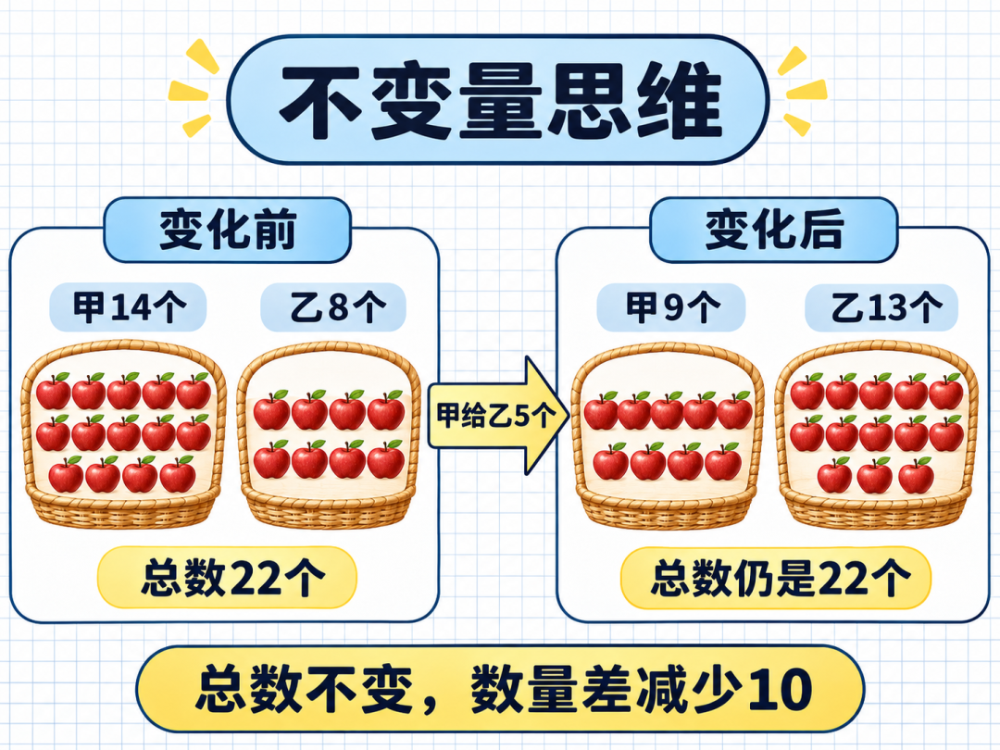
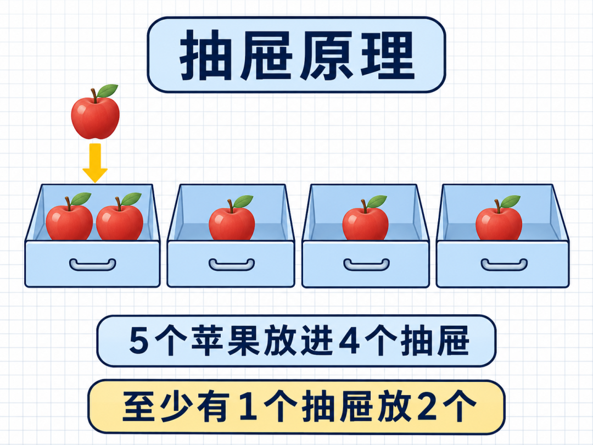

# 小学奥数真正拉开差距的12种思维：会算只是基础，会转化才是关键！
> 💡 备注属性未写入，可能是备注属性名称或者类型被修改了，建议将字段类型设置为 rich_text，可以在小程序-操作-修改文章数据库页面进行调整
> 💡 原文链接:[https://mp.weixin.qq.com/s?__biz=MzIyMTY1OTc5Mw==&mid=2247531635&idx=1&sn=071642255e0b1aa7e8a524d86c53e4f2&chksm=e9cb4b6e261d8f58ebebeb1b5b4dae948fa362ef6ebae3b79812b8085ab594a719601df3a446#rd](https://mp.weixin.qq.com/s?__biz=MzIyMTY1OTc5Mw%3D%3D&mid=2247531635&idx=1&sn=071642255e0b1aa7e8a524d86c53e4f2&chksm=e9cb4b6e261d8f58ebebeb1b5b4dae948fa362ef6ebae3b79812b8085ab594a719601df3a446#rd)
奥数真正训练的，也不只是“做难题”，而是能不能把复杂问题变简单、把陌生条件转化成熟悉关系。**下面这12种思维，是小学奥数中经常用到的底层方法。每一种都值得孩子慢慢体会**。
### 1、整体思维：先不拆开，整体看
**适用：**几个数量反复出现，但不需要分别求出。
**例题：**甲、乙两数的和是30，求甲数的2倍与乙数的2倍的和。
不必求甲、乙分别是多少：
2×甲＋2×乙＝2×（甲＋乙）＝2×30＝**60**
**易错点：**题目没有要求分别求，就不要为了“完整”增加无用步骤。
### 2、对应思维：一份变化，对应多少差

**适用：**盈亏、分配、和差倍、份数变化。
**例题：**给每名学生分3本书，剩12本；每人分5本，还差8本。有多少名学生？
每人多分5－3＝2本，总量相差12＋8＝20本。
学生人数：20÷2＝**10人**
**关键：**每人相差2本，与总共相差20本一一对应。
### 3、倒推思维：从结果一步步往回走

**适用：**连续操作、还原、年龄、移多补少。
**例题：**一个数先乘3，再加6，结果是30。原数是多少？
正向操作是“×3，再＋6”，倒推时顺序相反、运算相反：
（30－6）÷3＝**8**
**易错点：**倒推不只要变换运算，还要倒过来处理操作顺序。
### 4、假设思维：先假设一样，再调整
**适用：**鸡兔同笼、租船、答题得分、盈亏问题。
**例题：**鸡兔共10只，共有28条腿。鸡兔各多少只？
假设全是鸡：10×2＝20条腿。
实际多出：28－20＝8条腿。
每把一只鸡换成兔，多2条腿，所以兔有8÷2＝4只，鸡有10－4＝6只。
**关键：**假设不是猜答案，而是制造一个容易比较的标准。
### 5、转化思维：把陌生题变成熟悉题
**适用：**复杂图形、分数、行程、组合计数。
**例题：**求一个长方形中挖去一小块后的面积。
可以用大长方形面积减去挖掉部分，也可以移动、拼补，把剩余图形转化成规则图形。
**易错点：**转化后图形可以变化，但面积、长度或数量关系必须保持题目要求的不变量。
### 6、不变量思维：一直变化的题，先找没变的

**适用：**移多补少、操作题、年龄、交换、奇偶判断。
**例题：**从甲筐拿5个苹果放进乙筐，两个筐的苹果总数变了吗？
甲减少5个，乙增加5个，**总数不变**。
但甲、乙两筐的数量差会减少10，而不是5。
**常见不变量：**总和、总差、面积、周长、奇偶性、余数特征。
### 7、极端思维：先看最大、最小和边界
**适用：**最值、范围、至少、至多、安排问题。
**例题：**5个连续自然数的和是100，最大的数可能超过22吗？
5个数的平均数是100÷5＝20，所以它们是18、19、20、21、22，最大数是22。
**作用：**极端情况常常能快速缩小答案范围，排除不可能。
### 8、枚举思维：按顺序列全，不重不漏
**适用：**排列组合、钱币、整数分拆、路线、可能性。
**例题：**用1元、2元、5元各一张，可以组成多少种不同的钱数？
按使用1张、2张、3张分类：
1，2，5；1＋2＝3，1＋5＝6，2＋5＝7；1＋2＋5＝8。
共能组成**7种**不同的钱数。
**关键：**先确定分类标准，再按固定顺序列举。
### 9、分类讨论：一种方法不够，就分情况
**适用：**奇偶、位置、首位限制、分段计费、几何分类。
**例题：**用0、1、2组成没有重复数字的两位数，有多少个？
十位不能是0。
十位是1：可以组成10、12；十位是2：可以组成20、21。
共有**4个**。
**易错点：**分类标准要互不重复，并且覆盖全部情况。
### 10、抽屉原理：数量多于位置，必有重复

**适用：**至少有几个相同、一定出现、最坏情况。
**例题：**把5个苹果放进4个抽屉，不管怎么放，至少有一个抽屉里有几个苹果？
如果每个抽屉最多放1个，只能放4个。第5个苹果无论放进哪里，都会使某个抽屉至少有**2个**。
**关键：**先想最平均、最不容易重复的放法，再多放一个。
### 11、递推思维：先研究小情况，再一步步推
**适用：**数列、爬楼梯、图形增长、传球、染色。
**例题：**用小棒摆一排相连的正方形，1个用4根，2个用7根，3个用10根。摆n个需要多少根？
每增加1个正方形，只增加3根。
所以n个需要：4＋3×（n－1）＝**3n＋1根**。
**关键：**找出“从前一步到后一步增加了什么”。
### 12、数形结合：数字看不懂，就把关系画出来
**适用：**和差倍、分数、行程、面积、计数。
**例题：**甲数是乙数的3倍，甲、乙两数的和是40。两数各是多少？
把乙数画成1份，甲数画成同样的3份，一共4份。
乙数：40÷4＝10；甲数：10×3＝30。
**作用：**线段图不是装饰，而是把看不见的数量关系变成看得见的份数。
 一道题做出答案，只完成了一半。**能总结方法、解释原因、迁移到新题，才是奥数训练真正有价值的地方**。建议收藏，让孩子遇到难题时逐项对照：这道题可以换一种思维吗？也欢迎转给身边重视数学思维训练的家长。
