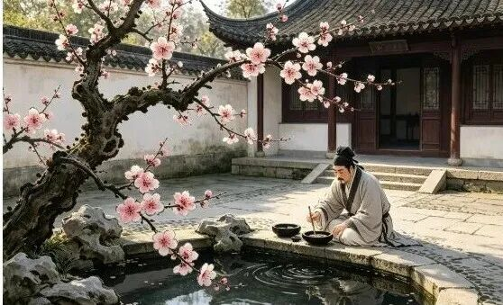
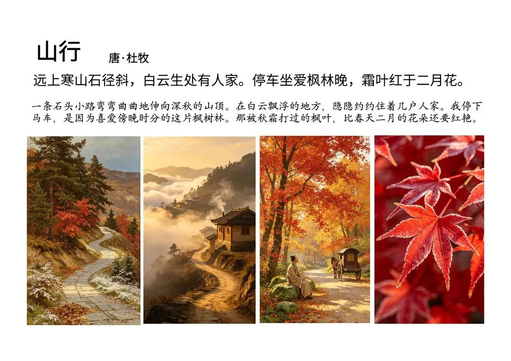
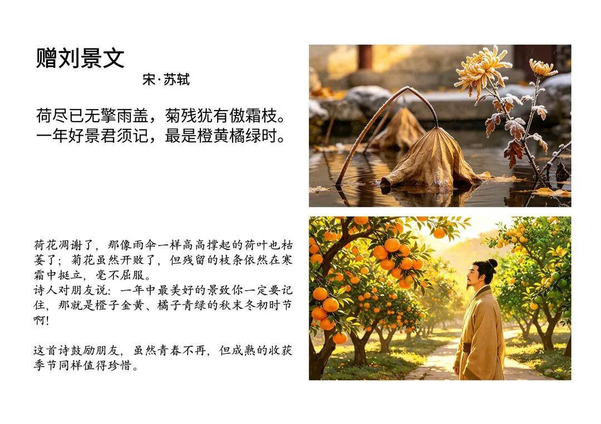
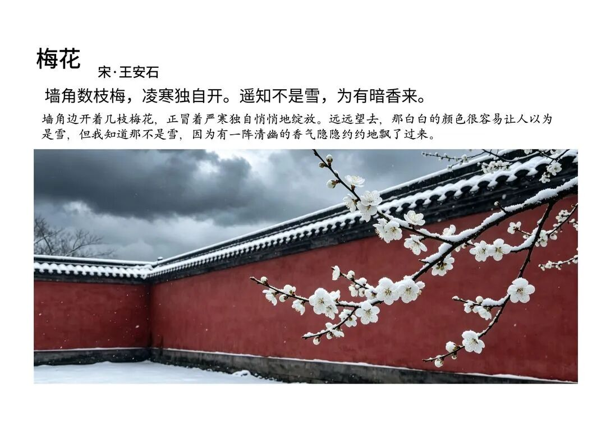
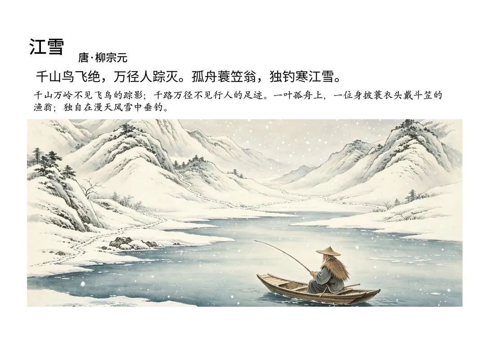
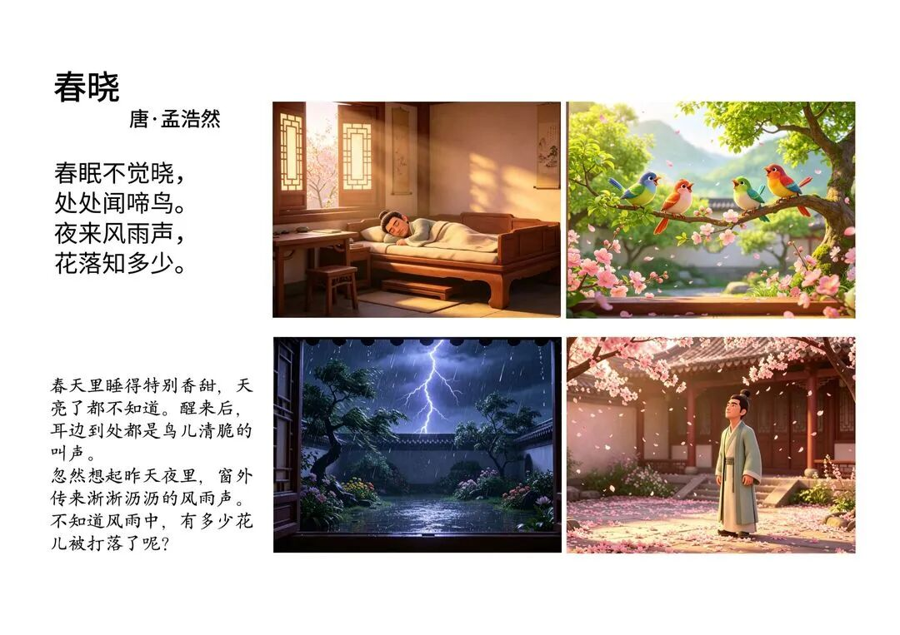
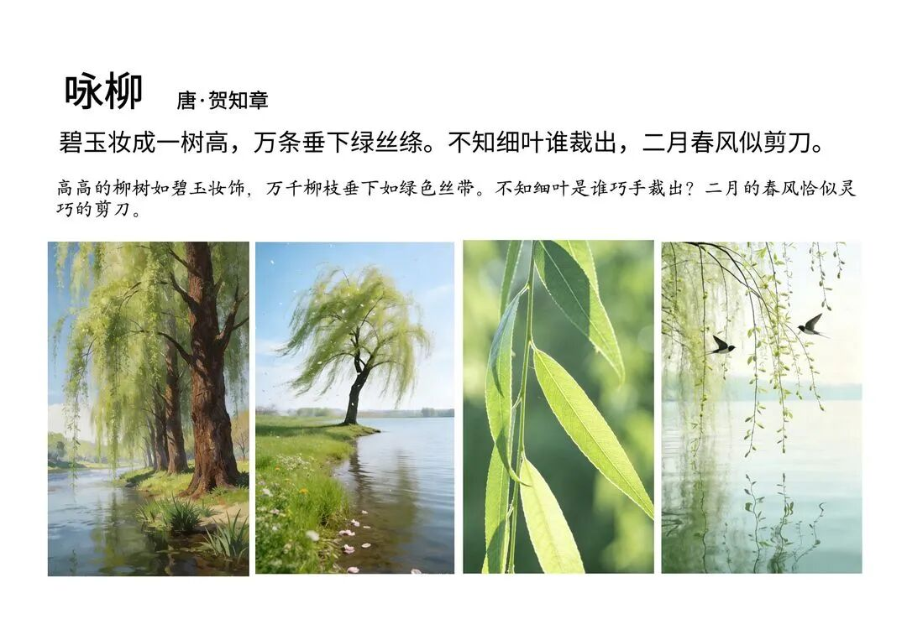
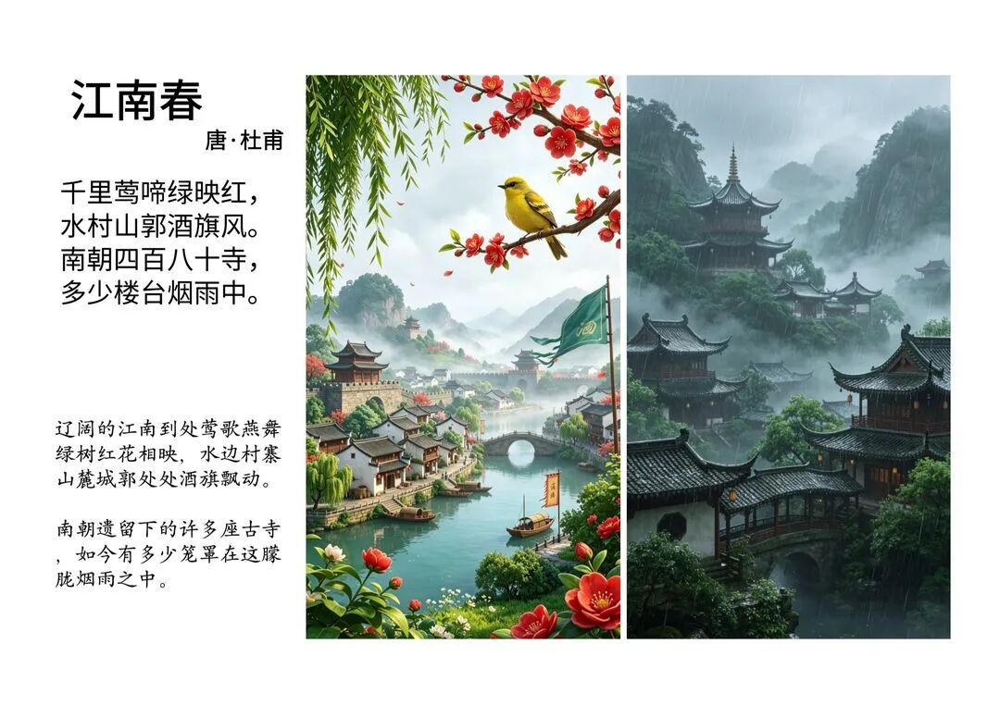
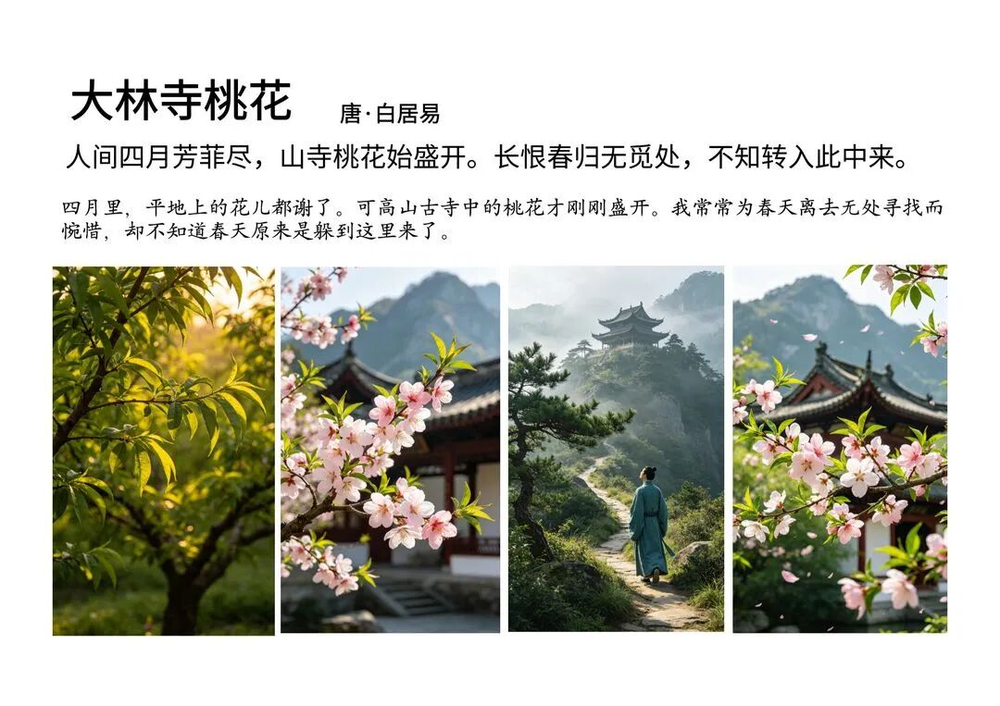
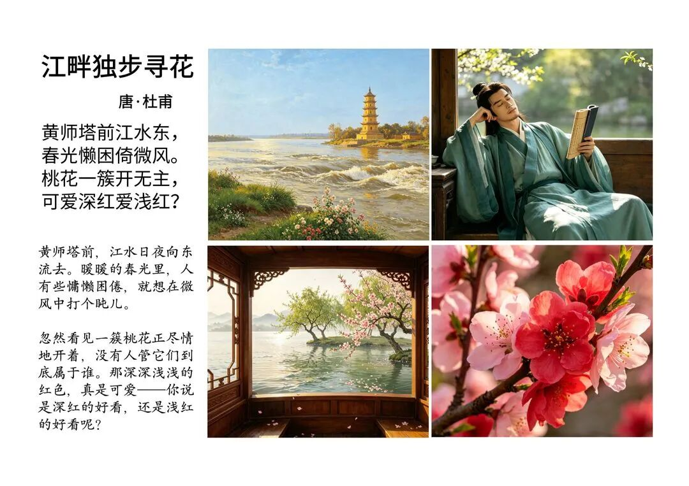

# 小学必背古诗 50 首图文合集：一诗一画讲给孩子听（建议收藏）
> 💡 备注属性未写入，可能是备注属性名称或者类型被修改了，建议将字段类型设置为 rich_text，可以在小程序-操作-修改文章数据库页面进行调整
> 💡 原文链接:[https://mp.weixin.qq.com/s?__biz=MzI4MjYyOTg0MA==&mid=2247485007&idx=1&sn=3f8f10e145029c6dc3f96dcde928fe54&chksm=ea19b1c6e2069406d7c5935000cece79acc0315d909a700f3e90dbd51b5c2c988a89f6dd05dc#rd](https://mp.weixin.qq.com/s?__biz=MzI4MjYyOTg0MA%3D%3D&mid=2247485007&idx=1&sn=3f8f10e145029c6dc3f96dcde928fe54&chksm=ea19b1c6e2069406d7c5935000cece79acc0315d909a700f3e90dbd51b5c2c988a89f6dd05dc#rd)
前 言
一年级开始，学校就要求背古诗了。学校课间休息的时候，广播里也会播放古诗音频给小学生磨耳朵。
上半年的某一天，早晨洗漱的时候，儿子问：**"我家洗砚池头树"**是什么意思？
我一边帮他收拾书包，一边给他讲了洗砚池——为什么要用砚台，洗完砚台后池水变成了黑色，水池旁边的梅树因为吸收了有墨汁的水，开出的梅花好像也带着淡淡的黑色痕迹。

送完他上学回来，我突发奇想：**古诗里的生活孩子们不好理解，如果把它画出来，岂不是更有利于理解了吗？**也解决了孩子们对古诗**"背得出，但不懂"**的问题。
人最怕的就是起心动念。
我用了一个多月的时间做了几十上百首古诗图文：先搜索小学必背的古诗名单，按照常见、低年级、中高年级的顺序一首诗一首诗地构思，每句诗一张一张地配图，或者给整首诗配一张意境图。
看到这些成品很有成就感。儿子每天看一首，很轻松就能印象深刻。
如果你家孩子也刚上小学，先收藏，每天翻一翻，留个好印象。
这篇文章整理了 50 首古诗，按照不同场景分类——看看有没有你家孩子背的那一首。
**第一组 · 一年四季**
先看画，再读诗
一年四季是孩子最容易走进诗里的入口——秋天捡的那片红叶、冬天期待的那场雪、春天闻过的花香、夏天等过的蜻蜓，诗里全都有。
现在正是秋天，就先从秋天的诗开始。这一组建议跟着季节读，不用按顺序。

**山行 ｜ 杜牧（唐）**
秋天带他捡一片红叶，"霜叶红于二月花"就不再是需要背的句子，是他手里那片叶子。

**赠刘景文 ｜ 苏轼（宋）**
"最是橙黄橘绿时"——秋天看到橙子橘子上市时读这首最好，一年好景就在菜市场。

**梅花 ｜ 王安石（宋）**
冬天读这首，别先讲"坚强"，先问他：别的花都怕冷，为什么梅花不怕？让他自己说。

**江雪 ｜ 柳宗元（唐）**
让他数数画面里有几个东西——一条船、一个老头、一场雪。越少，越安静。

**风 ｜ 李峤（唐）**
全诗没有"风"字，却句句在写风——当谜语读，猜谜底就是标题，孩子会抢答。

**春晓 ｜ 孟浩然（唐）**
别急着解释"晓"是什么，先问孩子：你睡醒时听到的第一个声音是什么？再对回诗里，他就懂了。

**咏柳 ｜ 贺知章（唐）**
带他下楼找一棵柳树，让他用手比划"万条垂下绿丝绦"——比解释十遍都管用。

**江南春 ｜ 杜牧（唐）**
读到"多少楼台烟雨中"，可以告诉他：一千多年前的房子和现在完全不一样哦，诗里藏着历史。

**大林寺桃花 ｜ 白居易（唐）**
山下花谢了山上才开——顺便讲讲"山越高越凉"，孩子会发现诗里藏着科学。

**春夜喜雨 ｜ 杜甫（唐）**
下雨天最配这首。让他闭上眼睛听雨，找找"随风潜入夜"的"潜"字藏在哪里。

**江畔独步寻花 ｜ 杜甫（唐）**
"千朵万朵压枝低"——拍一张小区里开得最满的花树给他看，就是黄四娘家那棵。
**第二组 · 山水风光**
诗里的风景，周末去看
李白和杜甫写过的地方，很多周末就能找到"平替"：一座楼、一条河、一个池塘。先读诗，再带他去看——看完回来再读一遍，风景会多一层意思。

**登鹳雀楼 ｜ 王之涣（唐）**
爬楼梯、爬山时最配这首。"更上一层楼"是走着就能懂的诗，不用坐着背。

**望庐山瀑布 ｜ 李白（唐）**
"飞流直下三千尺"是夸张——告诉他：夸张是诗人的特权，李白没有骗人。

**望天门山 ｜ 李白（唐）**
对着地图讲"天门中断楚江开"——两座山把江水夹成一道门，画面就出来了。

**早发白帝城 ｜ 李白（唐）**
"轻舟已过万重山"——孩子输了比赛、考砸了的时候，这句刚好能用上。

**绝句（迟日江山丽） ｜ 杜甫（唐）**
燕子衔泥、鸳鸯睡觉——春天公园里就能找到的两种动物，读完去找找。

**绝句（两个黄鹂） ｜ 杜甫（唐）**
诗里藏着四个颜色：黄、翠、白、青——让他边读边找，找齐了算他赢。

**鹿柴 ｜ 王维（唐）**
"返景入深林"是夕阳穿过树林的样子——傍晚逆光的照片，就是这首诗的感觉。

**滁州西涧 ｜ 韦应物（唐）**
"野渡无人舟自横"——问问他：为什么"无人"两个字，能让整首诗安静下来？

**小池 ｜ 杨万里（宋）**
夏天带他蹲在池塘边等一只蜻蜓落在小荷上——等到了，这首诗就活了。

**敕勒歌 ｜ 北朝民歌**
读"天似穹庐"之前，先问他：草原上的天空看起来像什么？再对答案。
**第三组 · 童趣生活**
写的就是孩子
偷采白莲的小娃、怕吓跑鱼连问路都不敢说话的钓鱼小孩——一千多年前的小孩，干的事和现在的孩子差不多。这一组让他自己发现：这些诗写的就是我。

**咏鹅 ｜ 骆宾王（唐）**
这是骆宾王七岁写的——先把这句告诉他，孩子立刻会觉得"那我也能写"。

**江南 ｜ 汉乐府**
"鱼戏莲叶东"东西南北重复四句不是凑字，是游戏——一家三口轮流接龙读。

**池上 ｜ 白居易（唐）**
小娃偷采白莲回——先别讲道理，问他：你猜他撑小艇回去的路上是什么心情？

**小儿垂钓 ｜ 胡令能（唐）**
钓鱼的人怕吓跑鱼，连问路都只敢摆手——钓过鱼的孩子秒懂这首。

**舟夜书所见 ｜ 查慎行（清）**
一盏渔灯散成一河星光——晚上开手电照水面，让他亲眼看光是怎么"散"的。

**夜书所见 ｜ 叶绍翁（宋）**
夜里提灯捉蟋蟀的小孩——秋夜的"捉迷藏"，他大概率也想试一次。

**画 ｜ 王维（传）（唐）**
这是一首谜语诗——"走近水无声，人走鸟不惊"，先玩猜谜，再看画对答案。

**画鸡 ｜ 唐寅（明）**
"一叫千门万户开"——早上闹钟响的时候用这句叫他起床，比吼十句管用。

**寻隐者不遇 ｜ 贾岛（唐）**
这是一首"没找到人"的诗——告诉他：没写完的故事，也是好故事。

**蜂 ｜ 罗隐（唐）**
"为谁辛苦为谁甜"——不用急着讲奉献，先问问他：你觉得蜜蜂像家里的谁？
**第四组 · 思乡送别**
关于想念和再见
孩子第一次离开你过夜、好朋友转学搬走，都是这首诗的时刻。想念和告别这件事，一千多年前的古人也一样在经历。

**静夜思 ｜ 李白（唐）**
全世界中国人都会背的一首——睡前可以聊聊：为什么看到月亮会想家？

**九月九日忆山东兄弟 ｜ 王维（唐）**
孩子第一次离开你去夏令营、去亲戚家住的时候，这首就是他自己的心情。

**回乡偶书 ｜ 贺知章（唐）**
八十多岁回村，小孩把他当客人——问问他：什么是"乡音"？你的家乡话说"吃饭"是什么？

**枫桥夜泊 ｜ 张继（唐）**
一个失眠的人听钟声——睡前读刚好，聊聊"睡不着的时候，你在想什么"。

**清明 ｜ 杜牧（唐）**
清明扫墓路上读最合适——他问"牧童在哪"，就带他在画面里找牛背。

**赠汪伦 ｜ 李白（唐）**
汪伦用歌声送朋友——问问他：如果好朋友要搬走了，你想用什么方式送他？

**送元二使安西 ｜ 王维（唐）**
"劝君更尽一杯酒"——分别之前，再多陪对方做一件小事，大人也该学的事。

**芙蓉楼送辛渐 ｜ 王昌龄（唐）**
"一片冰心在玉壶"——用孩子的话说就是：请转告大家，我的心是干净的。

**别董大 ｜ 高适（唐）**
"天下谁人不识君"——安慰朋友最高级的说法，不是"别难过"，是这个。

**赋得古原草送别 ｜ 白居易（唐）**
野火烧不尽——拔过草的孩子都知道，草的根有多倔强。
**第五组 · 品格志向**
长大以前，先认识"了不起"
这一组别急着讲道理。李广将军的故事、孟郊手里的针线、悯农的一粒米——故事讲到位了，道理他自己会长出来。

**古朗月行（节选） ｜ 李白（唐）**
"小时不识月，呼作白玉盘"——先问他：你小时候以为月亮是什么？

**长歌行 ｜ 汉乐府**
"少壮不努力，老大徒伤悲"——别拿来训话，讲讲植物春天不发芽，秋天会怎样。

**出塞 ｜ 王昌龄（唐）**
先讲李广将军的故事，再读"但使龙城飞将在"——他会主动要求背。

**凉州词（黄河远上白云间） ｜ 王之涣（唐）**
"春风不度玉门关"——打开地图看看玉门关离海有多远，就全懂了。

**凉州词（葡萄美酒夜光杯） ｜ 王翰（唐）**
"古来征战几人回"——读出豪迈，也读出豪迈背后的舍不得，两种都有才是这首诗。

**夜宿山寺 ｜ 李白（唐）**
"不敢高声语，恐惊天上人"——这是李白在开玩笑，幽默感最好的示范。

**游子吟 ｜ 孟郊（唐）**
你给孩子缝书包、钉扣子的时候，就是讲这首诗最好的时候。

**悯农（其一） ｜ 李绅（唐）**
"四海无闲田，农夫犹饿死"——比"粒粒皆辛苦"更深一层，适合读给大一点的孩子。

**悯农（其二） ｜ 李绅（唐）**
"谁知盘中餐"不是用来背的，是吃到最后一粒米的时候用的。
**写在最后**
50 首清单做成了下面这张总表，可以长按保存，睡前直接照着读。

#小学必背古诗#古诗启蒙#小学语文
**—END—**
如果这份清单对你有用，点个「**在看**」，或者转给家里管孩子背诗的那个人。
我是天天读书，一个二年级男孩的妈妈。这里记录小学生的真实日常和我的育儿复盘——剩下 50 首古诗做好就发在这里，关注就等得到
**聊一聊：**你家孩子背古诗卡在哪一首？留言区告诉我，下一组我优先画它~
