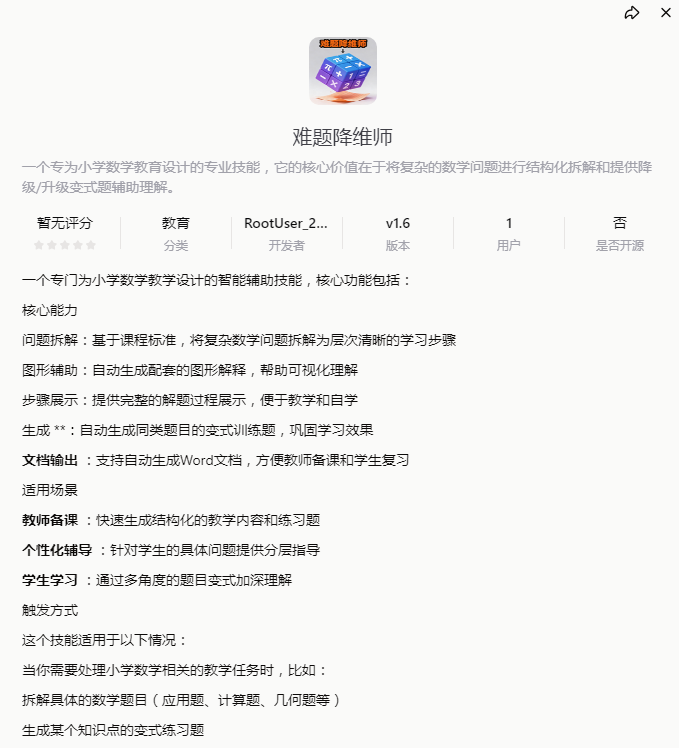

# 小学数学教学神器“难题降维师”，让复杂问题瞬间变简单！
> 💡 备注属性未写入，可能是备注属性名称或者类型被修改了，建议将字段类型设置为 rich_text，可以在小程序-操作-修改文章数据库页面进行调整
> 💡 原文链接:[https://mp.weixin.qq.com/s?__biz=MzYzNzcwNTQzNQ==&mid=2247483771&idx=1&sn=c284e0ece09df9df915e42d3bd2c9dad&chksm=f1d87f462fa347223a9d6a00a1e29dfc689f5484f5c9e18d825578f778feb7dce581176ce4d8#rd](https://mp.weixin.qq.com/s?__biz=MzYzNzcwNTQzNQ%3D%3D&mid=2247483771&idx=1&sn=c284e0ece09df9df915e42d3bd2c9dad&chksm=f1d87f462fa347223a9d6a00a1e29dfc689f5484f5c9e18d825578f778feb7dce581176ce4d8#rd)
各位老师、家长朋友们，新年好！
在小学数学的教与学中，你是否也遇到过这些令人头疼的瞬间？
讲了一遍又一遍的应用题，孩子还是瞪大眼睛问“为什么”；
想画个线段图辅助理解，手边却没有合适的工具；
备课时想找几道有梯度的变式题，翻遍教参也凑不齐；
辅导作业时，自己会做却讲不清步骤……
别急，今天我要给大家推荐一款真正的“教学外挂”——难题降维师！这是一个专为小学数学教育设计的智能辅助技能，它就像一位24小时在线的特级教师，随时帮你把复杂的数学问题“降维打击”，变得简单易懂！
## 它是什么？
难题降维师（教育分类 | 开发者：RootUser_2... | v1.6版本）是一个专注于小学数学教学的智能辅助工具。虽然目前暂无评分（因为太新了！），但用过的人都知道，它的实力绝对配得上★★★★★！目前已有1位用户（就是你！）正在体验，而且它完全免费开源，真正为教学服务！

## 它的核心能力有多强？
### 🔍 问题拆解：庖丁解牛，步骤清晰
基于国家课程标准，它能将任何复杂的数学问题（应用题、计算题、几何题）拆解成层次分明、环环相扣的学习步骤。孩子不再是一头雾水地看答案，而是沿着台阶一步步向上走，真正理解每一步的逻辑。
### 🎨 图形辅助：一图胜千言，抽象变直观
数学太抽象？它来画图！自动生成配套的线段图、几何示意图、面积模型……让抽象概念可视化。有了图，孩子的理解力瞬间提升，老师也不用费力在黑板上画歪歪扭扭的辅助线了。
### 📝 步骤展示：完整过程，拿来就用
无论是教师备课还是家长辅导，它都能提供完整的解题过程展示，逻辑严谨，格式规范。你甚至可以直接截图或复制，做成PPT、教案或学习单，效率翻倍！
### 🔄 生成变式：举一反三，巩固提升
听懂一道题不算什么，能会一类题才是真本事。它能自动生成同类题目的变式训练题——数字变、情境变、条件变，通过多角度变式，帮孩子彻底吃透知识点，告别“一讲就会，一做就错”。
### 📄 文档输出：一键生成Word，备课复习超省心
所有生成的内容（题目、步骤、图形、变式题）都可以直接导出为Word文档！教师可以快速形成备课资料或课后练习卷，学生也能整理成专属错题本或复习笔记。
## 它适用于哪些场景？
教师备课：快速生成结构化的教学内容和配套练习题，节省大量时间。
个性化辅导：针对学生的具体问题，提供分层指导和可视化讲解，实现因材施教。
学生学习：通过多角度变式和图形辅助，加深对数学概念的理解，建立自信。
## 如何触发这个神奇技能？
非常简单！只要你遇到与小学数学教学、解题、备课相关的需求，只需在对话框中输入你的问题或指令，例如：
“请帮我拆解这道应用题：小明有15个苹果，小红比小明多3个，两人一共有多少个？”
“生成5道关于‘三角形面积’的变式练习题，难度递增。”
“为‘鸡兔同笼’问题制作完整的教学方案，并配上图形解释。”
“我需要一个能解释‘分数乘法’概念的直观图形。”
难题降维师就会自动激活，秒回一份图文并茂、步骤清晰的教学方案，助你轻松搞定教学难题！
## 结语
教育不是注满一桶水，而是点燃一把火。而好的工具，能让这把火烧得更旺。
难题降维师，把数学的难度降下来，把孩子的兴趣提上去。无论是老师还是家长，它都是你值得信赖的智能助教。
体验方式：
请关注公众号后私信回复关键词 **“降维师”** ，即可获取工具直达链接。
科技赋能教育，智慧点亮课堂。我是数智陈，我们下期见。
