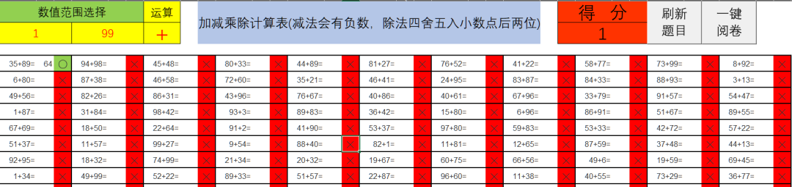
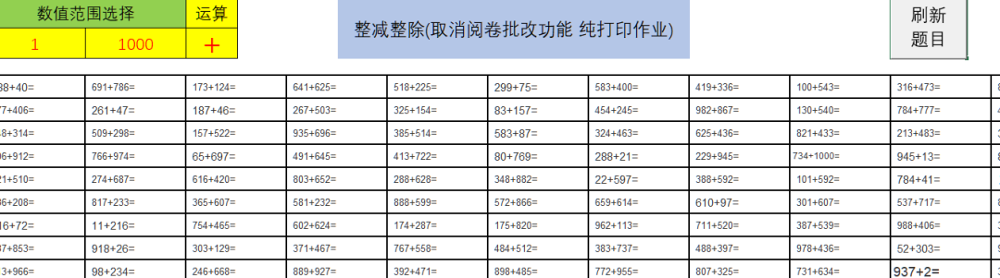
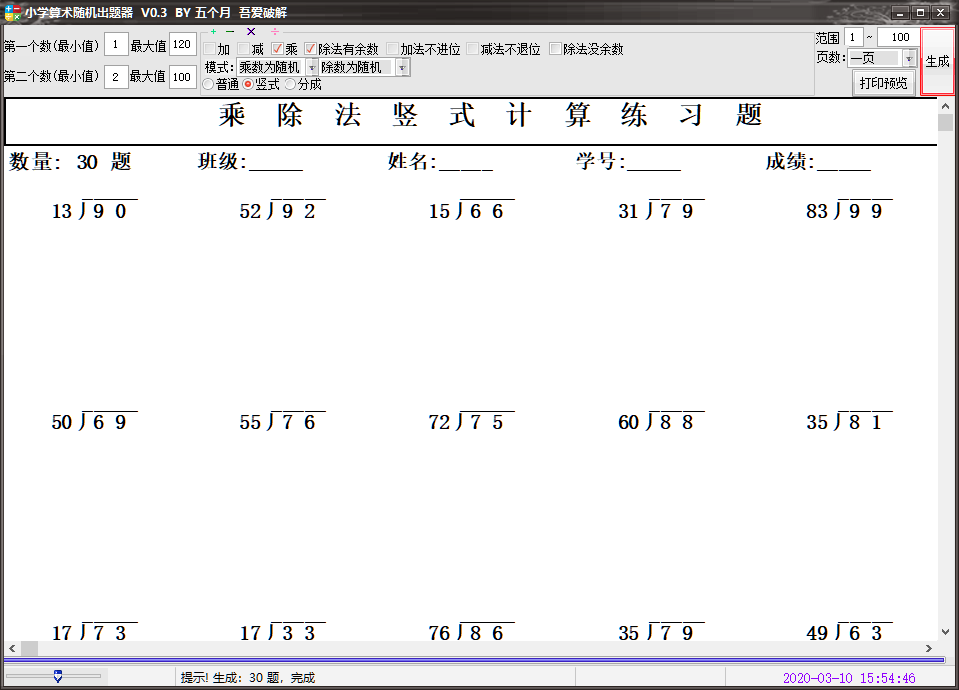
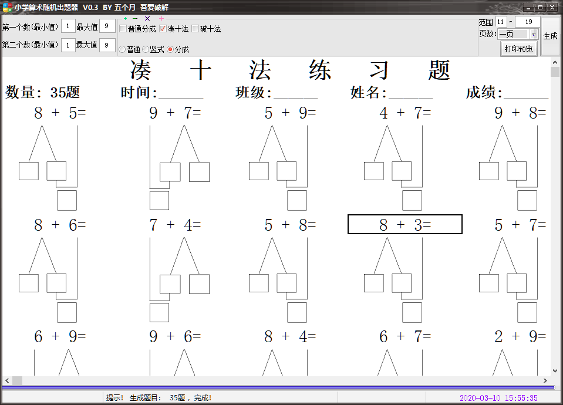
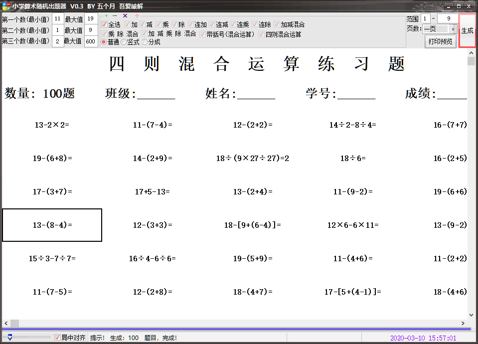
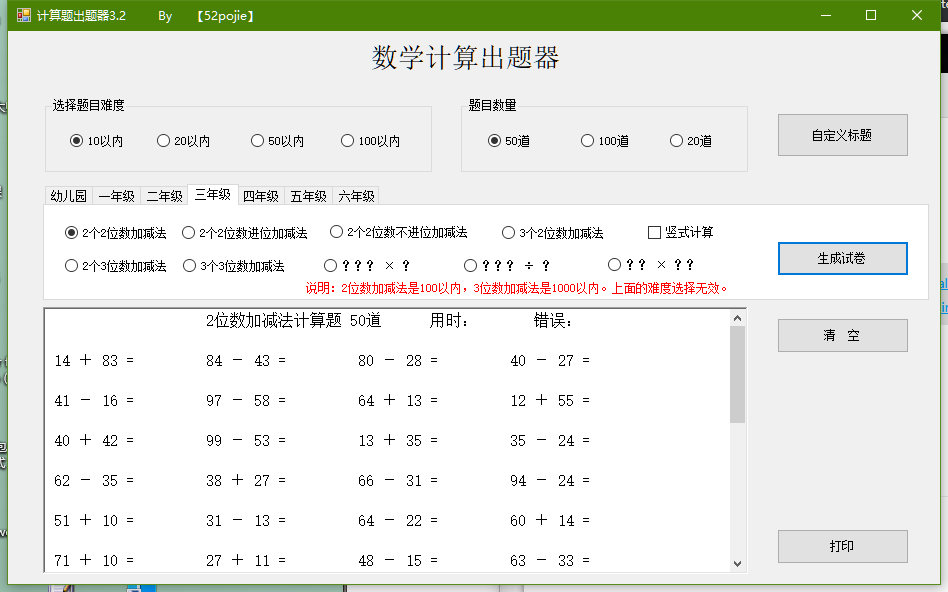
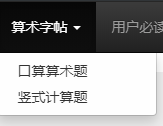
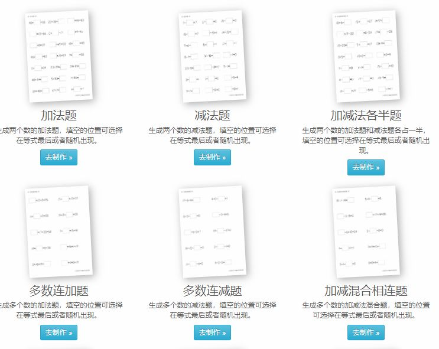

# 小学数学自动出题器（数学老师必备）
> 💡 备注属性未写入，可能是备注属性名称或者类型被修改了，建议将字段类型设置为 rich_text，可以在小程序-操作-修改文章数据库页面进行调整
> 💡 原文链接:[https://mp.weixin.qq.com/s?__biz=MzI2ODA3MDE3Mw==&mid=2649494723&idx=1&sn=68603016ee266a455e011a52c3910136&chksm=f363ea105a4b15e542f8d4602b6e8c99595877d795d12dd2d366c4d3afb0a0f26fe92efca886#rd](https://mp.weixin.qq.com/s?__biz=MzI2ODA3MDE3Mw%3D%3D&mid=2649494723&idx=1&sn=68603016ee266a455e011a52c3910136&chksm=f363ea105a4b15e542f8d4602b6e8c99595877d795d12dd2d366c4d3afb0a0f26fe92efca886#rd)

**文件下载方式在文末**

 今天，给数学老师分享自动出题器，可以轻松给学生出题。一共三种方式：1、表格生成。2、软件生成。3、网站生成。输入自己的要求即可出相应的题目。可以进行打印，也可以通过截图的方式，截图发送至家长群中。

**一、表格生成（文件下载方式在文末）**

直接在表格当中完成题目的话，还可以一键自动阅卷。但是只能单独的生成加减乘除，不能生成混合的算式。

**二、软件生成（文件下载方式在文末）**

乘除法竖式，破十法，凑十法，加减乘除的混合运算都能随机生成，软件功能使用相对简单，题目的文字大小可以进行调整。

**三、网站生成（zi.ixfc.net）**
网站根据要求生成pdf文件后，可下载。此外这个网站还提供了汉字字帖，英文字帖，拼音字帖等。工具不在多，在于真正的去使用了，才有用！

** 历史推文**

[●花了2天为大家亲测了近20款直播教学平台，看完知道哪一款适合你？](http://mp.weixin.qq.com/s?__biz=MzI2ODA3MDE3Mw%3D%3D&mid=2649494534&idx=1&sn=8e602bd8618ef881d744d3bf5a2c0ea6&chksm=f2ed8874c59a01620a0e16f3d6e520a772e7a1edf907c8e8e54bcbe35f7821f3e0d1b4c5d0b8&scene=21#wechat_redirect)
[●小学同步课堂：手机版和电视盒子版（去VIP收费内容任看）](http://mp.weixin.qq.com/s?__biz=MzI2ODA3MDE3Mw%3D%3D&mid=2649494595&idx=1&sn=4621decbe0658a21aa9f9301bc0dd3c2&chksm=f2ed8831c59a012704e21dbc61339abb6bd394eb1749e476234e152190845c6ba7a36adfc6f9&scene=21#wechat_redirect)
[●国家教育部出手，送给大家的这个教材礼包，“一个字”形容：卧槽、全面（可下载）](http://mp.weixin.qq.com/s?__biz=MzI2ODA3MDE3Mw%3D%3D&mid=2649494539&idx=1&sn=8f46b687ad081b8c2cdc44596c79cdd8&chksm=f2ed8879c59a016fee96b8a2c5244217ccc54129f36179155a3e63b35d1025b9ae3eaac63b1a&scene=21#wechat_redirect)
[●有音视频、图片互动的“数字教材”更适合你，别再使用pdf、图片版电子教材了](http://mp.weixin.qq.com/s?__biz=MzI2ODA3MDE3Mw%3D%3D&mid=2649494472&idx=1&sn=18d1fe3501ed8e6b089e4474e66931fa&chksm=f2ed8fbac59a06ac9c3c3f3c64bcb606e1679e24d0fbdc56700b599b66de6953957a23c51d8e&scene=21#wechat_redirect)
[●只要有份PPT（课件），就能录课（无需其他工具）原来PPT这么强大……](http://mp.weixin.qq.com/s?__biz=MzI2ODA3MDE3Mw%3D%3D&mid=2649494582&idx=1&sn=fb432e4a07dda664cc946cdb196d1a0e&chksm=f2ed8844c59a01528102bb7d1acf591b5c334487d9bc9cb83ae02667c37752729bdf1ab3c6cd&scene=21#wechat_redirect)
[●熊孩子上网课：一小工具防止上网课时玩游戏看视频（建议分享给家长）](http://mp.weixin.qq.com/s?__biz=MzI2ODA3MDE3Mw%3D%3D&mid=2649494553&idx=1&sn=3dfa1c719901fa2c9c97d3abe286c40e&chksm=f2ed886bc59a017d42a890e41656101b34e3134721f8729cf7c67532455af66f74097f948635&scene=21#wechat_redirect)
这里的教学资源不需要积分，不需要转发，全都是全套的、齐全的，全都可以直接下载！

你觉得有用的话可以点个关注，也可以将它分享给有需要的老师，帮助更多老师获取优质资源，这就是对小猴最大的帮助。
如果你需要什么课件包、教案包及资源包等等，可以后台留言，也可以联系小猴wx：186 0845 9603！除此之外，赛课ppt，微课，发展测评，网络学习、考试等，在这个里都可以搞定。

关注我，教学更轻松

**在公众号内回复关键字：“7795”获取下载地址**
**注意：不是在本文留言**
免责声明：
公众号所有资源均收集自互联网，由小猴收集整理，只用于交流学习，请勿用作其他用途。若公众号收录资源涉及您的版权或知识产权及其他利益，请联系，附上版权证明告知，删除处理！
