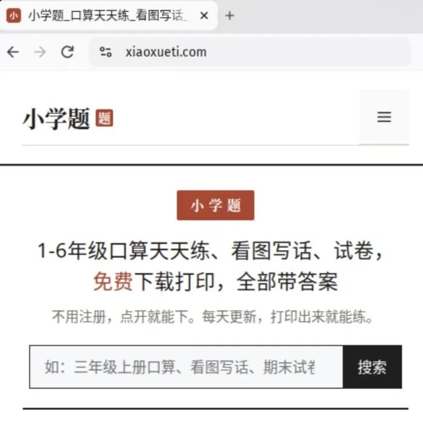

# 小学题来了：每天一份免费小学学习资料
> 💡 备注属性未写入，可能是备注属性名称或者类型被修改了，建议将字段类型设置为 rich_text，可以在小程序-操作-修改文章数据库页面进行调整
> 💡 原文链接:[https://mp.weixin.qq.com/s?__biz=MzY4MjUwMzc0OA==&mid=2247483655&idx=1&sn=5e3ec6aa37945188c2251e7c7e5b7528&chksm=f2f5555ff48f640ba59674a9632e1533ff2463afa679b842a38da8ca726171547383dea8ee29#rd](https://mp.weixin.qq.com/s?__biz=MzY4MjUwMzc0OA%3D%3D&mid=2247483655&idx=1&sn=5e3ec6aa37945188c2251e7c7e5b7528&chksm=f2f5555ff48f640ba59674a9632e1533ff2463afa679b842a38da8ca726171547383dea8ee29#rd)
各位家长、老师好，这里是小学题。

小学题（xiaoxueti.com）是一个专注于小学 1–6 年级学习资料的免费分享网站，由关心孩子学习的老师和家长共同维护。我们把平时收集、整理和自己编写的资料放在这里，方便家长和老师随时下载打印，给孩子做练习。今天这个号开通了，以后每天在这里给大家分享：
**一、口算天天练**
按年级和册次编排的口算练习，每天更新，带答案，打印出来就能练。
**二、看图写话**
看图写话练习，帮孩子把看到的东西写成通顺的话。
**三、语数英学习资料**
语文、数学、英语的单元、期中、期末试卷等学习资料，免费下载，带答案解析。
**四、在线口算练习**
不用下载，打开网页就能练：出题、计时、批改都在页面上完成，错题还能再练一遍。
**五、教育知识**
每天分享的学习方法与教育知识文章，帮家长了解孩子学习上的常见问题和解决方法。
所有资料都在小学题官网：xiaoxueti.com，上去就能免费下载。
欢迎关注这个号，每天一份，不错过更新。
——小学题
