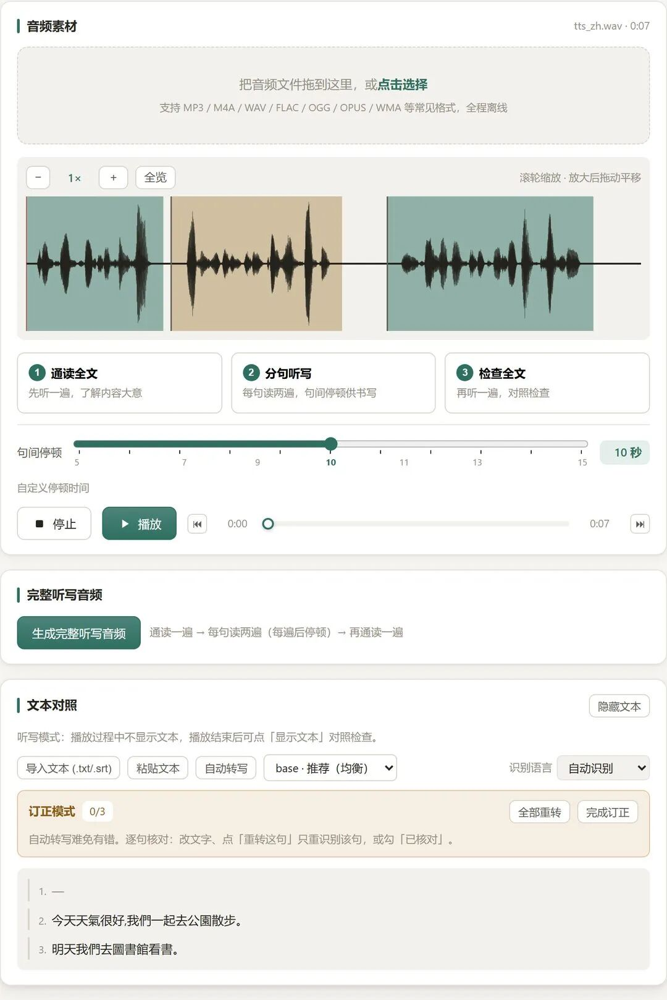
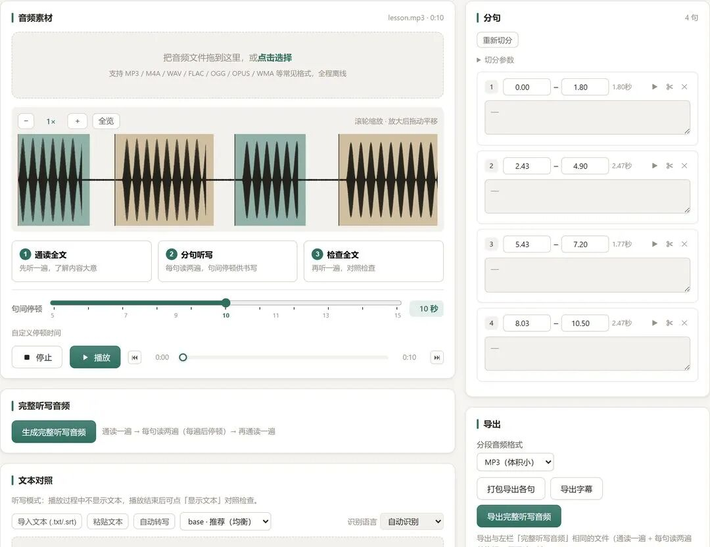
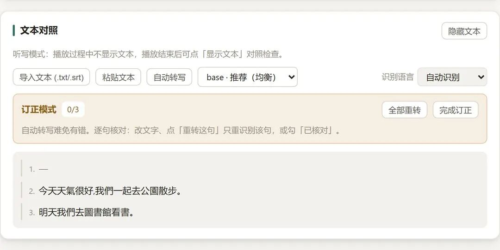
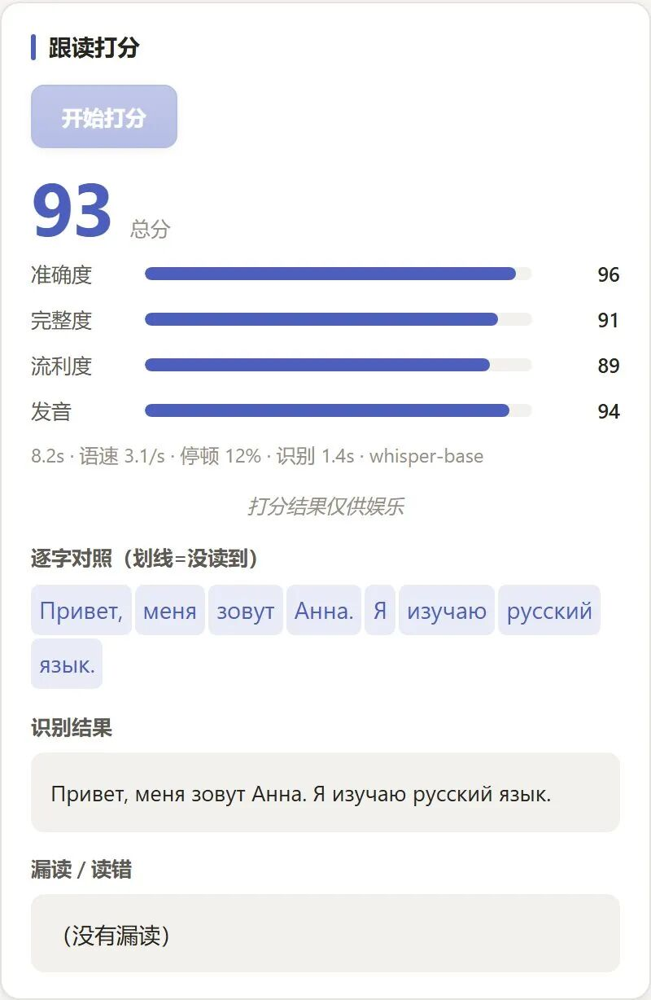
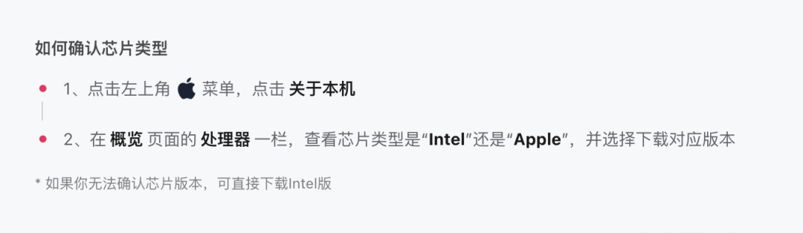

# 工具开发 | MyDictation 听写跟读工具
> 💡 备注属性未写入，可能是备注属性名称或者类型被修改了，建议将字段类型设置为 rich_text，可以在小程序-操作-修改文章数据库页面进行调整
> 💡 原文链接:[https://mp.weixin.qq.com/s?__biz=MzI1MTM1OTg0Mg==&mid=2247491635&idx=1&sn=25fb2ba886e4e1091c8cd42f9ef31320&chksm=e8dc78d7df57f079641c55652bebe95c73a955f28fc95a55fc3c27010ce09831ae5a9843edc2#rd](https://mp.weixin.qq.com/s?__biz=MzI1MTM1OTg0Mg%3D%3D&mid=2247491635&idx=1&sn=25fb2ba886e4e1091c8cd42f9ef31320&chksm=e8dc78d7df57f079641c55652bebe95c73a955f28fc95a55fc3c27010ce09831ae5a9843edc2#rd)
|  |  |  |
**MyDictation · PC 桌面端 v1.0.0 · 完全离线**
## 一段音频扔进去：切句、转文字、配停顿，跟读还能打分
导入音频 · 自动分句 · 自动生成文本 · 跟读四维评分
识别 · 合成 · 打分全部在本机完成，**支持 90+ 种语言**
练听力口语的你，是不是也这样——
🎧 好不容易找到的听力材料，想逐句精听，还得先手动剪音频；
⏱ 边听边写时，句间停顿不是太短就是太长，节奏全乱；
📝 写完想核对，只能来回拖进度条，一句一句找；
🗣️ 跟读全凭感觉，读得对不对，没人告诉你。
**MyDictation 把这条流水线一次打通：**导入音频 → 自动分句 → 自动转写 → 生成带停顿的听写音频 → 跟读四维打分。而且，**全程离线**。

↑ 导入一段音频后：波形自动切句 · 句间停顿可调 · 识别文字逐句生成
| 01 | **自动切分音频 ****长音频进，一句一句出** |
把音频文件拖进窗口，MyDictation 会沿着每一句话之间的自然停顿**自动下刀**，几秒钟就把长音频切成整齐的句子清单。
✂️ **双引擎断句**：静音能量检测打底，噪声环境可开启 Silero VAD 抗噪；
🧩 **超长句自动再切**：优先在句内最长停顿处断开，不产生「半分钟长句」；
🎚️ **参数全开放**：最短静音、最长句长、灵敏度、首尾余量都能调，切完还能在波形上手动微调；
📁 **格式通吃**：MP3 / M4A / WAV / FLAC / OGG / OPUS / WMA 拖进来就行。

↑ 每一句都有起止时间，可试听、拆分、删除；切分参数随时重切
| 02 | **句间停顿可设置 ****停几秒，你说了算** |
听写最讲究节奏：停顿太短写不完，太长又拖沓。MyDictation 用一个滑块解决——**5～15 秒自由设定**，写不完就调长，嫌慢就调短。

↑ 默认 10 秒，滚轮拖动即时生效
**标准「三遍式」听写节奏**
| ① 通读全文 | 先听一遍，了解大意 |
| ② 分句听写 | 每句读两遍，句间停顿供书写 |
| ③ 检查全文 | 再听一遍，对照检查 |
| **句 1 ×2** | **✍ 10s** | **句 2 ×2** | **✍ 10s** | **…** |
「完整听写音频」把三遍节奏合成一个文件——点一次播放，从头写到尾，中途不用碰电脑。
还可以导出**「跟读版」**音频：每句之间自动插入你设定的停顿，发给学生、发给自己，任何播放器里都是标准节奏。
| 03 | **自动识别成文字 ****原文稿子，它替你写好** |
没有原文？不用等。内置 **faster-whisper** 本地语音识别引擎，点一下「自动转写」，每句话的文字**逐句生成**，和音频时间戳精准对齐。
🌐 **语种自动判定**：不用先选语言，扔进来就知道说的是什么；
✏️ **订正模式**：识别难免有错——哪句不对改哪句，「重转这句」只重识别该句，还能逐句勾「已核对」；
🎬 **一键导出 SRT 字幕**：做视频、做教材直接用；
🔌 **不依赖任何云端 API**：无密钥、无额度、无按次收费。

↑ 自动识别的句子逐条列出，进订正模式逐句核对
| 04 | **跟读打分** 效果更加直观 |
跟读前先听 **TTS 原文范读**，然后按下录音、开口跟读——MyDictation 会把你的录音与原文逐词比对，给出**四个维度**的量化评分。
| **准确度**读对了吗 | **完整度**读全了吗 | **流利度**卡壳了吗 | **发音**标准吗 |
🔤 **逐字对照**：没读到的词直接划线标出，漏读、读错一目了然；
📊 **数据全量化**：语速、停顿占比、识别耗时全部摆在你面前；
🔁 **即测即练**：听完范读马上录，录完马上出分，一个窗口完成闭环。
⚠️ **友情提醒**：打分结果，仅供娱乐和参考。主要目的是要跟读。

↑ 总分 + 四维评分条 + 逐字对照（划线 = 没读到）
| 05 | **数十种语言 ****不止英语，小语种照样练** |
底层识别引擎支持 **90+ 种语言**，还能自动判定语种。主流语言可以直接指定，识别更快更稳：
**🇷🇺 俄语**
**🇬🇧 英语**
**🇯🇵 日语**
**🇨🇳 中文**
**🇩🇪 德语**
**🇫🇷 法语**
**🇪🇸 西班牙语**
**🇮🇹 意大利语**
**🇰🇷 韩语**
**…等 90+ 种语言**
俄语听写、日语精听、法语跟读……MyDictation 通通接管。界面本身也提供**中文 / Русский / English** 三语切换。
**🔒 完全离线运行，不上传任何数据**
识别、合成、打分全部发生在你自己的电脑里，录音不出本机，断网照常使用。
### 🎯 为什么选 MyDictation
| 对比维度 | 传统方式 | MyDictation |
| 切分音频 | 手动剪辑 | **拖入即自动分句** |
| 句间停顿 | 固定 / 不可调 | **5～15 秒随心设** |
| 对照文本 | 自己找 / 手打 | **自动转写 + 可导出字幕** |
| 跟读反馈 | 凭感觉 | **四维评分 + 逐字对照** |
| 语言支持 | 多为仅英语 | **90+ 种语言** |
| 数据隐私 | 上传云端 | **全本地，不出本机** |
### 系统要求：
- 最好 Windows 10（1809+）/ Windows 11
- MacOS 12 以上，新老芯片均支持。第一次使用尽量在应用程序内单击右键打开。如出现问题，双击Fix排错。

### 它适合谁：
🎓 
备考族
：备考
各种包含听写的考试
+ 听写自测；

🗣️ 
口语练习者
：想纠正发音、提升流利度的长期主义者；

🌍 
小语种学习者
：俄语、日语、法语……自己也能动手去设置练习素材；

👩‍🏫 
语言教师
：批量制作带停顿的听写音频，课堂随堂测验神器；

💡 
自学者
：没有语伴，需要一位「随时在线、句句给分」的练习搭档。
**现在，把你的第一段音频扔进来**
MyDictation Windows v1.0.0 已发布，开箱即用。
切句、转文字、配停顿、打分——让每一个字，都被认真听见。
### 如何获取：
🟢 **百度网盘**
链接：
https://pan.baidu.com/s/19ZfSir1ppg1uVm0W-Diszw?pwd=4wbi 
🟢 **夸克网盘 **
链接：
https://pan.quark.cn/s/f44e1398c63e?pwd=hVhm
**💬说明：**
**
**本人并不懂编程，开发这款小工具纯粹是出于自己外语学习过程中的实际需要，借着 AI 的帮助才得以完成。所以软件里面肯定还有不少 bug，很多地方还需要继续打磨。欢迎大家多多提出意见和建议。如果你有外语学习工具方面的需求，也欢迎留言，只是能力有限，没办法保证全部都能够实现哈。
本软件完全免费使用。如果觉得工具对你有帮助，可在软件内扫码进行打赏支持。 你也可以扫描下方二维码注册 WorkBuddy 新账号，注册会为号主增加积分，这也是对开发者莫大的鼓励，助力后续产出更多优质实用小工具。

— 完 —
练好一门语言，不需要天赋，只需要「正确的反馈」×「足够的重复」。
MyDictation，做你电脑里那面会说话的镜子。
让听写跟读，从此有迹可循
