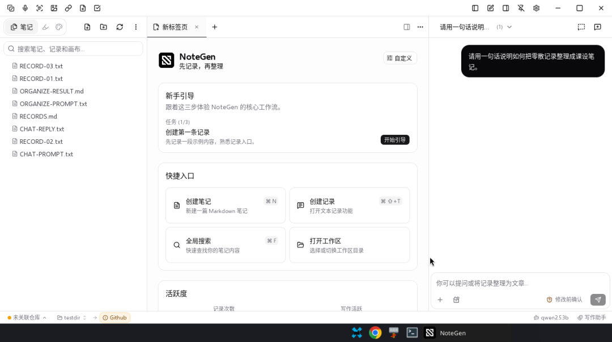
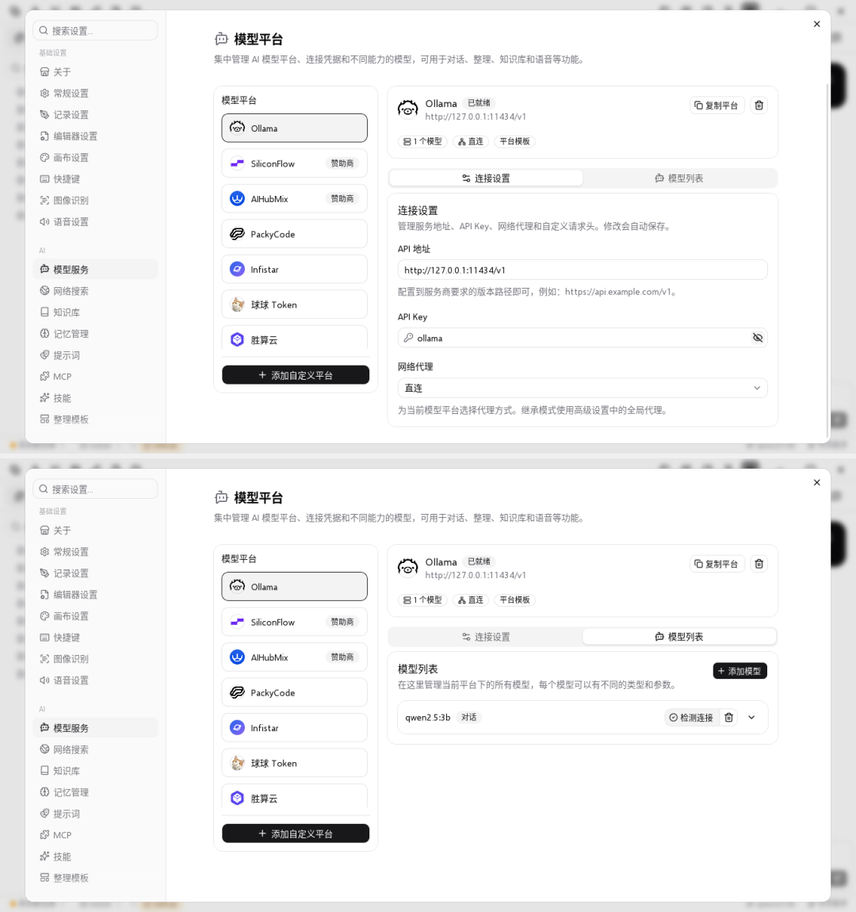
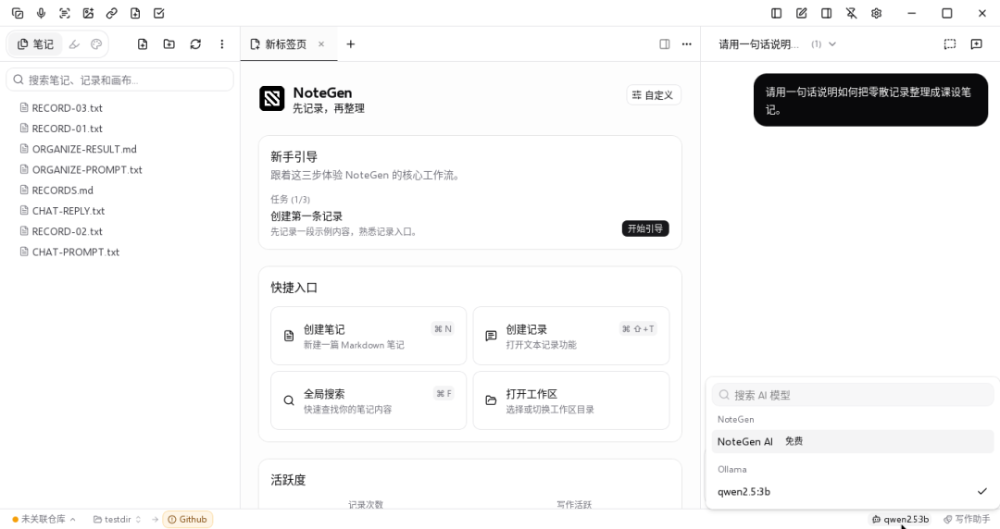
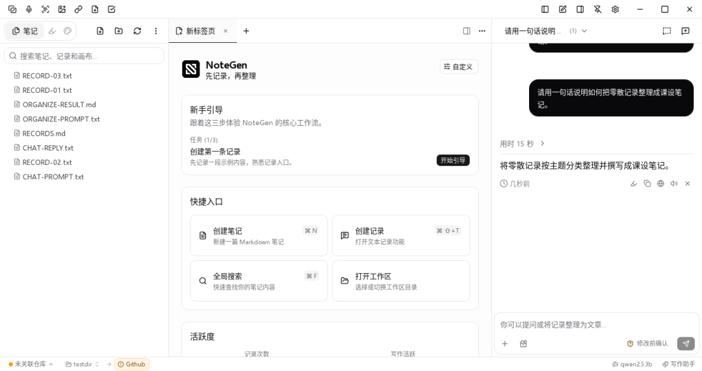
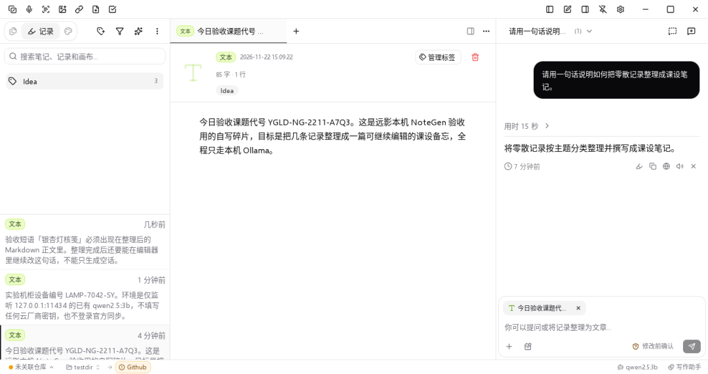
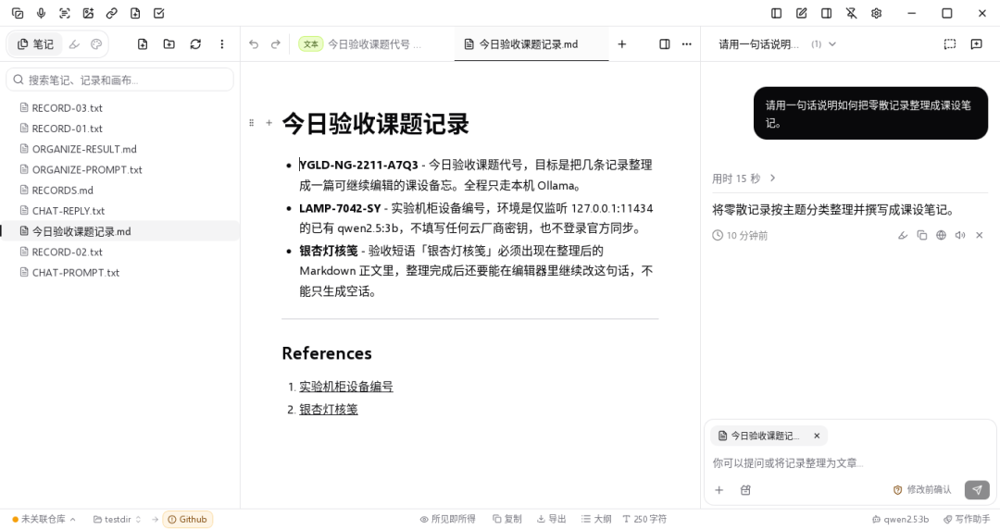
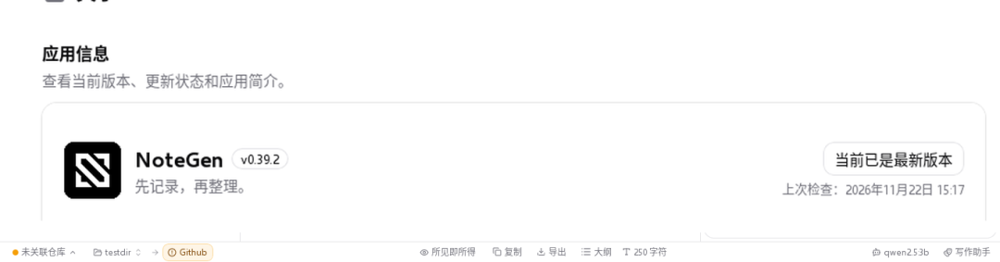

# 工具部署｜NoteGen 0.39.2 开源本地笔记整理｜先记录再整理，本机 Ollama 就能出可编辑 Markdown
> 💡 备注属性未写入，可能是备注属性名称或者类型被修改了，建议将字段类型设置为 rich_text，可以在小程序-操作-修改文章数据库页面进行调整
> 💡 原文链接:[https://mp.weixin.qq.com/s?__biz=MzIxOTA5MDI5OA==&mid=2247483952&idx=1&sn=6747dc7b1c7e3fd3e123d2dc1c2acedf&chksm=96285a68b7ab6953b251bfafcb06b3dca7d8983885c529faea357d897e50824deb7294c3256b#rd](https://mp.weixin.qq.com/s?__biz=MzIxOTA5MDI5OA%3D%3D&mid=2247483952&idx=1&sn=6747dc7b1c7e3fd3e123d2dc1c2acedf&chksm=96285a68b7ab6953b251bfafcb06b3dca7d8983885c529faea357d897e50824deb7294c3256b#rd)
课设或平时写笔记，最烦一上来就要写成完整文章。NoteGen 是一款本地优先的桌面笔记工具：先把一句话、一段备忘留下来，再用本机模型整理成还能继续改的 Markdown。
本篇主线只用本地小模型，不填任何云端 API Key。本帖免费，下载区是钉死版本的源码包和中文部署说明。协议是 GNU GPL-3.0，这是一种强 copyleft 许可：再分发或二次开发时，必须保留 LICENSE，并开源、提供相应源码。不要理解成可以按 MIT 去闭源使用。包里 vendor 目录中的剪贴板插件是 MIT，请一并保留。仅供学习。如果把整理结果拿去写课设或公开发布，内容要自己核对，不要直接当原创。
这篇和站内已有的几篇不一样：不是 AnythingLLM、Open Notebook、RuoYi-AI 那种「把文档丢进去再提问」，不是 Presenton 出 PPT，也不是 MoneyPrinterTurbo 出短视频。本篇做的是：在本机用小模型，把几条自己写的碎片记录，整理成一篇可编辑的 Markdown 笔记。
先说清楚范围：中文对话和「整理」可以在本机完成，不需要云端 Key。但安装桌面包、下载模型时仍然需要正常下载。不要用官网演示、默认免费云模型或赞助商模型，当成已经跑通的证据。
### 先看几个词
**工作区**：你选定的本机目录，笔记以普通 Markdown 文件放在这里。本机用的是空的测试目录 testdir，不要选家目录或已有私人笔记。
**Ollama**：在本机运行开源小模型的工具。本篇对话和整理只用 `qwen2.5:3b`。体积不大，能在 CPU 上跑，文笔一般，但够做验收。
**记录和整理**：记录是随时留下的碎片；整理是选中若干条，让模型写成一篇还能继续改的 Markdown 笔记。
**回环地址 127.0.0.1**：只有这台电脑自己能访问。本篇 Ollama 只听这个地址，不要改成 0.0.0.0。
### 4 步上手
1. 准备本机模型和安装包：安装 Ollama，让它只监听 ，执行 。本篇主线不必再拉嵌入模型。Linux 用钉死的 （sha256 ），不要从「最新下载」拿别的版本。Debian 13 上，安装包声明的  /  已经更名，本机先补装  和 ，再  装上。不要用  探版本，它仍会拉起图形界面。
1. 设好工作区，忽略更新：把工作区指到一个空的本机测试目录。自动更新请忽略，不要把 0.39.2 升到 latest。
1. 先改到本机 Ollama，再开始对话：首次启动会写入默认免费云模型，对话前必须改掉。打开「设置 → 模型服务」，平台选或添加 Ollama。API 地址填 （只填到 ），Key 填占位 ，网络代理选直连，再添加对话模型 。检测连接通过后，到窗口底部的模型选择器里勾选它。不要留在默认免费云模型或赞助商模型上。
1. 中文对话，再整理自写记录：在对话里发一句中文，必须看到可辨认的回复。再到「记录」里写 2～3 条自己的碎片，每条放一个独有记号，选中后用「整理」生成一篇可编辑的 Markdown。正文里要能看到这些记号或对应要点。3B 小模型质量一般，生成后要自己再改。
### 技术栈（压缩）
- 桌面端：Tauri（用系统 WebView 包起来的桌面应用）+ Next.js 界面
- 模型：本机 Ollama + qwen2.5:3b
- 本篇主线：钉死的 Linux deb 桌面包，不是 pnpm dev 开发服务器
### 本机实跑（按实际操作看）
详细步骤见包里的 `DEPLOY.txt`。下面这些图都是本机实拍，用的是已经装好的 0.39.2 桌面包，模型是本机 Ollama 的 `qwen2.5:3b`。

### 本机实际遇到的坑
- Debian 13 上，deb 声明的 libgtk-3-0 / libappindicator3-1 已经更名，需要先补 libwebkit2gtk-4.1-0 和 libayatana-appindicator3-1 再安装。
- 不要用 note-gen --version 查看版本，它会再拉起图形界面。
- 第一次启动会写入默认免费云模型。必须先改成 Ollama：地址只填到 /v1，Key 用占位 ollama，代理选直连，再在底部选择器里勾选 qwen2.5:3b。
- 模型服务页可能列出赞助商平台。那不是本篇主线，也不要去申请那些 Key。
- 不要用官网演示、默认免费云模型或赞助商模型的回复当能跑证据。
- 忽略自动更新，不要把 0.39.2 升走。
- pnpm dev 默认绑 0.0.0.0:3456，不要暴露到局域网。本篇主线是装好的桌面包，不是开发服务器。
- Ollama 继续只听 127.0.0.1，不要改成 0.0.0.0。
- 3B 小模型质量一般。对话可能只是短复述，整理结果也可能漏点或罗列，以「独有记号出现在可编辑 Markdown 里」为准，不要写成商用写作助手。
### 没有在本篇验收的功能
知识库 RAG、LLM Wiki、Agent、MCP、画布或思维导图、录音转写、官方或自托管同步、插件市场，都不是本篇必过项。不要把它们写成这份开源包已经跑通的能力。
包里是 0.39.2 源码和中文 `DEPLOY.txt`。已原样保留根目录的 GPL-3.0 LICENSE，以及 vendor 剪贴板插件的 MIT 说明；去掉了默认免费云模型配置里的硬编码访问密钥，也去掉了 README 中的捐赠入口、赞助商表格和官方宣传图。
原文：https://yuanyinglight.com/2641.html
