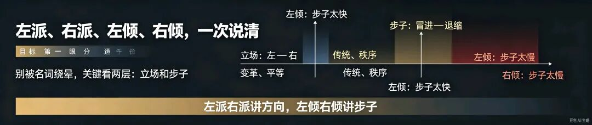
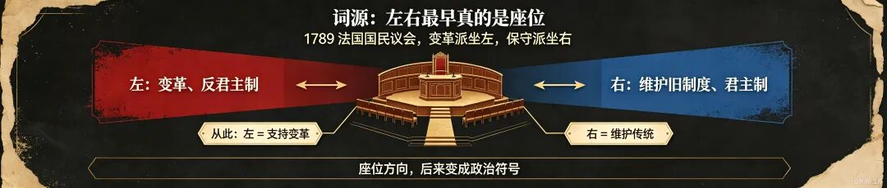
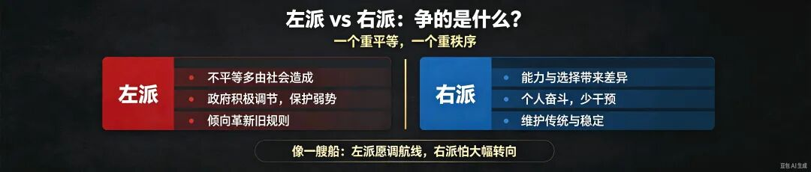
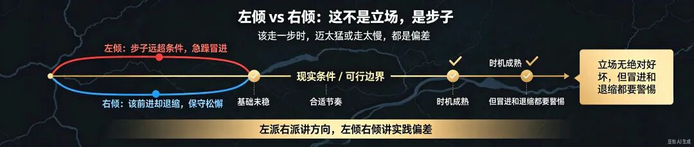

# 左派、右派、左倾、右倾、左翼、右翼，一次分清！别再被概念绕晕
> 💡 备注属性未写入，可能是备注属性名称或者类型被修改了，建议将字段类型设置为 rich_text，可以在小程序-操作-修改文章数据库页面进行调整
> 💡 原文链接:[https://mp.weixin.qq.com/s?__biz=MzY4NzMzMjAyNw==&mid=2247488495&idx=1&sn=dd3beba504793aa52ed1bc48f7836a51&chksm=f211695286745ba9be22224e69f9c3bf36bed9f1a6b242c0dac4139d171e9002ecd2cd592785#rd](https://mp.weixin.qq.com/s?__biz=MzY4NzMzMjAyNw%3D%3D&mid=2247488495&idx=1&sn=dd3beba504793aa52ed1bc48f7836a51&chksm=f211695286745ba9be22224e69f9c3bf36bed9f1a6b242c0dac4139d171e9002ecd2cd592785#rd)
**左派、右派、左倾、右倾、左翼、右翼，一次分清！别再被概念绕晕**
读史观潮｜通识科普

网上讨论社会议题，经常冒出左派、右派、左翼、右翼、左倾、右倾这一堆词。很多人越看越糊涂，常常把它们混为一谈，吵了半天，双方根本不在同一个维度对话。
其实拆解起来，只需要抓住两层核心：左派/右派、左翼/右翼，说的是立场；左倾/右倾，说的是做事的步子。
一个回答：你想往哪个方向走；另一个回答：你走的步伐合不合适。
**01 “左”和“右”，最早来自议会座位**

这套左右划分，起源于1789年法国大革命的国民议会。
议会开会时，主张推翻君主制、推动社会变革的激进代表，坐在议长的左手边；
主张保留君主、维护旧有制度的保守派，坐在议长右手边。
从这一刻起，符号被固定下来：
左 = 支持变革；右 = 维护传统。
这套划分方法，一直延续到现代社会的思想讨论之中。
**02 左派、右派，核心争论到底是什么**

简单概括：左派更看重平等，相信人可以主动改造社会；右派更看重秩序，相信传统本身自带价值。
面对社会问题，二者的底层思考完全不一样：
**1. 不平等从何而来？**
左派认为，大量社会不平等，是制度、社会环境造成的，应当通过公共政策加以调节修正；
右派认为，人与人天赋、能力、选择天然存在差距，不平等是竞争的自然结果，强行平均反而会破坏公平。
**2. 政府应当管多少？**
左派主张政府适度发力，建设社会保障、福利体系，保护弱势群体；
右派更看重个人自主，推崇小政府，减少行政干预，相信个人奋斗的力量。
**3. 如何看待传统？**
左派倾向于革新，愿意调整旧规则，解放束缚；
右派更珍视家庭、伦理等传统价值，认为贸然大幅改动秩序，容易引发巨大社会动荡。
打个形象比方：社会如同航行的大船。
左派愿意主动调整航线，优化航行模式，解决船上的失衡问题；
右派担心频繁大幅度转向会掀起巨浪，优先保障航行稳定，不主张轻易大改航向。
**03 左翼、右翼，和左派、右派是一回事吗？**
日常网络讨论里，大家大多混用这两组词汇。
如果精细辨析：
左翼，偏向宽泛的思想谱系，泛指所有追求平等、主张社会革新的思潮，从温和改良到激进革命，都可以归入左翼思想；
左派，更多特指这套思想下，具备组织、明确行动纲领的群体与政治力量。
右翼、右派的逻辑同理。
对普通读者而言，不必死抠细微差别，大体理解二者同义即可。
**04 左倾、右倾，最容易踩坑：这不是立场，是执行偏差！**

这是全文最重要的区分：
**左派/右派、左翼/右翼：**立场、信仰，代表前进方向
**左倾/右倾：**方法论、执行层面的路线偏差，代表步子是否贴合现实
经典概括：该走一步，硬迈两步，是左倾；该走一步，只迈半步，是右倾。
这里一定要分清文字背后的褒贬：
左派的“左”，代表进步革新，本身是正向含义；
左倾往往带引号，指代急躁冒进、脱离客观现实的错误，也就是历史上所说的左倾冒险主义。
右倾不等于右派。它指客观条件已经成熟，却畏缩保守、不敢推进变革，落在形势后面。
立场和路线偏差，可以交叉共存。
哪怕一个人在立场上属于进步的左派，如果无视现实条件，急于求成、盲目激进，照样会犯左倾错误；
同样，具备进步立场，但是面对变革畏难犹豫，也会出现右倾的问题。
左倾、右倾，是针对具体事件的路线诊断，和人的基础立场没有必然绑定。
**05 注意：不能直接照搬西方定义，要看中国语境**
这套概念传入国内，词义经过本土化改造，不能直接套用西方政党光谱。
在当代中国语境下：
我们所说的左派，一般指坚持社会主义、追求公平正义的群体，属于正面表述。
但左倾，是需要纠正的错误倾向，代表教条僵化、脱离实际，典型如历史上的王明左倾路线。
同时要明白，我国不存在西方模式的右派政党。“右派”更多是历史概念；而当代语境下的右倾，多指理想信念动摇、面对变革退缩松懈的思想倾向。
**06 一句话速记口诀**
读完前面的内容，可以浓缩成四句，方便快速记忆：
**左派/左翼：**追求社会平等，支持合理革新，通过规则调整优化分配；
**右派/右翼：**尊重市场竞争秩序，守护传统价值，主张改革稳步渐进；
**左倾：**步子远超客观条件，急躁冒进，根基未稳就强行跨越式推进；
**右倾：**时机已经成熟，却迟疑退缩，面对必要变革原地观望。
**最后总结：**
立场本身没有绝对好坏，任何社会都需要兼顾公平与秩序；但左倾、右倾，都是实践过程里需要警惕规避的路线偏差。
弄懂这套概念框架，再去看各类社会议题、政策讨论，就不容易被名词裹挟，心中自有一杆标尺。
**互动话题：**
你以前是不是经常混淆这几个词？你觉得在日常讨论里，最容易被误用的是哪一个？欢迎在评论区交流。
**文章标签：**
#读史观潮 #概念科普 #左翼右翼 #左倾右倾 #政治学通识 #社会思潮
感谢阅读！欢迎关注点赞评论转发，谢谢！
