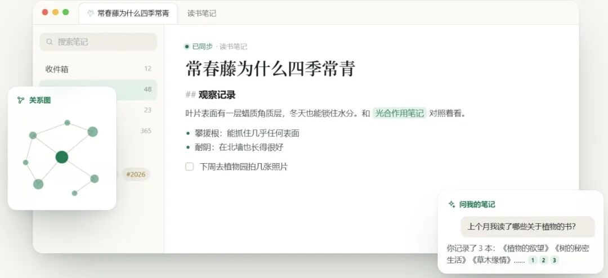

# 常青笔记 ivyNote：把散落的笔记连成网
> 💡 备注属性未写入，可能是备注属性名称或者类型被修改了，建议将字段类型设置为 rich_text，可以在小程序-操作-修改文章数据库页面进行调整
> 💡 原文链接:[https://mp.weixin.qq.com/s?__biz=MzIxNzAyNDUxNw==&mid=2247487821&idx=1&sn=bc7d7449cd4a3989d31314dd1149b401&chksm=9615b280328573e4d8179de98846178eccb8c348426e27f5b337559e663b4b7193c3c703efd3#rd](https://mp.weixin.qq.com/s?__biz=MzIxNzAyNDUxNw%3D%3D&mid=2247487821&idx=1&sn=bc7d7449cd4a3989d31314dd1149b401&chksm=9615b280328573e4d8179de98846178eccb8c348426e27f5b337559e663b4b7193c3c703efd3#rd)
笔记记了三四年，真要找一句话时反而翻不到。文件名早忘了叫什么，按关键词搜又散在两三个软件里，最后只能一篇篇点开碰运气。
常青笔记把顺序反过来：先让笔记稳稳存在本机，再用链接和提问把旧内容捞出来。写的是普通 Markdown，代码块、表格、待办清单都能直接用，不催你先建目录，也不要求改一套新习惯。

#### 先写在本机，断网也能接着写
桌面端有 macOS、Windows、Linux 三版，网页版打开浏览器就能用，还能像软件一样装到电脑上。新建的本地笔记库不用注册账号，装好直接开写。
所有改动先写进本机，联网后再自动推送。多台设备同时改同一篇会做合并，不会因为谁后保存就丢掉另一边的内容。
断网时照常写。
地铁上记的两句、回家补的一段，联网后自己合上，不用手动导来导去。
#### 用链接把散落的笔记连成网
在一篇里写 [[另一篇的标题]]，两篇就挂上了，反向链接自动出现在被指的那篇下面，不用手工维护目录。
关系图把这些连线画出来，哪几篇总被一起提到、哪块内容还是孤岛，一眼能看见。攒久了，网是自己长出来的，不是先规划出来的。
写项目复盘时把当时的会议记录链接进来，几个月后点回去，前后经过还在，不用重新翻聊天记录。
#### 想不起放哪儿，直接问一句
「问我的笔记」可以用大白话向全部笔记提问，比如「去年记过的那个报销规定写了什么」。回答带出处，能点回原本那篇，不用先猜文件名。
这一步对老笔记最有用：不用回忆当时怎么分类，也不必把几年的内容重新整理一遍。
它也能让外部 AI 工具读写同一份笔记，想把资料接到别处接着用，不用复制来复制去。
#### 换设备、换软件，笔记带得走
导入支持 Markdown 文件、整个文件夹，也能吃下别的笔记软件导出的内容；图片附件和笔记之间的链接会一起带过来。
反过来，全部笔记随时能导出成一个压缩包，附件一并打包，格式始终是普通 Markdown。
以前换电脑最怕软件还在、笔记却打不开。文件是通用的，换谁家的编辑器都读得出。
#### 图片附件和多端，也有交代
粘贴或拖入图片就进统一媒体库，相同文件自动去重；每个附件被哪些笔记引用看得到，没被引用的会定期清理。
写周报贴过的截图，过几个月还能从媒体库里找回来，不必再去聊天记录里重下一遍。
单篇笔记可以生成带密码和有效期的分享链接，也能把整个文件夹自动发到博客，图片和链接一起处理。
笔记正文和附件在服务端加密保存，就算数据库备份泄露也读不出内容。手机端还在开发中，眼下先用电脑和网页版。
#### 用之前，几句提醒
Mac 当前版本未经苹果公证，首次打开可能提示「已损坏」，需要在终端执行一条命令才能用；嫌折腾就先用 Windows 或网页版。
官方云服务分中国大陆和海外两个数据中心，账号互不通用，注册时选好就固定用同一地区。桌面端本地笔记库免费、不用注册，云同步的套餐以服务内说明为准。
常青笔记著作权归原作者及官方所有；这里只讲用法，不提供安装包，需要请到官方渠道自行获取，以官网说明为准，别用来路不明的整合包。文中配图来自官网，版权归官方所有。
---
笔记攒得越久越值钱，先保证它一直在自己手里，再谈怎么找得回来。
