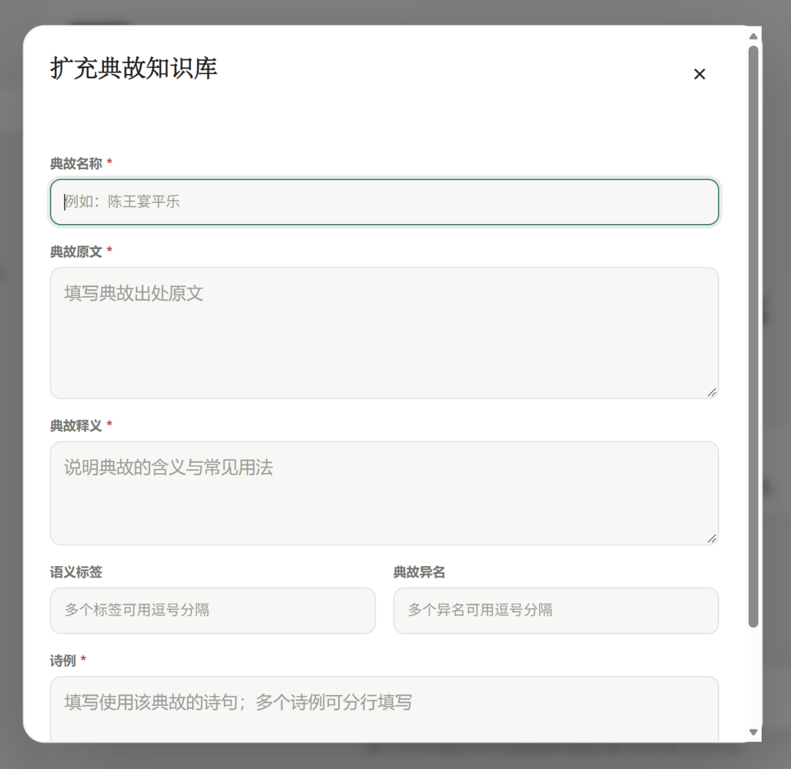

# 平台推介丨“多识”：基于类书知识库的中国古典文学典故智能识别平台
> 💡 备注属性未写入，可能是备注属性名称或者类型被修改了，建议将字段类型设置为 rich_text，可以在小程序-操作-修改文章数据库页面进行调整
> 💡 原文链接:[https://mp.weixin.qq.com/s?__biz=Mzk4ODk2OTk2Mg==&mid=2247491054&idx=1&sn=be03f1d62c4465dc714a37b2e68da908&chksm=c400caedd7db5e0bebfe3b915d02be539d55e167e0b33ab0e7df431e26c4015807c3e7f096d0#rd](https://mp.weixin.qq.com/s?__biz=Mzk4ODk2OTk2Mg%3D%3D&mid=2247491054&idx=1&sn=be03f1d62c4465dc714a37b2e68da908&chksm=c400caedd7db5e0bebfe3b915d02be539d55e167e0b33ab0e7df431e26c4015807c3e7f096d0#rd)

**“多识”**
**基于类书知识库的**
**中国古典文学典故智能识别平台**

在数字人文研究日益深入的今天，古典诗歌的典故考释仍然高度依赖学者的个人记忆与人工翻检，这种传统模式在面对海量文献时效率低下，且难以系统覆盖跨时代、跨文本的典故关联网络。为了应对这一难题，我们将自然语言处理与语义检索技术引入古典文学研究，构建了“古典诗词——典故”的智能识别平台**“多识”（https://www.duoshidh.com/）。**
**开发者**
王治田（厦门大学
马来西亚分校）
张杰（西南交通大学）
“多识”之名，取自《论语》“多识于鸟兽草木之名”，又《周易·大畜》象传云：“君子以多识前言往行，以畜其德。”“识”字有shí，zhì二读，由于本平台侧重“典故识别”的功能，而非强调记忆，故取shí之读音。

平台首页界面

**01**
**平台功能介绍 **
— Function Introduction —
“多识”是一个以类书中的语料为基础、面向古典诗词辅助阅读构建的典故智能识别平台。用户可以在该平台上输入任意古典诗词查询其典故，“多识”将会自动识别并分析其中是否存在典故，以及该句古诗词如何使用该典故。
提示词示例：
（1）直接输入诗句。如：蚕丛及鱼凫，开国何茫然。
（2）诗句+（使）用了什么典故。如：蚕丛及鱼凫，开国何茫然，（使）用了什么典故？
（3）诗人《作品名》：诗句，使用了什么典故。如：李白《蜀道难》：蚕丛及鱼凫，开国何茫然。使用了什么典故？
平台回答界面如下所示：

**02**
**用户注册、登录与知识库扩充**
— User registration, login, 
and knowledge base expansion —
用户可点击页面左上角的“注册”按钮，通过邮箱注册账户，并登录，可享受平台开发的更多功能。
由于团队人力、经费有限，目前我们仅完成了算法设计、模型训练、网站搭建，以及《初学记》中7000多条典故数据的结构化与录入。尽管“多识”平台已经初具雏形，但相较于卷帙浩繁的古典诗词，我们深知当前这个规模是远远不够的。后续我们将接入更多的类书，以扩充典故数据。
用户如果在使用的过程中，发现了尚未能匹配的典故，欢迎在登录账号后，点击页面左上角的“扩充知识库”，帮助扩充典故知识（如下图所示）。经过我们后台的审核后，您提供的知识，将成功被纳入我们的知识库，之后其他用户在检索到相应典故时，将在文末显示提供者的用户名。

**03**
**未来规划 **
— Future Plans —
“多识”仍是一个持续完善中的数字人文研究平台。未来的研究与开发工作将主要围绕以下三个方向展开：
（1）扩充与完善典故知识库：持续推进《唐类函》《渊鉴类函》等传统类书，以及《文选》李善注等古典诗文注释文献的结构化处理，并将相关材料整合至典故知识库，以扩充语料规模、丰富知识来源；
（2）建设可检索的类书数据库：整合已完成结构化处理的类书文献，开发面向研究者的检索与浏览介面，提升相关文献资源的可检索性与利用效率；
（3）开发量化互文性研究工具：探索类书与诗歌语料之间知识流通的量化分析方法，识别并呈现不同文本之间的知识关联与互文模式，为中国古典文学的量化互文性研究提供新的方法与实证基础。
上述工作旨在将传统文献学研究、结构化数据建设与计算方法相结合，同时服务于具有可检验性的学术研究与具体的课堂教学。
**04**
**用户交流与合作意向 **
— Exchange and Cooperation —
欢迎大家扫描下方二维码，加入“多识”用户交流群，为我们提供宝贵的反馈意见。

如您有好的改进意见或学术合作，也可直接与我们进行联系。
**【联系方式】**
王治田：909619437@qq.com
张杰：953110646@qq.com

编辑：黄 怡

审核：王京州
