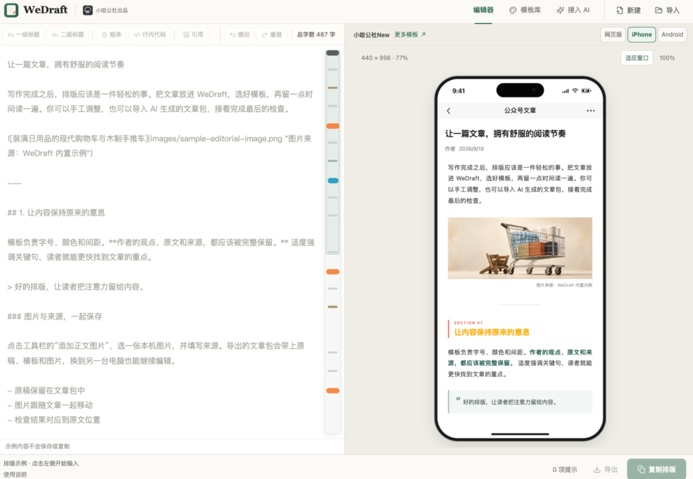

# 开源 AI 微信公众号文章排版工具
> 💡 备注属性未写入，可能是备注属性名称或者类型被修改了，建议将字段类型设置为 rich_text，可以在小程序-操作-修改文章数据库页面进行调整
> 💡 原文链接:[https://mp.weixin.qq.com/s?__biz=MzA4NzgyMTI0MA==&mid=2649530335&idx=1&sn=be5a748a6f663813deb06f7ee6b5c803&chksm=89951455d36871e3bb934c27419b908de1b6a9826b48ea876a98900c4997e9e52237709162bf#rd](https://mp.weixin.qq.com/s?__biz=MzA4NzgyMTI0MA%3D%3D&mid=2649530335&idx=1&sn=be5a748a6f663813deb06f7ee6b5c803&chksm=89951455d36871e3bb934c27419b908de1b6a9826b48ea876a98900c4997e9e52237709162bf#rd)

WeDraft 是面向微信公众号文章的 Markdown 排版工具。标题、段落、引用、列表、代码、表格、图片和来源说明，由统一模板处理；完成后复制富文本正文，粘贴到公众号后台。
https://github.com/pafa/WeDraft
网页版、CLI、MCP 和 Skill 共用排版核心，让手工编辑与 AI 工作流使用同一套效果。已提供公开测试版，当前源码准备 **0.2.0**；实际部署以 release.json 为准。
https://wedraft.xiaoha.org/
### 核心功能
- 边写边看，也能直接改预览。 Markdown 与排版实时联动；在预览中微调文字会写回原稿，支持双向定位、滚动、撤回和重做。
- 七款模板，一键换风格。 切换排版不改原文，选中的模板可设为默认，下次打开继续使用。
- 在手机尺寸下检查阅读效果。 提供网页、iPhone、Android 预览；手机外框等比缩放，保留正文排版宽度。
- 图片与来源一起排好。 支持 PNG、JPEG、GIF、WEBP，图片说明、来源与正文统一呈现。
- 复制前检查，发现问题能定位。 提示不支持的语法和图片、表格等问题；阻断问题修正后再复制，减少内容静默丢失。
- 原稿可带走，工作流可接续。 导出 .wedraft.zip，一起保留 Markdown、模板与本地图片；重新导入网页继续编辑，也可导出独立 HTML 预览。
[Star 889 开源 AI 小说创作工作台](https://mp.weixin.qq.com/s?__biz=MzA4NzgyMTI0MA%3D%3D&mid=2649530330&idx=1&sn=328ea8fa18bb23596d896b33f0b61142&scene=21#wechat_redirect)
[Star 26 短视频、AI 漫剧 创作工作台](https://mp.weixin.qq.com/s?__biz=MzA4NzgyMTI0MA%3D%3D&mid=2649530321&idx=1&sn=eb110852abe47ff49e7863734b8b95ef&scene=21#wechat_redirect)
[Star 3.4k 高性能中国古诗词 API 服务](https://mp.weixin.qq.com/s?__biz=MzA4NzgyMTI0MA%3D%3D&mid=2649530314&idx=1&sn=848bb5aba6a4c0b98edf11b3fe21d5e3&scene=21#wechat_redirect)
[无代码 AI 工作流引擎 FlowLong 1.2.7 发布](https://mp.weixin.qq.com/s?__biz=MzA4NzgyMTI0MA%3D%3D&mid=2649530180&idx=1&sn=3ce446e52867499b47ba9b4e959887c2&scene=21#wechat_redirect)
[MiniMax 开源 Music 3 一键生成5分钟完整歌曲](https://mp.weixin.qq.com/s?__biz=MzA4NzgyMTI0MA%3D%3D&mid=2649530308&idx=1&sn=0abdc1550395f37560e6671b9bd8fcfb&scene=21#wechat_redirect)
