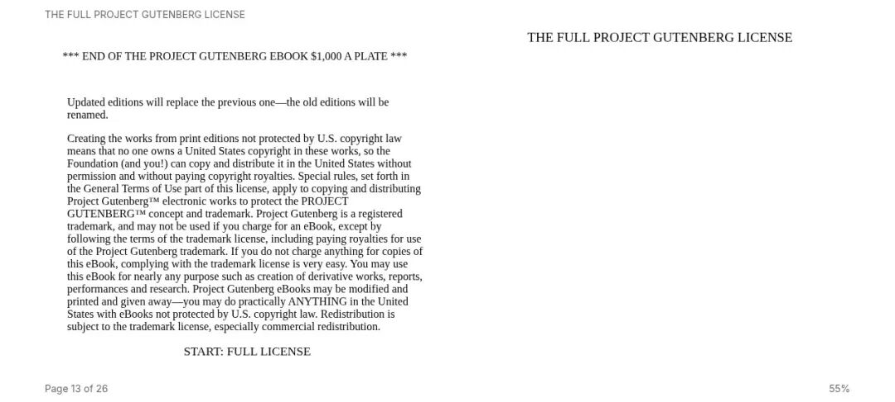
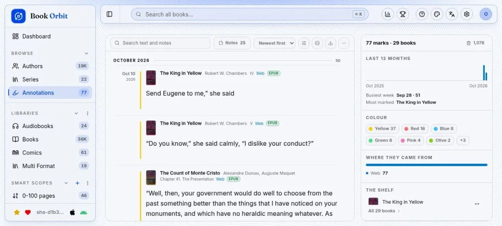
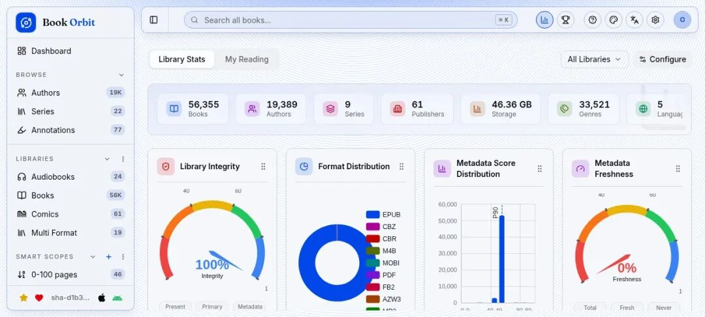
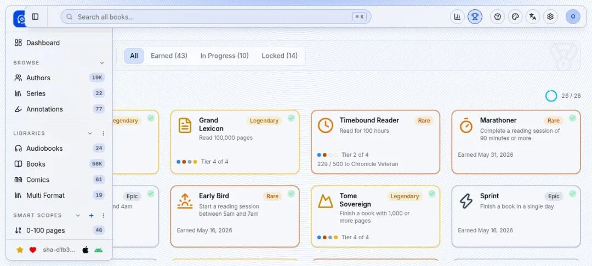
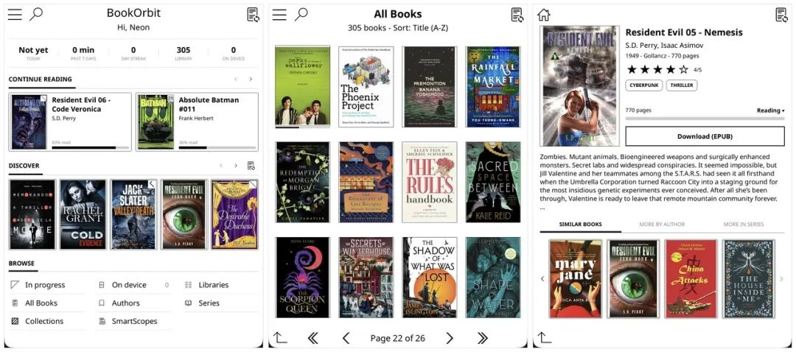

# 开源BookOrbit：私人阅读空间，三端进度同步
> 💡 备注属性未写入，可能是备注属性名称或者类型被修改了，建议将字段类型设置为 rich_text，可以在小程序-操作-修改文章数据库页面进行调整
> 原文链接:[https://mp.weixin.qq.com/s/WrPPl7TxE18N9nKBK_zlcQ](https://mp.weixin.qq.com/s/WrPPl7TxE18N9nKBK_zlcQ)

爱读书的人大概都有这个烦恼：电子书在网盘里、有声书在手机里、漫画在硬盘里，进度还各记各的——电脑上看到第三章，墨水屏上还停在第一章。
今天介绍的开源项目 **BookOrbit**，给你的书、有声书、漫画和 PDF 建一个自托管的「阅读空间」：浏览器里直接读，iPhone、墨水屏、KOReader 三端进度同步，还有阅读统计和成就系统，把读书这件事做出游戏感。
本文含完整 Docker 部署教程 + 官方 Demo 真机实测（实测截图均为实际界面）。

BookOrbit 今年 5 月才开源，GitHub 上已拿到 **5300+ Star**，发稿前一周刚发布 v3.3.0，迭代节奏非常快。技术栈是 NestJS + Vue，AGPL-3.0 协议，官方还上架了 iPhone / Apple Watch 原生 App（Android 版开发中）。
它的核心能力可以分成四块：
📚 **全格式阅读**：EPUB、MOBI、AZW3、FB2 电子书，PDF，CBZ/CBR 漫画，M4B/MP3/FLAC 有声书，浏览器里直接打开，无需装插件
🔄 **三端进度同步**：网页阅读器、KOReader、Kobo 墨水屏之间进度和高亮双向同步，换设备接着读
📊 **统计与成就**：阅读热力图、年度目标、连续打卡、Reading DNA 阅读画像、50+ 成就共 87 个等级
🛠 **硬核书库管理**：14 个元数据源自动刮削、多书库隔离、Smart Scopes 规则筛选、OPDS、Send-to-Kindle、多用户 + OIDC 单点登录
还能把阅读状态和划线自动同步出去——Hardcover、Readwise、StoryGraph 三个平台都支持。界面提供 24 种语言，**简体中文原生支持**。

部署是标准的 Docker Compose 流程，先建目录、拉两个官方文件：
mkdir bookorbit && cd bookorbit mkdir -p books data/app data/postgres curl -fsSLo .env https://raw.githubusercontent.com/bookorbit/bookorbit/main/.env.example curl -fsSLo docker-compose.yml https://raw.githubusercontent.com/bookorbit/bookorbit/main/docker-compose.yml
编辑 `.env`，五个必填项：
APP_URL=http://你的IP:3000 # 浏览器访问地址
BOOKS_HOST_PATH=./books # 书籍文件夹
POSTGRES_PASSWORD=… # openssl rand -hex 24
JWT_SECRET=… # openssl rand -hex 32
SETUP_BOOTSTRAP_TOKEN=… # openssl rand -hex 16 一次性向导令牌
然后 `docker compose up -d`，浏览器打开 3000 端口，输入向导令牌完成初始化，把书籍文件夹挂进去扫描即可。整体流程五分钟内。
⚠️ **两个高频坑**：① 书籍目录如果属于 UID 1000 以外的用户，要同步设置 **PUID / PGID**，这是首次扫描权限报错的头号原因；② 官方明确**不支持 NAS / 网络存储**（SMB、NFS、云挂载都不行），书库、数据目录必须放在本地文件系统上，否则可能出现文件损坏。

不想先部署？官方提供了**免注册在线 Demo**（带 5.6 万本公版书样本库）。笔者直接在 Demo 上实测了一轮，下面全是实拍界面。
登录进来首先是仪表盘，信息密度很高：2026 阅读目标已完成 100%（805/645）、每日金句高亮、阅读节奏热力图——这个 Demo 账号连续 14 天有阅读记录、日均 2 小时 41 分。最有意思的是 **Reading DNA**，它根据 112 本真实阅读记录给读者画像：「自律的跨类型读者」，偏好短篇、题材杂食、节奏稳定、夜猫子、速读型：

   
▲ 实测：仪表盘——阅读目标、Reading DNA 画像、节奏热力图
书库页是封面墙，支持网格 / 列表 / 表格三种视图，搜索、排序、筛选一应俱全。侧边栏可以建多个书库（这个 Demo 分了电子书、有声书、漫画、混合格式四个库），还能按规则建 Smart Scopes 动态书单——比如「100 页以内」「科幻」「食谱」，规则一设书单自动更新：

   
▲ 实测：书库封面墙 + 多书库 / Smart Scopes 侧边栏
随手点开一本在读的书，直接进入阅读器——纸面质感的排版，右侧显示当前进度 55%。网页阅读器支持字体、行距、主题调整，读书时的划线高亮会自动进入标注中心：

   
▲ 实测：内置网页阅读器，进度 55% 接着读
标注中心是笔者最喜欢的功能：网页、KOReader、Kobo 三处划的高亮**自动合并**到一个时间流里，带来源标签，可按颜色、书籍筛选，一键导出 Markdown / CSV / JSON。读书笔记再也不会散落各处：

   
▲ 实测：标注中心——多端高亮合并，按月归档

统计页从书库健康度到个人阅读数据全覆盖。这个 Demo 库的数字相当夸张：56,355 本书、19,389 位作者、46.36 GB 存储、33,521 个题材标签，还有体裁、语种、出版年代的分布图：

   
▲ 实测：统计页——书库全景 + 个人阅读数据
成就系统是真的下了功夫：87 个等级横跨五个类别，Demo 账号已解锁 65 个。看着「大档案管理员」（读完 100 本书）、「大辞海」（读完 10 万页）这些 Legendary 级成就挂在那里，读书的确会更有动力：

   
▲ 实测：成就页——65/87 级已解锁，Legendary 成就压轴

BookOrbit 的多端生态是它和 Calibre-Web 这类老牌方案拉开差距的地方。**官方 iOS App**（App Store 可下，需服务端 v3.0+）支持在线读、离线下载、有声书播放和文字转语音，Apple Watch 能独立播放下载好的有声书：

   
▲ 官方 iPhone / Apple Watch App（图源：官方 README）
墨水屏玩家看这里：KOReader 官方插件装上后，设备里直接浏览、搜索、下载服务器的书，进度和划线全程同步；Kobo 原生系统也走同样一套同步。对听书党，M4B 有声书在网页端直接流式播放，章节、倍速、睡眠定时都有。

   
▲ KOReader 插件：墨水屏上直接逛自己的书库（图源：官方 README）
进阶玩法还有不少：OPDS 协议让任何支持的书 App 直接订阅你的书库；Send-to-Kindle 一键推送；设一个「Book Dock」落盘文件夹，新书扔进去自动入库刮削元数据；用 Hardcover / Readwise / StoryGraph 的话，阅读状态和划线还能自动外同步。
**写在最后**
BookOrbit 把「拥有一个自己的书房」这件事做到了新高度：格式全、多端齐、统计好玩，开源五个月 5300+ Star 的热度也说明踩中了刚需。有服务器或 NAS（注意书库要放本地盘）的爱书人，值得一试；不确定的话，先逛逛官方 Demo 再决定。
项目地址：GitHub 搜索 **bookorbit/bookorbit**，
官网 bookorbit.app

## 摘要

（待补充）

## 我的笔记

（待补充）
